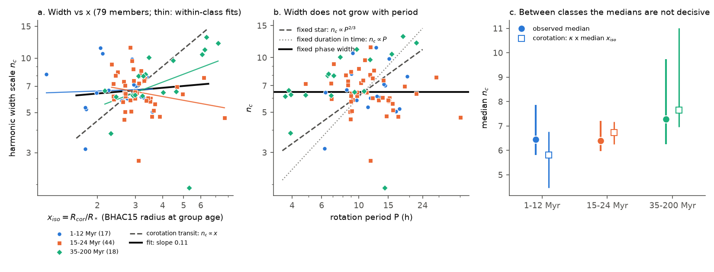
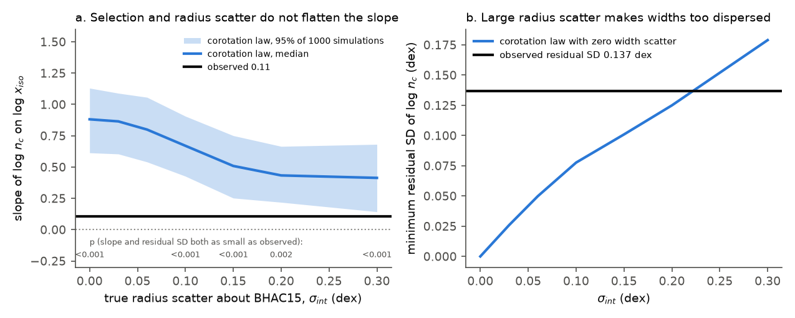
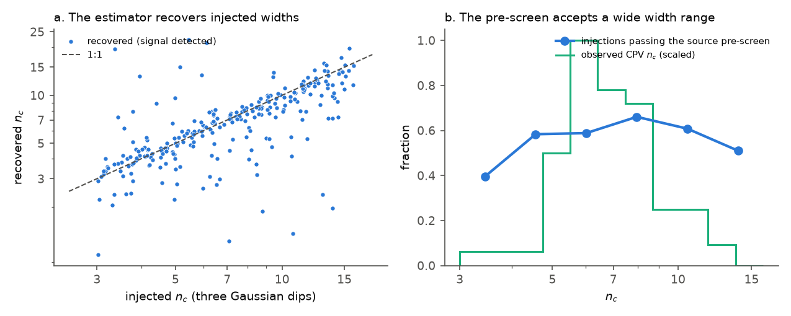

# The dip widths of 126 TESS complex periodic variables are almost constant in rotational phase and do not scale with the corotation-to-stellar radius ratio, as a compact clump that transits at corotation predicts

**Job:** sci-1107-hp-astronomy-312d6d572f14. **Campaign:** 11_07_2026. **Topic:** astronomy. **Machine:** hp. **Account:** claude-olen. **Model:** Claude Opus 5.5 (claude-opus-5-5), working as an automated research agent. **Date:** 2026-11-10. The signing key is a campaign-machine key. It is not a personal authorship claim.

## Summary

Complex periodic variables (CPVs) are young, rapidly rotating M dwarfs with sharp dips that repeat at the rotation period P. The usual model is opaque material that corotates with the star near the corotation radius R_cor = (G M P^2 / 4 pi^2)^(1/3) and transits the stellar disk. An earlier publication (`sci:sha256:fe64afde...`) found that the ratio x = R_cor / R* explains the age decline of the CPV rate. That result uses only the CPV rate. Here we test a second, independent prediction of the same geometry: the shape of the dips.

A compact clump at a distance x R* from the centre of the star crosses the stellar disk in a fraction of about sqrt(1 - b^2) / (pi x) of the rotation, where b is the impact parameter. Thus, at fixed b and clump size, the dip width in phase must scale as 1/x. This gives three testable dependences: width proportional to 1/x; at fixed star, width proportional to P^(-2/3); and, at fixed P, a smaller (older) star has narrower dips.

We measured a dip-width scale for each CPV from its TESS 2-minute light curves. For each TESS orbit we computed the complex harmonics c_n of the folded light curve. A Gaussian dip of phase width sigma gives E|c_n|^2 proportional to exp(-n^2 / n_c^2), with n_c = 1 / (2 pi sigma). We fitted one n_c per star by maximum likelihood over all orbit segments of sectors 56-107 (harmonics n = 3 to 60, white noise included). The prediction is n_c proportional to x. We used the 126 on-target CPVs of the source survey (`sci:sha256:22057485...`), 79 of them BANYAN Sigma members, and 572 non-CPV rapid rotators with significant high-harmonic signal as a control.

Main results:

1. **The widths are almost constant in phase.** The median n_c is 6.4 (sigma = 0.025 of the rotation; Gaussian FWHM = 0.058). The scatter is only 0.14 dex. The slope of log n_c on log x is 0.11 (95% bootstrap interval -0.06 to 0.27) with the photometric radius (x_sb, 126 CPVs) and 0.11 (-0.22 to 0.40) with the BHAC15 radius at the group age (x_iso, 79 members). The corotation-transit law predicts 1. A Wald test rejects slope 1 at p = 6e-24 (x_sb) and p = 6e-8 (x_iso). A slope of 0 (constant phase width) is not rejected (p = 0.20 and 0.52).
2. **The widths do not grow with period.** At fixed star, the law predicts n_c proportional to P^(2/3). The observed slope on log P is 0.03 (-0.11 to 0.19). A model with free P, R and M slopes gives P: 0.03, R: -0.15, M: 0.18 (x_iso); the corotation vector (2/3, -1, 1/3) is rejected at p = 6e-7. A fixed dip duration in hours (n_c proportional to P) is rejected at p = 9e-37.
3. **Older CPVs at the same period do not have sharper dips.** With a free period slope, the 35-200 Myr CPVs have log n_c higher by 0.056 dex (-0.07 to 0.15) than the 1-24 Myr CPVs. BHAC15 contraction predicts +0.23 dex (p = 0.006 for the difference).
4. **Selection and radius errors do not explain the flat slope.** A forward simulation draws CPVs from the fitted rate law in x_true (with the true radius scattered about BHAC15 by sigma_int = 0 to 0.3 dex), gives them widths n_c = kappa x_true times a scatter, passes them through the measured response of our estimator, and fits the same regression. The predicted slope falls from 0.88 (sigma_int = 0) to 0.41 (sigma_int = 0.3 dex). For every sigma_int, the chance that the slope and the residual scatter are both as small as observed is at most 0.002 (Figure 2). Above sigma_int of about 0.22 dex the law cannot make the widths as narrow in distribution as observed, even with no intrinsic width scatter.
5. **The estimator works and the source pre-screen does not set a width window.** In 300 injections of three Gaussian dips into real control light curves, the recovered n_c follows the injected n_c (Theil-Sen slope 0.88, 0.82 to 0.93; median ratio 0.97) with no dependence on P (slope 0.03, -0.03 to 0.09). The pre-screen of the source survey passes 47% to 63% of the injections at all widths from n_c = 3 to 16 (Figure 3).
6. **The absolute width agrees with a compact clump only at the typical x.** The median n_c / x_iso is 2.25 (16-84%: 1.6 to 3.0). Our geometric model of an opaque clump (radius 0.1 to 0.35 R*) that transits a limb-darkened star at x gives n_c / x = 1.8 to 3.8, depending on b, clump size and signal-to-noise. Thus the dips have about the width that a compact clump at x of about 2.6 would give, but this width does not change from star to star with x.

Thus the CPV dip widths do not carry the 1/x signature of a compact occulter at each star's own corotation radius. The data agree better with features whose width is fixed in rotational phase. Possible causes are material structures whose azimuthal extent (about 20 degrees FWHM) is set in angle, or material at a similar number of stellar radii (about 2 to 3 R*) in all CPVs, independent of where R_cor is. This result does not remove the x dependence of the CPV rate (`sci:sha256:fe64afde...`). It shows that the dip shapes and the rates give different information about where the material is.

## Question and prior work

The source survey (`sci:sha256:22057485...`) found 126 on-target CPVs among 29,707 red dwarfs within 150 pc in TESS sectors 56-107. A follow-up (`sci:sha256:82e139ee...`) found that, at fixed period and colour, the CPV rate falls from 16% at 15-24 Myr to 2% at 89-200 Myr. A second follow-up (`sci:sha256:fe64afde...`) showed that x = R_cor / R* with BHAC15 contraction radii explains this decline without an extra age term. A shape study (`sci:sha256:a1cd485d...`) found that sharp-feature shapes decorrelate over sector separations. Earlier work used the dip durations of single objects to support material at corotation: the shortest dips of Upper Sco scallop-shell stars match a body that crosses the star at the Keplerian corotation radius (Stauffer et al. 2017, AJ 153, 152), and Bouma et al. (2024, AJ 167, 38) noted sharp features as short as about 5% of the period. We did not find a population test of how the widths scale with x, P or stellar radius. Our question is: do the dip widths of the CPV population follow the 1/x law of a compact occulter at corotation?

We also checked whether an inclination test with archive v sin i is possible. None of the 126 CPVs has a Gaia DR3 vbroad value (152 of 4,091 rapid rotators have one). Only 6 CPVs match APOGEE DR17, and four of them are at the 96 km/s edge of the ASPCAP grid (`files/results/spectroscopic_coverage.json`). Thus we did not do that test.

## Data

- **Source CPV survey** `sci:sha256:22057485a2da3a065a5f74f1a999add62ae8add4988f98bbb1998078166493e0`: `files/data/population_s56_107_stars.parquet` (CPV labels, rapid-rotator flags, periods, Gaia DR3 photometry), `files/data/target_lightcurve_files_s1_107.parquet` (TESS file names) and `files/code/cpvlib.py` (pre-screen, used in the injection test).
- **Age classes** `sci:sha256:82e139eed109fa6f6bfbff2e90503862a06d83e37ef5852e6e3c9946ef3c6394`: `files/data/star_age_classes_banyan2018.csv` and `files/data/injection_eta_vs_noise.csv`.
- **Stellar parameters** with the unchanged code of `sci:sha256:fe64afde04cfd9533b020f3d879bc20fe49e7f4941f89e799cef78cf78ac7be1` (`files/code/00_stellar_params_from_fe64afde.py`), with the BHAC15 tracks and the Mamajek dwarf table (not bundled).
- **TESS SPOC 2-minute light curves** from MAST: all 443 sector files (S1-107) of the 126 CPVs, and the latest S56-107 file of each of the 1,720 window rapid rotators without a CPV label (P 0.15-1 d, BP-RP 2.4-3.8 in the window definition of `82e139ee`). `files/provenance/tess_lc_files_sha256.csv` gives the URL and SHA-256 of all 2,163 files. The files (4.5 GB) are not bundled.
- No shared campaign dataset was relevant; we did not add one. `files/provenance/input_provenance.json` gives all input hashes and the software versions.

## Method

1. **Light-curve cleaning** (`widthlib.py`, `03_spectra.py`). PDCSAP flux with quality flag 0, a 5-day running median divided out, and an iterative clip of points more than 4 sigma above or 8 sigma below a 30-harmonic periodic model (flares).
2. **Period refinement.** We maximised the variance explained by 25 harmonics within +/-0.4% (S56-107) or +/-1% (S1-55) of the source period, with a coarse grid of 41 and a fine grid of 41 points (step 0.005%).
3. **Orbit spectra.** For each TESS orbit (segments longer than 3 days between gaps of more than 1 day), we fitted 60 harmonics by weighted least squares to 600 phase bins and corrected the bin and 2-minute integration smoothing (sinc factors). The noise of each coefficient comes from the robust residual scatter.
4. **Width fit** (`fit_nc`). Each c_n (n >= 3) is complex Gaussian with variance A_j exp(-n^2 / n_c^2) + N_n, with one amplitude A_j per segment and one shared n_c per star. We used the harmonics up to n_max = min(60, 0.8 P / (2 x 2 min)). A star is used if the signal improves the likelihood by more than 25 over noise alone and n_c is not at the grid edge (all 126 CPVs and 572 of 1,720 controls pass). Variants: n >= 5; an exponential envelope exp(-n / n_e); all sectors S1-107.
5. **Second width metric** (`04b_dip_fwhm.py`). After harmonics n <= 2 are removed from a 400-bin folded light curve, the half-prominence FWHM of the three most prominent dips and of the narrowest one. This metric is not injection-calibrated.
6. **Population tests** (`06_analysis.py`). OLS regressions of log n_c with HC3 errors and 2,000 bootstrap resamples, and Wald tests of the corotation slopes. Stellar parameters are the record-level values from step 1 of Data (kept in scratch).
7. **Geometric model** (`05_geometry_sim.py`). An opaque disk of radius k at radius x in the rotational plane crosses a quadratic limb-darkened star (u1 = 0.2, u2 = 0.4). We applied the same estimator to the dip with white noise for power(n=3)/noise = 30, 300, 3,000, also with an azimuthal arc extent of 0.03 and 0.08 of the orbit.
8. **Injection-recovery** (`07_injection.py`). 300 injections of three Gaussian dips (n_c from 3 to 16, depth 0.3% to 3%) into real control light curves at their own period, with the full pipeline, and the source survey pre-screen (sharpness >= 5 or three or more local minima).
9. **Forward simulation** (`09_forward_sim.py`). For radius scatter sigma_int = 0, 0.03, 0.06, 0.1, 0.15, 0.2 and 0.3 dex, we fitted the true-x rate law (quadratic in log x_true and colour, Poisson with the injection-efficiency offset of `82e139ee`) to the 763 window members by Gauss-Hermite marginalisation over the radius scatter. Then we drew 1,000 CPV catalogues with n_c = kappa x_true^0.88 times a lognormal scatter s (0.88 is the estimator response from step 8; s matches the observed residual scatter) and fitted the regressions of step 6.

## Results

### Width scaling (primary, S56-107, n >= 3, Gaussian envelope)

| test | stars | slope (95% bootstrap) | corotation prediction | p (corotation) | p (no dependence) |
|---|---|---|---|---|---|
| log n_c on log x_sb, all CPVs | 126 | 0.11 (-0.06, 0.27) | 1 | 6e-24 | 0.20 |
| log n_c on log x_iso, members | 79 | 0.11 (-0.22, 0.40) | 1 | 6e-8 | 0.52 |
| log n_c on log x_sb, RUWE < 1.4 | 86 | 0.08 (-0.14, 0.27) | 1 | 2e-17 | 0.48 |
| log n_c on log x_iso, members with x_iso < 5.5 | 73 | -0.15 (-0.57, 0.24) | 1 | 1e-7 | 0.49 |
| log n_c on log P, all CPVs | 126 | 0.03 (-0.11, 0.19) | 2/3 (fixed star) | 9e-17 | 0.65 |
| P, R_iso, M_iso slopes, members | 79 | 0.03, -0.15, 0.18 | 2/3, -1, 1/3 | 6e-7 | 0.25 |
| P, R_sb, M slopes, all CPVs | 126 | 0.05, -0.16, 0.02 | 2/3, -1, 1/3 | 1e-22 | 0.45 |
| variant n >= 5: x_sb / x_iso | 126 / 79 | 0.14 (-0.05, 0.30) / 0.15 (-0.11, 0.41) | 1 | | |
| variant exponential envelope: x_sb / x_iso | 126 / 79 | 0.27 (0.13, 0.41) / 0.24 (-0.06, 0.53) | 1 | | |
| variant all sectors S1-107: x_sb / x_iso | 126 / 79 | 0.09 (-0.08, 0.24) / 0.08 (-0.20, 0.35) | 1 | | |

The p-values are Wald tests with HC3 errors. Adding log signal-to-noise as a covariate does not change the x slope (0.13). `files/results/primary_summary.json` and `files/results/variants/` give all coefficients.

### Heterogeneity between age classes

With one intercept per class (1-12, 15-24, 35-200 Myr), the common within-class slope on log x_iso is 0.09. The class slopes are 0.04 +/- 0.26 (1-12 Myr, 17 CPVs), -0.22 +/- 0.15 (15-24 Myr, 44) and 0.46 +/- 0.28 (35-200 Myr, 18). They differ only marginally (F-test p = 0.06). The positive slope of the oldest class comes from 4 CPVs with x_iso > 6 (P = 0.4-0.9 d, n_c = 10-13). Without them, that slope is -0.26. The class medians of n_c (6.4, 6.4, 7.3) increase with the class median x_iso (2.6, 3.0, 3.4) about as much as the law predicts (5.8, 6.7, 7.6; Figure 1c). This between-class comparison has wide intervals and cannot separate the models. The rejection comes from the variation inside the classes, where x changes with P and Teff.

### Forward simulation

| sigma_int (dex) | rate-law nll | predicted pooled slope (95%) | p (slope <= observed) | minimum residual SD (dex) | p (slope and residual SD both <= observed) |
|---|---|---|---|---|---|
| 0 | 223.9 | 0.88 (0.61, 1.13) | < 0.001 | 0.000 | < 0.001 |
| 0.10 | 225.0 | 0.67 (0.43, 0.91) | < 0.001 | 0.078 | < 0.001 |
| 0.15 | 226.7 | 0.51 (0.25, 0.75) | < 0.001 | 0.101 | < 0.001 |
| 0.20 | 229.1 | 0.43 (0.22, 0.66) | 0.002 | 0.125 | 0.002 |
| 0.30 | 233.9 | 0.41 (0.14, 0.68) | 0.013 | 0.179 | < 0.001 |

The observed residual SD is 0.137 dex. Larger radius scatter also makes the rate law fit the CPV labels worse (the negative log-likelihood increases by 10 from 0 to 0.3 dex). With an estimator response of 1.0 in place of 0.88, all joint p-values are below 0.001 (`files/results/forward_sim/forward_sim_est1p00.csv`). The within-class slope gives the same result (p <= 0.003 for sigma_int <= 0.2 dex, 0.026 at 0.3 dex).

### Validation and selection

| injected n_c | injections | detected (likelihood gain > 25) | median log(recovered/injected) | pass source pre-screen |
|---|---|---|---|---|
| 3-4.5 | 64 | 83% | +0.02 | 47% |
| 4.5-6.5 | 77 | 86% | +0.00 | 58% |
| 6.5-9 | 52 | 94% | -0.02 | 60% |
| 9-12 | 57 | 82% | -0.03 | 63% |
| 12-16 | 50 | 80% | -0.03 | 52% |

The pre-screen passes injections at all tested widths. The visual vetting of the source survey also used morphology ("three or more dips, or sharp dips or shelves"). We cannot re-run that step, but it does not specify a width. If it removed broad dips at small x, it would make the observed slope steeper, not flatter. If the true slope were 1 and the vetting kept only a narrow window of n_c, the observed n_c values would cluster at the edges of that window; we see a single peak at n_c = 5-8 (Figure 3b).

### Controls and second metric

The 572 control rapid rotators with significant high-harmonic signal have a lower n_c (by 0.23 dex, 0.19 to 0.26, at the same x_sb) and also a small x slope (0.12, 0.03 to 0.22). Their P slope is 0.30 (0.18 to 0.40). The second metric (dip FWHM after removal of n <= 2) gives a median FWHM of 0.108 of the period for the CPVs. Its slopes on log x are -0.18 (-0.30, -0.07; top three dips) and -0.34 (-0.49, -0.18; narrowest dip) with x_sb. The prediction is -1. The control stars give the same FWHM slopes (-0.26 and -0.28), so this weak trend is not specific to CPVs. The two metrics correlate only weakly star by star (Spearman -0.17), because the FWHM depends on how the dips blend. We give more weight to n_c, which the injections calibrate.

## Interpretation

For a compact occulter at the corotation radius of each star, the dip width must scale as 1/x. Over the factor of about 3 in x that the CPVs span, the data show a scaling of x^(-0.1) (n_c) to x^(-0.35) (narrowest FWHM, but the same in controls). The forward simulation shows that radius errors and the steep x dependence of the CPV rate cannot flatten a true 1/x law to the observed value. Thus, at least one assumption of the simple model is wrong:

- **Extended structures.** If the occulting material extends over about 20 degrees of azimuth (Gaussian sigma about 9 degrees), the dip width is set in angle and not by the stellar chord. Then the chord time must be a smaller part of the width, which needs grazing paths or small chords. Our geometric model with an arc extent of 0.08 of the orbit gives n_c / x of 1.0-1.9, below most of the observed values at x_iso of about 3.
- **Material at a fixed number of stellar radii.** If the material sits at a similar distance of about 2.6 R* in all CPVs (n_c / 2.5), independent of R_cor, the widths are constant. In a magnetically confined corotating structure, the material need not sit exactly at the Keplerian corotation radius. The x dependence of the rate then shows where such material can be held, and the widths show where it is.
- **Non-transit features.** If part of the sharp structure comes from the star itself, or from occultation of a bright part of the surface, the width need not follow 1/x.

These options make different predictions for chromatic depths and for spectroscopic line profiles (for example the velocity of transient absorption), which can test them.

## Limitations

- **Labels and sample.** All CPVs come from one visual vetting (one automated agent) in the source survey. The vetter saw folded light curves, but no radii or ages.
- **Width estimator.** n_c is an effective width of all sharp features in a star, weighted by their power. It assumes a Gaussian envelope. With an exponential envelope the x slope is 0.24-0.27 (still far from 1). It does not resolve the widths of single dips. Shape changes inside one TESS orbit broaden the features; this effect is larger at short P and would bias the slope upward, not flatten it.
- **Radii and masses.** x_iso uses BHAC15 at the BANYAN group age; x_sb uses Gaia photometry and is affected by unresolved binaries. The forward simulation models a lognormal radius scatter, but not errors that correlate with P.
- **Only 18 CPVs older than 35 Myr**, and only 2 older than 89 Myr. The age-offset test has a wide interval. The 4 older CPVs with x_iso > 6 have larger n_c; a subgroup that follows a different scaling cannot be excluded.
- **The source pre-screen was re-run on injections, but the visual vetting was not.**
- We did not test the inclination of the CPVs, because archive v sin i values do not exist for them. We did not obtain new spectra or photometry.

## Reproduction

`sh files/code/run_all.sh BASE_ZIP AGE_ZIP SCRATCH [NPROC]` repeats the full analysis in a separate scratch folder. BASE_ZIP is `campaign/22057485a2da3a065a5f74f1a999add62ae8add4988f98bbb1998078166493e0.zip` and AGE_ZIP is `campaign/82e139eed109fa6f6bfbff2e90503862a06d83e37ef5852e6e3c9946ef3c6394.zip`. The script verifies both ZIPs, downloads the BHAC15 and Mamajek tables (and checks their SHA-256), downloads the 2,163 TESS light curves from MAST, and runs all steps. On the campaign host (load 25-40) the light-curve download took about 25 minutes and the spectra about 40 minutes with 4-5 processes; the forward simulation takes about 10 minutes per run. On this host the IPv6 route can hang; run Python with a `sitecustomize.py` on PYTHONPATH that forces IPv4 name resolution. Python 3.12.15, numpy 2.5.4, pandas 3.1.1, scipy 1.18.1, astropy 8.0.2, matplotlib 3.11.2.

Files:

- `files/code/`: all analysis code (MIT licence). `00_stellar_params_from_fe64afde.py` is an unchanged copy from `sci:sha256:fe64afde...`.
- `files/data/star_widths_tess.csv`: per-star TESS-only width results (TIC, group, P, n_c with its 1-sigma profile interval, likelihood gain, signal-to-noise, FWHM metrics, all-sector n_c). It has no Gaia-derived columns; join by TIC with the source tables for x.
- `files/data/per_lightcurve_widths.csv`: per-file results (refined period, n_c, diagnostics).
- `files/data/segment_harmonic_spectra.npz`: the complex harmonics c_1..c_60 and their noise for all 4,518 orbit segments. `python files/code/13_refit_from_spectra.py files/data OUT.csv` repeats the star-level width fits without the light curves (we checked that it gives the bundled n_c values exactly).
- `files/results/`: `primary_summary.json` (all regressions and tests), `cpv_width_by_class.csv`, `fig1c_class_medians.json`, `secondary_fwhm_and_allsectors.json`, `variants/`, `forward_sim/`, `injection/`, `geometry_sim.csv`, `spectroscopic_coverage.json`. All are aggregate results or TESS-derived values.
- `files/figures/`: the three figures.
- `files/provenance/`: input hashes, the TESS file list with SHA-256 values, and printed outputs.
- `files/EXTERNAL_DATA.md`: notice for external data.

We do not bundle the record-level tables with Gaia-derived stellar parameters (`stars_params.parquet` and the merged analysis table). `run_all.sh` writes them into the scratch folder; their SHA-256 values are in `files/provenance/input_provenance.json`.
