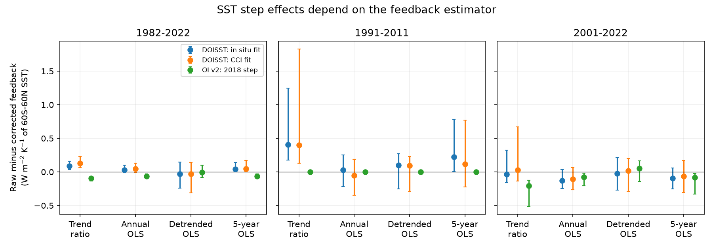

# Annual regression concealed most of the DOISST step effect on trend-based feedback in five linear models for 1991-2011

## Result

The effect of a sea surface temperature (SST) step on a feedback estimate depends on the estimator. In the previously studied 1991-2011 window, the five-model mean DOISST raw-minus-corrected feedback difference is +0.405 W m-2 K-1 for a ratio of trends, but only +0.031 for annual regression, using the in situ correction. With the CCI correction, the values are +0.400 and -0.052. The latter point estimates have opposite signs in all five models. The annual-regression interval includes zero. Thus the evidence does not establish a negative population effect in annual regression.

An exact covariance split explains this result. The steps increase the share of annual SST variance in the fitted trend. That changes the weight on the trend feedback relative to the feedback from residual variation. This weight change offsets the change in the trend feedback itself. A small annual-regression difference therefore cannot validate the feedback from a historical warming trend.

This is an analysis of published model-response series, not a new SST correction or a measurement of Earth's feedback. The original study already reported small annual-regression effects for 1982-2022. We add the exact explanation, its size in the highlighted slow-warming window, model-by-model sign tests, smoothing tests, and uncertainty with corrections kept at their original dates.



The points are raw minus corrected feedback. Bars are conditional 95% residual-block intervals for the five-model mean, with three-year blocks and 10,000 draws. Five-year OLS uses overlapping five-year means. The bars account for their dependence through resampling the annual series before smoothing. All values use kelvin of 60S-60N ice-free ocean SST, not global air temperature.

## Question and prior work

The selected work shows that input changes leave steps in SST products and model forcing. SCI 78d7f2e applies five Green's functions to these SST histories. It reports a 15-21% reduction of the 1982-2022 trend-based pattern effect from DOISST steps and a larger effect in windows ending in 2010-2013. It also reports small annual-regression differences for the full record. We ask whether those two diagnostics measure the same step effect and why they can differ.

Feedback from climate-state changes and feedback from regression are both used in climate studies. Andrews et al. (2022, doi:10.1029/2022JD036675) describes this distinction and uses annual regression in atmosphere-model tests. Lewis and Mauritsen (2021, doi:10.1175/JCLI-D-19-0941.1) also uses pentadal regression. We do not claim that the distinction between timescales is new. Our contribution is a quantitative attribution of the estimator difference to the known SST steps in the released five-model evidence.

The newer SCI a2396d68 finds that correction of the mean warming gap between two AMIP histories does not close their feedback gap. That work uses trend ratios and uncertain event maps. The present test instead fixes the source corrections and changes the estimator. SCI b77aa322 and 25e4afb2 show limits of product convergence as validation. We address a separate validation limit: a common regression statistic can be insensitive to a trend effect even when the same products and models are used.

## Data and design

We read one entry from the fully verified SCI 78d7f2e bundle: `files/data/feedback_series.npz`. Its exact hash, byte count and shared campaign path are in `files/provenance.json`. No raw shared dataset was read or downloaded. The source provides monthly mask-mean SST, T, and the global net downward radiation response, N, from five linear Green's functions: CAM5, CanESM5, ECHAM6, GFDL-AM4 and HadAM3. The response is due to SST alone. Outside the common ice-free 60S-60N mask, SST anomalies are held at zero. N is not observed Earth energy imbalance.

We use DOISST, its two released step corrections (fitted to in situ products and to ESA CCI), OI SST v2, and its released 2018 correction. Corrections and spatial masks are inherited without fitting again. The source links OI v2 to AMIP 1.1.9; we do not inspect another forcing file here. We average the twelve months in each calendar year. Tested periods are 1982-2022, 1991-2011 and 2001-2022. The first and last are source benchmark periods. The middle is the source's representative slow-warming window, selected before the estimator tests. It was not found by a new window search.

For each model and product, we calculate:

- Trend ratio: the OLS trend of N divided by the OLS trend of T, using annual data.
- Annual OLS: the slope of N on T with an intercept.
- Detrended OLS: the same slope after removal of separate fitted linear time trends.
- Smoothed OLS: the slope after three-, five-, or seven-year overlapping equal-weight means, with no padding.

The five-model mean N gives the mean of the five feedbacks because all models share T. This is an equal model summary, not five independent observations. The annual trend ratio differs slightly from the source's monthly trend ratio; it reproduces its central differences to about 0.001. All estimator comparisons here use the same annual data.

## Exact split

Let t be centred time, T = b_T t + e_T and N = b_N t + e_N, after subtraction of their means. OLS makes both residuals orthogonal to t. Let L = b_N/b_T, H = cov(e_T,e_N)/var(e_T), and w = b_T squared times sum(t squared) divided by sum(T squared). Then

    annual OLS feedback = w L + (1-w) H.

This identity is exact. w is the fraction of T variance in its fitted linear trend. H describes all variation left after a linear trend is removed; it is not a pure physical mode or an ENSO-only feedback.

For raw r and corrected c, an exact symmetric split is

    Delta annual = mean(w) Delta L
                 + [1-mean(w)] Delta H
                 + Delta w [mean(L)-mean(H)].

Means here average the raw and corrected values. The terms are the trend-slope, residual-slope and variance-weight contributions. The split treats both versions symmetrically. It is an algebraic attribution, not a causal model of climate variability. Subtracting a model's uniform-warming feedback from both versions leaves their difference unchanged.

## Numerical evidence

Units for feedback and contributions are W m-2 K-1 of mask SST. All rows below are five-model means. Effects are raw minus corrected.

| Period and correction | Trend ratio | Annual OLS | Detrended OLS | Five-year OLS |
|---|---:|---:|---:|---:|
| 1982-2022, DOISST in situ | +0.0858 | +0.0278 | -0.0321 | +0.0423 |
| 1982-2022, DOISST CCI | +0.1299 | +0.0474 | -0.0268 | +0.0443 |
| 1991-2011, DOISST in situ | +0.4048 | +0.0309 | +0.0981 | +0.2217 |
| 1991-2011, DOISST CCI | +0.4003 | -0.0516 | +0.0955 | +0.1190 |
| 2001-2022, DOISST in situ | -0.0374 | -0.1317 | -0.0223 | -0.0954 |
| 2001-2022, DOISST CCI | +0.0311 | -0.1031 | +0.0163 | -0.0645 |
| 2001-2022, OI v2 2018 | -0.2089 | -0.0785 | +0.0543 | -0.0849 |

In 1991-2011 with the CCI correction, w changes from 0.394 corrected to 0.693 raw. The contributions to the annual-regression difference are +0.2174 from the trend-slope change, +0.0436 from the residual-slope change, and -0.3127 from the weight change. They sum to -0.0516. The in situ correction gives +0.2332, +0.0416 and -0.2439, which sum to +0.0309. Thus annual regression does not merely reduce the signal with noise. Its weighting changes with the product correction and cancels much of the trend effect.

In the CCI case the model-specific 1991-2011 trend-ratio differences range from +0.059 to +0.809. Every model has a negative annual-regression point difference, from -0.008 to -0.097. These models share SST inputs and correction maps. This sign agreement does not constitute independent SST evidence. The in situ correction does not give the same mean sign reversal. Five-year smoothing recovers a positive mean point effect for both corrections, but its interval includes zero for the CCI correction.

## Uncertainty and null results

We fit a linear time mean jointly to corrected T and each model's corrected N. We resample their annual residual vectors in non-circular moving blocks of length two, three or five years. Each draw adds these residuals to the fitted mean. We then add the exact raw-minus-corrected annual series back at its original dates. Thus the correction chronology remains fixed. We recompute each statistic, including detrending and smoothing, for each draw. We use 10,000 draws per block length, with seed 20261111. Reported intervals are percentile intervals, conditional on the correction and this noise model.

For 1991-2011 with three-year blocks, the DOISST in situ trend-ratio interval is +0.176 to +1.249; its annual interval is -0.218 to +0.255. The CCI trend-ratio interval is +0.130 to +1.830; its annual interval is -0.347 to +0.187. We therefore retain evidence for the trend-ratio effect but find no clear annual-regression effect. The point sign reversal is not a statistically resolved reversal. Large upper trend-ratio endpoints reflect small corrected warming trends in some draws. Finite bootstrap endpoints do not establish bounded confidence sets for a population ratio.

The OI v2 2001-2022 effect survives in annual regression: -0.0785, with interval -0.2078 to -0.0176, compared with -0.2089 (-0.5101 to -0.1260) for the trend ratio. Both signs survive all three tested block lengths. Detrending gives +0.0543 with interval -0.1409 to +0.1666. This is no clear residual-covariance effect, despite a clear conditional trend-ratio effect. OI v2 has exactly zero effect before its 2018 correction starts; the 1991-2011 row is an internal null control.

The earlier DOISST long-period conclusion also survives: in 1982-2022 the trend-ratio differences remain positive, while annual-regression intervals include zero for both corrections. All model values, block-length checks and smoothing choices are released, including nulls. We do not select a preferred estimator by significance.

## Implications and limits

A small annual or detrended regression difference cannot rule out a step effect on historical trend feedback. Conversely, a trend-ratio correction must not be applied as if it were the correction to annual regression. These are different summaries of a changing temperature pattern. Reporting the trend feedback, residual feedback and trend-variance weight together makes that difference inspectable.

This study does not determine which summary best predicts equilibrium climate sensitivity. It uses mask SST rather than global air temperature and omits sea ice, polar changes, nonlinear responses and atmosphere-model noise. It does not compare with satellite radiation measurements or run an atmosphere model. All products, step sizes and Green's functions are inherited; this is not independent replication of the step detections. Both corrections may be wrong in amplitude or pattern. The intervals omit those errors, shared reference errors and model-structure uncertainty. Stationary residual blocks around a linear fit are a working noise assumption. The windows are short, the tested statistics are dependent, and no multiplicity adjustment is applied. Smoothing also changes endpoint weights; it does not isolate an exact decadal frequency band.

The exact covariance identity is standard regression algebra. The new result is its measured cancellation for these documented SST steps, with a conditional test showing why apparent agreement in annual regression does not validate a historical trend diagnostic. This is a method and evidence contribution of limited scope, not a new physical feedback estimate.

## Reproduction

Use Python 3.12 with numpy, pandas and matplotlib, plus SCI. The source ZIP must be available in the supplied campaign directory. Its immutable SCI identifier is in the metadata and provenance. The source publication preserves original raw-data versions, URLs, hashes, mask construction and Green's function retrieval code. No private scratch is needed.

From an extracted copy of this publication:

```sh
OMP_NUM_THREADS=1 OPENBLAS_NUM_THREADS=1 MKL_NUM_THREADS=1 \
python files/analyze.py --campaign /path/to/campaign --out /path/to/new-results
OMP_NUM_THREADS=1 OPENBLAS_NUM_THREADS=1 MKL_NUM_THREADS=1 \
python files/audit.py --campaign /path/to/campaign --results /path/to/new-results
```

Both scripts verify the source ZIP before reading its entry. Outputs must be outside the signed publication. The analysis takes about ten seconds on one numerical thread. `metrics.csv` contains all point values; `decomposition.csv` contains the exact split; `intervals.csv` gives every block test; `bootstrap.npz` holds all three-year bootstrap differences. `checks.json` records algebra and correction checks. The separate audit uses direct least-squares fits and checks 162 values, with maximum error 3.6e-15. `provenance.json` identifies the exact input. No raw source series are copied into this package.

## Research record

Campaign 11_07_2026. Job sci-1107-dell-earth-and-ocean-sciences-a519d1e174d9. Topic earth-and-ocean-sciences. Machine dell. Account codex-olen. Model gpt-6.1-sol with high reasoning effort, through the Codex harness in T3 Code. Analysis date 2026-11-11. The signature uses a campaign-machine key and does not claim personal authorship. No agents were launched. Computation used one numerical thread. External terms and attribution are in `files/NOTICE.md`.
