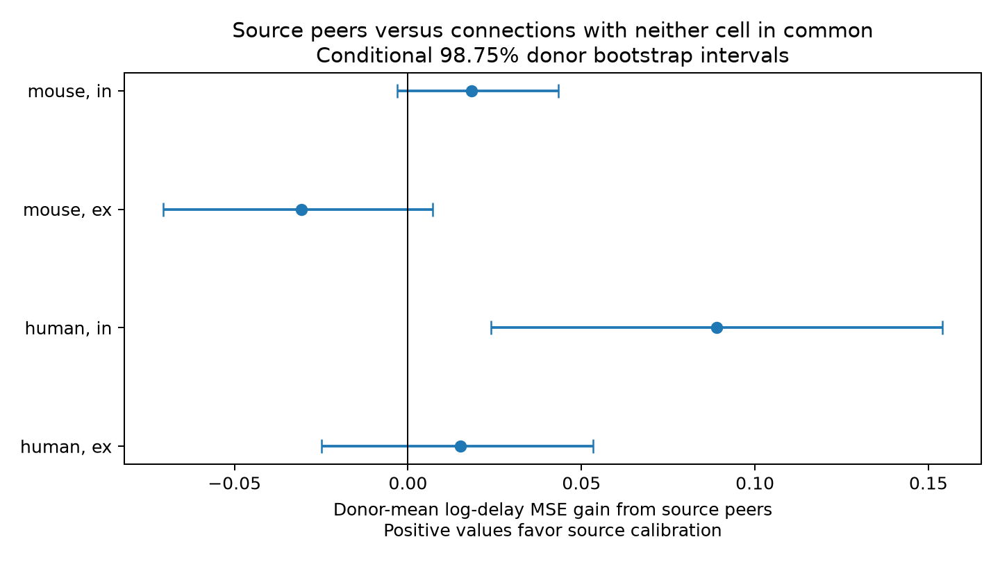

# Source-peer delay calibration gave no clear gain over disjoint peers in three screened Allen cortical slice groups

We did not resolve an added prediction gain from source identity over disjoint recording peers in the screened mouse excitatory, mouse inhibitory, or human excitatory sample. This does not establish equal performance. In mouse inhibitory connections, source calibration improved on the model with no local calibration. The comparison with disjoint peers remained uncertain. The unscreened check gave a positive source-specific interval. Thus, the data do not support a selection-independent source calibration rule.



## Question and prior evidence

Can a few measured output delays reduce the number of separate delay measurements needed for a circuit model? A common source could impose some common action-potential or release timing. Boudkkazi and colleagues (2011), doi:10.1113/jphysiol.2010.199653, showed that axonal action-potential waveform can alter cortical synaptic latency. That mechanism motivates a test; this study does not measure it. Delay also includes propagation and response-onset effects.

Campagnola, Seeman and colleagues (2022), doi:10.1126/science.abj5861, supplied the linked cell, pair and response measurements. The same recorded cell IDs link circuit structure and function here. We use no cross-animal cell match. We test a method for sparse measurement within a new recorded circuit, not prediction without any measured peers.

Published campaign work found a donor-held-out distance benefit for mouse inhibitory latency (SCI 2405b942827aa469febd8caff7e828eeb4896a36c1f112aa2356a799dfebcf99). We adapted its SQL selection and specimen-name donor parsing. Shared-endpoint timing tests (SCI ea126e6a11065e9fbcd14983df1d8d6ba9f48953e7c51cff3a9eeba18573117b and a92e9eeadc69101b2ef1d1a92f3284b39789f3f8ee1c0988519959dc4ab7e48e) did not give corrected association evidence. Our contribution is an explicit residual-calibration prediction benchmark, with disjoint recording peers as a control. This is a reanalysis of the same release, not an independent biological replication.

We ran `sci --help`, `sci spec`, and local SCI searches for connectome and neural before the final question. The full bundle checks were slow. We also inspected published ZIP metadata and read relevant published bundles. A targeted completed SCI search is preserved in files/campaign_search.json. No sibling private workspace was used. Web searches covered Allen physiology, axonal timing and source-specific delay mechanisms. The question and screen were chosen during this investigation, before its numeric results. This was not a registered study.

## Data

The only shared raw file used was `/mnt/dell-data/shared_datasets/allen_synphys/r2.1_small_2023-01-26/synphys_r2.1_small.sqlite`. The worktree link is `datasets/allen_synphys/r2.1_small_2023-01-26/synphys_r2.1_small.sqlite`. Version: r2.1 small, schema 22, S3 Last-Modified 2023-01-26. Size: 176771072 bytes. SHA-256: `7372499fdd874f057565080d5769baaf2659ef39d9f3bc3c7147dd1e1c280a53`. We checked that hash on the read-only local scratch copy used for fast SQL access. We did not change shared data. No data download was needed. The SQL and exact source URL are preserved.

We select detected chemical connections from the synapse table, mouse VisP or human TCx, a finite positive soma distance at most 500 micrometres, positive finite latency, and at least one manually passed average response fit. This fit flag does not validate every component of the summary latency. The extracted table has 905 mouse excitatory, 1327 mouse inhibitory, 241 human excitatory and 61 human inhibitory connections. No pulse-train arrays are used. Latency is a response-onset delay, not pure axonal conduction or spike jitter.

The primary screen keeps latencies from 0.2 to 5 ms, inclusive, for targets and peers and for baseline training. The second run retains every positive finite latency. Missing cell labels are explicit categories. Donor groups are inferred from six-digit mouse specimen numbers or the first three dotted fields of human specimen names. Parsing is asserted. These groups are not verified animal identifiers.

## Prediction and calibration

Each species and synapse type has a separate model. The outcome is natural log of latency in ms. Five GroupKFold folds keep whole inferred donors separate. The baseline uses one-hot source and target nonsynaptic class, Cre label and intended layer, plus a cubic spline of log soma distance with four knots. Encoders and splines are fitted only on training donors. Ridge penalty is 10; the intercept is not penalized. The folds are deterministic for the preserved row order and library version. These are fixed choices, not tuned by reported test performance.

For a target edge, source peers are all other eligible edges in the same recording and synapse type with the same source cell. Disjoint peers are edges in that recording and type whose two cells both differ from the target's two cells. A target qualifies only if both peer sets are nonempty. Peer cell labels can differ; their baseline residuals adjust only for the modelled labels and distance. Residual adjustment is not exact matching.

Let b be the target baseline log prediction. For each available peer j, its residual is `r_j = log(latency_j) - baseline_j`. The calibrated prediction is `b + sum(r_j)/(n + k)`. The primary fixed shrinkage k is 2. Checks use k equal to 1 and 5. Both methods use their own available peer count. This tests the two available measurement strategies, not a control with equal measurement budgets. Peers and target belong to the same held-out donor, so their baseline predictions come from the same training model. No target delay enters its own calibration. Full peer measurements are deliberately supplied at test time. This is leave-one-edge completion in an already partly measured circuit. It does not predict a new circuit with no calibration measurements.

We average squared log error within each inferred donor, then across donors. Gain is reference MSE minus source-calibrated MSE. Positive gain favors source peers. The primary reference uses disjoint peers. The uncalibrated reference is secondary. Whole-donor bootstrap resampling uses 5000 draws, seed 917. Nominal 98.75% percentile intervals apply a four-group Bonferroni convention for the primary comparison. They are conditional on the fitted baseline predictions and exclude model-refit uncertainty. They are not a formal calibrated test in the two-donor group. Sensitivity comparisons are exploratory and are not additional independent confirmations.

## Results

The table shows the primary screen and k=2. ex means excitatory and in means inhibitory. Error and gain are squared natural-log units. Each donor has equal weight.

| Species | Type | Targets / inferred donors | Disjoint MSE | Source MSE | Gain [98.75% interval] |
|---|---|---:|---:|---:|---|
| human | ex | 39 / 14 | 0.102284 | 0.087216 | 0.015067 [-0.024925, 0.053322] |
| human | in | 9 / 2 | 0.375226 | 0.286292 | 0.088934 [0.023871, 0.153996] |
| mouse | ex | 71 / 32 | 0.117186 | 0.147997 | -0.030811 [-0.070514, 0.007135] |
| mouse | in | 193 / 60 | 0.093091 | 0.074791 | 0.018299 [-0.003153, 0.043363] |

Only two inferred human inhibitory donors enter the comparison. Its interval has just three possible bootstrap means. We report the finite-sample result but make no population claim from that interval.

For mouse inhibitory targets, source calibration lowered MSE from 0.101557 without local calibration to 0.074791. Its gain was 0.026766, with conditional interval 0.004176 to 0.056385. The stronger reference lowered MSE to 0.093091. The source-versus-disjoint gain then had an interval that included zero. The data therefore separate a benefit relative to no calibration from evidence for source identity beyond recording calibration.

For k=1 and k=5, all three better-sampled groups still had source-versus-disjoint intervals that included zero under the primary screen. Without the delay screen, mouse inhibitory targets increased from 193 in 60 donors to 195 in 62 donors. The k=2 gain became 0.027928, with interval 0.002977 to 0.057124. All three shrinkage choices gave positive intervals in that unscreened group. Removing the screen changes baseline training, folds and peer sets as well as target selection. The change cannot be assigned only to the two extra targets. The mouse excitatory and human excitatory unscreened comparisons remained uncertain. All runs are in files/results.csv.

## Limits and use

The main result is a benchmark with an uncertain source-specific advantage in the screened data. It is not a claim of independent delays. The source-specific biological explanation remains untested. Unmeasured cell subtypes, axon paths, slice damage, recording offsets, common fit error, and unequal peer counts can affect the comparison. The screen is a modelling choice, not a known measurement-error boundary. Its sensitivity matters. The recorded graph samples only a small part of the circuit and selects connected, measured outputs. Results cannot establish a rule for intact brains, other regions or behavioral states. Species and regions differ together here. The two-donor human inhibitory group is not a replication.

## Reproduce

From the extracted bundle root, run:

```sh
OPENBLAS_NUM_THREADS=1 OMP_NUM_THREADS=1 python files/analyze.py --out reproduced
OPENBLAS_NUM_THREADS=1 OMP_NUM_THREADS=1 python files/check_evidence.py
```

The first command uses the preserved edge table and writes all predictions, scores, bootstrap draws and the figure. The second separately reconstructs every donor-held-out baseline, recalculates every calibration from its peer IDs, checks that the target is excluded and the peer roles are correct, and checks every reported gain. It writes all_baselines.csv as inspectable evidence. This step uses no raw database. The thread settings avoid overhead for these small fits; they are not required for the scientific method.

To extract again, use the shared raw file above, or obtain the same bytes from `https://allen-synphys.s3-us-west-2.amazonaws.com/synphys_r2.1_small.sqlite`, check the recorded SHA-256, and run:

```sh
python files/analyze.py --db /absolute/path/synphys_r2.1_small.sqlite --out reextracted
```

The versions are in files/provenance.json. The preserved evidence is sufficient for offline model reproduction. Raw Allen data remain under the Allen Institute Terms of Use, https://alleninstitute.org/legal/terms-use/ . Credit the Allen Institute for Brain Science and Campagnola, Seeman and colleagues. The baseline license covers this publication's original text, code, figures and derived evidence subject to source rights. No upstream software or raw database is redistributed.

## Campaign record

Job: sci-1107-syam2-neural-structure-and-computation-a5d32a0bbd05. Topic: neural-structure-and-computation. Campaign: 11_07_2026. Machine: syam2. Account: codex-myxtap. Model: gpt-6.1-sol, high reasoning effort. Date: 2026-11-08. One worker conducted this investigation. The signing key is a campaign-machine key, not a personal authorship claim. No private key is included.
