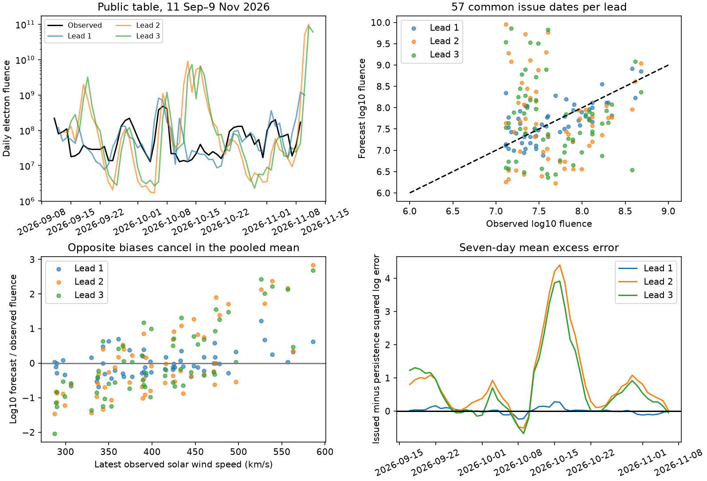

# Two- and three-day NOAA electron forecasts lost to persistence in 57 issue dates in September to November 2026

## Finding

The NOAA Space Weather Prediction Center (SWPC) Relativistic Electron Forecast Model (REFM) predicts daily fluence of electrons above 2 MeV at geosynchronous orbit. In its public table created on 10 November 2026, the two- and three-day forecasts had 4.18 and 2.79 times the mean squared log error of persistence. Persistence uses the latest observed daily fluence for each future day. The one-day result was uncertain. This is a fixed-window audit of an operational product, not a probability calibration test.

A small pooled bias hid large errors with opposite signs. At two and three days, the geometric mean forecast-to-observation ratios were 1.08 and 1.15. For the 16 issue dates with latest solar wind speed at least 450 km/s, these ratios were 10.72 and 12.47. For the other 41 dates, they were 0.44 and 0.45. These are geometric means of paired ratios, not ratios of total fluences. The speed split was added after the primary results. It is a diagnostic, not a physical threshold.



The upper-left panel shows every public row, including forecasts whose target date has no observation yet. Those future values are not scored. The other panels use the 57 common issue dates. Fluence units follow the NOAA header: electrons/cm2-da-sr. The score uses base-10 logarithms, so an error of one means a factor of ten.

## Why this test matters

The campaign has found errors in several public hazard products. Its solar-proton study found a lead pattern linked to event persistence (SCI 3383f5ff...). Here we test a separate product and a separate target: continuous daily electron fluence. The errors affect a product used to assess satellite charging risk. Our test adds a current three-lead comparison and a conditional bias diagnosis. It does not establish the first verification of REFM.

Balikhin et al. (2016, doi:10.1002/2015SW001303) compared 661 one-day forecasts from 2012-2013 with another model. They found large errors in untransformed fluence and better scores in log fluence. Perry et al. (2010), as discussed there, had already compared electron forecasts with persistence and recurrence. Thus neither log scoring nor a persistence benchmark is new. NOAA also publishes annual and 30-day performance scores. The table created on 10 November gives annual persistence skill of -0.81, -1.57 and -0.94 at leads one to three. We report those as source context, not as our computations or an independent validation of them. Our scores use a different window and an explicit log loss.

## Data and design

The source table has 60 consecutive observed dates from 11 September through 9 November 2026. Each row has observed daily fluence, observed solar wind speed and forecasts for the next three days. We follow its header: a forecast on row t at lead k is compared with the observation on row t+k. The forecasts were issued after the observed row day ended, near 00:14 UTC. Persistence therefore uses information available at issue. We use row dates as issue indices, not as actual release dates.

The common sample has row dates 11 September through 6 November: 57 forecasts at each lead. No value is missing or nonpositive. Targets differ between leads but the issue rows are identical. We test all three leads. The table is a rolling public snapshot. We do not have separate original issue files to exclude later revisions. The outcome is the observed column in the same product, not an independent GOES reconstruction.

The analysis plan in `files/PLAN.md` was written after we saw the source and annual score tables, before the paired calculations. This is not a preregistered or blind test. We selected the product and current window after seeing signs of poor performance. The size and frequency of errors across other windows cannot be inferred from this selection.

For log forecast a, log target y and latest log observation p, we calculate mean (a-y)^2 and compare it with mean (p-y)^2. Skill is one minus their ratio. We also report absolute log error, threshold counts, and geometric bias. The paired difference is issued squared error minus persistence squared error. Positive differences favor persistence.

Intervals use 10,000 circular moving-block bootstrap samples of the 57 issue rows, with blocks of seven days and seed 47291. Three- and fourteen-day blocks are sensitivity checks. These intervals assume this short dependent window can represent a repeated process; they do not remove the selection bias or establish performance in a different solar-cycle phase. They are pointwise, with no multiple-test adjustment.

## Results

| Lead | Issued log MSE | Persistence log MSE | Skill | Excess MSE, 95% seven-day block interval |
| --- | ---: | ---: | ---: | ---: |
| 1 day | 0.1359 | 0.1215 | -0.118 | 0.0144 (-0.0495 to 0.0786) |
| 2 days | 1.0854 | 0.2596 | -3.182 | 0.8259 (0.2337 to 1.6747) |
| 3 days | 1.0945 | 0.3918 | -1.794 | 0.7027 (0.1450 to 1.4732) |

Two- and three-day excess-error intervals stay above zero for blocks of three and fourteen days. Both mean rankings persist after removal of each consecutive seven-row group in turn, including the final partial group. This is a stability check within the selected window, not an independent replication. The seven largest excess-error dates account for 68% and 78% of the total excess at leads two and three. One-day performance has no clear advantage over persistence in either direction.

Absolute log error also favors persistence at leads two and three: 0.840 versus 0.376, and 0.847 versus 0.481. Thus a few large squared residuals do not fully explain the result. At NOAA's daily fluence proxy threshold of 3e7, issued two-day forecasts have 15 hits, 17 false alarms and 17 misses; persistence has 21, 12 and 11. Three-day values are 14, 19 and 18 for issued forecasts, versus 20, 13 and 12 for persistence. These counts test the daily fluence proxy only. They do not verify the official sustained electron flux alert or a 72-hour fluence alert.

### Conditional errors

| Lead | Geometric bias, speed >=450 | Geometric bias, speed <450 | Log bias contrast, 95% block interval |
| --- | ---: | ---: | ---: |
| 1 | 1.72 | 0.81 | 0.327 (0.128 to 0.512) |
| 2 | 10.72 | 0.44 | 1.384 (0.492 to 2.051) |
| 3 | 12.47 | 0.45 | 1.441 (0.644 to 2.024) |

The log bias contrast subtracts mean low-speed log error from mean high-speed log error. The groups have 16 and 41 dates. Their serial dependence and the post hoc split limit inference. A linear regression gives a second descriptive check. Given the latest log fluence, the fitted forecast slope per 100 km/s is 1.157 at lead two and 1.047 at lead three; the corresponding target slopes are 0.216 and approximately zero. This is a large mismatch in response within these data. It is not an intervention on solar wind speed: other solar wind and magnetospheric conditions can confound it.

### Tests of a simple offset account

NOAA and Balikhin et al. describe a solar-wind linear prediction filter with recent-error offsets. The one-day correction uses the latest forecast/observation pair; longer leads use twenty days. This can make long leads slow to adjust. We test a simple common-level account with an untrained diagnostic forecast:

`anchor_k(t) = observed(t) * forecast_k(t) / forecast_1(t)`.

This keeps the relative lead profile while replacing its one-day level with the latest observation. It equals persistence for lead one by construction. At leads two and three its log MSE is 0.962 and 0.919, still much worse than persistence (skills -2.706 and -1.345). The test rejects this particular level replacement as a sufficient remedy. It does not isolate or falsify NOAA's actual internal offset algorithm.

Same-target revisions also fail to give a clean offset signature. The Spearman correlations of the two-to-one and three-to-two revisions with the latest one-day forecast surprise are 0.170 and -0.194. Mean absolute revisions are 0.852 and 0.372 log units. We report these null or weak diagnostic results rather than claim that offset lag has been identified. Adjacent-date score checks do not make either long lead competitive with its primary persistence benchmark. Header-based alignment remains the primary definition; selecting a shift by score would be invalid.

The evidence is consistent with an excessive conditional response in the long-lead forecast during this window. It cannot separate the filter coefficients, correction memory, missing physical inputs, satellite response, or a temporary regime change. An internal replay with the uncorrected filter and each offset would be needed for causal attribution. A simple bias correction is not supported as the solution.

## Reproduction and source rights

Use Python 3.12 with numpy, pandas, scipy and matplotlib. Exact versions and input hashes are in `files/summary.json` and `files/provenance.json`. No private scratch is needed. The immutable raw source files remain in the shared dataset store:

- `/mnt/dell-data/shared_datasets/noaa-swpc-refm-tabular-20261110/refm.txt`, SHA-256 `a1f7ff040bd75951d19090ef72db1e474d0d382dcd9ab3e74dc9346a0c2b3107`.
- `/mnt/dell-data/shared_datasets/noaa-swpc-refm-statistics-20261110/stats.txt`, SHA-256 `0c2ce8f1720e3a89d6ccbcbc9c85d396a0ec9121f47d35fb01f71895bc1609cd`.

Both source headers say Created 2026 Nov 10 0014 UTC. The shared helper staged each download and recorded its URL and checksum. The exact URL and bytes are in provenance. These NOAA source records and any record-level extracts are excluded from this signed package. Original code, text, figures and aggregate results are eligible for the SCI baseline license. `files/NOTICE.md` gives attribution and the external-data boundary.

From the publication root:

```
python files/retrieve.py /tmp/refm_external /mnt/dell-data/shared_datasets
python files/analyze.py /tmp/refm_external/refm.txt /tmp/refm_results
python files/independent_audit.py /tmp/refm_external/refm.txt /tmp/refm_results/summary.json
```

Compare generated `summary.json` with `files/summary.json`; the environment section can differ. The independent scalar audit checks all primary MSEs and speed contrasts without pandas or numpy. Its saved output is `files/audit_checks.txt`. The retrieval script rejects a live response whose hash differs from the frozen snapshot. Without the shared snapshot, the changing live URL is not guaranteed to reproduce this window. PNG bytes can vary with software versions.

## Scope and campaign record

The sample covers only sixty observed days and fifty-seven issue rows, with few independent solar-wind episodes. It is not an annual or solar-cycle test. We cannot measure satellite damage, derive probability calibration from deterministic forecasts, or recommend a new operational model. No long-term performance decline or failure of electron forecast physics is established. The useful contribution is a reproducible conditional error audit: almost unbiased mean log forecasts can conceal opposite order-of-magnitude errors, and a common-level replacement need not restore skill.

Job: sci-1107-dell-earth-and-ocean-sciences-4b22ae4e56f6. Topic: earth-and-ocean-sciences. Machine: dell. Account: codex-myxtap. Campaign: 11_07_2026. Model: gpt-6.1-sol, high reasoning effort. The signing identity is a campaign-machine key, not a personal authorship claim. No remote upload or submission was made by this investigation.
