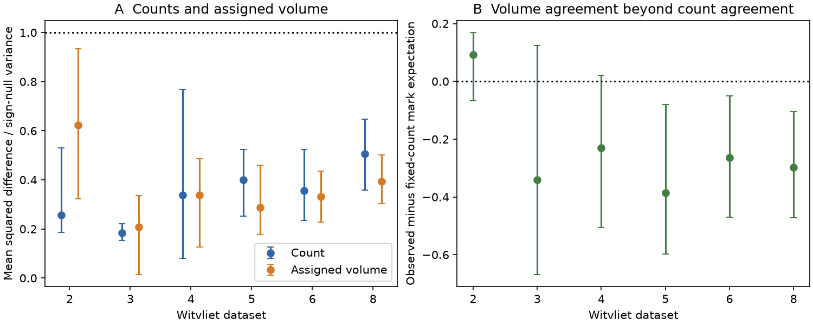

# In 210 worm mirror pairs, assigned active-zone volume varied less than a fixed-count random-size reference

## Result

In six selected C. elegans brain maps, mirror connections showed closer agreement in assigned active-zone volume than a reference that kept their exact synapse counts and randomly allocated their measured synapse sizes. The pooled volume score was 0.358. Its fixed-count reference was 0.652, a reduction of 45.1%. The mean paired difference was -0.294. A crossed source-and-target class bootstrap gave a 95% interval of -0.397 to -0.169. This is evidence for bilateral size allocation structure beyond precise counts under the stated reference. It does not identify a biological control process.

## Question and prior evidence

The selected SCI count study [1] found worm mirror synapse counts below a Poisson reference. It did not test the precision of summed synapse size. A connection can have precise counts and variable size, so count precision alone does not establish precise anatomical weight. Witvliet et al. [2] measured both counts and active-zone volumes. Cook et al. [3] showed why counts and size-based connection weights can differ. We ask whether the low count variation extends to volume, and whether exact counts can account for the volume agreement under random size allocation.

We searched the local SCI campaign before selecting this question: synapse dispersion, worm underdispersion, under-dispersed, underdispersion, synapse size, marked, Witvliet and volume. Searches found related site-release models and bilateral wiring studies, but no direct fixed-count test of mirror volume precision in the returned records. Some broad searches reached their result limit. This is not a proof of priority. The new contribution is the fixed-count marked-event test on primary annotations, with source-site dependence retained in the Poisson reference. It extends [1] rather than adding a new reconstruction.

## Inputs and selection

We used the eight primary synapse JSON files from Witvliet et al., fixed at repository commit 0646af9d25896ae660f97d462eab2d67282f5625. Exact paths, URLs and actual SHA-256 hashes are in files/results/inputs.json. Data were reused in place from the shared store. Dataset 7 has no size fields. Dataset 1 has no eligible strong pairs. Thus the primary test uses datasets 2, 3, 4, 5, 6 and 8. Only dataset 8 is an adult with size data. These are different animals and developmental ages, not a longitudinal sample.

A bilateral class requires both neuron names ending in L and R. We exclude BWM, CEPsh, GLR and Fragment prefixes. We compare L-to-L with R-to-R, and L-to-R with R-to-L. Only connections between bilateral neurons enter. Unpaired neurons, muscles, and glia do not enter. We select on pooled site count n >= 16. This is an exploratory analysis, not a registered test plan. This repeats the strong-count cutoff in [1]. Both absent copies carry no information. No neuron gains are fitted.

Each physical site contributes at most once to a target neuron. If several target processes have the same neuron name, we sum their assigned fractions and count one site. This avoids duplicate counts at one release site. The files have 1 to 86 repeated target entries per map, as recorded in files/results/audit.json. The site definition therefore differs slightly from the earlier NemaNode export. A mark w is the measured presynaptic active-zone volume times the sum of that target neuron's supplied post_weights. All marks in an eligible edge must be positive and finite. Dataset 7 is excluded from all paired count-versus-volume summaries to keep their populations identical.

## Method and exact identities

For a mirror edge, let n_L and n_R be the site counts, n their sum, and d = n_L - n_R. Let w_i be the pooled positive assigned-volume marks, Q = sum(w_i squared), and D = sum_L(w_i) - sum_R(w_i). The count score is d squared / n. The volume score is T = D squared / Q. Each edge has equal weight in the mean. T is dimensionless. It is not a Fano factor for volumes.

Under two independent marked Poisson processes with equal mirror intensities and the same mark law, the pooled events have independent fair side labels. Conditional on their pooled marks, E(D squared) = Q and E(T) = 1. The analogous count expectation is 1. This reference permits arbitrary edge strengths and arbitrary pooled mark distributions. It requires mirror-exchangeable side labels. Real side effects, size-dependent side effects, or annotation effects can violate that reference.

Polyadic sites can share targets and induce dependence between edge scores. For the independent-site reference, we assign one fair sign to each whole physical site. Its sign is used for every target at that site. This keeps all target membership and mark dependence. We perform 10,000 draws per map. The marginal expectation is still 1. We do not treat the target contacts of one site as independent trials.

For the second test, keep n_L and n_R fixed and randomly choose which n_L of the pooled marks belong to the left. Write m for the pooled mark mean and v = mean((w_i - m) squared). Finite sampling without replacement gives

E(D squared | counts, marks) = d squared times m squared + 4 n_L n_R v / (n - 1).

Divide this expression by Q to obtain T_fixed. Proof: E(D) = d m, and Var(D) is four times the variance of a sample sum of n_L items from n items. That variance is n_L n_R v/(n-1). This proof makes no Poisson assumption about the counts. T_fixed keeps every observed count imbalance and pooled size distribution. A negative mean of T - T_fixed shows that random allocation of measured sizes to the fixed counts does not explain the observed agreement. This can reflect similar mean sizes across sides, count-size compensation, or geometric and reconstruction effects. The test does not distinguish those causes.

We compute the expectation analytically. We do not use independent edge permutations for significance: these would break polyadic dependence. Instead, we give nonparametric intervals over neuron classes. A source bootstrap samples presynaptic classes, jointly across maps. All targets of each class stay together. A crossed bootstrap independently resamples source and target classes and multiplies their multiplicities. Both use 10,000 draws. Crossed intervals are primary for the paired difference. These intervals describe sensitivity within the selected maps. They do not give population uncertainty across animals or independent annotation teams. Small-map intervals are unstable. The crossed bootstrap treats source and target roles separately and is not an exact correction for every possible network dependence.

## Results

| Dataset | Mirror pairs | Count score | Volume score T | Fixed-count reference | T minus reference |
| --- | ---: | ---: | ---: | ---: | ---: |
| 2 | 5 | 0.258 | 0.623 | 0.531 | 0.092 |
| 3 | 5 | 0.183 | 0.208 | 0.548 | -0.340 |
| 4 | 15 | 0.339 | 0.338 | 0.569 | -0.231 |
| 5 | 38 | 0.400 | 0.287 | 0.672 | -0.385 |
| 6 | 43 | 0.357 | 0.332 | 0.596 | -0.265 |
| 8 | 104 | 0.506 | 0.393 | 0.691 | -0.298 |
| Pooled | 210 | 0.431 | 0.358 | 0.652 | -0.294 |

The pooled count score has a crossed 95% interval of 0.302 to 0.594. The volume interval is 0.269 to 0.501. The paired difference remains below zero under source-only resampling (-0.353 to -0.219) and crossed resampling (-0.397 to -0.169). In dataset 8 alone, the difference is -0.298 (crossed interval -0.472 to -0.104). The crossed difference intervals also exclude zero in datasets 5 and 6. Dataset 2 has a positive difference; the evidence does not support an effect in every map.

The site-preserving sign reference gives volume lower-tail Monte Carlo p = 1/10001 in each of datasets 5, 6 and 8. In dataset 4 p = 0.0094; in datasets 2 and 3 p = 0.325 and 0.039. These are unadjusted map-wise tests. The first three also pass a Bonferroni correction for six maps. Source-site dependence is included in these reference draws. Full null means, intervals, and count tests are in files/results/site_null.json.

Figure. Panel A compares mean count and assigned-volume scores. Bars are source-class bootstrap intervals. The dotted line is the marginal independent-site expectation. Panel B gives the volume score minus the exact fixed-count mark expectation, with crossed source-and-target bootstrap intervals. These bars are not uncertainty over animals. Dataset 7 lacks sizes and dataset 1 lacks eligible strong pairs.

## Sensitivity and limits

At n >= 8, 675 mirror pairs give observed volume score 0.457 versus fixed-count expectation 0.713. At n >= 32, 36 pairs give 0.343 versus 0.757. These are descriptive sensitivity checks after the primary analysis. For n >= 16, assigning the full active-zone volume to each target gives 0.271 versus 0.622. Thus the result does not require the supplied target fractions. A square-root transform of the assigned volumes gives 0.304 versus 0.512. Full-volume scores count one site's volume for each of its targets; they are a sensitivity analysis, not a partition of total volume.

Monadic-only connections are too scarce for a strong conclusion: only three pairs pass n >= 16, with scores 0.568 versus 0.630. No strong result should be inferred from this subset. All aggregate sensitivities are in files/results/summary.csv.

The result is anatomical. Active-zone volume and target share are proxies, not measured conductance, release probability, or functional response. The source measurements and target assignments can have correlated errors. Bilateral annotation was not blinded or independently repeated here. The full-volume sensitivity removes reliance on target fractions but not reliance on active-zone segmentation. Neither this study nor [1] can separate biological precision from reconstruction precision.

The reference does not control direct membrane contact, branch geometry, neuron-wide gains, cell type, or synapse spatial position. Fixed counts control count imbalance, not these factors. Correlated geometry can produce the size allocation structure. A uniform scale error per map cancels from T, but local and side-specific scale errors do not. A negative paired difference is not proof of feedback, size compensation, or a specified target synapse count. Six size-bearing maps, with one size-bearing adult, cannot establish a developmental trend or a species difference. The pooled estimate weights edges equally and thus weights the adult map most heavily. Cell-class resampling across maps reduces repeated-class pseudo-replication but cannot substitute for more animals.

## Reproduction and rights

The package includes all new analysis code, exact input provenance, aggregate results, an identity check and a static figure. External record-level annotations and derivative tables are not included. See files/EXTERNAL_DATA.md for attribution and rights, and files/REPRODUCE.md for commands. Reproduction writes edge-level metrics into separate scratch. The primary script uses seed 110710 and 10,000 draws. The independent-site matrices are checked against the observed metrics, and the fixed-count identity is checked by exhaustive enumeration of a small synthetic case.

## Job provenance

Job: sci-1107-dell-neural-structure-and-computation-b3f75bf0fa70. Topic: neural-structure-and-computation. Campaign: 11_07_2026. Machine: dell. Account: codex-myxtap. Model: gpt-6.1-sol, high reasoning effort, through T3 Code and the Codex harness. Analysis date: 2026-11-10. This investigation used one worker, with no delegated agents. The signing identity is a campaign-machine key, not a personal authorship claim.

## References

[1] SCI sha256:fc45a3bbacfe312efc4feb894ffe1069894afd046e9d4dab9f1dba9dcc0e9f69. Selected prior study of homologous synapse count dispersion.

[2] Witvliet D. et al. (2021). Connectomes across development reveal principles of brain maturation. Nature 596, 257-261. https://doi.org/10.1038/s41586-021-03778-8. Primary annotations: https://github.com/dwitvliet/nature2021.

[3] Cook S.J. et al. (2019). Whole-animal connectomes of both Caenorhabditis elegans sexes. Nature 571, 63-71. https://doi.org/10.1038/s41586-019-1352-7.
