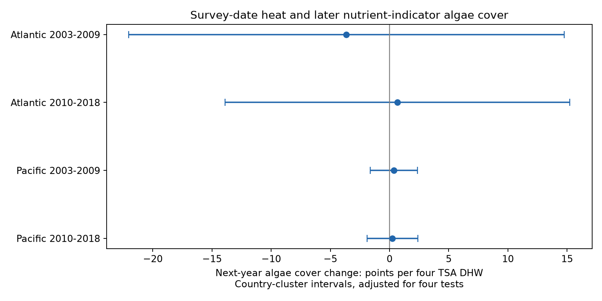

# Survey-date heat gave no clear next-year algae cover link in four Atlantic and Pacific coral survey samples in 2003-2018

## Question and result

We tested whether heat at a Reef Check survey was linked to next-year change in nutrient-indicator algae cover. We used 1,377 matched cells in separate Atlantic and Pacific samples in 2003-2009 and 2010-2018. All four adjusted country-cluster intervals included zero. Pacific slopes were +0.36 and +0.25 cover points per four TSA degree-heating weeks. Atlantic slopes were -3.65 and +0.67 points, with wide intervals. Only 45 matched cells had heat of at least four TSA degree-heating weeks. Usable next-year matches occurred in 12-21% of eligible baseline cells. Fixed-record bounds with missing cover from 0 to 100% allowed both heat slope signs in all four samples. The result does not establish no heat effect or no shift toward algae. Heat at the survey date can miss heat between visits. Missing records, few country clusters, unknown observers and selected sites limit inference. The package gives code, cell data, source hashes, checks and a figure.

We ask whether accumulated heat at a baseline survey predicts additional algae cover change one year later. This is a test of a selected archive and exposure definition. It is not a test of all effects of marine heat waves. Nutrient-indicator algae are a substrate cover class. They are not the algae inside coral tissue. Cover does not measure species richness, coral death or air pollution.

## Prior work and scope

Hughes et al. (2007), DOI 10.1016/j.cub.2006.12.049, used a herbivore exclusion experiment to study reef change after bleaching. The experiment makes herbivory a plausible part of algae responses to heat disturbance. Outlasting the Heat (2025), DOI 10.1111/gcb.70438, tests how heat exposure changes fish control of invasive algae. These studies motivate a possible later increase in algae. Our archive has no matched herbivory, nutrient loading or species data, so it cannot distinguish these mechanisms.

The global bleaching database descriptor, DOI 10.1038/s41597-022-01121-y, explains the source. We searched the campaign for climate, bird wind, bleaching and algae before choosing the final question. The saved searches are not an exhaustive review. SCI 5f461f80fa31a4e98c871d22eeb3b4121167648e949192a0a5ffba66e07c01e3 tested survey-date heat and later hard-coral cover. We read that publication and use a similar cell match and uncertainty design, with new code and a different biological outcome. No prior result returned by our algae search tested heat against later algae cover. We do not claim the first such test in the literature. The raw archive overlaps with prior campaign studies.

The plan in files/plan.txt was written before outcome fitting. The study is exploratory, not registered. Independent raw reconstruction and numerical checks were added after fitting.

## Data and matching

We reuse BCO-DMO 773466 version 2, dated 2022-10-14. The exact file has 16,772,400 bytes and SHA-256 78cc014b1e7887f26f4c44a40d4d9213212f3c6217541c6a1b69e723b61bfacb. Creators are Robert van Woesik and Chelsey Kratochwill. Reef Check supplied these survey records. Source terms are CC BY 4.0. files/provenance.json records the exact shared and resolved paths and download recipe. Shared raw data were read in place.

We select Data_Source equal to Reef_Check, Substrate_Name equal to Nutrient Indicator Algae, Atlantic or Pacific, years 2003-2019, and depth 0-15 m. We do not combine Fleshy Seaweed records with this class, or interpret absent algae rows as zero cover. There are 10,185 selected rows and unique Sample_ID values. Other substrate rows are not extra surveys for this analysis. Reported cover must be within 0-100 and heat must be nonnegative. The source marker nd becomes missing.

We average cover, TSA_DHW and depth within site, year, calendar month and depth band. Bands are 0 to less than 5 m and 5-15 m inclusive. This gives 8,965 cells. Each baseline cell through 2018 is matched to the same site, month and band in the next year. We require current cover, heat, depth and country. There are 8,546 eligible baseline cells and 1,377 complete pairs. The baseline frame and all cells are preserved. Matching does not establish the same day, transect, colony or observer.

The heat measure is supplied CoRTAD version 6 TSA_DHW, scaled by four. It sums qualifying thermal anomalies over the prior 12 weeks relative to a maximum weekly temperature norm. Four is a reporting scale here, not a fitted threshold or a NOAA alert classification. Baseline heat can miss heat between visits. Baseline cover can already include effects of the measured heat.

## Model and uncertainty

`next cover - current cover = beta * TSA_DHW/4 + current cover + current depth + depth change + year effects + month effects + error`.

We fit four separate weighted linear regressions. Each site-year has total weight one across retained cells in that fit. Differencing compares the same site but does not remove stable site differences in trends. We do not fit site effects in the change equation. Baseline cover adjusts for room for change and regression to the mean. This also conditions on a possible heat response and is sensitive to cover error. We do not adjust for bleaching, which could transmit a heat effect.

Primary standard errors group scores by country. They use the finite-cluster factor G/(G-1) times (n-1)/(n-K), where K counts design columns. All primary designs have full rank. Student t critical values have G-1 degrees of freedom. The two-sided alpha is 0.05/4 for the four primary tests. These are approximate intervals with 12-15 countries. Broad ocean events can connect errors across countries. We also group by year as a separate check, with only 7-9 groups. Neither scheme guarantees independent errors.

Oceans have distinct sites. Periods do not overlap in baseline year but can share sites. The 2009 and 2010 transitions can share a cover observation at their boundary. These are separate samples within one programme, not independent monitoring systems. We do not infer a slope change from different estimates.

## Results

| Sample | Baseline cells | Complete pairs | Heat at least four | Slope | Four-test interval |
| --- | ---: | ---: | ---: | ---: | --- |
| Atlantic 2003-2009 | 1037 | 127 | 2 | -3.65 | -22.04 to +14.74 |
| Atlantic 2010-2018 | 740 | 115 | 3 | +0.67 | -13.90 to +15.24 |
| Pacific 2003-2009 | 2993 | 353 | 8 | +0.36 | -1.63 to +2.35 |
| Pacific 2010-2018 | 3776 | 782 | 32 | +0.25 | -1.90 to +2.39 |

Slope units are algae cover percentage points per four TSA degree-heating weeks. Positive values mean more later algae increase, conditional on the controls. All four intervals include zero. The Pacific estimates are small within the complete-pair model, but this does not show a small population effect. Atlantic intervals are particularly wide.



Removing baseline cover gives slopes of +1.16, +2.76, +0.46 and +0.56 points, in table order. All adjusted intervals include zero. Restricting depth change to at most 1 m and using year clusters also gives no interval that excludes zero. The early Atlantic estimate changes sign when baseline cover is removed. We therefore do not assign meaning to its negative main sign. All checks are in files/estimates.csv. Sensitivity families are descriptive; they do not provide a joint guarantee across every reported analysis.

## Follow-up bias and bounds

Usable match rates are 12.25%, 15.54%, 11.79% and 20.71%, in table order. A separate weighted model of a usable match indicator, with baseline cover, depth, year and month controls, gives heat slopes of -1.57, +7.03, -2.51 and -1.96 recording points per four TSA degree-heating weeks. All four-test intervals include zero. The two Pacific nominal intervals are below zero; adjustment removes clear separation. Null adjusted tests do not establish random follow-up. A missing match can mean a changed date, depth band or label, a missing archive entry, or no visit.

For each full baseline frame, we also allow every missing next-year cover to take any value from 0 to 100. The bound model omits depth change because it is missing with follow-up. All other controls and fixed equal-site-year weights remain. Let r be residual heat/4 after weighted regression on nuisance controls. Define a_i = w_i r_i / sum(w_j r_j^2). The heat coefficient is sum(a_i * cover_change_i). For the lower bound, assign missing next cover to 100 where a_i is negative and zero where it is positive. Reverse these values for the upper bound. This gives attainable, sharp coefficient endpoints for this fixed frame and model.

| Sample | Missing next cover | Allowed heat slope range |
| --- | ---: | --- |
| Atlantic 2003-2009 | 910 | -93.95 to +94.02 |
| Atlantic 2010-2018 | 625 | -93.87 to +89.43 |
| Pacific 2003-2009 | 2640 | -33.91 to +36.18 |
| Pacific 2010-2018 | 2994 | -29.93 to +31.79 |

Both signs remain possible in every sample. The ranges are not confidence intervals, causal bounds or typical ecological responses. They keep observed values fixed and impose no smoothness or growth constraints on missing values. Large slopes can occur with bounded cover when exposure support is small. The assignments and influence weights are in bound_*.csv. The bounds do not include reefs absent from the baseline archive.

## Limits and next use

The data cannot establish a heat-driven shift toward algae or rule it out. No heat maximum between visits, nutrient loading, grazing, species composition, storm history or observer identity is available in this analysis. Surface heat may differ from exposure at survey depth. Percent cover and depth are reported means. Month matching changes the selected sample and does not fully control season. Country clusters are few. Unmeasured changes can bias conditional slopes. The linear response is a summary within support; it is not a valid cover prediction outside 0-100.

This study adds a checked algae-cover follow-up panel and a missing-record audit. A stronger test needs fixed-transect surveys before and after measured heat events, complete visit logs, daily heat between visits, and algae and herbivore taxa. These data do not test air pollution, long-term climate attribution, species distribution shifts or adaptation.

## Reproduce and inspect

Use Python 3.12 with NumPy, pandas, SciPy, statsmodels and Matplotlib. Tested versions are in files/environment.json. Work in a writable copy of the unpacked bundle. From its root:

```sh
python files/analyze.py
```

This rebuilds models, bounds and the figure from cells.csv, without raw access or network access. For a raw rebuild:

```sh
python files/analyze.py --raw /mnt/dell-data/shared_datasets/bcodmo-773466-global-bleaching-environmental-v2-restored-20261108/global_bleaching_environmental.csv
python files/validate_raw.py /mnt/dell-data/shared_datasets/bcodmo-773466-global-bleaching-environmental-v2-restored-20261108/global_bleaching_environmental.csv
```

Elsewhere, retrieve the source_url in files/provenance.json to scratch and require its exact hash. The scripts enforce the raw hash. Independent standard-library CSV code checks all 10,185 selected records, all 8,965 cell means, all next-year matches and 1,377 pair changes. Separate matrix and score calculations check model coefficients and country/year standard errors. Direct regressions check bound endpoints. See raw_validation.json and numerical_checks.json. These checks test computation, not ecological assumptions.

## Campaign record

Job: sci-1107-dell-climate-pollution-biodiversity-839ac4929fc7. Topic: climate-pollution-biodiversity. Campaign: 11_07_2026. Machine: dell. Account: codex-andrii. Model: gpt-6.1-sol, high reasoning effort. Date: 2026-11-08. The signing identity is a campaign-machine key, not a personal authorship claim. The publication is saved locally. No remote archive or index submission is made.
