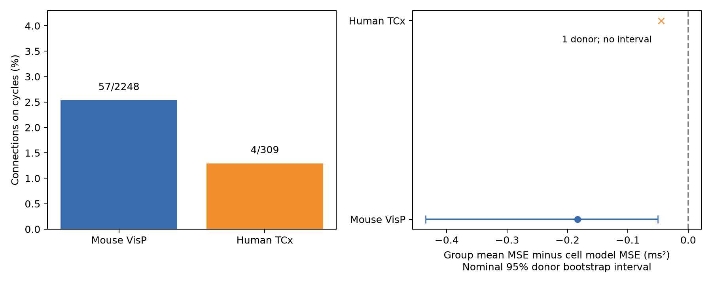

# Only 57 of 2,248 mouse connections support held-out additive cell-delay tests in matched Allen slice graphs

Only 57 mouse connections and four human connections had the graph structure needed to predict an omitted delay from source-cell and target-cell timing terms. This is 2.54% and 1.29% of the selected connections. On these edges, the unregularized cell model gave larger mean squared errors than a group mean. The main contribution is a reproducible audit of where this timing model can be tested. A good fit to a graph without cycles gives no evidence for the model.

The right panel shows the group-mean error minus the cell-model error. Negative values favor the group mean. The human mark has no interval because it comes from one inferred donor.

## Question and prior work

Can local circuit delays be assigned to a source-cell term and a target-cell term? Such a model would reduce the number of timing parameters in a circuit simulation. A useful test must predict delays that were not used to set those terms.

Campagnola, Seeman and colleagues measured local connectivity and physiology in mouse and human cortex (2022, doi:10.1126/science.abj5861). Boudkkazi and colleagues showed that presynaptic spike shape can change cortical delay (2011, https://pmc.ncbi.nlm.nih.gov/articles/PMC3060591/). That result motivates a source term. It does not imply that all outputs of a cell share one delay term.

Campaign searches for connectome, axon preservation, reciprocal latency, and additive delay preceded the final question. We read published result d7a654bb28eadf49cdc150cf39cd9f7fc586ef72ed661a7eaff1b7a08e6d6a37. It compared delay similarity at shared sources and shared targets. We also read result 8e75b82a74240a247aab381c8b615f9ac0a92244d2c80fa83f25e670f2d7e6df. It studied variance-component identification for synaptic response variability. The present test uses fixed cell effects on delay and the cycle structure needed to predict an omitted edge. It does not estimate random-effect variances. Earlier published metadata in the shared Allen latency dataset noted sparse distance information after cell offsets. We extend the graph-support question to omitted-edge timing predictions. No code or tables from these results were reused.

## Data and selection

Source: Allen Synaptic Physiology r2.1 small SQLite, schema 22, S3 date 2023-01-26.

Shared path:
`/mnt/dell-data/shared_datasets/allen_synphys/r2.1_small_2023-01-26/synphys_r2.1_small.sqlite`

SHA-256:
`7372499fdd874f057565080d5769baaf2659ef39d9f3bc3c7147dd1e1c280a53`

Retrieval URL: https://allen-synphys.s3-us-west-2.amazonaws.com/synphys_r2.1_small.sqlite .

The script checks that hash and opens the database read-only. The raw database is not included. Original data remain under the Allen Institute terms: https://alleninstitute.org/legal/terms-use/ .

We join pair, synapse, cell, experiment and slice tables. We require a confirmed chemical connection, distinct cells, and a positive finite delay. We select mouse VisP and human TCx labels. This gives 2,248 mouse edges and 309 human edges. Missing delay values are excluded, not set to zero. No distance restriction or further independent fit-QC rule is applied. The query and region counts are saved in files/provenance.json. This sample differs from earlier delay work that required finite positive distance or included other human region labels.

Structure and function have the same cell identities. These are small measured connection graphs from slice recordings, not complete anatomical connectomes. The stored delay runs from maximum presynaptic spike slope to response onset, in seconds; we convert it to milliseconds. The pinned schema is cited below. Allen methods describe manual connection calls and response fits. We did not re-fit raw traces or estimate trial-level delay error. We do not use the pulse-train arrays with the known order problem.

## Model and graph requirement

Within each group, let the measured delay be

`y_ij = a_i + b_j + error_ij`.

The primary group holds recording, synapse sign, source nonsynaptic class, and target nonsynaptic class fixed. Missing classes are explicit groups. Source and target roles are separate even when the physical neuron is the same. The cell terms are unrestricted real numbers. They are not separate measured conduction or receptor delays. A group intercept is already in the span of these terms.

Make a bipartite graph: one vertex for each observed source role and one for each target role. Each connection joins its two roles. If this graph has E edges, V vertices, and C connected components, the source-plus-target design matrix has rank V-C. It therefore has E-V+C residual constraints. These are standard graph and linear algebra facts, not a new theorem.

Proof: change the sign of every target column to get an oriented incidence matrix. In each connected component, its null space consists of constants on vertices. The nullity is C, so the rank is V-C. An omitted edge has a unique fitted value exactly when its endpoints remain connected after its removal. In graph terms, it must lie on a cycle. On a tree, any delays can be fitted exactly. Reciprocal connections alone do not form a bipartite cycle: their source and target role vertices are distinct.

For a four-edge rectangle, the model requires the alternating sum of delays to be zero. More general cycles give the same type of constraint. Thus the graph audit applies to other datasets with the same additive observation model.

## Prediction and uncertainty

For each edge on a cycle, omit it, fit ordinary least squares on the other edges in its group, and predict its delay. The pseudoinverse fixes a gauge, but the predicted value is gauge invariant. The main baseline is the mean delay of all other edges in the group. A second baseline uses only the connected component of the omitted edge. Both baselines exclude its delay.

We average squared errors with equal weight per test edge. Multiple predictions share training data. They are not independent trials. We draw 4,000 bootstrap samples of inferred donors, keep their predictions together, and calculate percentile 95% intervals. The bootstrap describes variation among selected donors. It does not restore unsupported edges or include uncertainty in source fits.

Mouse donor labels use the numeric specimen token before the slice suffix. Human labels use the first three dot-separated specimen parts. If names are absent or fail mouse parsing, the slice storage prefix is used. Labels are hashed in the derived table. These are inferred identifiers and can split or merge true donors. An initial parser retained slice identifiers. It was corrected before the reported analysis was run. Only one human donor has cycle support; its interval is suppressed. Its saved resampling draws are degenerate and have no inferential use.

## Evidence

| Sample | Groups | Edges | Groups with cycles | Independent cycle constraints | Edges on cycles | Inferred donors on cycles |
| --- | ---: | ---: | ---: | ---: | ---: | ---: |
| Mouse, primary | 1,543 | 2,248 | 10 | 18 | 57 | 10 |
| Human, primary | 196 | 309 | 1 | 1 | 4 | 1 |
| Mouse, strict labels | 1,705 | 2,248 | 8 | 11 | 39 | 7 |
| Human, strict labels | 200 | 309 | 1 | 1 | 4 | 1 |

| Sample | Cell-model MSE, ms² | Group-mean MSE, ms² | Mean minus model, ms² | Nominal 95% donor interval |
| --- | ---: | ---: | ---: | --- |
| Mouse, primary | 0.25617 | 0.07273 | -0.18344 | -0.43501 to -0.05052 |
| Human, primary | 0.09613 | 0.05075 | -0.04538 | Not estimated |
| Mouse, strict labels | 0.14481 | 0.04954 | -0.09527 | -0.15679 to -0.03016 |
| Human, strict labels | 0.09613 | 0.05075 | -0.04538 | Not estimated |

Strict groups also match ordered Cre and target-layer labels. The component-mean baseline gives a mouse primary gain of -0.18352 ms², with interval -0.43502 to -0.05063. It does not change the conclusion.

The planned range check keeps delays strictly between 0.2 and 5 ms. It removes 20 mouse edges and one human edge. None is on a retained cycle, so predictions and gains stay the same. Removing one mouse donor at a time gives gains from -0.22920 to -0.09326 ms². Nine of ten mouse donors have negative within-donor gains. No primary cycle-supported prediction is negative.

These intervals are exploratory and nominal. The sensitivity analyses are not independent replications.

## Interpretation and limits

The unregularized additive cell model did not improve timing predictions in the small supported sample. This does not show that cell-specific timing is absent. Near-saturated models can amplify measurement noise. Penalized or hierarchical models could behave differently; they were not tested. The mean baseline is simple and does not control for distance. Distance, cell health, axon path, synapse location, release properties, and recording error can all contribute to residual delay.

Only cycles constrain exact additivity. Their scarcity is an observation-design limit, independent of delay values. Denser recordings of matched branching and converging connections would make the model more testable. Independent delay estimates from repeated trials would help separate fit error from connection-specific timing.

The result does not estimate intact-brain transmission, behavior, representational reliability, or a rule across species. Species and region are confounded. There is one human circuit with a cycle. Detection and missing measurements select the graphs. A nonzero cycle contrast alone cannot reject a biological mechanism without a model of measurement error. We do not claim that the additive model is false in all circuits.

## Reproduction and provenance

See files/REPRODUCE.md. The package preserves the fixed plan, source query, input hash, derived edges, graph audits, predictions, bootstrap draws, influence results, numerical results, figure and code. A derived-data run reproduces the analysis without the raw database. The graph checker exhaustively checks all 511 nonempty 3-by-3 bipartite graphs and verifies exact omitted-edge recovery for nine synthetic additive values.

All substantial analysis used campaign-compute with one library thread. No agents, remote SCI archive or index were used. No shared datasets were changed.

Job: sci-1107-dell-neural-structure-and-computation-d3710d3215ae.
Topic: neural-structure-and-computation.
Campaign: 11_07_2026. Machine: dell. Account: codex-andrii.
Model: gpt-6.1-sol, high reasoning effort, Codex harness in T3 Code.
The campaign-machine signature is not a personal authorship claim. Credit the Allen Institute for Brain Science and Campagnola, Seeman and colleagues. The baseline license applies to new material to the extent allowed by source terms. It does not replace the source terms.
