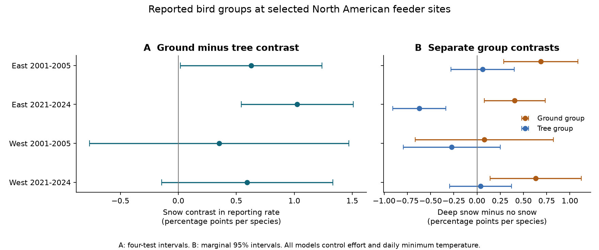
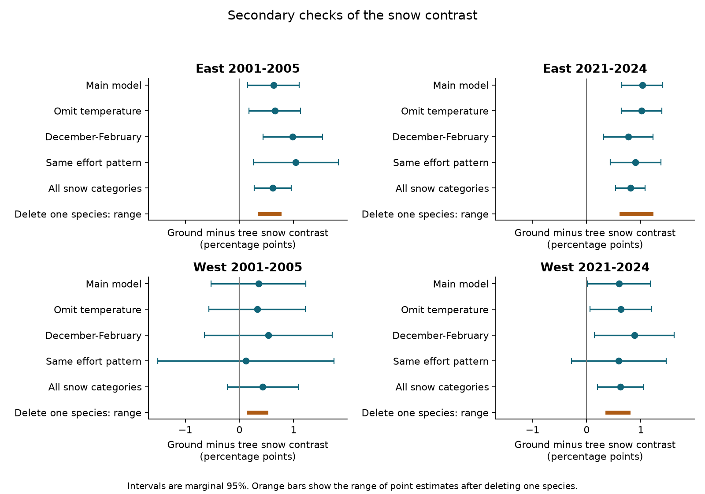

# Deep snow had larger report contrasts for ground than tree bird pools in eastern feeder samples in 2001-2005 and 2021-2024

## Question

Does deep snow have a larger positive link to reports of ground-feeding birds than to reports of tree-feeding birds on the same feeder checklists? Snow can cover natural food on the ground. A change toward ground feeders would agree with a food-access explanation for higher recorded species richness at feeders. This is a test of a prediction. It does not measure bird movement or true local species richness.

## Prior work and new test

Zuckerberg et al. (2011), doi:10.1111/j.1365-2656.2010.01780.x, modeled winter bird occupancy and feeder attendance. They showed why feeder use and broad distributions must be distinguished. Deshpande et al. (2022), doi:10.1111/jbi.14326, linked snow depth to bird habitat use in Finland. Their work motivates a food-access prediction but does not establish that prediction for this North American sample.

Campaign study [SCI d9986378](sci:sha256:d998637862f59880b1132f5cb31b51000699190db694001555a222a5f4c42eee) found a positive link between deep snow and feeder species richness in three of four region-period samples. We follow its checklist rules and model design. We add an independent trait source, daily temperature, a comparison of bird groups on the same checklist, and checks that remove one species at a time. This is a new outcome test in the same survey program. It is not a new independent survey. Campaign study [SCI c94acf78](sci:sha256:c94acf78273342e4059d41fb6b8494821e7960ffeaf617f2c1e88631488fe9f2) also identified weather-dependent feeder use as a possible limit on interpretation of winter community change.

## Data and scope

We use Project FeederWatch's May 2024 public checklist snapshots and species translation table. Cornell Lab of Ornithology, Birds Canada, and volunteer participants supplied these data. Bonter and Greig (2021), doi:10.3389/fevo.2021.619682, describe the protocol. Participants record the largest simultaneous count of each reported species across two count days. We use only report indicators, not a sum of counts as an estimate of abundance.

The early sample covers seasons ending in 2002-2005; the later sample covers seasons ending in 2022-2024. Dates run from November 2001 to April 2005 and November 2021 to April 2024. We keep November-April dates in the US and Canada, 25-65 N and 130-60 W. East is at or east of 100 W; West is west of 100 W. We remove all records at duplicated site-dates. We require known snow and effort categories, valid half-day indicators, and at least one observed half-day.

We roll recognizable forms to full species. A bird report must have a positive count and VALID=1. We use species with two-word scientific names and an exact name match to EltonTraits 1.0 (Wilman et al. 2014, doi:10.1890/13-1917.1). We do not guess synonyms across taxonomy versions. Ground species have at least 80% ground foraging in EltonTraits. Tree species have at least 80% summed use of the understory, mid-high, and canopy strata. These are general foraging traits, not measured winter behavior at a feeder. The 80% rule omits familiar mixed-stratum species, including Dark-eyed Junco and Mourning Dove, whose ground shares in this source are 60%. The exact-name rule also omits chickadees whose genera differ between taxonomy versions. These strict pools are not a complete list of birds that can feed on the ground or in trees.

For each region, we select species reported on at least 1% of early checklists that pass the scope and effort rules. This selection is before the changing-snow filter and does not use fitted snow slopes. We keep the same species pool in the later period. Each site-winter must have at least two no-snow and two deep-snow reports. Deep snow means the reported category above 15 cm. This is a depth category, not a local rarity measure or snowfall event. Intermediate categories enter a secondary check only. We retain the two-record rule after excluding missing temperature.

Temperature is the mean of daily minimum temperature on the count start date and the next day. We use the nearest 0.5-degree cell in NOAA CPC Global Unified Temperature V1.0, supplied by NOAA PSL, Boulder, Colorado. A missing value on either day makes the two-day mean missing. We do not interpolate across the coast or missing cells. A nearest-cell tie uses the larger coordinate.

## Outcome and model

On each checklist, the ground outcome is the number of reported pool ground species divided by the number of pool ground species. The tree outcome has the same form. The primary outcome is ground minus tree. An unreported species has report indicator zero on an existing checklist. It is not a known true absence. We do not insert visits for dates without a checklist.

Each of four region-period samples has its own linear model. The target is the deep-snow minus no-snow contrast in the primary outcome, in percentage points per species. A positive value means a larger snow contrast for ground than tree reports. It need not mean that either group increased in true abundance. Each species has equal weight within its group. The target concerns these fixed species pools; it is not a random-species or phylogenetic effect.

Models remove site-winter effects and state or province by ISO year-week effects. They control effort-hour category, four half-day indicators, and a quadratic in two-day minimum temperature. A comparison on the same checklist removes a common additive report change across groups. It does not remove a group-specific detection change. Site-winter effects remove stable local pool differences. Regional week effects remove group contrasts common to that state or province and week.

We remove fixed effects by repeated mean subtraction. A rank check retains an independent nuisance space. The fixed-effect rank is calculated from the connected components of the two-effect graph. Standard errors use site clusters, state/province-week clusters, and their two-way combination. For each coefficient, we take the largest of these three variance estimates. The t reference degrees of freedom are the smaller cluster count minus one. Corrections use the full residual degrees of freedom. Four primary intervals use a Bonferroni correction. Their nominal family coverage needs valid approximate cluster inference. Regions and periods share species and a survey program; broad weather systems can also link observations beyond the chosen clusters.

Secondary checks omit temperature on the same rows, restrict dates to December-February, hold exact effort pattern fixed within site-winter, or restore all snow categories. The same-effort check requires at least two records in each snow state within that site-winter and effort pattern. We also delete each species from its group once, changing that group's denominator. Secondary intervals are marginal 95% intervals and do not adjust for all these checks. The saved plan preceded fitting but was not registered externally.

## Results

We read 16,312,898 species rows and made 1,470,534 checklists. All within-checklist metadata checks passed. The scope and effort rules retained 896,785 checklists. Changing-snow site-winters gave 126,232 no-snow or deep-snow checklists. Missing temperature removed 652, leaving 125,580 for the four primary models. Reapplying the two-record rule removed no extra rows. The selected all-snow-category panel had 198,925 checklists before temperature filtering. The raw-snapshot missing-snow shares were 40.9% early and 8.7% later; these shares use all source checklists, before scope selection. Thus the selected samples are not representative of all participants.

| Sample | Checklists | Sites | Ground / tree species | Contrast (pp) | Four-test interval |
| --- | ---: | ---: | ---: | ---: | ---: |
| East 2001-2005 | 34,801 | 2,721 | 15 / 13 | +0.627 | +0.017 to +1.238 |
| East 2021-2024 | 75,866 | 4,081 | 15 / 13 | +1.026 | +0.542 to +1.510 |
| West 2001-2005 | 3,936 | 319 | 20 / 24 | +0.351 | -0.767 to +1.469 |
| West 2021-2024 | 10,977 | 629 | 20 / 24 | +0.594 | -0.144 to +1.333 |

All four point estimates were positive. The four-test intervals were above zero in both eastern periods and included zero in both western periods. This supports a repeated eastern association in the fixed pools. It does not establish a common positive association across both regions. The western intervals still permit positive changes of more than one percentage point.

The separate group slopes help interpret the difference. In early East, the ground contrast was +0.69 pp (marginal 95% interval +0.29 to +1.09) and the tree contrast was +0.06 pp (-0.28 to +0.40). In later East, the ground contrast was +0.41 pp (+0.08 to +0.73) and the tree contrast was -0.62 pp (-0.91 to -0.34). The later group difference therefore contains both more ground reports and fewer tree reports. These are absolute reporting changes, not percent changes in abundance. The separate intervals are descriptive and are not an additional corrected test family.

| Sample | No temperature | December-February | Same effort | All snow categories | Delete-one point range |
| --- | ---: | ---: | ---: | ---: | ---: |
| East 2001-2005 | +0.65 [+0.18, +1.13] | +0.98 [+0.43, +1.53] | +1.04 [+0.26, +1.82] | +0.61 [+0.27, +0.96] | +0.37 to +0.74 |
| East 2021-2024 | +1.01 [+0.64, +1.39] | +0.77 [+0.32, +1.22] | +0.90 [+0.43, +1.37] | +0.81 [+0.53, +1.08] | +0.64 to +1.20 |
| West 2001-2005 | +0.33 [-0.56, +1.22] | +0.53 [-0.65, +1.71] | +0.11 [-1.51, +1.74] | +0.43 [-0.23, +1.09] | +0.17 to +0.49 |
| West 2021-2024 | +0.63 [+0.06, +1.20] | +0.88 [+0.15, +1.61] | +0.59 [-0.28, +1.47] | +0.62 [+0.20, +1.04] | +0.38 to +0.77 |

These secondary intervals are marginal 95% intervals. All eastern check estimates stayed positive with intervals above zero. Both western point estimates stayed positive in every listed model, but their main four-test intervals included zero. Deleting any one pool species kept all four point estimates positive. This point-direction check does not make every deletion interval clear. The lowest early eastern deletion estimate followed removal of European Starling. The lowest estimates in the other three samples followed removal of American Robin. The general trait source places American Robin in the tree pool, with 20% ground and 80% understory plus mid-high use. This illustrates why these source-defined pools should not be treated as direct winter behavior measurements.

The pattern agrees with one prediction of the food-access explanation: ground-pool reports changed more positively with deep snow in both eastern periods. But it is also consistent with group-specific visibility, local migration, feeder practice, or other weather differences. The later eastern difference is partly a tree-pool decrease. We therefore do not identify food access as the cause. This test does not decompose the earlier total-richness result. The omitted mixed-stratum and unmatched species can carry much of that signal. The results provide a regional association in selected records and a reproducible test with trait groups of the earlier richness result.

Primary coefficients agreed with independent sparse indicator regressions to less than 0.000001 percentage point. Eight source checklists and their temperatures matched independent reconstruction exactly. A simulated crossed-design coefficient and cluster standard error agreed with statsmodels to less than 0.000001 percentage point. These checks test calculation and joining, not causal identification. A second clean rebuild with the final source code reproduced all 198,925 rows and every column of the external all-snow model input exactly. The external panel file hashes also matched. No model input depends on a private cache. Complete estimates and checks are in files/results/.

## Limits

Snow, temperature, feeder use, and reporting can change together. A quadratic in a 0.5-degree temperature measure cannot remove all local weather effects. Feeder food, feeding method, wind, rain, food crops, habitat change, and observer attention can remain confounders. Recorded effort categories do not measure exact hours or skill. No observer identity is available in the used checklist files. Fixed effects only partly address these limits.

The sample selects sites with repeated reports in both snow states. It omits places with permanent snow, no snow, missing snow, or too few reports. Participation and snow reporting changed between periods. The species pool omits rare species, mixed-stratum species, and exact-name mismatches. Report probabilities can also approach their bounds at different rates in the two groups. A general foraging trait need not describe feeder use in winter. Thus a group contrast cannot prove a food-access mechanism, and a null group contrast cannot disprove snow effects on particular species.

These results describe recorded feeder communities. They do not estimate survival, population growth, broad-scale species gain, pollution effects, or a causal effect of human-driven climate change. We do not infer a period change from two separate point estimates.

## Provenance, rights, and reproduction

Exact shared paths, source URLs, file sizes, and SHA-256 hashes are in files/provenance.json. The shared dataset link resolves through the campaign's compatibility path on HP SSD. No failed disk path was read. Only the named source files were hashed.

The raw and transformed record-level databases stay external. FeederWatch permits public research access and asks for credit but gave no explicit general data license on the inspected page. We do not grant new terms for that database. The archived EltonTraits source states CC0. The bundle includes our code, narrative, figures, finite species selectors, and aggregate statistical results. See files/EXTERNAL_DATA_NOTICE.md for source rights and code attribution. The unchanged LICENSE is the SCI baseline license.

Run `bash files/code/run_all.sh DATASETS_DIR EXTERNAL_SCRATCH EXTERNAL_RESULTS` from an extracted verified package. All three destinations must be outside the signed package. The script rebuilds records, fits models, makes figures, and runs independent checks. files/REPRODUCE.md explains exact retrieval on another host. Source-dependent caches and panels are not needed in the signed bundle because the code regenerates them from fixed, hashed external sources.

Campaign: 11_07_2026. Job: sci-1107-hp-climate-pollution-biodiversity-d7e8c0acd04d. Topic: climate-pollution-biodiversity. Machine: hp. Account: codex-andrii. Model: gpt-6.1-sol, high reasoning effort, through the Codex harness in T3 Code. Analysis date: 2026-11-09. No agents were launched. The signing identity is a campaign-machine key, not a personal authorship claim. This worker saves the signed publication only in the local campaign and does not upload it.
