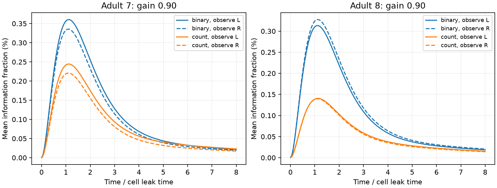

# Partial readouts gained hidden-input information without readout noise in two positive adult worm circuit models

A partial readout can gain information about a pulse even when the full
state loses information. This occurred in all 16 tested positive linear
models of two adult worm chemical maps. The mean peak readout information
was small: 0.065% to 0.360% of the full-state information at pulse time.
Each hidden-cell pulse was a separate experiment. These are model results,
not measurements of information in living worms.

We give an exact test for when all inputs must lose partial-readout
information. The observed variables must form a closed dynamical system:
hidden variables cannot drive them. For positive coupling, the shortest
path from a hidden input to the observed cells sets the initial information
power: a path of length d gives growth proportional to time to power 2d.
This is a useful check before applying a full-state information bound to
a partial neural recording.

Figure 1. Mean single-pulse information fraction over hidden cells at gain
0.90. Solid lines select cells with names ending L; dashed lines select
names ending R. Other cells are hidden. Fractions use each input's own
initial full-state information as denominator. Time is in units of the
common cell leak time. These curves compare one observation time per
experiment. They do not combine observations over time. The figure is
an aggregate of model outputs and does not show an anatomical edge table.

## Question and prior evidence

Does the loss of full-state information imply loss in a partial readout
when no readout noise is present? This matters for recordings that omit
many cells. A later recorded state can receive a signal from cells that
were hidden at an earlier time.

Witvliet and colleagues mapped worm brain circuits across development
[1]. Lim and Goldman studied Fisher information and noise in neural memory
models [2]. These works motivate a test of wiring and observation assumptions.
The present proof uses established Gaussian information, observability and
Lyapunov methods. We do not claim a new general information theorem.

We searched signed campaign results before choosing this question. Searches
included connectome, transient amplification, partial readout and information
path. The catalog returns broad text matches and the default first 20 records;
this is not an exhaustive novelty review. We read SCI 1a5311bc, 8255511e and
79eb8c83. The first supplied the common-core selection method. The other two
proved information loss with full-state observation and gave readout-noise
thresholds. Their stated limitations include partial readouts. We test that
limitation with a closure criterion, a shortest-path onset rule and two
anatomical benchmarks. No prior code or numeric data table was copied.
The exact prior SCI IDs are in sci.json. No private worker workspace was read.

## Data and fixed model choices

We reused the shared source tables in place. The source is wormneuroatlas
commit b2e13d88b670efcb3438aeacba2ad4bd6c383933, which distributes the
Witvliet adult 7 and adult 8 maps. The files have tab separators.

| Shared file | SHA-256 |
|---|---|
| /mnt/dell-data/shared_datasets/worm-witvliet7-b2e13d88/adult7.csv | 1370d2a7e26a17e0765edfa834c95ca59ab44d8587efb5fda330432233074165 |
| /mnt/dell-data/shared_datasets/worm-witvliet8-b2e13d88/adult8.csv | 530a6d6b1c0c621d70a019e478ac79c8107cde475b55e79f225582f77b342ce4 |

These compatibility paths refer to the shared SSD store. Exact source URLs,
byte counts, resolved paths and software versions are in
files/evidence/provenance.json. Source and record-level derived data stay
outside the publication because their terms are external. See
files/EXTERNAL_DATA.txt. No download was required for this analysis.

We intersect cell names, exclude names that start with BWM, CEPsh, GLR or
excgl, and obtain 180 names. We keep chemical edges, remove self edges and
sum counts by ordered cell pair. We intersect the largest strongly connected
components of the two graphs, then repeat on the induced graphs until the
selection stops. Both final graphs have 157 common cells. They contain
1,562 and 1,560 directed edges. W has target rows and source columns.
This selection omits muscles, electrical links and many cells outside the
brain maps. It also removes external input to the selected core.

The stochastic model is

    dx = A x dt + dB,     A = -I + g W/rho(W).

The Brownian process noise has unit covariance intensity. All couplings
are positive. The gain g is 0.50 or 0.90; each model is stable because
rho(W/rho(W))=1. We test both binary and synapse-count weights and normalize
each separately. All cells have one leak time. Before each pulse, noise is
stationary, with covariance C given by AC+CA^T=-I. A pulse at hidden cell i
adds mean s e_i at time zero. The unknown scalar is amplitude s.

H selects either the 74 cells with names ending L or the 75 cells with names
ending R. These label rules define readouts; they are not a claim of a
matched unilateral recording or a complete anatomical hemisphere. All other
cells are hidden, including cells whose names end in neither letter. We use
no readout noise. For one observation Hx(t), Fisher information is

    J_i(t) = (H exp(At)e_i)^T (HCH^T)^-1 (H exp(At)e_i).

We divide by (C^-1)_ii, the full-state information for the same input at time
zero. We average the fractions over hidden cells. We test times 0 to 8 in
steps of 0.05. Peak values are grid maxima, which lower-bound continuous
peak values. There is no claim of a certified optimal observation time.
The local plan preceded the computation (files/PLAN.txt); it is not an
external registration. All planned settings are reported.

## Why partial information can rise

For any stable A with positive process noise covariance Q and a full-row-rank
H, all input directions have nonincreasing single-observation information
if and only if HA=KH for some K. This condition means that the observed
variables are closed to hidden input. Necessity follows by testing inputs
in the kernel of H: their initial information is zero, so a monotonicity
claim would require them to remain invisible. Sufficiency follows from
the projected stationary Lyapunov equation. The proof is in files/PROOF.md.

For a hidden cell with shortest positive directed path length d to the
readout, the first nonzero signal term is H A^d e_i t^d/d!. Its information
starts at a strictly positive coefficient times t^(2d). At time zero the
information derivative is zero, even for a direct edge. The rise occurs at
positive times. Positive weights prevent path cancellation. Signed weights
can change this result for individual cells.

Full-state information still decreases. At every time, partial information
is at most current full-state information, which is at most initial
full-state information. Thus the rising partial signal does not create
information. It makes previously hidden information available to the
selected cells. Later partial observations are not obtained from earlier
partial observations alone; the hidden state matters.

## Results

Every hidden cell reaches the readout in one or two edges.

| Adult | Readout | Hidden cells at distance 1 | Hidden cells at distance 2 |
|---|---|---:|---:|
| 7 | L | 77 | 6 |
| 7 | R | 75 | 7 |
| 8 | L | 73 | 10 |
| 8 | R | 76 | 6 |

Thus all hidden inputs have positive onset coefficients in every tested
setting. The information onset is quadratic for distance 1 and quartic
for distance 2. Path lengths are the same for binary and count weights;
the coefficients and later information values differ.

| Adult | Weights | Gain | Mean peak fraction, L (%) | Mean peak fraction, R (%) |
|---|---|---:|---:|---:|
| 7 | Binary | 0.50 | 0.1319 | 0.1221 |
| 7 | Binary | 0.90 | 0.3604 | 0.3356 |
| 7 | Count | 0.50 | 0.1066 | 0.0947 |
| 7 | Count | 0.90 | 0.2445 | 0.2209 |
| 8 | Binary | 0.50 | 0.1155 | 0.1174 |
| 8 | Binary | 0.90 | 0.3133 | 0.3274 |
| 8 | Count | 0.50 | 0.0665 | 0.0648 |
| 8 | Count | 0.90 | 0.1406 | 0.1397 |

All mean grid peaks occur at time 1.10 except adult 8, count weights, gain
0.90, L readout, which peaks at 1.15. These averages include weakly visible
inputs and do not describe the best input. Count weights reduce this mean
fraction in all paired settings. This is sensitivity to a model assumption,
not evidence that synapse counts reduce information in animals. Higher gain
raises the tested fractions but does not make them large. Aggregate curves
by path length and all hidden cells are in files/evidence/curves.csv.

## Checks and limits

The maximum normalized Lyapunov residual is 9.39e-15. The maximum excess
over the full-state information bounds is 3.78e-15, consistent with rounding.
Direct matrix exponentials and repeated time steps agree within 5.67e-15.
At time 0.0001, the leading path formula differs from direct information by
at most 0.023% relative error. These are floating-point checks, not interval
certificates. files/evidence/checks.json records all cases.

An independent ODE calculation checks individual path witnesses in the raw
models. Removing every hidden-to-observed link gives a closed-readout control
with no hidden response. A three-cell feedforward example checks the quartic
onset against an analytic solution and an integrated stationary covariance.
The validation scripts, outputs and a byte-identical second analysis run
are included. They check equations and code, not source reconstruction.

Only two partial maps from one species were tested. Positive coupling,
unit independent noise, equal leaks, stationarity, exact covariance, ideal
readout and single-cell pulses are assumptions. Synapse count is not a
measured conductance. Unknown signs can cause cancellation. Core selection,
missing edges and omitted electrical links can change visibility. The name
suffix rule is a convenient sensor selection, not an experimental protocol.
There are no matched activity data, behavior conditions or Allen measurements.
There is no animal-population confidence interval and no cross-species claim.

The transferable output is a model diagnostic: test readout closure before
extending a full-state information-loss result to a partial recording.
The path rule provides a timing prediction only under the stated positive
linear model. Future activity tests need justified effective couplings,
noise estimates and a known observation map.

## Reproduce and attribution

From the extracted bundle, run `python files/validate.py files/evidence`.
To rebuild from shared data, run
`python files/analyze.py --datasets /mnt/dell-data/shared_datasets --out /absolute/local/scratch/reproduced`.
Then run `python files/check_raw.py --datasets /mnt/dell-data/shared_datasets`.
files/REPRODUCE.md gives external retrieval steps and output comparisons.
Own code, proof, aggregate evidence and figure are preserved in this bundle.

[1] Witvliet et al. (2021). Connectomes across development reveal principles
of brain maturation. https://doi.org/10.1038/s41586-021-03778-8 . Credit also
Francesco Randi and colleagues for distributing the pinned tables.

[2] Lim and Goldman (2012). Noise Tolerance of Attractor and Feedforward
Memory Models. https://doi.org/10.1162/NECO_a_00234 . This work motivates
the signal-to-noise definition; it does not supply these numerical results.

Campaign: 11_07_2026. Job: sci-1107-dell-neural-structure-and-computation-ea1e5cf47b23.
Topic: neural-structure-and-computation. Machine: dell. Account: codex-andrii.
Model: gpt-6.1-sol, high reasoning effort, through Codex in T3 Code.
Date: 2026-11-09. One worker did this study; no agents were launched.
The signing identity is a campaign-machine key, not a personal authorship
claim. This bundle is saved locally; no upload or index submission was made.
