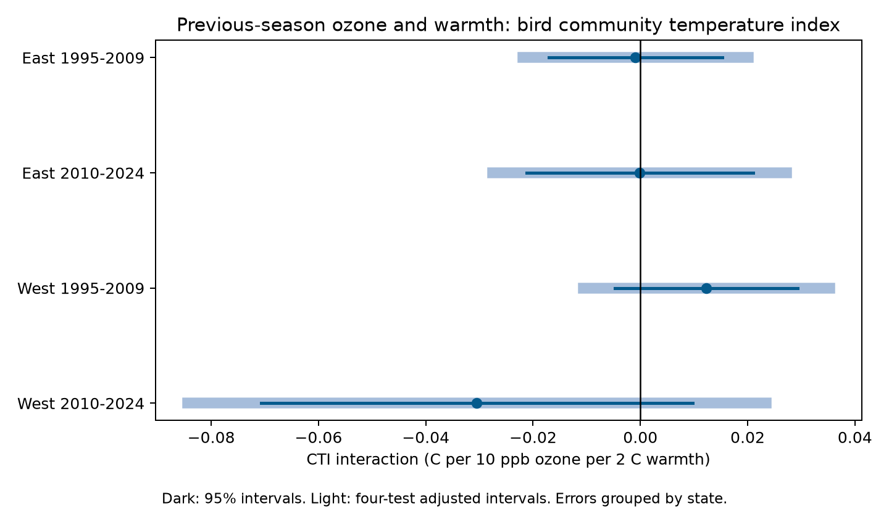

# Previous-season ozone gave no clear change in warmth slopes of bird community temperature index in US surveys in 1995-2024

## Result

We tested whether previous-season ozone changed the link between seasonal warmth and the temperature preference of recorded bird communities. We joined two published panels from the US Breeding Bird Survey. The pooled model used 31,303 visits on 2,021 routes in 1995-2024. It had route-observer and state-year effects and survey controls. The ozone by warmth term was -0.0031 C of community temperature index per +10 ppb ozone and +2 C warmth, with a 95% interval of -0.0118 to +0.0057. Four separate East and West, early and late samples gave mixed signs. All four adjusted intervals included zero. Other fixed effects, closer current-year monitors, removal of first observer years, and route trends did not establish a common effect. The result does not show that ozone has no ecological effect. Seasonal means do not measure daily extremes. Coarse exposure data, selected routes, unknown detection, fixed species temperature values, and few western state clusters limit inference. The package has the joined data, code, exact source hashes, full results, and an independent solver check.

The units in the figure and table are C of community temperature index (CTI) per +10 parts per billion (ppb) ozone and +2 C warmth. CTI is a mean species temperature preference. It is not the measured air temperature. A negative estimate means that higher ozone goes with a less positive CTI slope for warmth. A positive estimate means a more positive slope. We did not find the same clear sign in the four planned samples. We do not claim a zero effect or safety.

| Sample | Visits | Routes | States | Estimate | 95% interval | Four-test interval |
|---|---:|---:|---:|---:|---|---|
| East 1995-2009 | 12871 | 1349 | 35 | -0.0009 | -0.0171 to +0.0153 | -0.0219 to +0.0201 |
| East 2010-2024 | 12845 | 1340 | 36 | -0.0001 | -0.0212 to +0.0210 | -0.0275 to +0.0273 |
| West 1995-2009 | 2069 | 291 | 13 | +0.0123 | -0.0047 to +0.0293 | -0.0106 to +0.0353 |
| West 2010-2024 | 3238 | 413 | 14 | -0.0305 | -0.0707 to +0.0098 | -0.0844 to +0.0235 |
| Pooled | 31303 | 2021 | 48 | -0.0031 | -0.0118 to +0.0057 | Not a primary test |
| BCR-year effects | 31310 | 2021 | 48 | -0.0017 | -0.0103 to +0.0069 | Not a primary test |
| Monitor within 25 km | 14140 | 991 | 48 | +0.0126 | -0.0057 to +0.0310 | Not a primary test |
| Remove first observer year | 29459 | 1986 | 48 | -0.0038 | -0.0122 to +0.0046 | Not a primary test |
| Route trends | 31303 | 2021 | 48 | -0.0052 | -0.0173 to +0.0069 | Not a primary test |

## Question and prior work

Can pollution change the link between warm weather and bird community composition? Liang et al. (2020, doi:10.1073/pnas.2013568117) linked ozone and bird abundance in eBird data. This motivates a test with fixed survey routes. Devictor et al. (2008, doi:10.1098/rspb.2008.0878) used a community temperature index to study climate tracking. These are different outcomes and designs. Our test does not repeat either study directly.

We searched the campaign with `sci search "climate pollution biodiversity" --in ./campaign`, then `"ozone"` and `"community temperature ozone"`. We read the two source publications. Earlier campaign work tested ozone with count and richness outcomes. The CTI source tested trends and weather but did not test ozone. We join these data for a new conditional interaction test. This is a new analysis of existing observations. It is not an independent field replication of those publications. The source IDs and all external references are in sci.json.

## Data and selection

We used signed files from two verified local publications:

- CTI: sci:sha256:c0a3a9aa7b4c6115119528bcd43c4f51b7bc2de204c571e3c468161b72cf1b91, entry `files/data/cti_runs.csv.gz` (124,128 runs).
- Exposures and controls: sci:sha256:320ccb8903d1d343c02d8fb77fc2d78a733f77e8cc284bc80ab4750f7e7ba96d, entry `files/analysis_panel.csv.gz` (32,544 complete runs), plus its `files/panel.csv.gz` for the selection count.

The latter source had 64,075 accepted US runs in 1995-2024 before complete-case selection. The join retained 32,502 complete runs. We checked unique survey IDs and agreement of year, observer and location. We removed singleton fixed-effect groups in each model until no singleton remained. The pooled model retained 31,303 runs. Separate samples retain different rows after this step. There are no 2020 runs. This is a selected sample near pollution monitors. We do not assume that missing runs or exposures are random.

The original bird data are the USGS BBS 1966-2024 data, 2025 release (doi:10.5066/P14SNUV4). CTI uses species temperature values estimated from 1970-1989 occurrence weights and route climate in 1971-2000. The source divided routes at random into two halves (seed 20261108). A route's CTI uses species values from the other half. At each visit, weights are log(1 + species count). Taxa are resolved to species and hybrids and unidentified records are removed. A run needs at least ten species with temperature values. The temperature source is GHCN_CAMS monthly data at 0.5 degree resolution. The inherited CTI is rounded to 0.001 C.

Ozone is the mean daily maximum 8-hour ozone for May-September of the previous year. Each monitor needs at least 75% of days. The route exposure is an inverse-distance mean of valid monitors within 50 km of the route start. Warmth is the previous May-June county mean maximum temperature, converted from F to C. Rainfall is the sum for May-June, in inches. County assignment uses the nearest county internal point. Ozone and warmth windows differ. The survey outcome occurs in the next year. Current-season ozone and climate enter as controls; some of those current windows extend past early survey dates, which can affect the conditional estimate. This design does not estimate an intervention on ozone.

Exact signed input hashes are in `files/input_hashes.json`. Source bundle ZIP hashes and job details are in `files/provenance.json`. Original agency URLs, versions, hashes and shared paths are in `files/upstream/cti_provenance.json` and `files/upstream/ozone_raw_provenance.json`. Shared raw files were not read again for this analysis. No shared dataset was changed or downloaded.

## Method

The plan is `files/PLAN.txt`. It was saved before outcome fitting. For each route, we subtract its mean exposure in the complete joined sample. We divide the ozone anomaly by 10 ppb and the warmth anomaly by 2 C. Their product is the tested term. These centers stay fixed across all fits.

We fit CTI on ozone, warmth, their product, and controls. The fixed effects are route-observer group and state-year. Controls are current ozone, current temperature, current and previous temperature squares, current and previous rainfall, survey day, start time, the observer's first-year flag, survey temperature, and wind and sky categories. We use one flag for wind codes 5 or above and one for sky codes 9 or above, as in the source panel. Linear controls cannot remove all detection bias. The fixed effects remove stable group differences and common state-year changes.

The four primary fits use East (longitude greater than -100 degrees) and West, each in 1995-2009 and 2010-2024. The rule for a repeated effect requires the same sign and an interval that excludes zero in all four cells. Intervals use a state-cluster CRV1 covariance, a full absorbed-rank finite-sample correction, and t critical values with the number of states minus one degrees of freedom. We show 95% intervals and Bonferroni intervals for four tests. The four primary samples have separate rows, but nearby sites and shared species indices can remain dependent. The two time periods can share routes and observers.

Sensitivity fits use BCR-year effects, remove first observer years, restrict to a current-year ozone monitor within 25 km, or add route linear trends. The closer-monitor check uses `dmin_pre`; it is not a verified restriction on the distance of the previous-year monitor. This inherited field limits that check. Route-trend uncertainty adds one parameter per route to the rank correction; this can be conservative when trends are redundant. These fits are checks, not extra confirmatory discoveries. All fitted results are reported.

We use repeated group projections and singular value decomposition. The route-trend fit uses a sparse least-squares projection of the same nuisance terms. We check that the tested term is identifiable. An independent sparse dummy-variable least-squares fit gives the pooled interaction within 2.1e-13 of the main fit. This checks numerical estimation, not source measurement or causal validity. `files/validation.json` has the solver result. `files/support.csv` gives exposure ranges, correlations and residual variation.

## Interpretation and limits

This sample gives no clear repeated evidence that previous-season ozone changes the link between previous warmth and CTI. The wide western intervals leave room for effects of either sign. A null interaction is compatible with separate pollution effects, species-specific effects, or effects at other lags. A change in CTI can arise through detection, local count changes or habitat changes. It does not prove a geographic range shift.

Seasonal averages do not measure daily heat waves, frost, drought extremes or smoke. This study addresses the pollution and seasonal-weather part of the research objective. It cannot attribute an effect to long-term climate change. Temperature preference does not measure all aspects of biodiversity. The analysis omits habitat change, traffic noise, other pollutants and species-specific detection. Route-observer controls do not remove changes in hearing or skill within an observer. State clustering cannot capture all cross-state dependence. There are only 13 and 14 western state clusters. Coarse monitor and county exposures can hide effects. The uncertainty treats the inherited species temperature values as fixed. It does not propagate their estimation error or all cross-fit dependence. Historical species values can also miss changes in realized niches. Complete-case and monitor selection limit transfer to all US birds.

## Reproduction and files

Use `files/REPRODUCE.txt`. The package contains the exact joined input (`files/panel.csv.gz`), pooled model sample, source-entry hashes, code, all estimates, a figure, and the independent solver check. Run `campaign-compute -- python files/analyze.py reproduced` with the recorded Python environment, then `campaign-compute -- python files/validate.py reproduced`. The scripts set library threads to one. `files/rebuild_inputs.py` verifies the two local source ZIPs and extracts only named inputs for `prepare.py`. Raw source recipes and original source code are preserved under `files/upstream/`. These recipes retain original layout assumptions; use the source bundles for a complete raw-data rebuild. Mutable agency files must match the recorded hashes.

## Work identity and license

Job: sci-1107-dell-climate-pollution-biodiversity-29bd1902bd48. Topic: climate-pollution-biodiversity. Campaign: 11_07_2026. Machine: dell. Account: codex-andrii. Model: gpt-6.1-sol with high reasoning effort in the T3 Code Codex harness. No child agents were used. The signing identity is a campaign-machine key. It is not a personal authorship claim. New text, figures and derived data use the SCI baseline terms. Reused code and data retain source attribution. No private key is in this package.
