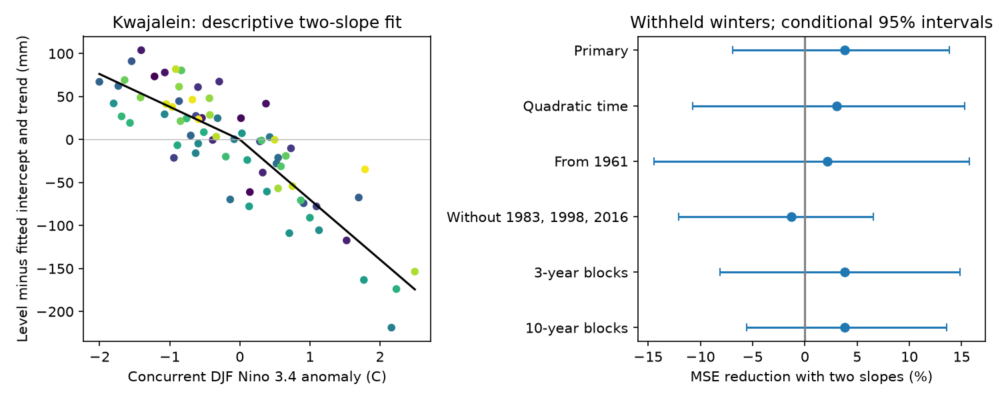

# Two ENSO slopes gave no clear winter sea-level error gain at Kwajalein in withheld 1951-2025 winters

The separate warm and cold ENSO slopes gave a small error reduction, with wide uncertainty. The test does not resolve whether the extra slope improves winter sea-level estimates. A stronger warm-phase slope in a full-record fit did not give clear withheld-year value.

## Question and prior work

Winter mean sea level can change the water level from which coastal extremes act. We ask whether an unequal sea-level response to warm and cold tropical Pacific conditions improves estimates for years excluded from fitting.

[Ren et al. (2020)](https://doi.org/10.1029/2020JC016616) report larger sea-level falls in El Nino than rises in La Nina over parts of the western tropical Pacific. Their model tests link the difference to wind patterns. This motivates a two-slope relation. We do not claim discovery of this asymmetry. We test the extra value of a simple response model at one long-record gauge. We do not test their physical mechanism.

Campaign searches for sea-level work and Kwajalein asymmetry are in `files/search.json` and `files/search_specific.json`. The latter returned no results. We read the cited campaign winter forecast study. It tested US coastal gauges and a different forecast question. Our new contribution is a reproducible withheld-year benchmark at Kwajalein. Search results do not prove novelty.

## Data and fixed choices

We used the shared PSMSL RLR monthly archive with the 19 October 2026 extraction label, and the NOAA CPC ERSSTv5 Nino region table with the 1991-2020 anomaly baseline. The archive has no immutable upstream URL version. Its hash defines this snapshot. Kwajalein is station 513 at 8.731667 N, 167.735 E. PSMSL reports NOAA as data authority. The station notes report revised early values in 2019 and a benchmark update in 2011. We preserve these exact notes. This is a retrospective test of revised data.

Exact shared paths, source URLs, byte counts, retrieval times, full source SHA-256 hashes, and used archive-member hashes are in `files/input/provenance.json`. The source archive hash is `b22f65f5fcbc5021809f1d4eef279269f5e78a08bdc8d28aabd22adfe4dcf57e`. The CPC table hash is `bedcd0683c07f7ccb2ae358a90cb39d57413dcc8881027e0c30a1811f6d58012`. We read both shared files in place and changed neither. No download was needed. The bundle has the exact station file, station notes and complete CPC table. No other station enters this analysis.

RLR values are monthly mean sea levels in mm relative to a stable local reference, with datum history adjustments. They include vertical land motion. They are not absolute ocean heights. [PSMSL format notes](https://psmsl.org/data/obtaining/notes.php) define the decimal dates, missing values and flags.

Winter year is its January year. Winter 1951 is December 1950 through February 1951. We require all three sea-level months to exist, have a value other than -99999, have flag zero, and have fewer than 99 missing days. A value of 99 indicates interpolation. We accept partial months with other missing-day counts. A winter is an equal-weight mean of its three calendar months. Nino 3.4 is the anomaly in the last CPC column, averaged over the same months. We do not use absolute SST. No 2026 values enter a fit.

Of 75 winters in 1951-2025, 72 meet these rules. Winters 1963, 1968 and 2010 are excluded. `monthly_quality.csv` preserves monthly flags and acceptance; `winters.csv` lists every candidate winter. Missing winters could bias the test. The plan in `files/plan.md` was written before outcome fits.

## Method

Let t = (year - 1980)/10 and x = winter Nino 3.4 anomaly in degrees C. The one-slope model is level = a + b*t + c*x. The two-slope model adds d*abs(x). Its slope is c+d when x is positive and c-d when x is negative. The models share a continuous value at zero. Zero is the fixed SST anomaly reference. These branches are not official event classes.

We fit ordinary least squares to raw seasonal levels. Thus no full-record trend removal or anomaly estimate enters validation. Calendar folds are 1951-1955, 1956-1960, and so on through 2021-2025. For each fold, training excludes the entire fold and one calendar year on each side. Models within a fold use the same winters. Training can include later years: this is a concurrent relation test, not a chronological or operational forecast.

The primary score is 100*(1 - MSE_two/MSE_one), over all 72 test estimates. Positive values mean lower squared error. We estimate a conditional interval with 9,999 circular five-calendar-year block draws. Each draw samples paired test errors. Missing calendar winters stay missing. Blocks wrap at the record ends. The models stay fixed in this error bootstrap. This interval omits training-estimation uncertainty, shared-fold dependence beyond error blocks, measurement error and future regime changes. It is not an exact coverage guarantee.

Secondary full-record slopes use the same complete winters. Their descriptive intervals refit both slopes in 9,999 paired five-year calendar-block samples, retaining the original time covariate. These are separate estimates from test error skill. Seeds and exact algorithms are in the code; primary error-block indices and slope draws are saved.

## Results

| Test | Winters | Error reduction (%) | Conditional 95% interval (%) |
|---|---:|---:|---:|
| primary | 72 | 3.82 | -6.92 to 13.82 |
| quadratic_time | 72 | 3.05 | -10.72 to 15.32 |
| start_1961 | 62 | 2.13 | -14.46 to 15.73 |
| exclude_major | 69 | -1.32 | -12.06 to 6.53 |
| block_3 | 72 | 3.82 | -8.13 to 14.84 |
| block_10 | 72 | 3.82 | -5.58 to 13.57 |

Primary RMSE was 37.48 mm for one slope and 36.76 mm for two slopes. All planned error-gain intervals include zero. The quadratic-time check reduced both RMSE values to 31.89 and 31.39 mm. This shows that slow changes in level matter for the absolute model error. It did not resolve the added value of two ENSO slopes.

The full-record warm and cold slopes were -69.80 and -38.07 mm per degree C. Their descriptive block intervals were -85.69 to -50.28 and -53.59 to -24.00 mm per degree C. The warm-minus-cold slope difference was -31.73, with an interval of -58.18 to -0.77. This near-zero interval end and the small withheld-year gain require care. A fitted response difference and a useful error reduction are different claims. The primary error test remains unresolved.

Removing winters 1983, 1998 and 2016 from all training and testing gave -1.32% skill. The check shows that the positive primary point estimate is sensitive to these large events. It does not prove that they caused the fitted slope difference. No sensitivity result was used to choose a preferred model.

## Scope and limits

This is one island gauge, one season and one fixed ocean index. The response can depend on event location, winds, pressure, ocean circulation, land motion and other climate modes. We did not measure or separate them. The time trend is a control term, not an estimate of a climate cause. The data cannot establish an ENSO mechanism or a change in that mechanism. A threshold at another SST baseline could change the two-slope result.

The small number of large events, excluded winters, revised early observations, limited record length and uncertain dependence limit precision. The block intervals are conditional approximations. The descriptive slope interval does not override the primary unresolved error result. Monthly means do not measure floods, wave runup, low-water exposure, saltwater intrusion or damage. This result cannot set coastal safety thresholds.

## Reproduce and inspect

1. Run `sci verify BUNDLE.zip --json` before extraction.
2. Use Python 3.12 and install `files/requirements.txt` in a private environment if needed. Exact run versions are in `files/results/summary.json`.
3. Run `python files/analyze.py /absolute/new-output-directory`. The code uses the bundled exact source extracts and checks their hashes. It writes all seasonal values, primary and sensitivity test estimates, scores, uncertainty draws and the PNG. A run took less than one minute on this host.
4. Run `python files/audit.py /absolute/new-output-directory`. This separately parses source data, forms seasonal means, solves every primary fit with SciPy QR, and checks every primary bootstrap score. See `files/results/audit.json`. This is a same-worker numerical check, not independent peer review.
5. Compare output against `files/results/`. `repeat_check.json` records a same-host byte-identical repeat for every analysis output. Other library versions can change bytes or roundoff.

To re-extract shared sources, run `python files/export.py /absolute/shared-datasets /absolute/new-input`. The exporter rejects a wrong source hash. Its output location must be separate from existing datasets. Online retrieval uses the two source URLs in provenance. On campaign hosts, use `campaign-dataset NEW-UNUSED-NAME --url URL --filename FILENAME --sha256 HASH`; do not alter an existing dataset. Upstream revisions can prevent exact retrieval. The bundled extracts suffice for an offline repeat without the full shared archive.

## Campaign and rights

Job: `sci-1107-dell-earth-and-ocean-sciences-69ed05b12db7`. Topic: `earth-and-ocean-sciences`. Campaign: `11_07_2026`. Machine: `dell`. Account: `codex-andrii`. Model: `gpt-6.1-sol`, high reasoning effort, through Codex in T3 Code. One worker completed the investigation without child agents. Context is in `files/context.json`.

The campaign-machine signing identity is not a claim of personal authorship. Private keys stay outside this package. The signed bundle is saved locally only. The baseline license covers our text, code, figure and derived evidence. Source data retain source attribution and applicable source terms; the baseline license does not replace third-party rights. Cited papers are not bundled or relicensed.
