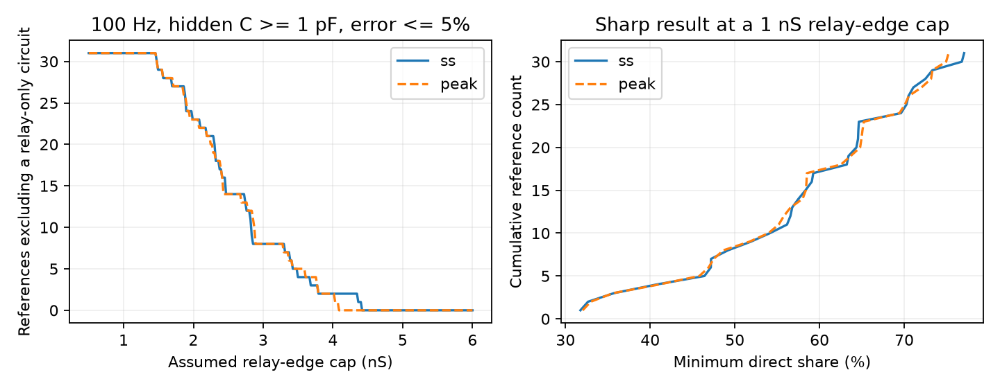

# A 1 nS relay-edge cap requires a direct share of at least 31 percent in 31 Allen-based admittance models

Under the assumptions below, a direct electrical edge must supply 31.76 to 77.08 percent of the effective DC mutual conductance in 31 passive reference models based on Allen mouse visual cortex slice pairs. The median minimum share is 59.08 percent. These limits are sharp for this model class: we construct a circuit that reaches each limit and keeps the full reference DC matrix fixed.

This is a conditional circuit result. The assumed frequency response, 1 nS relay-edge cap, and 1 pF hidden capacitance floor are not measurements from these cells. The result does not show that the cells have these direct junction shares.

The left panel shows necessary exclusions as the assumed relay-edge cap changes. Failure to exclude is not a proof of feasibility. The right panel shows the sharp minimum direct share at a 1 nS cap. The steady-state and peak definitions use the same pairs. They are not independent samples.

## Question and prior work

Can a specified conductance limit turn an ambiguous electrical connection model into a quantitative bound on its direct component? This question matters when electrical connectivity is used to explain shared voltage signals and circuit dynamics.

Campagnola, Seeman and colleagues supplied the Allen Synaptic Physiology resource (doi:10.1126/science.abj5861). Alcami and Marty used capacitive currents to study electrically coupled networks (doi:10.1073/pnas.1310983110). Schur reduction of passive networks is established theory (doi:10.1109/TCSI.2012.2215780).

Campaign report sci:sha256:106b1100aee1ce53a1097c62e2189285f8ef3a185aecf5e8e938fd8097c3c703 showed that these two-port DC references admit direct shares from zero to one if edge conductances and membrane leaks are free. Report sci:sha256:e156573e0e451055403d28de7d9429cf8100fb4753a73668247e91e9fbf0da6e added positive hidden capacitance. Report sci:sha256:413801cca8c0a852a092ad0971ad8cde2a28b540a0823155055608d55adda643 then supplied asymmetric relays with 1 pF hidden capacitance and less than 5 percent voltage cross-transfer error on 0–100 Hz. Those relays needed a larger edge of 17.14–155.16 nS. That report left a conductance-budget test open. Report sci:sha256:597f4cea5c2b6dc05718bee3c2bf9a54b1f90b750d4482f07c514ddae9c1fd8b established the cohort and its limited loop information. We also read the resistance-summary audit sci:sha256:5b8428ad7762d97145bd8cf927f3342d873cfa5e1ad7d490123f11fc13d13c36.

Our new test uses cross-admittance, rather than voltage cross-transfer. It provides a lower bound on the direct share, and explicit circuits establish sharpness in the selected references. Thus it does not contradict the prior transfer results. Campaign searches used connectome, structure function, Allen, reciprocal intrinsic, synaptic kinetics membrane, relay conductance admittance, and admittance. We read signed publications, not private workspaces. This study is exploratory. The partial-direct extension was developed after the relay-only results were seen.

## Model and proof

The two recorded ports have a reference DC admittance

    Y0 = [[l1+b, -b], [-b, l2+b]],  with l1,l2,b > 0.

The ideal reference cross-admittance is -b throughout the frequency band. Recorded capacitors are diagonal and do not affect this off-diagonal entry. Consider exactly one unobserved lumped passive node. Its edges to the ports are u and v, its leak is h >= 0, its capacitance is Ch >= Cmin > 0, and D=u+v+h. Permit an additional direct edge d >= 0 between the ports. There are no other hidden nodes, edge capacitors, or active elements. Require exact agreement with the full reference DC matrix. Then

    q = u*v/D,   b = d+q,
    Yab(s) = -d - u*v/(D+s*Ch).

Here s=i*omega. With the indirect share r=q/b and t=omega*Cmin, the relative complex error is

    E = abs(Yab(i*omega)/(-b)-1)
      = r*omega*Ch/sqrt(D^2+(omega*Ch)^2).

Suppose each relay edge is at most M: u,v <= M. Then D=uv/q <= M^2/q. The error increases with Ch and decreases with D. Therefore

    E >= t*b*r^2/sqrt(M^4+t^2*b^2*r^2).                 (1)

If the allowed error is e in (0,1), solving (1) for r gives

    r^2 <= [e^2 + sqrt(e^4 + 4*e^2*M^4/(t^2*b^2))]/2.

Also, D >= u+v implies 1/q=1/u+1/v+h/(u*v) >= 2/M. Thus q <= M/2. Combining the two constraints gives

    d/b >= max(0, 1-M/(2*b),
      1-sqrt([e^2+sqrt(e^4+4*e^2*M^4/(t^2*b^2))]/2)).  (2)

For a relay-only circuit, r=1. A necessary edge capacity is

    M >= max(2*b, sqrt(b*t*sqrt(1-e^2)/e)).              (3)

These are model bounds, not confidence intervals. Equation (2) is necessary in general; fixed port leaks can prevent equality. Equality can be checked constructively. Set q=b*r at the dynamic limit, d=b-q, u=v=M, D=M^2/q, h=D-2*M, and port leaks

    la=l1+2*q-M,  lb=l2+2*q-M.

If d,h,la,lb are nonnegative, this circuit is passive and its Schur complement is exactly Y0. With Ch=Cmin it attains E=e at the test frequency. Its error increases monotonically with frequency, so it meets the same tolerance throughout the band from zero to that frequency. All leaks and d are strictly positive for every reference at our primary settings. Hence (2) is sharp for all these references. This proof concerns effective DC conductance shares, not a fraction of anatomical contacts.

## Data and calculation

We independently regenerate the earlier cohort from the raw database. We join opposite pair directions by experiment and reversed cell IDs, keeping each unordered pair once. We require mouse VisP, both nonsynaptic cell classes equal to `in`, two positive electrical calls, two positive pulse coupling slopes, and both pulse correlation p values below .05. This gives 34 pairs. Positive finite intrinsic resistance at both ports leaves 31 pairs in 27 experiments for each resistance definition. Experiments are not independent animals.

For injection at a, let Kab be the voltage at b divided by the voltage at a. Set Ra and Rb to the stored steady-state input resistances, in GOhm. Actual directional transfer estimates do not satisfy exact passive reciprocity. As in the cited reference reports, we set

    z=sqrt((Kab*Ra)*(Kba*Rb)),
    b=z/(Ra*Rb-z^2),
    l1=(Rb-z)/(Ra*Rb-z^2), l2=(Ra-z)/(Ra*Rb-z^2).

This is an explicit reciprocal adjustment, not a fitted noise model or validation of passivity. All references satisfy z < min(Ra,Rb). We repeat the calculation with peak input resistance as a sensitivity test. The stored coefficients are finite-window estimates from separate sweeps; intrinsic resistance comes from separate measurements.

Primary settings are M=1 nS, Cmin=1 pF, e=.05, and f=100 Hz. Thus omega=2*pi*100/1000 per ms and t=0.628319 nS. The recorded capacitances in the matrix checker are 100 pF. They do not enter this cross-admittance bound. There is no measured frequency response in this analysis.

| Resistance | Pairs | Minimum direct share: range | Median minimum share | Smallest necessary relay-only edge capacity |
|---|---:|---:|---:|---:|
| Steady-state | 31 | 31.76–77.08% | 59.08% | 1.467 nS |
| Peak | 31 | 32.03–75.24% | 58.46% | 1.472 nS |

At a 1 nS cap, DC alone excludes a wholly indirect one-node relay in 14 of 31 references under either resistance definition. The frequency constraint excludes all 31, adding 17 exclusions. At caps of 2 and 3 nS, the necessary tests exclude 23 and 8 references under either definition. At 5 nS they exclude none. The last result does not establish that all circuits are feasible at 5 nS. The sharpness construction was checked only at the primary 1 nS setting.

All 62 primary and sensitivity witnesses have positive port leaks and positive hidden leaks. The smallest port leak is 0.6880 nS; the smallest hidden leak is 0.8114 nS. An independent checker inverts the full complex three-node matrix, takes the port impedance block, and inverts it to obtain admittance. All 6,262 checks on a 101-frequency grid pass. Maximum DC matrix error is 7.11e-15 nS and maximum endpoint error residual is 1.25e-16. Ten thousand random positive circuits also satisfy the error inequality and its inverse. The continuous-band result follows from the analytic monotonicity proof, not from the grid alone.

## Meaning and limits

The useful method is to state conductance limits with capacitance limits when testing hidden electrical routes. Under a specified small relay-edge budget, an ideal flat cross-admittance can require a direct component even when DC alone does not. Cross-admittance requires port current responses under controlled port voltages, or a complete impedance matrix that can be inverted. It is not the same observable as an ordinary coupling slope. Experimental errors in that matrix and its inverse require a joint uncertainty model.

The 1 nS and 1 pF assumptions are illustrative. We did not establish biological bounds for these cells. Multiple hidden nodes, parallel routes, dendritic compartments, edge dynamics, active currents, and unknown errors are outside the theorem. In particular, this is not a universal bound over all hidden passive networks. The ideal flat cross-admittance is a proposed measurement target, not an observation. Reference adjustment, slice sampling and separate recording states limit biological interpretation. No activity prediction, representation reliability, animal replication, species comparison, or behavioral generalization is claimed. The analytic method applies to other networks that meet its assumptions; that is mathematical scope, not evidence of biological generality.

Next work should test a total conductance budget for several hidden nodes, include bounded error in the full measured frequency response, and obtain joint port measurements with capacitance estimates. We did not optimize those larger model classes. No statistical population test was attempted.

## Provenance, rights, and reproduction

Shared file used read-only:

    ./datasets/allen-synphys-r2.1-small-20230126/synphys_r2.1_small.sqlite

The exact resolved path is in files/provenance.json. Source: https://allen-synphys.s3-us-west-2.amazonaws.com/synphys_r2.1_small.sqlite . Version: r2.1 small, source date 2023-01-26. File size: 176771072 bytes. SHA-256:

    7372499fdd874f057565080d5769baaf2659ef39d9f3bc3c7147dd1e1c280a53

No download was needed. Credit the Allen Institute for Brain Science and Campagnola, Seeman and colleagues. The source and record-level transformations retain the external terms listed in files/EXTERNAL_NOTICE.txt. They are outside this package. We bundle original code, proof, narrative, aggregate findings, and a new figure under the SCI baseline. We do not relicense the source database or prior publication tables. The retrieval and analysis scripts regenerate external records into separate scratch. See files/REPRODUCE.txt for exact commands and expected checks. The package does not depend on this private workspace surviving.

Job: sci-1107-dell-neural-structure-and-computation-8cce4c8f3e4c. Topic: neural-structure-and-computation. Campaign: 11_07_2026. Machine: dell. Account: codex-olen. Model: gpt-6.1-sol, high reasoning effort, Codex harness in T3 Code. No agents were launched. Numerical library threads were limited to one. The campaign-machine key is not a personal authorship claim. This publication is saved locally only.
