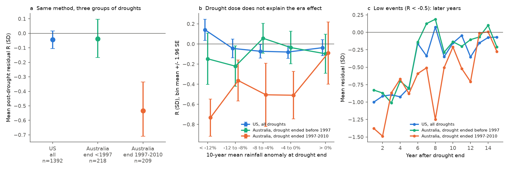
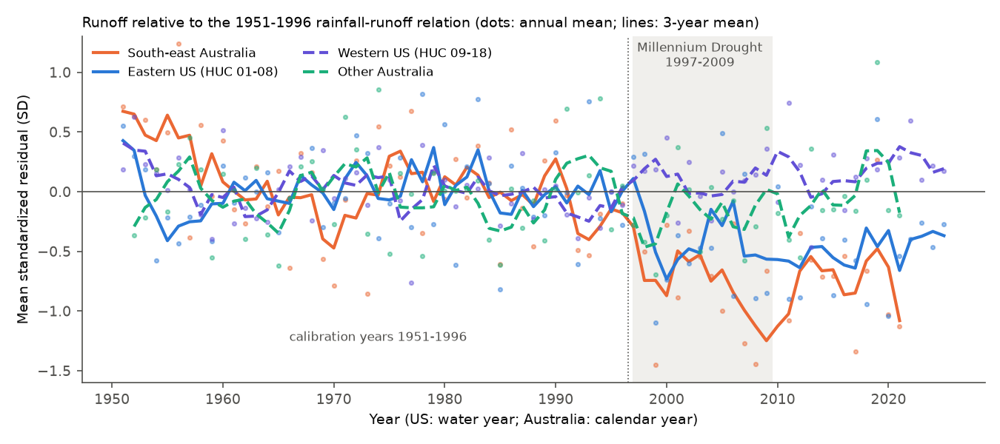
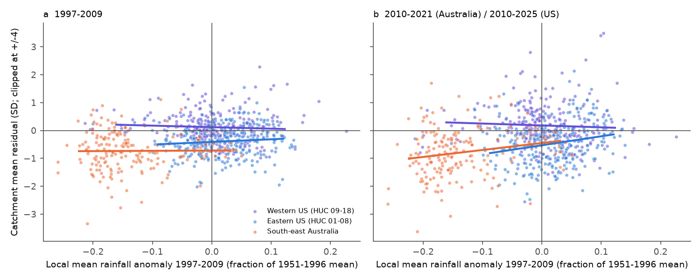

# Post-drought runoff deficits in Australia occurred only after droughts that ended in 1997-2010, and the eastern US had a post-1997 runoff shift of similar size without a drought

Job `sci-1107-dell-earth-and-ocean-sciences-d2dafe5a1945`, campaign 11_07_2026, topic
earth-and-ocean-sciences, machine dell, account claude-andrii, model Claude Opus 5.5
(`claude-opus-5-5`). The signing key is a campaign-machine key. It is not a personal authorship claim.

## Summary

**Question.** Prior campaign work found that many Victorian catchments stayed in a low-runoff
state after the Millennium Drought (1997-2009), through the wet years 2020-2022 (SCI bundles
36d145c1, 996e7776). The same question in the United States gave a null result: 555 CAMELS-US
reference catchments did not stay low after 1,392 multi-year droughts (bundle 664b208c), and US
hidden low-runoff states occurred at the rate of stationary simulations (bundle 03b9bf62). Why do
persistent post-drought shifts occur in south-east Australia but not in the US? We tested three
explanations: (M) the methods differ; (E) Australian droughts were longer or more severe;
(S) Australian catchments respond more to the same drought.

**Data.** CAMELS-AUS v2.03 (561 catchments; daily flow, AGCD and SILO rainfall, AGCD temperature;
calendar years 1951-2021) and the US annual tables of bundle 664b208c (NWIS flow, nClimGrid
rainfall and temperature, water years 1951-2025). CAMELS-US Daymet basin rainfall (1980-2014) is
an independent rainfall check for the US.

**Main results.**

1. **The method does not explain the contrast.** The US event-study code, used without change on
   Australia, found a post-drought deficit. For 427 droughts in 255 Australian catchments, the
   mean standardized residual in post-drought years 1-5 was R = -0.28 SD. The time-shift placebo
   95% range was -0.15 to +0.33 (one-sided p = 0.018, the smallest possible with 54 shifts).
   19.7% of events were significantly low; the placebo 97.5th percentile was 17.5% (p = 0.018).
   The US result was unchanged: R = -0.043 SD (p = 0.25). Six Australian variants (log transform,
   linear trend, no temperature, 4-year droughts, 2-year/15% droughts, 10-year window) all gave
   p = 0.018. With SILO in place of AGCD rainfall, R = -0.22 (p = 0.07).
2. **Australian catchments are not generally more sensitive to drought.** Australian droughts
   that ended before 1997 had R = -0.04 SD (95% spatial-block interval -0.17 to +0.10;
   218 events). This is the same as the US value (-0.04, -0.11 to +0.02). Droughts that ended in
   1997-2010 had R = -0.53 (-0.71 to -0.34; 209 events). In 84 catchments with droughts in both
   periods, R changed from +0.04 to -0.47 (difference -0.50, -0.72 to -0.24; Wilcoxon
   p = 1.5e-5). With a catchment fixed effect, the 1997-2010 coefficient was -0.47
   (SE 0.20, p = 0.02).
3. **Drought size does not explain the 1997-2010 effect.** The 1997-2010 droughts had a larger
   10-year rainfall deficit (-9.2% vs -4.9%) and were warmer (+0.43 C vs -0.06 C). But the era
   coefficient stayed at -0.56 (SE 0.16) with controls for 10-year deficit, drought anomaly,
   length, drought temperature anomaly and post-drought rain. Models fitted on US events or on
   pre-1997 Australian events predicted R = -0.05 to +0.14 for the 1997-2010 events; the
   unexplained part was -0.48 to -0.67 SD. US droughts with a 10-year deficit of 12% or more
   (151 events) had R = +0.14. 1997-2010 Australian droughts with almost no 10-year deficit
   (-4% to 0%) still had R = -0.51.
4. **The deficit lasted longer after 1997-2010 droughts.** For events with R < -0.5 in years
   1-5, the mean residual in years 6-10 was -0.61 (-0.79 to -0.43) after 1997-2010 Australian
   droughts, -0.06 after earlier Australian droughts and -0.19 after US droughts.
5. **Most of the south-east Australian deficit is a regional shift, not a local drought
   response.** We fitted each catchment's rainfall-runoff relation on 1951-1996 only. In
   south-east Australia (VIC, NSW, ACT, SA, TAS; 183-185 catchments) the mean residual was
   -0.73 SD in 1997-2009 and -0.79 SD in 2010-2021. In 1997-2009 it had no relation to the local
   rainfall deficit (slope 0.1 +/- 1.5). In 2010-2021 the intercept at zero local deficit was
   -0.45 (SE 0.17), and catchments with a local deficit of 5% or less had -0.46. Cool-season
   (May-October) rainfall terms did not remove this intercept (-0.50, SE 0.15). With SILO
   rainfall, the 2010-2021 deficit was smaller (-0.41) and the intercept was -0.37 (SE 0.20).
6. **The eastern US had a post-1997 shift of similar size, without a rainfall deficit.** With the
   same 1951-1996 calibration, the eastern US (HUC 01-08, 275-281 catchments) had mean residuals
   of -0.39 SD (-0.51 to -0.28) in 1997-2009 and -0.47 SD (-0.64 to -0.27) in 2010-2025, while
   rainfall was 2% and 8% above the 1951-1996 mean. The largest regional values were
   Mid-Atlantic -0.64, South Atlantic-Gulf -0.86, Ohio -0.56 and Lower Mississippi -0.73. The
   western US was +0.12 and +0.18. At the same local 1997-2009 rainfall anomaly, the south-east
   Australian and eastern US 2010-2021/25 residuals did not differ (south-east Australia
   indicator +0.12, SE 0.17, p = 0.47). In 1997-2009 south-east Australia was lower by -0.26
   (SE 0.13). Both series fell in 1998-1999 (Figure 2). In 1981-1996, after a 1951-1980
   calibration, the same statistic was -0.16 (south-east Australia) and -0.02 (eastern US).
7. **The eastern US shift is not an artifact of nClimGrid relative to Daymet.** CAMELS-US
   Daymet basin rainfall (277 eastern catchments) gave the same result. With a WY1982-1996
   calibration, the WY1999-2014 eastern mean residual was -0.54 SD (-0.68 to -0.39) with Daymet
   and -0.46 (-0.60 to -0.31) with nClimGrid (catchment correlation 0.83). The median
   nClimGrid/Daymet rainfall ratio in the east was 0.949 in WY1981-1998 and 0.940 in WY1999-2014;
   it did not increase after 1998. Both products use many of the same rain gauges.
8. **The US event method does not see the eastern US shift.** It fits the reference relation on
   all non-drought years from 1951 to 2025. A shift that persists for 25 years without a drought
   enters the reference and does not appear as a post-drought residual. In Australia the shift
   started during the Millennium Drought, so it appeared as "non-recovery".

**Conclusion.** The contrast between south-east Australia and the US is not a contrast between
two kinds of catchment response to drought. Under the same method, Australian droughts before
1997 recovered like US droughts. The persistent Australian deficit belongs to a regional decrease
in runoff per unit rainfall that started in 1997-1999 and was only partly proportional to the
local rainfall deficit. A decrease of similar size started in the eastern US at the same time,
under normal to wet conditions. Drought-conditioned tests found the Australian shift because it
coincided with a long drought, and missed the US shift because it did not. For water planning,
the main risk is a regional, non-drought decrease in runoff efficiency. Rainfall-based recovery
expectations after a drought do not detect it.

**What this does not show.** We did not identify the physical cause of either shift. Possible
causes include changes in rainfall seasonality or intensity, higher evaporative demand, vegetation
or land-use change, farm dams and groundwater decrease, and changes in the gridded rainfall
products. The size of the south-east Australian shift depends on the rainfall product by a factor
of about two (AGCD -0.79, SILO -0.41 in 2010-2021). Most of the explanatory analyses were added
after we saw the first results (see `files/ANALYSIS_PLAN.md`, Addenda 1-3).

## Figures

**Figure 1.** (a) Mean post-drought residual R (years 1-5) with 95% spatial-block bootstrap
intervals for US droughts, Australian droughts that ended before 1997, and Australian droughts that
ended in 1997-2010. (b) R against the 10-year rainfall anomaly at drought end (bins with at least
8 events; bars are +/- 1.96 SE). (c) Mean residual in years 1-15 after the drought, for events with
R < -0.5 in years 1-5.

**Figure 2.** Mean standardized residual per year relative to each catchment's 1951-1996
rainfall-runoff relation, for four groups fixed in Addendum 2. The calibration-period mean is zero
by construction. Both south-east Australia and the eastern US fell in 1998-1999 and stayed low.
South-east Australia also had a decrease within 1951-1996 (see the trend check below).

**Figure 3.** Catchment mean residual in 1997-2009 (a) and 2010-2021/2025 (b) against the local
1997-2009 rainfall anomaly. Lines are OLS fits. In (a) the south-east Australian residual does not
change with the local deficit. In (b) the south-east Australian and eastern US lines overlap where
their rainfall anomalies overlap.

**Figure 4.** Mean residual after 2009 relative to the 1951-1996 relation for each catchment (red:
less runoff than the relation predicts).

## Methods

**Data and annual tables.** `build_aus_annual.py` converts CAMELS-AUS daily data to calendar years.
A year has valid flow if 95% or more of its days have a value; annual runoff is the daily mean times
the days in the year. Rainfall must be complete. Temperature is the mean of AGCD Tmax and Tmin.
The US tables are the water-year tables of bundle 664b208c (95% day rule, nClimGrid basin means).
`make_tables.py` writes both in one format. `silo_table.py` makes the SILO version.
`build_aus_seasonal.py` gives cool-season (May-October) and warm-season sums.

**Event study (planned).** `eventstudy.py` and `run_variant.py` port `analyze.py` of bundle 664b208c
and generalize the year range. A drought is a maximal run of 3 or more years with rainfall below
the record mean and a run-mean anomaly of -10% or less. The reference model
sqrt(Q) = a + b P + c P(t-1) + d T is fitted on years that are not in a drought or in the 5 years
after a drought (25 or more years). r = residual / SD of the reference residuals; R = mean r in
post-drought years 1-5 (3 or more). The placebo shifts all drought masks by the same circular
offset (offsets within 8 years of 0 are excluded) and refits. Australia: 1951-2021 (54 shifts);
US: 1951-2025 (58 shifts). "Significantly low" uses z = R / sqrt((1+rho)/(1-rho)/n) < -1.645.
The US code reproduced bundle 664b208c exactly (1,392 events, R = -0.04288).

**Era, dose, matching and persistence (Addendum 1, post hoc; `event_covariates.py`, `explain.py`).**
d10 = mean rainfall anomaly of the 10 years that end at the last drought year; dT = drought-mean
temperature minus the mean of other years; postP = mean rainfall anomaly in the post-drought
window. Intervals are percentile intervals from 2,000 bootstrap draws of 2 x 2 degree spatial
blocks of gauge locations (seed 1107). Regressions use SEs clustered by the same blocks. Matching:
each 1997-2010 Australian event is matched to all US events (or pre-1997 Australian events) with
the same length class (3, 4, 5, 6+ years), |d10 difference| <= 0.03, |anomaly difference| <= 0.03,
|log aridity difference| <= 0.3, |precipitation seasonality difference| <= 0.3 and US snow
fraction <= 0.1. Transfer: OLS of R on dose terms (and catchment attributes) fitted on US events or
on pre-1997 Australian events and applied to the 1997-2010 events.

**Regional shift (Addenda 1-2, post hoc; `regional_shift.py`, `groups.py`, `se_vs_east.py`).** For
each catchment with 25 or more valid years in 1951-1996, we fitted
sqrt(Q) = a + b P + c P(t-1) + d T on 1951-1996 and averaged the standardized residuals over
1997-2009 and 2010-end (5 or more valid years). The local deficit is the mean rainfall anomaly in
the same window relative to 1951-1996. Checks: 1951-1980 calibration with test years 1981-1996;
calibration with a linear year term; SILO rainfall.

**Daymet check (Addendum 3; `fetch_camels_forcing.py`, `daymet_check.py`).** We read the lumped
Daymet basin files of CAMELS-US v1.2 with HTTP byte-range requests, summed water-year rainfall
(WY1981-2014) and compared it with the nClimGrid totals. We fitted sqrt(Q) = a + b P + c P(t-1) on
WY1982-1996 with each rainfall source and averaged the standardized residuals over WY1999-2014.

## Results tables

| Statistic | US | Australia, end < 1997 | Australia, end 1997-2010 |
| --- | --- | --- | --- |
| Events (catchments) | 1,392 (555) | 218 | 209 |
| Mean R, years 1-5 (95% block interval) | -0.04 (-0.11, +0.02) | -0.04 (-0.17, +0.10) | -0.53 (-0.71, -0.34) |
| Mean d10 | -5.3% | -4.9% | -9.2% |
| Drought temperature anomaly | +0.02 C | -0.06 C | +0.43 C |
| Low events (R < -0.5): years 6-10 | -0.19 | -0.06 | -0.61 |
| Matched comparison | | vs US: +0.03 (-0.18, +0.30), 74 matched | vs US: -0.23 (-0.44, -0.08), 74 matched; vs pre-1997: -0.70 (-0.93, -0.42), 68 matched |

| Group (1951-1996 calibration) | Catchments | 1981-1996 (1951-1980 cal.) | 1997-2009 | 2010-end | Rain 1997-2009 | Rain 2010-end |
| --- | --- | --- | --- | --- | --- | --- |
| South-east Australia, AGCD | 183-185 | -0.16 (n=53) | -0.73 (-1.04, -0.48) | -0.79 (-1.04, -0.56) | -14% | -2% |
| South-east Australia, SILO | 183-185 | -0.17 | -0.55 (-0.88, -0.31) | -0.41 (-0.71, -0.19) | -16% | -5% |
| Other Australia, AGCD | 93-97 | -0.06 (n=11) | -0.15 | -0.01 | -3% | -1% |
| Eastern US (HUC 01-08) | 275-281 | -0.02 | -0.39 (-0.51, -0.28) | -0.47 (-0.64, -0.27) | +2% | +8% |
| Western US (HUC 09-18) | 268-269 | -0.10 | +0.12 | +0.18 | 0% | -1% |
| South-east Australia, with trend term | | +0.31 | -0.60 | -0.59 | | |
| Eastern US, with trend term | | -0.24 | -0.41 | -0.51 | | |

All values: `files/results/variant_summary.csv`, `explain_summary.json`, `groups_summary.json`,
`se_vs_east*.json`, `region_shift_table.csv`, `daymet_check.json`.

## Limitations

- Most explanatory tests are post hoc (Addenda 1-3). The planned tests are 1-5 of the plan; the
  continent-level tests (1-2) were planned.
- The size of the Australian shift depends on the gridded rainfall product (AGCD vs SILO). The US
  check uses Daymet, which uses many of the same gauges as nClimGrid; it is not a fully
  independent rainfall record.
- Residual-based shifts depend on the model form (square-root runoff linear in annual rainfall,
  previous-year rainfall and temperature). Catchments that became wetter after 2009 had more
  negative residuals (coefficient about -7 per unit of rainfall anomaly in the pooled south-east
  Australia/eastern US model). This can come from a real decrease in runoff efficiency or from a
  model that over-predicts runoff in wetter years. We did not separate these causes.
- Australian records are shorter than US records; only 255 of 561 Australian catchments enter the
  event study, and 53 enter the 1951-1980 calibration check. Most flow records end in 2014, 2020
  or early 2022, so the Australian "after" window is 2010-2021 and is shorter for some gauges.
- Spatial blocks of 2 x 2 degrees do not remove all spatial correlation; large-scale climate
  makes neighbouring blocks dependent, so intervals can be too narrow.
- The time-shift placebo for the pre-drought-only reference variant ("preref") is approximate
  and gave wide ranges (both continents p > 0.2).
- We did not test physical causes (seasonality, intensity, evaporative demand, vegetation, farm
  dams, groundwater).

## Reproduction

`bash files/code/reproduce.sh <empty_scratch_dir> [camels_aus_dir] [folder_with_prior_SCI_zips]`
runs all steps (about 10 minutes plus about 1 hour for the Daymet range reads). It never writes
into this folder. The derived annual tables are in `files/data/` (`us_annual.csv.gz`,
`aus_annual.csv.gz`, `aussilo_annual.csv.gz`, `aus_seasonal.csv.gz`); all event outputs are in
`files/results/event_runs/`. External data sources, licences and hashes: `files/DATA_NOTICE.md`
and `files/provenance/`.

## Prior work

- Peterson, T. J., Saft, M., Peel, M. C., John, A. (2021) Watersheds may not recover from drought.
  Science 372, 745-749.
- Saft, M., Peel, M. C., Western, A. W., Zhang, L. (2016) Predicting shifts in rainfall-runoff
  partitioning during multiyear drought. Water Resour. Res. 52, 9290-9305.
- Fowler, K. et al. (2022) Explaining changes in rainfall-runoff relationships during and after
  Australia's Millennium Drought: a community perspective. HESS 26, 6073-6120.
- Campaign bundles: 36d145c1, 996e7776, 664b208c, 03b9bf62, d124c3f7, 363ebf38.
