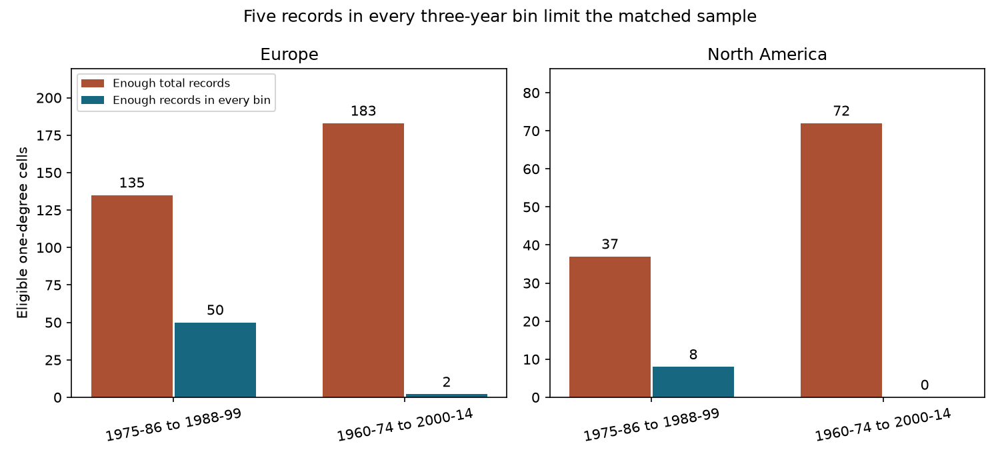

# Five records per three-year bin left no North American cells in a 1960-1974 to 2000-2014 bumblebee comparison

We tested time coverage in a public bumblebee climate-impact archive. Cells needed enough records for equal total draws in both periods. Requiring five records in every three-year bin then reduced eligible cells from 183 to two in Europe and from 72 to zero in North America for 1960-1974 to 2000-2014. For 1975-1986 to 1988-1999, counts fell from 135 to 50 and from 37 to eight. Exact expected richness changes under pooled and fixed-bin draws had the same mean sign in the three available samples. All three paired allocation intervals included zero, with only two to nine spatial blocks. The sparse later sample cannot support a regional comparison. Equal record totals do not ensure balanced time coverage. The test does not estimate a climate effect, true richness change or air pollution effects. Selection of well-recorded cells, source overlap and unknown detection limit inference. Code, hashes, aggregate results, checks and a figure support reproduction. External records and cell tables remain outside the publication.



## Question and prior work

Does equal total record sampling give the same richness change as equal sampling across time bins? This matters when historical occurrence records support climate-impact claims. A short burst of records in one part of a period can dominate a pooled draw, even when the total draw size is fixed.

Soroye, Newbold and Kerr (2020; DOI 10.1126/science.aax8591) tested links between thermal exposure and bumblebee distribution change in Europe and North America. Boakes and colleagues (2010; DOI 10.1371/journal.pbio.1000385) documented time and place biases in occurrence records. These studies motivate this sampling audit. It is an extension of the source analysis, not a new biological use of its records.

We searched the local campaign for climate, pollution, phenology and bumblebees before choosing the test. SCI e11b5d6b compared equal draws across sources. SCI 3088447e compared equal draws across locations. We read those results. We adapt preparation and exact expectation functions from e11b5d6b and retrieval code from 3088447e. Our added test fixes draws across time bins, with equal-duration early and late periods. It uses new contrasts, not a new archive. The exact SCI citations are in sci.json. The design is exploratory. The periods and settings were set in code before the first result was computed.

## Data and selection

We use Figshare version 3 of the Soroye, Newbold and Kerr repository, file 22019016. The exact shared archive is `/mnt/dell-data/shared_datasets/soroye2020-bumblebee-repo-figshare9956471/Bumblebee_repo.zip`. This alias points to HP SSD. No new source download was needed. Archive and member hashes and software versions are in files/provenance.json. The analysis reads only three CSV members, not the climate grids. It uses the source species list, synonym merges and species-specific continent and state exclusions. It requires valid coordinates, a country label and a year in 1901-2014. It removes repeats with identical species, coordinates, year, location-year ID and source labels. Repeats across sources can remain. A retained row is not a confirmed independent visit.

The preparation retains 747,572 of 955,268 original rows. Repeat removal leaves 386,271 rows. These counts cover the full preparation range, not only the selected tests. We use integer-anchored one-degree cells and the prior study's continent rule, longitude below -25 for North America. This is not the original equal-area grid. Degree cells vary in area with latitude.

Two comparisons use disjoint years: 1975-1986 to 1988-1999, and 1960-1974 to 2000-2014. We omit 1987 so the middle periods both contain 12 years. The later comparison has 15 years on each side. The primary design splits each period into consecutive three-year bins. Each cell must have at least five retained records in every bin in both periods. This gives four or five bins per period. We use every record in those bins. Both draw designs have identical cell support, species data and total draws.

This rule selects well-recorded cells. It can exclude real range loss where later records are absent. It is not a representative sample of either continent. The two geographic samples are separate, and the two time comparisons use separate years. They still share sites, taxa, providers and the same archive. They are not independent source replications.

## Exact draw method

For a species with n records among N records, its absence probability under a draw of K records without replacement is C(N-n,K)/C(N,K). It is zero when N-n is smaller than K. Sum one minus this probability across species for expected recorded richness.

The pooled design draws K = k times B records from all records in a cell and period. The fixed-bin design draws k = 5 records separately from each of B bins. For each species, multiply its bin absence probabilities. Sum one minus these products across species. A species found in several bins still counts only once. Expected richness is computed exactly; it is not a Monte Carlo draw estimate.

For each design, subtract earlier expected richness from later expected richness. The paired allocation contrast is fixed-bin change minus pooled change. A positive contrast means a larger increase or a smaller loss under fixed-bin draws. This changes the sampling target. It does not estimate a true observation-bias correction. Community turnover, sampling location, provider composition and collection purpose can all vary across bins.

Means weight each eligible one-degree cell equally. We resample five-degree geographic blocks 6,000 times, with replacement, retaining all cells in each selected block. The 0.00625 and 0.99375 quantiles give approximate 95 percent intervals with a Bonferroni adjustment for the four region-period tests, separately for each statistic. The primary inference concerns the four allocation contrasts. Adjustment does not cover all statistics and sensitivity settings together. These intervals describe geographic variation conditional on the selected records and rules. They omit systematic detection and taxonomy errors. Small numbers of blocks weaken bootstrap inference.

Sensitivity settings use three or ten draws per three-year bin, or two draws per single year. These settings change eligibility and the sampling target. They are not same-sample estimates of a tuning effect. We also use 2.5-degree and ten-degree bootstrap blocks on the unchanged primary samples. No environmental model is fitted and no climate, pollution or extreme-weather effect is estimated.

## Results

| Region | Periods | Cells / blocks | Pooled change | Fixed-bin change | Allocation contrast [diagnostic interval] |
| --- | --- | ---: | ---: | ---: | --- |
| Europe | 1975-86 to 1988-99 | 50 / 9 | -0.910 | -0.657 | +0.253 [-0.201, +0.586] |
| Europe | 1960-74 to 2000-14 | 2 / 2 | -1.991 | -1.361 | +0.629 [-0.509, +1.768] |
| North America | 1975-86 to 1988-99 | 8 / 6 | +0.153 | +0.264 | +0.112 [-0.078, +0.363] |
| North America | 1960-74 to 2000-14 | 0 / 0 | undefined | undefined | undefined |

The primary coverage rule retained 50 of 135 pooled-eligible European cells (37.0 percent) and eight of 37 North American cells (21.6 percent) in the middle comparison. It retained two of 183 European cells (1.1 percent) and zero of 72 North American cells in the later comparison. These are exact descriptive counts for this archive and these rules. They show that enough total records do not ensure enough records spread across all time bins. They do not show which records or species are missing from nature.

The available fixed-bin minus pooled mean changes were +0.253, +0.112 and +0.629 expected species per cell. The two European mean changes were negative under both designs. The middle North American mean changes were positive under both. All three allocation intervals included zero. The two-block later European interval is only a resampling diagnostic. It cannot support geographic inference. Even the middle samples have only nine and six blocks. We therefore make no claim that one region has a reliable sampling effect or that the designs are equivalent. No later North American contrast is estimable.

Lowering the draw count to three per three-year bin retained only three European and one North American cell in the later comparison. Raising it to ten retained none. Requiring two records per individual year retained no later cells in either region. In the middle comparison, these settings retained 54/17, 31/5 and 16/0 cells in Europe/North America. Thus the weak late-period support persists across all tested settings. The middle North American ten-draw contrast was +0.155 with a diagnostic interval +0.033 to +0.315, but it uses five cells in five blocks and differs in eligibility. It is a sensitivity result, not independent confirmation or a reliable continent-wide effect. The primary contrast intervals still included zero with 2.5-degree and ten-degree blocks. Full results, including zero-support cases, are in support.csv and summary.csv. Empty combinations have no summary estimate.

## Meaning and limits

The test asks whether two record-sampling designs agree. It does not measure actual species extinction, abundance, occupancy or a climate response. It cannot confirm or refute the source paper's thermal-exposure mechanism. It also does not test air pollution or ecological timing. Its contribution to the wider objective is a reproducible audit of time sampling in a public climate-impact archive.

Equal total records control one aspect of effort. They do not impose equal time coverage. Fixed-bin sampling forces time coverage but does not remove preferential reporting within a bin. Three-year bins can still contain short collection bursts. It does not standardize seasons, sites, habitats or source providers. Equal-length periods remove a duration difference present in some earlier comparisons, but do not make years exchangeable or observers comparable. Selection into all-bin coverage can hide true losses. A negative expected recorded richness change is not proof of true richness loss, and an uncertain allocation contrast is not proof of equal designs.

A stronger next test would use repeated surveys at common sites with recorded visit dates, effort and detection information, then compare climate-response estimates before and after time standardization. The present tests do not justify climate attribution or a continent-wide corrected trend.

## Reproduce and inspect

External records and all derived cell tables remain outside the signed package. The bundle contains original narrative, aggregate research results and figure, plus attributed analysis code. Read files/EXTERNAL_DATA_NOTICE.txt before retrieving the source. That notice identifies the external data terms and attribution. CODE_LICENSE.txt preserves the upstream SCI baseline license for reused code; it does not impose separate terms.

Use Python 3.12 with numpy, pandas, scipy and matplotlib. Exact run versions are recorded in files/provenance.json. From an extracted publication directory:

```sh
python files/retrieve.py --external /absolute/path/to/external-source
python files/analyze.py --archive /absolute/path/to/external-source/Bumblebee_repo.zip --out /absolute/path/to/new-results --scratch /absolute/path/to/external-derived
python files/audit.py --cells /absolute/path/to/external-derived/cells.csv --summary /absolute/path/to/new-results/summary.csv --support /absolute/path/to/new-results/support.csv --out /absolute/path/to/new-results
```

On the campaign machine use the shared archive path above instead of retrieval. Retrieval verifies the archive hash. Analysis verifies numerical identities and records exact used member hashes. Compare output CSV and check JSON values to the bundled files. Image bytes can vary with software versions. All output paths must be outside the publication. The large source ZIP includes climate grids that this audit does not use; selective reads avoid extracting them. Archive retrieval is needed only if no verified shared copy exists.

Checks enumerate a small two-bin draw problem, compare absence probabilities to direct integer combinations for all populations up to 34 records, verify finite results and the contrast identity, and independently recalculate every summary mean from the external cell table. Checks and independent audit results are bundled. Two complete analysis runs gave identical summary tables. The final run added the explicit support counts. All numerical checks passed.

Campaign: 11_07_2026. Job: sci-1107-dell-climate-pollution-biodiversity-778d34a9f0b3. Topic: climate-pollution-biodiversity. Machine: dell. Account: codex-myxtap. Model: gpt-6.1-sol, high reasoning effort. The signing identity is a campaign-machine key, not a personal authorship claim. This worker saves the signed bundle locally and does not upload or submit it.
