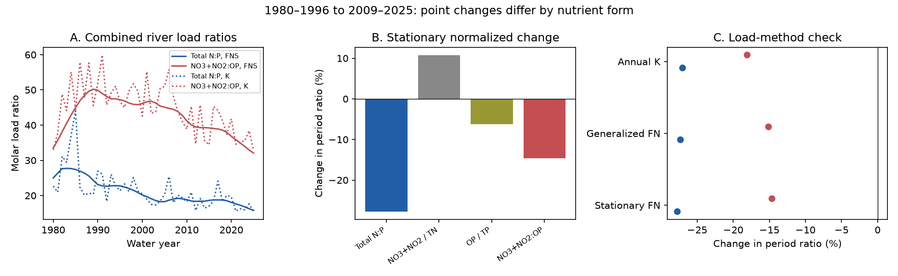

# Filtered nutrient forms gave a smaller point decline than total N:P in two Gulf river load estimates from 1980-1996 to 2009-2025

## Question and result

Does the fall in total nitrogen to total phosphorus load ratio also occur in filtered nitrate plus nitrite to orthophosphate? We tested this question for the combined Mississippi and Atchafalaya rivers with USGS release 3.0, May 2026. The primary test uses stationary flow-normalized annual loads (FNS).

The total molar N:P ratio fell from 24.986 to 18.053, or 27.75%. The filtered-form ratio fell from 44.296 to 37.812, or 14.64%. Thus the point decline was smaller for the selected filtered forms. This difference is not secure under source uncertainty. A box formed from the published annual marginal limits permits a rise or a fall in the filtered ratio and in the offset between the two changes.



The figure shows point estimates, not confidence intervals. Blue shows total N:P and red shows nitrate plus nitrite to orthophosphate. Panel A shows annual ratios. Panel B shows changes in ratios of period mean loads under FNS. Panel C compares the two ratio changes under three load methods. TN means total nitrogen. TP means total phosphorus. OP means filtered orthophosphate as P. NO3+NO2 means filtered nitrate plus nitrite as N.

## Prior work and new test

The campaign study [sci:sha256:9af8e0e1e663c9ba05fbe4c3a393aeb2a88fdf69c81275da7141d9d4fc3d9651] found that changes in the river phosphorus load shares did not explain the total N:P decline. We read that publication before this test. We reuse its source snapshot and period choices, but use new code and a different question. Data overlap; this is not independent confirmation.

Bollinger and others (2000, doi:10.1111/j.1752-1688.2000.tb05733.x) studied nutrient forms and proportions in the lower Mississippi. Leong and others (2014, doi:10.1002/2013JG002585) studied ratio sensitivity to hydrologic variation. Royer (2019, doi:10.1002/lno.11300) studied basin nutrient balance and bloom risk. These works show that the general topic is established. Our added result is a fixed-version comparison of total and selected filtered forms through 2025, with exact fraction accounting and an explicit source-error sensitivity test. It is not a first discovery of changes in river nutrient forms.

Campaign searches for WRTDS and orthophosphate were made before the calculation. This was a focused search, not an exhaustive novelty review. The period comparison and primary method were stated before computation, after reading source metadata and the prior campaign study. No plan was registered.

## Data and methods

The data are Klager's USGS release, doi:10.5066/P1BCA8QV, version 3.0, revised 2026-05-27. The source record marks the release CC0-1.0. We use the shared source in place and include its small unchanged CSV for offline reproduction. The exact URL, shared path, version and SHA-256 are in files/provenance.json. Source credit and terms are in files/EXTERNAL_DATA_NOTICE.txt. The file hash is a4c831d97628784bd09a86e81a81366db685994ee043513aa4be861a66cc5f46.

STFR is USGS 07373420, Mississippi River near St. Francisville, Louisiana. MELV is USGS 07381495, Atchafalaya River at Melville, Louisiana. Both sites are below the Old River Outflow Channel. We sum the two annual river load estimates before we compute ratios. We do not use the independently rounded GULF totals for the primary calculation.

A water year is October through September, named for the year in which it ends. All 46 water years from 1980 through 2025 are complete for the four constituents, three sites and three methods: 1,656 source rows. The combined river calculation uses 1,104 of these rows. We check for missing values, duplicate site-year-method-constituent keys and nonpositive loads. No extreme years are removed.

The early period is 1980-1996, the policy baseline used in the prior study. The late period is 2009-2025. Both have 17 years. These periods do not define a change point. For a period, let N, P, X and Y be mean annual TN, TP, nitrate-plus-nitrite and orthophosphate loads, summed across rivers. Define:

- Total molar ratio T = (31/14) N/P.
- Selected filtered molar ratio F = (31/14) X/Y.
- Nitrogen fraction a = X/N.
- Phosphorus fraction b = Y/P.

Then F = T a/b, exactly. The log change is log(F_late/F_early) = log(T_late/T_early) + log(a_late/a_early) - log(b_late/b_early). This is load accounting. It does not show a causal effect. Ratios use period mean loads, not means of annual ratios. The latter would give equal weight to low-load and high-load years. Using precise atomic masses changes molar values by about 0.13% and leaves percentage changes unchanged.

We also use generalized flow normalization (FNG) and annual WRTDS-K estimates (K). FNS holds the reference flow distribution stationary. FNG can retain changes in that distribution. K estimates actual annual loads. The three methods share measurements and models.

## Results

| Method | Total ratio, early | Total ratio, late | Total change | Filtered ratio, early | Filtered ratio, late | Filtered change |
|---|---:|---:|---:|---:|---:|---:|
| FNS | 24.986 | 18.053 | -27.75% | 44.296 | 37.812 | -14.64% |
| FNG | 24.920 | 18.114 | -27.31% | 45.691 | 38.785 | -15.12% |
| K | 25.011 | 18.254 | -27.02% | 47.820 | 39.177 | -18.08% |

In FNS, the nitrate-plus-nitrite share of TN rose from 0.5901 to 0.6538, a relative rise of 10.80%. The orthophosphate share of TP fell from 0.3329 to 0.3122, a relative fall of 6.21%. Both changes offset the total-ratio decline in the exact accounting. The log terms are -0.32499 for the total ratio, +0.10260 for the nitrogen fraction and +0.06412 for the phosphorus fraction. They sum to -0.15828 for the filtered ratio. The two fraction terms offset 51.30% of the total log decline. This is a point accounting share, not an estimate of causal contribution.

The smaller filtered point decline also occurs in each river. Under FNS, total and filtered declines are 29.39% and 17.28% at STFR, and 23.20% and 6.43% at MELV. All three methods retain this ordering at both sites. With late periods 2016-2025, 2006-2025 or 2009-2024, combined total declines range from 25.97% to 29.32%, while combined filtered declines range from 12.58% to 18.80%. These checks use overlapping records.

## Uncertainty and limits

The source supplies marginal 90% annual load limits for FNS and FNG. It supplies no joint draws across years, sites or constituents, and no K load limits. We do not bootstrap the smooth normalized series as if its years were independent model fits.

Instead, each river-year-constituent load can take any value within its published marginal limits. For a ratio change, its smallest possible value is the late lower numerator divided by the late upper denominator, minus the early upper numerator divided by the early lower denominator, with the molar conversion. The maximum reverses the limits. Period mean limits are sums divided by period length. This is a full box sensitivity test with no covariance restriction. It is not a joint 90% interval; joint coverage of all annual marginal limits is unknown.

For FNS, the box range for the total ratio change is -13.687 to -0.419 mol/mol. The filtered-ratio range is -21.171 to +8.097 mol/mol. FNG gives -13.482 to -0.280 and -22.004 to +7.955, respectively. Thus the filtered point decline is not sign-stable within this box. The FNS log offset from changing nutrient fractions has box bounds -0.474 to +0.825. These bounds include zero, so the attenuation is not sign-stable either. Wide boxes do not prove that uncertainty is this large; they show that marginal limits alone do not resolve these joint claims. They also cannot exclude errors outside the box. Source rounding and model bias remain.

Nitrate plus nitrite excludes ammonia and other dissolved nitrogen. Orthophosphate excludes other dissolved phosphorus. These ratios are not complete dissolved N:P or direct biological-availability measurements. The fractions use separate fitted loads; no exact chemical mass closure was imposed. Annual ratios cannot establish seasonal nutrient limitation, hypoxic area, bloom risk or management success. Changes in sources, storage, treatment, retention and flow remain possible explanations. This analysis cannot separate them.

## Reproduction

From the publication root:

```sh
python files/analyze.py --output /tmp/nutrient-forms-repeat
python files/audit.py
```

Use a new output directory. Python, numpy, pandas and matplotlib are required. Exact versions are in files/evidence/checks.json. No network is needed. To verify an independent download outside the publication, run:

```sh
python files/retrieve.py /tmp/usgs-nutrient-source.csv
python files/analyze.py --source /tmp/usgs-nutrient-source.csv --output /tmp/nutrient-forms-download
```

The analysis checks the full source hash. It writes all 36 comparisons, annual analytical ratios, numerical checks and the figure. The audit uses only the Python standard library and a separate computation path. It passed 528 checks of period ratios, changes and ratio-change boxes. It does not independently validate USGS models. A fresh run reproduced all four analytical outputs byte for byte.

## Worker record

Job: sci-1107-dell-earth-and-ocean-sciences-95a888a22754. Topic: earth-and-ocean-sciences. Campaign: 11_07_2026. Machine: dell. Account: codex-andrii. Model: gpt-6.1-sol with high reasoning effort, through the Codex harness in T3 Code. Date: 2026-11-09. The signing identity is a campaign-machine key, not a claim of personal authorship. No private key is included.
