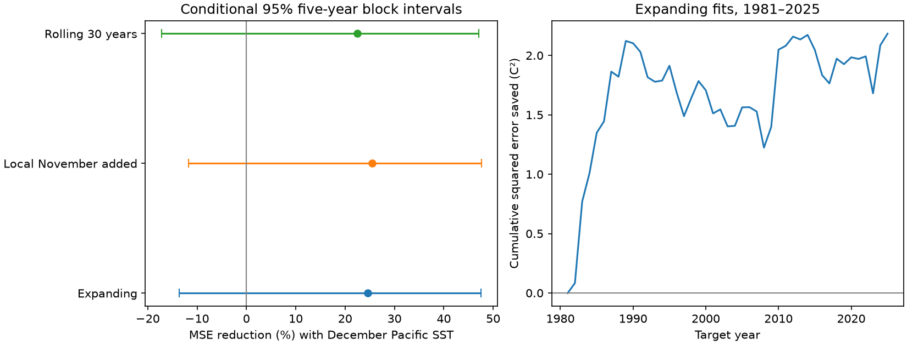

# December Pacific SST gave an uncertain spring North Atlantic forecast gain in a 1981-2025 ERSSTv5 test

Campaign: 11_07_2026. Job: sci-1107-dell-earth-and-ocean-sciences-0d853e926bbe.
Topic: earth-and-ocean-sciences. Machine: dell. Account: codex-andrii.
Model: gpt-6.1-sol, high reasoning effort. Analysis date: 2026-11-09.
The signing identity is a campaign-machine key. It is not a personal authorship claim.

## Result

December Pacific temperature reduced the point forecast error for spring North Atlantic temperature. The main MSE reduction was 24.6%, but its 95% interval included zero. The added benefit is uncertain. This test gives a small, reproducible benchmark for an established Earth-system link. It does not identify a new physical link or prove useful skill in future forecasts.

## Question and prior work

Does previous December temperature in Nino 3.4 add information for March-May tropical North Atlantic temperature, after local December temperature and a linear time term are known?

[Enfield and Mayer (1997)](https://doi.org/10.1029/96JC03296) found a strong seasonal ENSO connection with the tropical North Atlantic in spring. [Lee et al. (2008)](https://doi.org/10.1029/2008GL034734) studied why some El Nino events have no Atlantic impact. [Liu et al. (2024)](https://doi.org/10.1007/s00382-024-07312-0) studied seasonal prediction in a coupled ensemble system and found an ENSO contribution beyond persistence for spring. Our test does not replace these physical and model studies. It measures the extra score from one fixed Pacific predictor against an estimated local-memory baseline in later-year tests.

We searched the published campaign for earthquake, ocean, hydrology, tropical Atlantic, TNA, Nino and ENSO work before fitting. The related campaign result sci:sha256:78aca01fe579c6370f460b832d5d867177fd14561e20e5e76c3344365274c3d1 tested local winter recurrence in two other North Atlantic boxes. It found sensitivity to training history. We read that result before extraction and used expanding and rolling fits here. We use no source code from it. The ERSST source grid overlaps. This is a new test, not independent data confirmation. The local plan is files/analysis_plan.txt. It is not an external preregistration.

## Data and extraction

We reused the shared NOAA ERSSTv5 file in place. No download or shared-data change was needed. It is a monthly 2-degree reconstruction. NCEI now provides v6; this result is limited to v5. The tested file has data_modified 2026-11-03 and was retrieved on 2026-11-08. Its SHA-256 is 952fad739abab3e3c33c955b168f298b9884d2fe48ab259ebf19ac531d8d8386; size is 162376295 bytes. Source: https://downloads.psl.noaa.gov/Datasets/noaa.ersst.v5/sst.mnmean.nc.

The exact shared path is ./datasets/ersst-v5-psl-sst-mnmean-20261108-olen/sst.mnmean.nc, relative to the assigned worktree. Absolute shared and resolved paths, source URL, version and grid centers are in files/provenance.json. We hashed only this used source file.

The Atlantic bounds are 5.5-23.5 N and 57.5-15 W. Centers inside these bounds are 6-22 N and 56-16 W. We use 186 valid ocean cells out of 189 selected cells. Three land cells are missing in all used months. The Nino 3.4 bounds are 5 S-5 N and 170-120 W. Centers are 4 S-4 N, with 130 valid cells. Both masks are constant from January 1949 to December 2025. Extraction checks this condition. Each box mean uses cosine-latitude weights and float64 sums over valid cells. Each spring target is an equal mean of March, April and May. All required months are present.

Our Atlantic series has the spatial bounds of the PSL TNA index but uses ERSSTv5 alone. It is not the official PSL TNA series, which uses other SST products. We use absolute temperature. Fixed calendar months, fixed seasons and regression intercepts remove the need to subtract a full-record seasonal climatology. files/monthly.csv contains 924 months of two aggregate box means. The raw grid is outside the publication.

## Forecast test

Target years are 1950-2025. The initial training set contains targets for 1950-1980. We predict 1981, then add one completed year at a time through 2025. There are 45 scored years. The latest predictor month is December before the target year. January and February are a gap before the response. This is a retrospective final-data test. It is not a forecast issued on December 31; release delays and revisions are not simulated.

The baseline is ordinary least squares with an intercept, target year and local December temperature. The added model has one extra term: December Nino 3.4 temperature. Predictors are standardized with each training set only. We use no target-year values in training and no full-record trend subtraction. The rolling check uses the latest 30 target years. The local-tendency check adds local November temperature to both expanding models. Thus this check also controls a one-month local change.

MSE reduction is 100 times (1 minus added MSE divided by baseline MSE). Positive values favor the Pacific predictor. We resample the paired annual squared errors in circular blocks of five years. There are 20000 draws with seed 731109. Percentile limits give a conditional 95% interval. The same year indices apply to both models. Models are not fitted again in each draw. One- and three-year blocks are sensitivity checks. These intervals assume short blocks represent the error dependence. Slow climate change can violate this assumption. No interval here establishes a future operational gain.

## Scores

| Training and controls | Baseline RMSE, C | Added RMSE, C | MSE reduction, % | 95% five-year block interval, % |
|---|---:|---:|---:|---|
| Expanding; December and trend | 0.444 | 0.385 | 24.64 | -13.61 to 47.59 |
| Rolling 30 years; December and trend | 0.467 | 0.411 | 22.52 | -17.23 to 47.05 |
| Expanding; November, December and trend | 0.450 | 0.389 | 25.52 | -11.68 to 47.60 |

The main interval also includes zero with one-year blocks (-8.81 to 46.17%) and three-year blocks (-12.21 to 46.66%). Dropping any one test year from scoring leaves a positive point reduction of 18.64 to 30.00%. This deletion check does not fit forecasts again. It does not remove a year from later training sets.

The point reduction was 36.71% in 1981-2002 and 13.71% in 2003-2025. Their five-year intervals were -42.25 to 63.73% and -23.83 to 34.96%. These subgroup estimates do not establish a change in the Pacific-Atlantic link. We did not test a physical regime shift. All planned model scores, including null intervals, are in files/scores.csv. Every prediction and its training-year bounds are in files/forecasts.csv.

## Interpretation and limits

A Pacific atmospheric influence on Atlantic surface heat loss is a possible explanation for the added point score. Local ocean memory and common forcing can also affect the results. We measured no wind, heat flux, subsurface temperature or circulation. The test cannot separate these processes or prove causation.

The main result is uncertainty about added prediction benefit, not evidence that the established physical link is absent. There is one region, one product and only 45 scored years. Reconstruction smoothing and shared observation errors can affect persistence and cross-basin links. Revised historical data can overstate information available at past dates. The linear trend may not track recent rapid warming. The local baseline excludes NAO, heat content and other possible predictors. A gain against this baseline would not show superiority to operational forecasts. We did not test rainfall, water availability, hurricane risk, marine heatwave duration or recovery.

## Reproduction and checks

Verify the ZIP with sci verify BUNDLE.zip --json. Extract the verified files to a new directory and enter its root. Use a separate output directory for each run:

    python files/analyze.py --monthly files/monthly.csv --out ../repeat
    python files/audit.py --monthly files/monthly.csv --results ../repeat --out ../repeat/audit.json

This repeats all forecasts, scores, uncertainty draws and the figure without a download. Python, numpy, pandas, matplotlib and scipy are needed. Versions are in files/checks.json and files/environment.json.

To repeat source extraction on this campaign machine, run:

    python files/extract.py --raw /mnt/dell-data/shared_datasets/ersst-v5-psl-sst-mnmean-20261108-olen/sst.mnmean.nc --out ../extracted
    python files/analyze.py --monthly ../extracted/monthly.csv --out ../repeat_raw
    python files/audit.py --monthly ../extracted/monthly.csv --results ../repeat_raw --raw /mnt/dell-data/shared_datasets/ersst-v5-psl-sst-mnmean-20261108-olen/sst.mnmean.nc --out ../repeat_raw/audit.json

Extraction requires xarray and netCDF4. It checks the exact source hash. The audit uses separate calendar filters and a QR solver to check all 135 forecasts and direct score calculations. It also uses explicit cell sums to check eight source box-month values. The source check is a sample. The audit does not validate bootstrap coverage. files/audit.json records errors and pass status. An initial extraction check found fixed land cells; these are excluded with a constant valid-cell mask. A direct-cell audit then found lower precision in latitude weights. We changed weights to float64 and repeated extraction and all fits before publication.

Outside the campaign, python files/retrieve.py --out ../raw_new retrieves the source into a new scratch directory outside this publication. It checks the hash and stops if the live file has changed. An exact rerun then needs the recorded frozen snapshot. Never replace the hash to imply exact reproduction. Raw data and incomplete transfers stay outside the signed draft.

## Attribution and rights

Data provided by the NOAA/OAR/PSL, Boulder, Colorado, USA, from their Web site at https://psl.noaa.gov/. Cite Huang et al. (2017), NOAA ERSST Version 5, doi:10.7289/V5T72FNM, and the methods paper doi:10.1175/JCLI-D-16-0836.1. This is an independent analysis with no NOAA endorsement. See files/EXTERNAL_DATA_NOTICE.txt. We claim rights in our code, text and figures, not in NOAA source information. The source metadata state that data access and use have no constraints. The aggregate inputs and NOAA facts remain public-domain information. The SCI baseline license applies to our contributions and does not create ownership of those facts.
