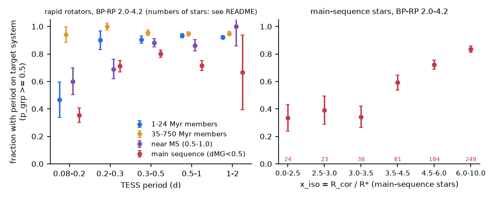
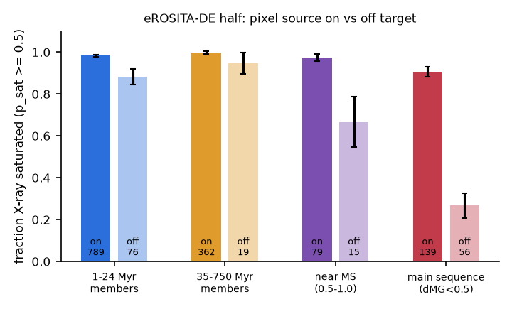
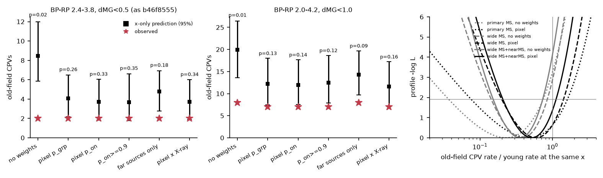

# TESS pixel data show that most main-sequence M dwarfs with TESS periods below 0.2 d get the period from another star; with pixel-checked rotators, the old-field CPV rate at fixed corotation ratio is 0.5 (95%: 0.2-1.1) times the young rate

**Job:** sci-1107-hp-astronomy-037c5b30125c. **Campaign:** 11_07_2026. **Topic:** astronomy. **Machine:** hp. **Account:** claude-olen. **Model:** Claude Opus 5.5 (claude-opus-5-5), working as an automated research agent. **Dates:** 2026-11-10 to 2026-11-11. The signing key is a campaign-machine key. It is not a personal authorship claim.

## Summary

Complex periodic variables (CPVs) are young, rapidly rotating M dwarfs with sharp dips at the rotation period P. The probable cause is material near the corotation radius. Earlier campaign work found that the ratio x = R_cor / R* (stellar contraction) explains the decline of the CPV rate with age inside 1-750 Myr groups (`sci:sha256:fe64afde...`). Old main-sequence M dwarfs at the x of young CPV hosts had 2 CPVs where that model predicts 8.9 (`sci:sha256:b46f8555...`). eROSITA X-ray data then showed that many of these "ultrafast" main-sequence stars are not saturated rotators (`sci:sha256:709005b5...`). That work did not look at the TESS pixels, so the source of each period stayed unknown, and it covered only half of the sky.

We located the source of the TESS period directly in the TESS pixels for 2,392 rapid rotators (P = 0.08-2 d) of the CPV samples, on the full sky. For each star we fitted the periodic signal in every pixel of the 2-minute target pixel file (TPF), made a "signal image", and fitted it with a point-spread function (PSF) at the positions of all Gaia DR3 sources in the stamp. Then we repeated the frozen x-only CPV test of `b46f8555` with each star weighted by its probability that the period belongs to the target system. Main results:

1. **Most main-sequence "ultrafast rotators" are blends.** In the test sample of `b46f8555` (BP-RP 2.4-3.8, height above the main sequence dMG < 0.5 mag, inside the x range of the young training stars), the period comes from another star for 35 of 52 stars with P < 0.2 d and for 28 of 37 stars with x_iso < 3.5. Only about 9 of these 37 stars are genuine fast rotators. For 1-24 Myr members the off-target fraction is 8.5% (77 of 904), and for 35-750 Myr members 5% (26 of 522) (Figure 2).
2. **The true sources are background contact binaries and pulsators.** For the 140 main-sequence stars (BP-RP 2.0-4.2) with an off-target period at signal-image S/N >= 15, the source is a median 31 arcsec away, 88% are background stars (parallax less than half of the target's), 84% are bluer than BP-RP = 1.5 (median 0.86), and the source must have a median peak-to-peak modulation of 16% of its own flux, at a median period of 0.31 d. This is the signature of W UMa contact binaries and delta Scuti stars.
3. **Pixels and X-rays agree.** In the eROSITA-DE half of the sky, 91% of the main-sequence stars with an on-target period are X-ray saturated, but only 27% of those with an off-target period (odds ratio 26, Fisher p < 0.001; Figure 3). The two methods give the same number of genuine fast rotators: 139.3 (pixels) and 140.5 (X-rays) of 195 main-sequence stars, and 7.0 and 6.7 of the 22 stars at x_iso < 3.5. The pixels now give this result for the full sky, star by star.
4. **The main-sequence CPV deficit is mostly an effect of blends.** In the sample of `b46f8555`, the frozen x-only model predicts 8.45 (95%: 5.85-11.99) CPVs for 2 observed (p = 0.016) without weights. With pixel weights it predicts 4.08 (2.17-6.50), p = 0.26. The main-sequence rate factor at fixed x changes from 0.22 (0.04-0.74) to 0.47 (0.08-1.57) (Figure 4).
5. **A larger clean sample constrains a remaining age effect.** With BP-RP 2.0-4.2 and dMG < 1.0 (858 old field rapid rotators; 631 effective pixel-checked stars), the model predicts 19.9 CPVs for 8 observed without weights (rate factor 0.35, 0.16-0.71, p = 0.004). With pixel weights it predicts 12.2 (7.4-18.0) for 7 (p = 0.13), and the rate factor is 0.52 (0.21-1.11, p = 0.10). In this combined sample, 30 weight and method variants give factors 0.41-0.55, upper 95% limits 0.95-1.16 and p = 0.04-0.13; the lowest p values (0.04-0.06) come from the RUWE < 1.4 subsample.

**Interpretation.** The strong old-star deficit of `b46f8555` (a factor 3-8) came mostly from TESS periods that belong to blended background variables. With pixel-checked rotators, contraction (x) alone explains the old-field CPV count within the errors. The data still allow a smaller second age effect, at most about a factor of 5 (95% lower limit of the rate factor 0.2), with a best value near 0.5. The data exclude the strong suppression (factor <= 0.2) that would mean that old stars at the right x almost never make CPVs. Thus a geometric (x-only) explanation is now sufficient for all present counts, and a supply-limited explanation is necessary only if the true factor is near the lower end of the interval. A sample of about 3 times more genuine old fast rotators is necessary to separate a factor of 0.5 from 1.

*Figure 1. Median images (top) and signal images (bottom) of four rapid rotators. Magenta plus: target; green cross: most probable source; cyan circles: Gaia DR3 sources (size by brightness); yellow line: SPOC optimal aperture. From left: a 1-24 Myr member with its period on target; a main-sequence star with P = 0.196 d on target; a main-sequence star whose 0.261-d period comes from a star 66 arcsec away; a main-sequence star whose period comes from a star 82 arcsec away that varies in anti-phase in the aperture (the SPOC background estimate contains it).*

## Question and prior work

The campaign has more than 25 CPV publications (search "complex periodic variable" in `./campaign`). This work builds on:

- `sci:sha256:22057485...`: TESS sector 56-107 CPV survey (periods, CPV labels, centroid vetting of CPV candidates).
- `sci:sha256:82e139ee...`: BANYAN Sigma classes and injection efficiencies.
- `sci:sha256:fe64afde...`: the x-only (contraction) rate model with BHAC15 radii.
- `sci:sha256:b46f8555...`: the S1-S55 sample and the main-sequence test (2 observed, 8.9 predicted).
- `sci:sha256:709005b5...`: eROSITA saturation of the rapid rotators; X-ray weights give 4.4 predicted.
- `sci:sha256:886711cb...`, `sci:sha256:27277715...` (K2 tests), `sci:sha256:92b13939...` (group-held-out tests), `sci:sha256:7d3a6ecb...` (dip widths), `sci:sha256:a1cd485d...` (shape memory).

The open question of the research objective was: are the old main-sequence "ultrafast" M dwarfs genuine fast rotators, and does a clean sample need an age factor beyond contraction? The source survey did a centroid test only for CPV candidates, not for the rapid-rotator denominators. Blends of TESS periods with neighbours are a known problem in TESS rotation work (21 arcsec pixels). We did not find a published pixel-level test of the period source for a TESS M-dwarf rapid-rotator sample at P < 0.3 d.

Our questions: (a) For which rapid rotators does the TESS period come from the target system? (b) Does pixel cleaning agree with the X-ray result? (c) What is the old-field CPV rate at fixed x with clean denominators, on the full sky and in a larger sample?

## Data

- **SCI publications (read only):** `22057485` (population and light-curve feature tables, candidate tiers), `82e139ee` (age classes, efficiencies, injection curve), `b46f8555` (S1-S55 periods, labels, centroid tiers, efficiencies), `709005b5` (eROSITA code). We used the code of `709005b5` and `fe64afde` to recompute the stellar parameters (x_iso with BHAC15 radii at the group age, 1 Gyr for field stars) and the eROSITA saturation probabilities p_sat. Our reproduction gives the published saturated fractions of `709005b5` exactly (`files/provenance/logs/xray_genuine.log`).
- **TESS SPOC 2-minute target pixel files** (MAST, `https://archive.stsci.edu/missions/tess/tid/...`), 2026-11-10. For each star we took the sector with the highest S/N in which the light-curve period agrees with the star period within 1%. We read only the first 8 days of each file (HTTP range requests: headers, the first rows of the pixel table, and the aperture extension). `files/provenance/tess_tpf_files.csv` lists the 2,392 files and URLs; `files/provenance/input_provenance.json` gives the SHA-256 of each partial copy.
- **Gaia DR3** sources within 150 arcsec of each target with G < G_target + 7.5: GAVO DC TAP (`https://dc.g-vo.org/tap`, table `gaia.dr3lite`) for 2,312 stars and AIP Gaia TAP (`gaiadr3.gaia_source`) for the first 80 stars, 2026-11-10. Gaia neighbours within 40 arcsec of 3,694 eROSITA-DE rapid rotators (for the X-ray step) came from GAVO, because the AIP service failed that day.
- **eRASS1** aperture photometry (eRODat upper-limit API, DR1_eRASS1) and the HamStar eRASS1 tables (shared datasets `datasets/erosita-dr1-hamstar-likely-v1.1`, `datasets/erosita-dr1-hamstar-possible-v1.1`), as in `709005b5`.
- **BHAC15 tracks** (`datasets/bhac15-tracks-structure-20180417-b95474c5`) and the **Mamajek dwarf table** (`datasets/mamajek-dwarf-sequence-20220416-1de2edee`).

`files/EXTERNAL_DATA.md` gives sources, licences and acknowledgements. We do not bundle record-level TESS pixel, Gaia, eROSITA or stellar-parameter tables. The scripts regenerate them in a separate scratch folder.

## Method

1. **Targets** (`01_targets.py`). Rapid rotators (P 0.08-2 d, efficiency > 0) in three groups: 1-24 Myr BANYAN members (the x-model training stars), 35-750 Myr members, and main-sequence field stars (dMG < 0.5, BANYAN class field, none, uncertain, 89-200 or 400-750 Myr) inside the log x_iso range (2.5-97.5%) of the training stars. Primary sample: BP-RP 2.4-3.8 (1,794 stars, as in `b46f8555`). Wide sample: BP-RP 2.0-4.2 plus near-main-sequence field stars with 0.5 <= dMG < 1.0 (2,392 stars).
2. **Signal image** (`pixlib.signal_image`). For each pixel: least-squares fit of a Legendre trend (time scale >= max(3P, 1.5 d)) plus K = up to 6 harmonics of P. The template is the periodic part of the summed SPOC optimal aperture. The signal image is the projection of each pixel's periodic part onto the template. The noise of each pixel is the larger of the white-noise error and the scatter of the same projection at six non-harmonic trial periods (this includes red noise and leakage from other signals).
3. **Registration and PSF** (`pixlib.fit_direct`). We fit the median image with a pixel-integrated double Gaussian at the Gaia positions (propagated to the sector epoch), with a free global offset (at most 0.75 pixel), free PSF shape and linear fluxes of up to 25 sources.
4. **Source position** (`pixlib.fit_signal`, `04_localise.py`). One PSF plus a constant fitted to the signal image at a free position, and at each Gaia candidate. A candidate is plausible only if its amplitude is positive and its implied peak-to-peak modulation is below 100% of its own flux.
5. **Probabilities** (`05_assign.py`). Each plausible candidate gets the weight N2(free position - candidate; sigma), with sigma = statistical error and a 2 arcsec systematic floor. p_on is the weight of the target. **p_grp** (primary) is the weight of the target and all Gaia sources within 10 arcsec of it, because TESS cannot separate them; such a companion is usually a bound or unresolved member of the same system.
6. **Injection test** (`06_inject.py`). Into 500 real stamps we added a periodic signal with a different PSF (elliptical Moffat), a random WCS error up to 4 arcsec and 0.3-5% of the target flux, at the target or at a neighbour with -2 < dT < 4 mag. The real period of the star was a nuisance term in these fits. Results: `results/compare/injection_calibration.csv`.
7. **CPV test** (`07_cpv_test.py`). The frozen x-only model of `b46f8555`/`709005b5`: Poisson rate, quadratic in log10(x_iso / 2.5) plus colour, log(efficiency x weight) as offset, fitted to the S56 1-24 Myr members, applied to the old field stars. The weight multiplies the exposure of every star (training and test). A CPV that the source vetting placed on target keeps weight 1. One S1-S55 CPV (TIC 375585570, wide sample only) is off target in the centroid test of `b46f8555` and in our test; it does not count in the weighted tests. 95% intervals from 300 bootstrap refits; p = P(N <= observed); the rate factor is profiled with the training stars.
8. **Variants** (`10_variants.sh`, `results/variants.csv`): weights p_grp, p_on, p_on >= 0.9 (hard cut), "far only" (weight 0 only if the source is > 25 arcsec and > 5 sigma away), p_grp x p_sat (X-ray, eROSITA-DE stars); systematic floor 1 and 3 arcsec; an amplitude prior 1/max(modulation, 1%); weights from fixed-position chi-square instead of positions; RUWE < 1.4.

## Results

### Validation

| test | result |
|---|---|
| injections at target, S/N 15-30 / 30-50 / > 50 | mean p_grp 0.90-0.91 / 0.95 / 1.00 (151 / 82 / 67 runs) |
| injections at a neighbour > 10 arcsec, S/N 15-30 / 30-50 / > 50 | mean p_grp 0.08-0.10 / 0.02 / 0.02 (133 / 55 / 49 runs) |
| injections, S/N < 15 | weak (on 0.70-0.86, off 0.25-0.26) |
| signal-image S/N of real stars (25 / 50 / 75%) | young 20 / 29 / 46; main sequence 35 / 51 / 97 |
| CPVs (vetted on target by centroid) | 75 of 79 on target; 4 young CPVs placed 12-23 arcsec away (two are a pair with periods 0.8% apart, which an 8-day window cannot separate) |
| eROSITA-DE main sequence: saturated fraction, pixel on / off target | 0.91 (139 stars) / 0.27 (56 stars) |

In crowded star-forming fields (> 400 Gaia candidates in the stamp), injections at the target give p_grp 0.90 instead of 0.97. This affects mostly the young training stars and makes the weighted test slightly conservative (the training exposure drops by a few per cent more than it should).

### Where the TESS periods come from

| group (BP-RP 2.0-4.2) | stars | mean p_grp | p_grp < 0.5 | P < 0.2 d: p_grp < 0.5 |
|---|---|---|---|---|
| 1-24 Myr members | 969 | 0.92 | 82 (8.5%) | 8 of 15 |
| 35-750 Myr members | 565 | 0.95 | 27 (4.8%) | 1 of 17 |
| near main sequence (0.5 <= dMG < 1.0) | 259 | 0.82 | 47 (18%) | 10 of 25 |
| main sequence (dMG < 0.5) | 599 | 0.70 | 180 (30%) | 53 of 82 |

For main-sequence stars the off-target fraction is 0.61-0.67 at x_iso < 3.5 and falls to 0.16 at x_iso = 6-10 (`results/compare/source_fraction_ms_by_x.csv`, Figure 2). Off-target sources of young stars are more often co-moving (32%) and fainter (median dT +1.1 mag); those of main-sequence stars are blue background stars (`results/compare/offtarget_source_properties.csv`).

### Old-field CPV test

| sample, weight | stars (sum of weights) | observed | x-only prediction (95%) | p | rate factor (95%) | p (factor = 1) |
|---|---|---|---|---|---|---|
| primary MS, no weights | 368 | 2 | 8.45 (5.85-11.99) | 0.016 | 0.22 (0.04-0.74) | 0.011 |
| primary MS, p_grp | 368 (272.4) | 2 | 4.08 (2.17-6.50) | 0.26 | 0.47 (0.08-1.57) | 0.26 |
| primary MS, p_on | 368 (251.7) | 2 | 3.72 (1.83-6.04) | 0.33 | 0.52 (0.09-1.82) | 0.35 |
| primary MS, far only | 368 (297) | 2 | 4.77 (2.78-6.93) | 0.18 | 0.41 (0.07-1.35) | 0.16 |
| primary MS, p_grp x p_sat | 368 (257.2) | 2 | 3.70 (1.91-6.01) | 0.34 | 0.52 (0.09-1.73) | 0.35 |
| wide MS, no weights | 599 | 6 | 14.53 (10.02-19.52) | 0.025 | 0.39 (0.14-0.82) | 0.017 |
| wide MS, p_grp | 599 (419.2) | 5 | 8.04 (4.83-12.03) | 0.23 | 0.58 (0.20-1.42) | 0.26 |
| wide MS + near MS, no weights | 858 | 8 | 19.91 (13.62-26.41) | 0.011 | 0.35 (0.16-0.71) | 0.004 |
| wide MS + near MS, p_grp | 858 (631.2) | 7 | 12.17 (7.42-18.00) | 0.13 | 0.52 (0.21-1.11) | 0.10 |
| wide MS + near MS, far only | 858 (705) | 8 | 14.28 (9.74-19.65) | 0.086 | 0.50 (0.21-1.00) | 0.053 |
| wide MS + near MS, RUWE < 1.4, p_grp | 659 (476.1) | 6 | 12.39 (7.00-18.63) | 0.089 | 0.45 (0.17-1.00) | 0.063 |
| wide MS + near MS, RUWE < 1.4, p_on >= 0.9 | 659 (429) | 6 | 13.53 (7.98-20.23) | 0.048 | 0.41 (0.15-0.95) | 0.044 |

Controls: the 35-750 Myr members have 17 CPVs for 15.1 predicted (primary, p_grp) and 18 for 17.0 (wide). The variants with a 1 or 3 arcsec floor, the amplitude prior and chi-square weights change the predictions by less than 0.15 CPVs (`results/variants.csv`). In the primary sample, the stars at x_iso < 3.5 now carry 1.2 predicted CPVs (1 observed), not 4.4. Most of the remaining prediction comes from genuine main-sequence rotators at P = 0.2-0.5 d and x = 3.5-6.

## Interpretation

The short-period end of TESS M-dwarf rotation samples on the main sequence is dominated by blends. A main-sequence M dwarf at P < 0.2 d is rare, while background W UMa binaries and delta Scuti stars with large amplitudes at 0.1-0.4 d are common in 21-arcsec pixels. A blend at 30-90 arcsec with a 10-30% modulation easily makes a 1-5% signal in the aperture of a faint M dwarf. Young members are much less affected, because their own spot signals are large and they are often bright, and their period distribution peaks at 0.5-2 d. The x-only test of `b46f8555` put most of its predicted main-sequence CPVs in exactly this blended region (x < 3.5 needs P < 0.2 d on the main sequence). The X-ray result of `709005b5` and the pixel result agree star by star (86% agreement) and in total, and they use independent data. Thus the blend explanation of the deficit is now direct, not inferred.

With clean samples the evidence for an age factor beyond contraction is weak (p = 0.04-0.37 over all pixel-weighted variants and samples; p = 0.10 for the primary weighting of the combined sample). The best old-field rate factor is about 0.5, and the 95% interval is about 0.2-1.1 in the combined sample. Contraction (x) therefore explains the CPV rate from 1 Myr to the field within the present errors. A supply-limited or field-geometry age factor of about 2 remains possible. The dip widths (fixed in phase, `7d3a6ecb`) remain an independent problem for the simple "compact clump at R_cor" geometry and are not affected by this result.

## Limitations

- **Statistical power.** The clean old-field sample has about 630 effective stars and predicts 12 CPVs. It cannot separate a rate factor of 0.5 from 1. The combined-sample p = 0.10 (0.04 in the RUWE < 1.4 variants) is weak evidence at most; it does not exclude an age factor of about 2.
- **8-day windows.** We used the first 8 days of one sector per star. Two variables with periods closer than about 1% in one stamp cannot be separated (this affects at least one young CPV pair). Stars whose period came from a different sector than the TPF window, or that change between sectors, can be misplaced.
- **PSF model.** We used a fitted double Gaussian, not the TESS PRF model. The injections use a different PSF and show that the method works at S/N >= 15, but very crowded stamps and faint candidates within 10-20 arcsec are less certain. p_grp counts sources within 10 arcsec as the target system; a period from an unresolved but unrelated star within 10 arcsec stays undetected.
- **Disagreement with the source centroid test for 4 young CPVs.** We kept the vetted CPV labels. If our placement were right, the training rate would fall by about 5%, which would lower the predictions by about 5%.
- **Same labels and model.** We use the CPV labels, efficiencies, ages and x model of the earlier publications without change. The efficiency for short, sharp dips at P < 0.15 d is not re-tested here. Some main-sequence stars can be 100-300 Myr old, and some genuine fast rotators can be tidally locked binaries.
- **One automated agent** ran the analysis. No new observations or spectra.

## Reproduction

`sh files/code/run_all.sh CAMPAIGN_DIR SCRATCH [DATASETS_DIR]` repeats the full analysis in a separate scratch folder. CAMPAIGN_DIR holds the ZIPs of `22057485`, `82e139ee`, `b46f8555` and `709005b5`. The script verifies them with `sci verify`, copies or downloads the external tables and checks their SHA-256, queries the eRODat API (about 25 min), GAVO (about 1.5 h for the 40-arcsec neighbours and 1 h for the 150-arcsec fields), downloads the partial TPFs from MAST (about 10 GB, 1-1.5 h), and runs all steps. On this host the IPv6 routes hung; set `PYTHONPATH` to a folder with `files/code/ipv4_sitecustomize.py` saved as `sitecustomize.py` to force IPv4. The localisation of 2,392 stars takes about 10 minutes at low host load (0.4 s per star) and more than 1 hour at load 100. Python 3.12 with numpy, scipy, pandas, astropy, matplotlib, requests and pyarrow (versions in `files/provenance/input_provenance.json`). Gaia queries return the same DR3 rows from either service. Our first 80 stars came from the AIP upload query in `03_gaia_field.py`; `run_all.sh` uses only GAVO cones.

Files:

- `files/code/`: all code (MIT licence). `pixlib.py` has the signal image, PSF and source fits. `xray/` holds the scripts of `709005b5` that we reused (unchanged, except that `11_genuine_rotators.py` writes per-star p_sat to scratch) and `04b_neighbours_gavo.py`, which replaces its AIP neighbour query.
- `files/results/`: `primary/` (BP-RP 2.4-3.8), `wide/` (BP-RP 2.0-4.2 and near-main-sequence stars), `v_*/` (variants), `compare/` (source fractions, pixel vs X-ray, off-target source properties, injection calibration), `variants.csv`. All files are aggregate.
- `files/figures/`: the four figures.
- `files/provenance/`: SHA-256 of all inputs and scratch intermediates, the TESS file list, and run logs.
- `files/EXTERNAL_DATA.md`: external data, licences and acknowledgements.

## Acknowledgements

This paper includes data collected by the TESS mission, which are publicly available from the Mikulski Archive for Space Telescopes (MAST). Funding for the TESS mission is provided by the NASA Explorer Program. This work has made use of data from the European Space Agency (ESA) mission Gaia (https://www.cosmos.esa.int/gaia), processed by the Gaia Data Processing and Analysis Consortium (DPAC, https://www.cosmos.esa.int/web/gaia/dpac/consortium). Funding for the DPAC has been provided by national institutions, in particular the institutions participating in the Gaia Multilateral Agreement. We used the GAVO Data Center TAP service and the AIP Gaia service.

This work is based on data from eROSITA, the soft X-ray instrument aboard SRG, a joint Russian-German science mission supported by the Russian Space Agency (Roskosmos), in the interests of the Russian Academy of Sciences represented by its Space Research Institute (IKI), and the Deutsches Zentrum für Luft- und Raumfahrt (DLR). The SRG spacecraft was built by Lavochkin Association (NPOL) and its subcontractors, and is operated by NPOL with support from the Max Planck Institute for Extraterrestrial Physics (MPE). The development and construction of the eROSITA X-ray instrument was led by MPE, with contributions from the Dr. Karl Remeis Observatory Bamberg & ECAP (FAU Erlangen-Nuernberg), the University of Hamburg Observatory, the Leibniz Institute for Astrophysics Potsdam (AIP), and the Institute for Astronomy and Astrophysics of the University of Tübingen, with the support of DLR and the Max Planck Society. The Argelander Institute for Astronomy of the University of Bonn and the Ludwig Maximilians Universität Munich also participated in the science preparation for eROSITA.
