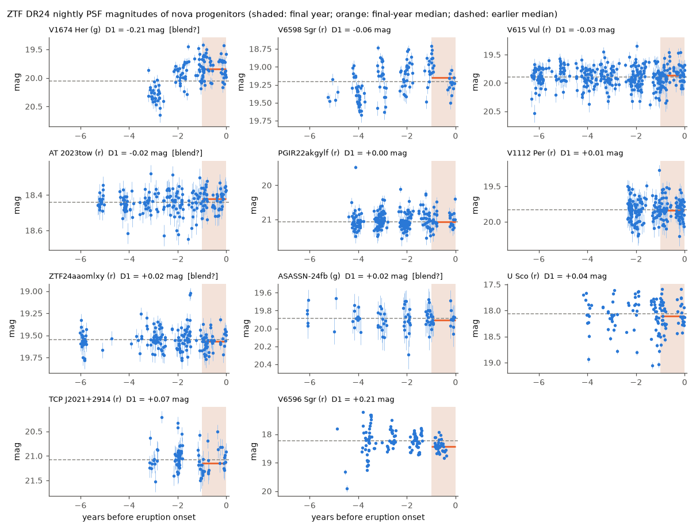
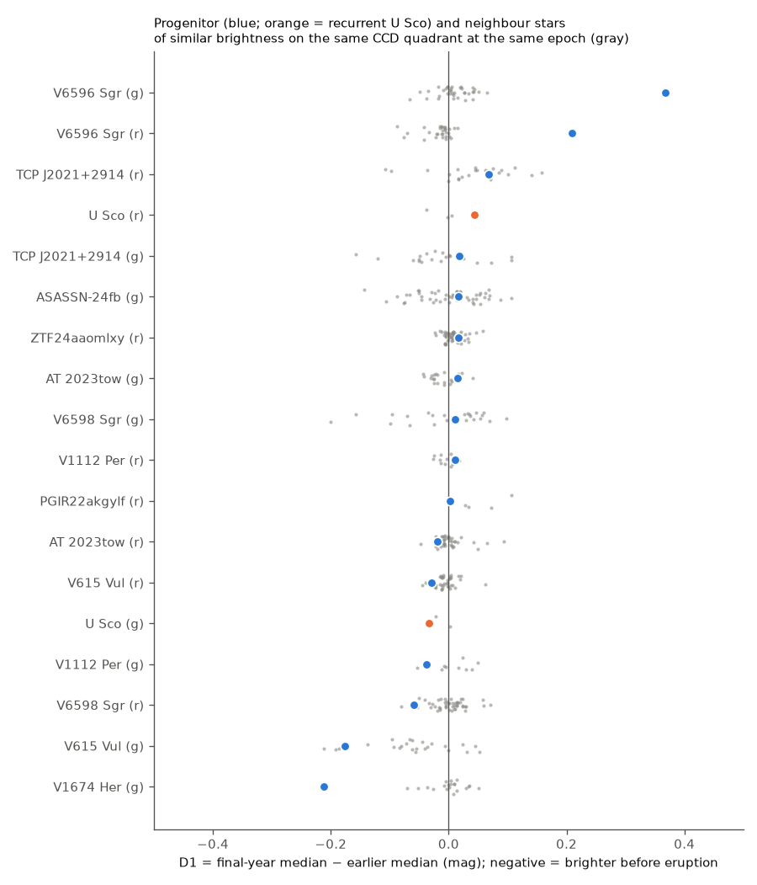
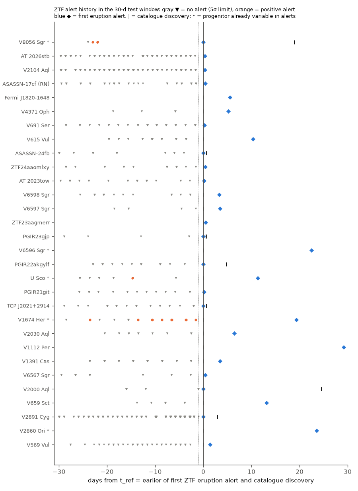

# ZTF data show no common brightening of 10 classical nova progenitors in the final year before eruption, and no precursor alert in the final 30 days of 22 novae (2018-2026)

## Summary

Some old photographic records suggest that a few novae become brighter in the months or years before they erupt. Collazzi et al. (2009) found such a rise in 2 of 22 novae (V533 Her and V1500 Cyg). We tested this with modern CCD data from the Zwicky Transient Facility (ZTF).

We took all 63 Galactic novae in Koji Mukai's list of recent novae that were discovered from 2018-06-29 to 2026-10-12 at declination above -31 degrees. We used two data sets:

1. ZTF Public Data Release 24 (DR24) PSF-photometry light curves, which end near 2025-10-24.
2. The ZTF public alert stream, through the ALeRCE broker. This gives difference-image detections and 5-sigma non-detection limits to 2026-11.

Results:

- **Final year (DR24).** For 14 novae, the progenitor light curve is the same ZTF object that later shows the eruption. Ten classical novae have enough data for the main test. The final-year median magnitude minus the earlier median (D1) has a median of +0.007 mag. Relative to neighbour stars on the same CCD quadrant at the same epoch, the median is -0.002 mag (bootstrap 95% interval -0.051 to +0.017 mag; Wilcoxon p = 0.70). No progenitor changed by 0.5 mag or more (0 of 10; exact 95% upper limit 31%). Under the Collazzi rate (2 of 22), the chance to see no rise in 10 novae is 0.39, so our sample cannot reject that rate.
- **Individual progenitors.**
  - V1674 Her (g band) became brighter by about 0.47 mag over the 4 years before eruption (yearly medians 20.31, 20.25, 19.87, 19.84 mag). Its slope (-0.16 mag/yr) is steeper than that of all 20 neighbour stars, whose slopes are within 0.021 mag/yr of zero. Most of the rise occurred 2 to 3 years before eruption, not in the final year. The ZTF object is 1.6 arcsec from the nova position, so it can contain light from a neighbour star.
  - V6596 Sgr became fainter by 0.37 mag (g) and 0.21 mag (r) in its final observed season. This season ended 138 to 152 days before the eruption. Both the neighbour null and the same-star null give p of about 0.02 to 0.03. One such result among 10 novae is expected by chance with probability of about 0.4.
- **Final 30 days (alerts).** 22 novae with quiet progenitors had ZTF coverage in the 30 days before eruption (median 9.5 nights, 260 nights in total, median 5-sigma limit 20.0 mag). They gave no precursor alert. Our automatic rule flagged two detections. Manual checks show that both are the start of the eruption. Where the quiescent magnitude is known (7 novae), the limits exclude a final-month brightening larger than 0.23 to 1.1 mag.
- **Early onsets.** In 3 novae, ZTF detected the eruption 2.8 d (V2891 Cyg), 4.8 d (PGIR22akgylf) and 24.5 d (V2000 Aql) before the catalogue discovery date.

Main limitations: the sample is small (10 classical novae in the main test). The progenitors are faint (18 to 21.6 mag) and in crowded fields. DR24 ends before the 2025-11 to 2026-10 eruptions. Seasonal gaps remove the final months for some bulge novae.



## Question

Do classical nova progenitors change brightness in the years, the year, or the month before eruption? We tested four things:

- (a) a rise of 0.5 mag or more, as Collazzi et al. (2009) reported for 2 of 22 novae;
- (b) a smaller common shift in the final year;
- (c) a slow trend over the full ZTF baseline;
- (d) a short precursor flare in the final 30 days.

## Data and provenance

| Item | Source | Version / date | Local copy |
| --- | --- | --- | --- |
| Nova list | Koji Mukai, "List of Recent Galactic Novae", https://asd.gsfc.nasa.gov/Koji.Mukai/novae/novae.html | page "Last updated 2026 Oct 28"; fetched 2026-11-09 | `files/raw/novalist/mukai.html` |
| ZTF light curves | ZTF Public DR24 through the SNAD mirror API: `https://db.ztf.snad.space/api/v3/data/dr24/circle/full/json?ra=RA&dec=DEC&radius_arcsec=45` (only good observations, catflags = 0) | DR24, last epoch near MJD 60969; fetched 2026-11-09 | `files/raw/ztf_snad/<id>.json.gz` (63 cones; 6 are empty) |
| ZTF alerts | ALeRCE API: `https://api.alerce.online/ztf/v1/objects?ra=..&dec=..&radius=2` and `/objects/<oid>/lightcurve` (detections and non-detections) | fetched 2026-11-09 | `files/raw/alerce/<id>.json.gz` |

`files/raw/SHA256SUMS.txt` gives the SHA-256 and the size of each raw file. We did not use the shared campaign datasets folder, because it had no ZTF or nova data. The raw inputs are in this bundle, so all analysis steps run offline.

Job and production: campaign 11_07_2026, job sci-1107-dell-astronomy-1f29e9d090b9, topic astronomy, machine dell, account claude-andrii. The model was Claude Opus 5.5 (claude-opus-5-5), working as an automated research agent. The signature identifies a campaign machine key, not a personal author.

## Method

### Sample (code 01, 01b)

We parsed 197 novae from the list. We kept 63 novae that were discovered on or after 2018-06 and are at declination above -31 degrees (`files/derived/novae.csv`). The list includes recurrent novae (U Sco 2022, RS Oph 2021, V3890 Sgr 2019, ASASSN-17cf 2026). We kept them, but we did not use them in the classical-nova statistics.

### Progenitor identification (code 03, 04)

For each nova we downloaded all DR24 objects within 45 arcsec. A ZTF object is a **confirmed** progenitor light curve when two conditions are true:

- it is within 2.5 arcsec of the nova position;
- its own light curve contains the eruption (a point 2 mag or more brighter than the earlier median, at or after the discovery date minus 60 d).

This rule stops us from using a neighbour star by mistake. Objects that are within 1.0 arcsec, but whose light curve ends before the eruption (eruptions after DR24), are **position** matches only. For each nova and filter, we used the object with the most pre-eruption nights. Objects more than 1.0 arcsec from the nova position have a blend flag.

### Final-year statistic (code 05)

We took the nightly median of the magnitudes. The eruption onset t_e is the first point 1 mag or more brighter than the baseline within 60 d before the discovery date. If there is no such point, t_e is the discovery date. We used only nights before t_e - 3 d. Then:

- D1 = median(nights in [t_e - 365, t_e - 3]) - median(nights before t_e - 365). Negative D1 means that the star became brighter.
- D90 is the same statistic for the final 90 d.
- The slope is the Theil-Sen slope over all pre-eruption nights (mag/yr).

We required at least 10 baseline nights and 5 final-year nights.

We used two null distributions:

1. **Neighbour null.** Stars on the same field, filter and CCD quadrant, 5 to 45 arcsec away, with a median within 0.75 mag of the progenitor. We calculated D1 and the slope for them at the same t_e. This null controls calibration and seasonal systematics.
2. **Same-star null.** D1 of the same progenitor at earlier pseudo-onsets, every 15 d, all at least 365 d before t_e. This null controls the normal variability of the star itself.

The primary filter of each nova is the filter with more final-year nights. In the population test, U Sco is not included.

### Final-month alert test (code 06, 07)

For each nova we read the ALeRCE objects within 2 arcsec. For novae whose progenitor did not already cause alerts, we did these steps:

- A candidate detection is a positive difference detection with drb > 0.5 (where drb is given) in [t_disc - 90, t_disc + 30].
- A candidate is "contradicted" if it is fainter than 15.5 mag and a later non-detection in the same filter is deeper by more than 0.3 mag. That non-detection must occur at least 1 d before the source is first seen brighter than 15.5 mag. This makes sure that the source faded again.
- The onset t_on is the earliest candidate that is not contradicted.
- The test window is [t_ref - 30, t_ref - 1] d, where t_ref is the earlier of t_on and the discovery date. Near the peak, a saturated or flagged eruption gives no alert. Thus non-detections near the peak are not reliable, and the window must not include them.

Two detections were contradicted. We examined them manually (see below). For progenitors that already caused alerts (V1674 Her, U Sco, V6596 Sgr, V2860 Ori, V8056 Sgr), we compared the rate of positive alerts per covered night in the final 30 d with all earlier 30-d windows.

## Results

### Final-year shifts (DR24)

Columns: discovery date, filter, ZTF object separation from the nova (arcsec), baseline magnitude, baseline/final-year nights, D1, D90, slope (mag/yr), number of neighbour stars, neighbour-null p for brighter (D1) and fainter, same-star-null p for brighter and fainter, neighbour-null p for a more negative slope, and the primary filter.

| nova | disc. | f | sep | base | nights | D1 | D90 | slope | n_nb | p_nb br | p_nb fa | p_self br | p_self fa | p_nb slope | primary |
|---|---|---|---|---|---|---|---|---|---|---|---|---|---|---|---|
| V615 Vul | 2024-07-29 | r | 0.18 | 19.89 | 282/75 | -0.030 | -0.030 | +0.002 | 38 | 0.103 | 0.923 | 0.221 | 0.788 | 0.590 | yes |
| V615 Vul | 2024-07-29 | g | 0.09 | 21.44 | 98/9 | -0.176 | -0.254 | -0.021 | 24 | 0.160 | 0.880 | 0.010 | 1.000 | 0.160 | |
| ASASSN-24fb | 2024-07-17 | g | 1.28 | 19.89 | 67/19 | +0.017 | +0.011 | +0.004 | 48 | 0.612 | 0.408 | 0.407 | 0.611 | 0.633 | yes |
| ZTF24aaomlxy | 2024-05-19 | r | 1.07 | 19.55 | 136/45 | +0.016 | -0.056 | +0.002 | 53 | 0.759 | 0.259 | 0.955 | 0.061 | 0.741 | yes |
| AT 2023tow | 2023-09-11 | r | 1.16 | 18.44 | 151/51 | -0.020 | -0.040 | -0.005 | 38 | 0.128 | 0.897 | 0.038 | 0.975 | 0.128 | yes |
| AT 2023tow | 2023-09-11 | g | 1.11 | 20.05 | 159/40 | +0.015 | +0.034 | -0.002 | 20 | 0.857 | 0.190 | 0.691 | 0.321 | 0.619 | |
| V6598 Sgr | 2023-07-15 | r | 0.13 | 19.21 | 105/21 | -0.058 | +0.013 | -0.072 | 47 | 0.042 | 0.979 | 0.909 | 0.109 | 0.021 | yes |
| V6598 Sgr | 2023-07-15 | g | 0.23 | 20.67 | 25/6 | +0.011 | +0.058 | -0.054 | 24 | 0.520 | 0.520 | 1.000 | 0.040 | 0.040 | |
| V6596 Sgr | 2023-02-19 | r | 0.11 | 18.22 | 107/33 | +0.209 | n/a | +0.051 | 30 | 1.000 | 0.032 | 1.000 | 0.023 | 1.000 | yes |
| V6596 Sgr | 2023-02-19 | g | 0.09 | 19.31 | 54/26 | +0.368 | n/a | +0.203 | 36 | 1.000 | 0.027 | 1.000 | 0.026 | 1.000 | |
| PGIR22akgylf | 2022-08-16 | r | 0.39 | 21.07 | 201/35 | +0.002 | +0.046 | -0.014 | 4 | 0.200 | 1.000 | 0.618 | 0.400 | 0.200 | yes |
| U Sco (RN) | 2022-06-06 | r | 0.34 | 18.06 | 76/47 | +0.044 | +0.068 | +0.024 | 3 | 1.000 | 0.250 | 0.857 | 0.163 | 1.000 | yes |
| U Sco (RN) | 2022-06-06 | g | 0.34 | 18.55 | 75/38 | -0.033 | -0.033 | +0.034 | 2 | 0.333 | 1.000 | 0.653 | 0.367 | 1.000 | |
| TCP J2021+2914 | 2021-07-16 | r | 0.10 | 21.08 | 60/24 | +0.068 | +0.004 | +0.015 | 23 | 0.667 | 0.375 | 1.000 | 0.045 | 0.542 | yes |
| TCP J2021+2914 | 2021-07-16 | g | 0.31 | 21.58 | 13/6 | +0.019 | +0.062 | -0.006 | 21 | 0.773 | 0.273 | n/a | n/a | 0.727 | |
| V1674 Her | 2021-06-12 | g | 1.61 | 20.05 | 72/57 | -0.211 | -0.178 | -0.162 | 20 | 0.048 | 1.000 | 0.889 | 0.148 | 0.048 | yes |
| V1112 Per | 2020-11-25 | r | 0.27 | 19.83 | 131/86 | +0.011 | +0.023 | +0.009 | 11 | 0.917 | 0.167 | 0.125 | 1.000 | 1.000 | yes |
| V1112 Per | 2020-11-25 | g | 0.31 | 20.38 | 87/52 | -0.038 | -0.094 | -0.016 | 9 | 0.200 | 0.900 | 0.125 | 1.000 | 0.200 | |

Notes on the table:

- With n neighbours, the smallest possible neighbour p is 1/(n+1). For PGIR22akgylf (4 neighbours) and U Sco (2 or 3 neighbours), the neighbour test therefore has little power.
- Three confirmed progenitors had too little pre-eruption data for D1: V6593 Sgr (2020), V2860 Ori (2019) and Gaia18cew (2018).

Population numbers (primary filter, 10 classical novae):

- Median D1 = +0.007 mag. Median of D1 minus the neighbour median = -0.002 mag (95% interval -0.051 to +0.017 mag).
- When we remove the 4 novae with a blend flag, this median is -0.002 mag (6 novae).
- Two novae had |D1| > 0.1 mag: V1674 Her (-0.21) and V6596 Sgr (+0.21 in r, +0.37 in g).
- Two were brighter than the neighbours at p ≤ 0.05 (V1674 Her and V6598 Sgr). The binomial p against the 5% expected rate is 0.086. Neither of the two is unusual against its own earlier pseudo-onsets.
- One nova (V6596 Sgr) became fainter at p ≤ 0.05 against both nulls.
- Two slopes are more negative than all or almost all neighbour slopes: V1674 Her (-0.16 mag/yr; p = 0.048, which is the smallest possible value with 20 neighbours) and V6598 Sgr (-0.072 mag/yr in r, p = 0.021; -0.054 mag/yr in g, p = 0.040).



### Notes on single novae

- **V1674 Her** (the fastest known nova, 2021): the g-band yearly medians before t_e are 20.31 (year -4, 11 nights), 20.25 (year -3), 19.87 (year -2) and 19.84 (year -1). The steady brightening of about 0.47 mag does not occur in the neighbours. The ZTF g object includes the eruption. But its catalogue position is 1.6 arcsec from the nova, and the r-band object at 1.8 arcsec does not include the eruption. Thus a neighbour star can dilute the g light curve; the intrinsic change can be larger. The ZTF alerts at the nova position also show positive difference flux (progenitor brighter than the reference image) on most nights from 2019 to 2021. In the final 30 d, the rate of positive alerts per covered night was 0.91, against a median of 0.54 in 14 earlier windows (0.07 of the earlier windows had a rate this high or higher). Mróz et al. (2021) used the same ZTF progenitor data to find the 501 s white-dwarf spin period. We did not find an earlier report of this slow brightening, but our literature search was limited.
- **V6598 Sgr** (= IGR J17528-2022, a hard X-ray source): r-band yearly medians 19.40 (year -4), 19.20 (year -3), 19.00 (year -2) and 19.15 (year -1). This is a slow brightening of about 0.25 to 0.4 mag over 3 years. The final year is not brighter than the year before it.
- **V6596 Sgr**: the final observed season (ending 138 to 152 d before the eruption) is fainter by 0.2 to 0.4 mag. This star also had a faint season about 5 years before the eruption (4 nights). The light curve has large scatter (robust rms 0.4 mag).
- **V8056 Sgr** (2026-10-12; position match only): the progenitor is a bright variable star (g ≈ 16.4, r ≈ 15.2 mag) that caused 540 alerts from 2019 to 2026. In September 2026, its g magnitudes stayed in their normal range (16.0 to 16.8 mag). One i-band alert on MJD 61306.13 (19 d before discovery) gives 14.48 mag. This is 0.4 mag brighter than any earlier i-band alert. It can be the start of the eruption or a precursor. One point cannot tell the difference.
- **Flagged detections.** PGIR22akgylf: the r = 18.93 alert on MJD 59802.25 is on a monotonic rise in DR24 PSF photometry (21.0 at 59798, 20.40 at 59800, 17.97 at 59807). Thus the later alert non-detection at 59805 is not consistent with DR24, and this detection is the onset. V6567 Sgr: the g = 15.81 alert is on the discovery date. The later deep non-detections are not consistent with a 13.84 mag detection 17 d later. We treat this detection as the eruption.

### Final 30 days (alerts)

| quantity | value |
|---|---|
| novae with quiet progenitors and 3 or more covered nights in [t_ref - 30, t_ref - 1] | 22 |
| covered nights (median / total) | 9.5 / 260 |
| median 5-sigma non-detection limit | 20.0 mag |
| confirmed precursor alerts | 0 |
| onset seen by ZTF 1 d or more before catalogue discovery | 3 (V2891 Cyg 2.8 d, PGIR22akgylf 4.8 d, V2000 Aql 24.5 d) |

For 7 novae with a DR24 quiescent magnitude, a final-month brightening larger than these values would have caused an alert (approximate; the g and r limits are mixed):

- TCP J2021+2914: 1.10 mag
- ASASSN-24fb: 1.02 mag
- PGIR22akgylf: 0.91 mag
- V615 Vul: 0.67 mag
- ZTF24aaomlxy: 0.54 mag
- V6598 Sgr: 0.46 mag
- AT 2023tow: 0.23 mag

Thus a V1500 Cyg-like rise of several magnitudes in the final month did not occur in any of the 22 novae. However, a short flare that fell between ZTF visits (every 1 to 3 nights) is not excluded.



## Interpretation

In 10 classical novae from 2019 to 2024, the year before eruption looks like the earlier years, to within a few hundredths of a magnitude on average. The data do not support the claim that progenitors usually become brighter just before eruption. They agree with Collazzi et al. (2009), who found that most claimed rises were not real. However, our sample is too small to reject their 9% rate of real rises.

Two progenitors became slowly brighter over several years: V1674 Her by about 0.5 mag and V6598 Sgr by about 0.3 mag. Both are known or possible magnetic systems: V1674 Her is an intermediate polar, and V6598 Sgr is a hard X-ray source. A slow rise in the accretion rate is one possible explanation. The other explanation is a normal change in accretion state that is not related to the eruption. Two events cannot separate these explanations. Also, the population test for such slopes is not significant (binomial p = 0.086).

The alert stream adds a practical result: in 3 of 22 novae, ZTF saw the eruption days to weeks before the catalogue discovery. For slow and reddened novae, the ZTF alert stream gives earlier eruption times than the discovery reports.

## Limitations

- Small sample: 10 classical novae in the main test; 22 in the 30-day test.
- Faint progenitors in crowded Galactic-plane fields. Four main-test objects are 1.0 to 1.6 arcsec from the nova position and can be blends. The neighbour null controls calibration, but not blending.
- DR24 ends near 2025-10-24. Thus novae that erupted from 2025-11 to 2026-10 have only position matches and no final-year DR24 data. For bulge novae, the final months are often lost in the seasonal gap.
- ALeRCE non-detections mean "no alert". This can also come from a rejected candidate or a saturated source. We used them only in the faint phase, and we checked the flagged cases manually. For quiet progenitors, the alert history covers only about 30 d before the first alert.
- Discovery dates in the list are not eruption onsets. We used ZTF onsets where ZTF saw the rise.
- We did not use ZTF forced photometry (it needs an account), Gaia epoch photometry, ATLAS, or spectra. Southern novae (declination below -31 degrees) are not in the sample.
- The 0.5 mag rise threshold and the windows (365 d, 90 d, 30 d) were our choices. We did not test other values. The statistics are descriptive. We did not correct the p-values for multiple tests.

## Reproduction

All steps run with Python 3.12 with numpy, pandas, scipy, astropy, matplotlib and pyarrow. Run them in `files/`:

```
bash code/run_all.sh
```

The script parses the list (01, 01b), matches progenitors (03, 04), calculates the DR24 statistics (05), runs the alert test (07), and makes the summary and the figures (08). Steps 02 and 06 download the data again; they are commented out, so the script uses the archived raw files. A clean run from the archived raw files gave a `results/summary.json` identical to the one in this bundle (about 4 minutes). The large intermediate files `derived/lc.parquet` and `derived/objects.parquet` are not included; step 03 makes them again.

Output files:

- `results/summary.json`: population numbers.
- `results/table_progenitors.csv`: all D1, D90, slope and null p-values.
- `results/table_alert_onsets.csv`: onsets, coverage, limits and the manual resolutions.
- `results/table_final30d_limits.csv`: brightening limits for the final 30 days.
- `derived/stats.csv`, `derived/null_neighbours.csv`, `derived/null_self.csv`, `derived/nightly_progenitors.parquet`: intermediate tables.

## References

- Collazzi, A. C., Schaefer, B. E., et al. 2009, AJ 138, 1846, "The behavior of novae light curves before eruption" (arXiv:0909.4289).
- Schaefer, B. E. 2010, ApJS 187, 275, "Comprehensive photometric histories of all known Galactic recurrent novae" (arXiv:0912.4426).
- Bellm, E. C., et al. 2019, PASP 131, 018002 (ZTF system overview).
- Masci, F. J., et al. 2019, PASP 131, 018003 (ZTF data system).
- Förster, F., et al. 2021, AJ 161, 242 (ALeRCE broker).
- Mróz, P., et al. 2021, ApJ Letters (V1674 Her: 501 s spin period from ZTF progenitor data).
- Mukai, K., List of Recent Galactic Novae, https://asd.gsfc.nasa.gov/Koji.Mukai/novae/novae.html
- SNAD ZTF data mirror, https://db.ztf.snad.space
