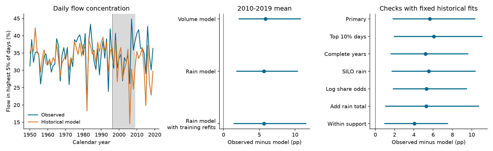

# Mean daily flow concentration exceeded historical estimates across 69 Victorian gauges in 2010-2019

At 69 Victorian stream gauges, the days with the highest flow carried a larger share of annual flow in 2010-2019 than a fixed historical model predicted. The mean excess was **5.64 percentage points**. The conditional 95% interval was **1.86 to 10.32 points**. The model used annual flow volume, daily rain concentration and seasonal rain fractions. It was fitted separately at each gauge with data from 1950-1996.

This result describes the distribution of daily flow within a year. It is not a rise of 5.64 points in the raw period mean. The observed mean share was 34.61% before the drought and 36.37% in 2010-2019. The historical model predicted 30.73% for the later records. The result also does not show that high daily flows became larger in absolute units.

The left panel shows annual gauge means of the observed and predicted shares. The grey band marks 1997-2009. The available gauges can change by year. The middle panel shows the 2010-2019 equal-gauge residual and 95% intervals. The right panel shows sensitivity tests. One percentage point is 0.01 of annual flow. The fixed-fit intervals condition on the historical model coefficients. The interval with training refits also varies those coefficients.

## Question and prior evidence

The Millennium Drought reduced runoff in southeast Australia. Peterson et al. (2021), [doi:10.1126/science.abd5085](https://doi.org/10.1126/science.abd5085), found that some catchments remained in a low runoff state after rainfall recovered. Fowler et al. (2022), [doi:10.5194/hess-26-6073-2022](https://doi.org/10.5194/hess-26-6073-2022), assessed possible causes. They discussed groundwater, vegetation, rainfall and changes in low flow. Thus, a change in the daily flow distribution is a prior possibility, not a new proposed mechanism.

Recent work also examines recovery of surface and subsurface flow and the timing of state changes. Zahedi et al. (2026), [doi:10.1029/2024WR039750](https://doi.org/10.1029/2024WR039750), modelled state probabilities with past rainfall deficits. Our test does not estimate those states or identify a storage threshold.

Campaign study [SCI 672c039d](sci:sha256:672c039d9e43607ac87973a55327f96bf0a3fa9ed71b643f31d4e16713710b97) found that two daily rain measures did not remove a post-drought annual runoff deficit at 70 gauges. [SCI a543d03e](sci:sha256:a543d03e2deabf3a55ebe32181f276d675340df270f3d065da0a4d3795d4979d) tested annual runoff memory across Australia. We read both verified publications. We use overlapping source records, but new code and a different response. This study tests the shape of daily flow after annual volume is included. It is not independent confirmation of their annual runoff results.

The scientific question is: does daily flow concentration retain a post-drought difference after a fixed historical relation accounts for annual volume and rain distribution? A positive result would limit an explanation based only on those summaries. It would not prove that drought caused the difference.

## Source data and sample

We used CAMELS-AUS v2.03, released on 7 December 2024 by Keirnan Fowler, Ziqi Zhang and Xue Hou, [doi:10.5281/zenodo.14289037](https://doi.org/10.5281/zenodo.14289037). The source paper is [doi:10.5194/essd-17-4079-2025](https://doi.org/10.5194/essd-17-4079-2025). We reused these existing files in shared storage:

| Path below `datasets/` | File |
| --- | --- |
| camels-aus-v2.03-zenodo14289037-streamflow | 03_streamflow.zip |
| camels-aus-v2.03-zenodo14289037-hydrometeorology | 05_hydrometeorology.zip |
| camels-aus-v2.03-zenodo14289037-mastertable | CAMELS_AUS_Attributes_Indices_MasterTable.csv |
| camels-aus-v2.03-zenodo14289037-datadescription | CAMELS_AUS_v2_Data_Description.pdf |

`files/results/provenance.json` gives the full shared and resolved paths, source URLs, file sizes, archive hashes and hashes of the ZIP members used. We read the observed daily flow in millimetres of catchment depth, not the model-infilled series. The primary rain source is AGCD. SILO supplies a source check. The master table supplies gauge location and state. No existing dataset was changed and no new shared download was needed.

We considered all 190 gauges with outlets in Victoria. Negative source values are missing. A valid calendar year has at least 97% nonnegative observed daily flow, complete nonnegative daily rain, and positive total flow and rain. A gauge needs at least 30 valid years in 1950-1996, 10 in 1997-2009, and 8 in 2010-2019. Selection does not use a runoff state or fitted sign. We retained 69 gauges, 2,608 training gauge-years, 885 drought gauge-years, and 662 post-drought gauge-years. Each fixed fit has at least 30 valid rows within the 47-year training period. We apply no further source quality-code filter. Nested catchments remain in the sample. A year with no flow cannot define a flow share and is excluded.

## Measures and models

For each gauge-year, we sort the observed daily flow values. We sum the largest `ceil(0.05*n)` values and divide by the sum of all `n` observed values. Call this share C5. In a complete year, the rule selects 19 days. In an accepted incomplete year, it can select 18 days. Ties do not affect their summed value. C5 is unchanged if every daily flow is multiplied by the same positive number.

Annual flow Q is observed mean daily flow times the number of calendar days. This correction assumes missing days have the observed mean. It cannot restore a missing flood peak. The complete-year check tests this concern in part. Rain concentration uses the same top-day rule. Seasonal rain fractions use March-May, June-August and September-November. January, February and December form the reference within that same calendar year. These are annual distributions, so no event-level alignment of rain and flow is assumed.

Each gauge has two ordinary least-squares models:

| Model | Terms besides an intercept |
| --- | --- |
| V: volume | Standardized log(1+Q) and its square |
| R: primary | V terms, rain top-day share, and three seasonal rain fractions |

All predictor means and standard deviations use the gauge's training rows only. Each model is fixed after 1996. Residuals are observed minus predicted shares. We average post years within gauge and then give each gauge equal weight. R tests a conditional historical relation, not a rainfall forecast. Current annual Q is an observed response of the catchment. Conditioning on it can introduce selection or dependence that prevents a causal interpretation.

The design in `files/PLAN.md` was written before calculation of concentration or model results. It is not an independent registration. Earlier campaign findings were known. Added source and model diagnostics are identified in `files/DIAGNOSTIC_NOTE.md`.

## Results and uncertainty

The primary mean residual was **+5.64 points**, with a conditional 95% interval of **+1.86 to +10.32**. The volume-only result was +5.85 points, with limits of +2.18 to +10.73. Adding the tested rain summaries changed the estimate by only -0.20 points. Fifty-eight gauge mean residuals were positive and 11 were negative. These signs are descriptive; they are not 69 separate significance tests.

The primary intervals use 5,000 resamples. We sample the 16 one-degree centroid cells with replacement and retain all gauges in a sampled cell. We also sample circular three-year blocks from the ten post years. All gauges use the same sampled years. A draw averages valid sampled years within each gauge and then all sampled gauges equally. It omits a gauge copy if no valid target remains. These intervals describe the selected sample and depend on the assumed spatial and time blocks.

A second procedure used 1,000 shared five-year training-block samples. It refitted the primary model at each gauge before sampling post years and spatial cells. The primary interval became **+1.47 to +11.47 points**, with a bootstrap median of +5.75. Of 69,000 fitted gauge models, 57 lost matrix rank. We retained their least-squares solutions and all draws. There were 15,737 predictions outside [0,1] across 662,000 post predictions. These model defects limit this approximate uncertainty check. It does not include measurement or model-form uncertainty.

| Model or data check | Gauges | Post rows | Mean R residual, points | Conditional 95% interval |
| --- | ---: | ---: | ---: | --- |
| Primary | 69 | 662 | +5.64 | +1.86 to +10.32 |
| Highest 10% of days | 69 | 662 | +6.06 | +1.98 to +11.07 |
| Complete flow years | 62 | 584 | +5.20 | +1.63 to +9.58 |
| SILO rain | 69 | 662 | +5.55 | +1.75 to +10.36 |
| Model of log share odds | 69 | 661 | +5.31 | +1.88 to +9.45 |
| Add annual rain and its square | 69 | 662 | +5.29 | +1.08 to +10.71 |
| Within all individual training ranges | 69 | 517 | +4.04 | +0.99 to +7.49 |

These are dependent sensitivity checks. They do not supply independent replications. The top-10% check changes both flow and rain shares. The model of log share odds omits one post row at the upper boundary. The primary direct-share model has ten post predictions below zero. This is a model defect. The bounded model retains a positive result. Clipping the direct predictions to [0,1] gives +5.43 points. Individual predictor ranges also do not define the full joint support of a regression.

One- and five-year post blocks gave intervals of +2.02 to +10.63 and +2.01 to +10.37 points. Using two-degree cells gave seven spatial groups and an interval of +1.37 to +11.50. Larger-scale dependence can remain even in that check.

The source paper recommends caution with rain before 1960. An added fit with 1960-1996 and at least 25 training years retained all 69 gauges and gave +5.55 points, with limits of +1.79 to +10.18. The estimate ranged from +3.69 to +6.27 points when each one-degree cell was removed in turn. It was +3.82 points in 2010-2014 and +7.47 in 2015-2019. A historical linear time term gave +7.24 points, with limits of +2.35 to +13.27. These added checks cannot establish a discrete drought effect or rule out other long-term changes.

## Historical prediction and arithmetic checks

For a separate historical check, we fitted the models on 1950-1986 and predicted 1987-1996. This check required at least 25 training years and eight test years. It retained 44 gauges and 439 test rows. R reduced mean squared share error by 10.34% relative to V. The block interval was -15.67% to +29.94%, so the gain was uncertain. Its mean residual was -2.25 points, with limits of -4.42 to -0.22. The model therefore had historical bias and should not be treated as a fully calibrated null. The earlier bias had the opposite sign to the post-drought estimate.

The audit independently selected the same 69 gauges. Pivoted QR and the analysis solver agreed within 5.1e-13 in predicted shares. A sorted-list calculation reproduced flow and rain metrics in 12 source gauge-years at three gauges, for 24 variable checks. Tests cover ties, zero totals and missing daily values. Three cached resampling draws matched direct table calculations within 1e-10 points. All checks passed. `files/results/audit.json` preserves the results. The aggregate bootstrap draws permit a separate check of the reported intervals without the source archives.

## Interpretation and limits

The result rejects an exact match to the tested fixed historical conditional mean under the stated bootstrap assumptions. It supports a post-drought change in daily flow distribution beyond these annual volume and rain terms. It does not prove a new physical mechanism. Groundwater loss, changes in flow generation, vegetation, fire, extraction, rain sequencing, measurement changes and model error remain possible explanations.

C5 does not identify baseflow, zero-flow spell length, peak flood size, groundwater recharge, or the season of flow. It can rise because low flows fall, because large flows rise, or because both change. Daily peaks can occur in more than one event. The test does not measure within-day extremes. The raw observed share changed by only +1.77 points between the two unequal period samples; the +5.64-point result is a conditional model residual.

The gauges are selected for long coverage, not sampled randomly from Victoria. Shared weather and nested catchments can create dependence across cells. Sixteen spatial cells and ten post years give limited support for uncertainty estimation. The intervals omit source error and model-form uncertainty. Neither the bounded response check nor the historical test removes those limits. We cannot generalize this result to all Australian rivers or claim that the change is permanent.

## Reproduction and publication rights

`files/REPRODUCE.md` gives exact commands. `files/code/prepare.py` rebuilds annual measures from fixed source files. `analyze.py` fits models and generates aggregate evidence and the figure. `audit.py` checks the arithmetic and added diagnostics. `retrieve.py` can fetch and hash-check the public snapshot if the shared files are absent. Runtime versions are in `files/results/summary.json`.

Raw archives, source extracts, gauge-year tables and gauge coefficients stay outside this signed bundle. They can be rebuilt in separate scratch. Their hashes are in `files/results/external_evidence_hashes.json`. The signed package contains our own code, text, figure and aggregate evidence. Source credit and external terms are in `files/DATA_NOTICE.md`. The exact SCI baseline LICENSE is unchanged. We grant its terms for the bundled materials and do not replace the source data license.

Campaign: 11_07_2026. Job: sci-1107-hp-earth-and-ocean-sciences-a1d5ed1a006f. Topic: earth-and-ocean-sciences. Machine: hp. Account: codex-andrii. Model: gpt-6.1-sol, high reasoning effort. Date: 2026-11-09. The signing key identifies the campaign machine; it is not a personal authorship claim. No agents were launched. The bundle was saved locally; this worker did not upload it or submit it to an index.
