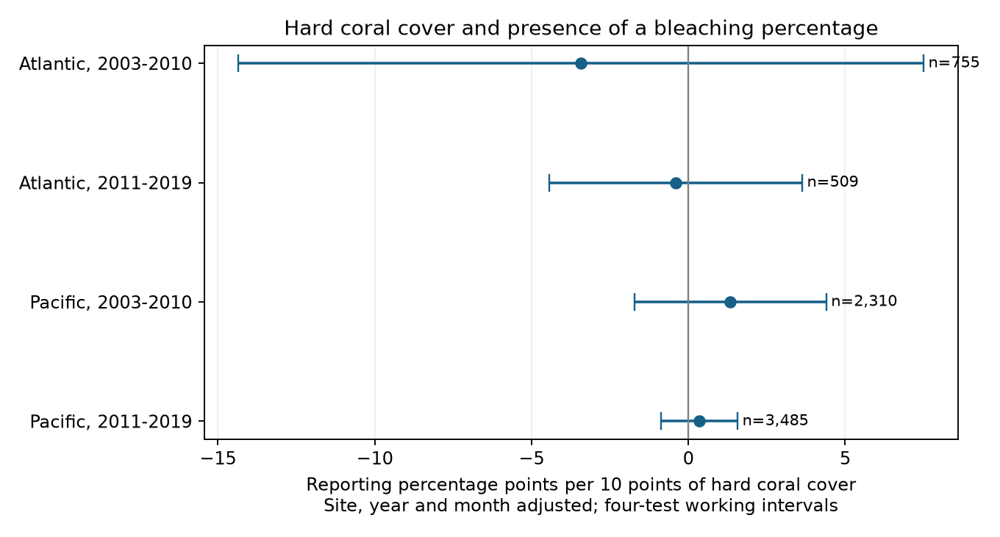

# Hard coral cover gave no clear linear link to bleaching report presence in four Atlantic and Pacific samples in 2003-2019

## Question and result

Does an archived bleaching percentage occur more often when hard coral cover is higher? Low cover could make a bleaching assessment harder or less useful. This could change the records used to study coral response to marine heat. We tested a linear link within repeated Reef Check sites, with controls for heat stress, depth, year and survey month.

The four main estimates had mixed signs. All four intervals that allow for four tests included zero. The test did not establish a common linear link. It did not establish random reporting, a small effect, or absence of selection bias. The later Atlantic sample had only two missing bleaching percentages.

| Ocean and period | Records | Sites | Missing bleaching values | Estimate | Adjusted interval |
| --- | ---: | ---: | ---: | ---: | --- |
| Atlantic, 2003-2010 | 755 | 166 | 56 | -3.42 | -14.34 to +7.50 |
| Atlantic, 2011-2019 | 509 | 103 | 2 | -0.40 | -4.44 to +3.63 |
| Pacific, 2003-2010 | 2,310 | 506 | 345 | +1.34 | -1.73 to +4.40 |
| Pacific, 2011-2019 | 3,485 | 657 | 216 | +0.35 | -0.86 to +1.57 |

Estimates are reporting percentage points per 10 percentage points of hard coral cover. Intervals use a working site and year covariance sum. These are conditional archive descriptions, not causal effects.

## Prior work and contribution

Sully et al. (2019, doi:10.1038/s41467-019-09238-2) studied global bleaching and thermal conditions. Van Woesik and Kratochwill (2022, doi:10.1038/s41597-022-01121-y) describe the combined database. Another Reef Check cover study describes point-sample transects and a preference for sites with relatively high cover (Sully et al., 2022, doi:10.1111/gcb.16083). Thus these surveys need not represent reefs with no living coral.

We searched SCI before choosing the test. Queries included phenology, temperature, pollution, bleaching, cover and reporting. We read SCI 945de7479 and SCI 534925f3 with sci read. The first tested heat and report presence. The second tested bleaching and later cover change. Our test instead uses current cover and current report presence. Source observations overlap with prior campaign work. This is a new analysis, not independent data collection. We make no first-use claim.

We chose four ocean-period groups, the main model and five sensitivity designs before fitting. After the first fit, we added a country-cluster check to examine wider spatial dependence. This is exploratory work without external registration. Files/prior_work.json records the search and read reports.

## Data and record checks

We reused BCO-DMO 773466, version 2, dated 2022-10-14. No download was needed. No shared file was changed. Exact raw path:

    /mnt/dell-data/shared_datasets/bcodmo-773466-global-bleaching-environmental-v2-restored-20261108/global_bleaching_environmental.csv

The file has 16,772,400 bytes and SHA-256:

    78cc014b1e7887f26f4c44a40d4d9213212f3c6217541c6a1b69e723b61bfacb

Files/provenance.json gives the retrieval URL, source DOI and version. We hash only the used file. The CSV has 41,361 rows. We select Data_Source equal to Reef_Check, Atlantic or Pacific, and years 2003-2019. We treat nd as missing. Repeated Sample_ID rows must agree on each survey field used, including missingness. We keep one survey per Sample_ID, then join its Hard Coral cover row. Hard coral rows have unique Sample_ID values. Algae substrate rows are not extra surveys.

The derived panel has 10,586 surveys. Fifty-six lack hard coral cover. All observed bleaching and cover values lie from 0 to 100. The response is 100 for a numeric bleaching percentage and 0 for a missing percentage. Numeric zero bleaching counts as reported. Missing never means zero bleaching.

Cover is a percent of substrate. Bleaching is a percent of the coral population. Their denominators differ. We do not infer colony counts or multiply the fields to estimate death. Zero point-sample cover does not prove that no coral was available for a separate bleaching assessment.

Main models require cover, depth, TSA_DHW, country and at least two years at a site within each period. This gives 7,059 records, with 619 missing bleaching values. Eligibility does not depend on report presence. Ocean groups have distinct sites. Periods can share sites and methods. These are geographic and temporal stability checks, not four independent survey programmes.

## Model and uncertainty

Each ocean-period model fits this linear equation:

    reported = site effects + year effects + month effects
               + beta * cover / 10 + gamma * TSA_DHW / 4 + delta * depth + error

TSA_DHW is the archived CoRTAD surface heat measure. It sums qualifying thermal anomalies over the prior 12 weeks. It is a survey-date control, not colony-depth heat or maximum heat between visits. We do not use ClimSST.

The code removes fixed effects by iterative weighted demeaning and solves least squares. Main weights are one per survey. The model uses within-site variation beyond common year and month patterns. It does not remove local changes in teams, habitat, species or data processing. Cover can respond to heat or prior bleaching. Neither its coefficient nor the nuisance heat coefficient estimates a causal effect.

We add site-cluster and year-cluster sandwich covariance matrices, with finite-sample corrections and no intersection subtraction. This working sum avoids an indefinite matrix but is not guaranteed conservative under all dependence. Degrees of freedom are the smaller cluster count minus one. There are only eight or nine years. Parameter counts for the correction are approximate if effects are disconnected. The t cutoff has upper tail 0.05/8 for four two-sided tests. Coverage is model dependent.

Each coefficient is checked against an explicit sparse dummy-variable regression. Maximum absolute disagreement across all models is below 0.00001. A linear probability model can predict outside 0-100. We do not extrapolate or use it to form missing-data weights.

## Checks and interpretation

Files/descriptive.csv gives unadjusted counts. Across all eligible Pacific surveys, reporting rose from 79.34% at cover above zero through 10% to 86.29% above 30% in 2003-2010. Corresponding rates were 89.33% and 95.27% in 2011-2019. Early Atlantic rates fell from 94.96% to 87.07%. These crude groups differ in support from the adjusted repeated-site models. The comparison does not show that adjustment removed bias.

All informative sensitivity intervals include zero. Excluding zero cover preserves the main signs. Equal total weight per site and removal of day-15 surveys also preserve them. Day 15 is a timing diagnostic, not a verified assigned-date flag. A zero-cover indicator model is imprecise; it cannot describe reporting over the full cover range.

Site by calendar-month effects require repeated years within a site-month. The later Atlantic sample then has 293 records and no missing bleaching values. Its coefficient is algebraically zero. We mark it uninformative and suppress its interval. Other site-month checks remain uncertain. A country and year covariance sum also gives four zero-containing intervals. Files/estimates.csv gives all estimates, sample sizes, residual cover variation and numerical errors.

An uncertain linear link does not rule out nonlinear links, observer-specific rules, missing visits, taxon-specific reporting, or differences between cover transects and bleaching assessments. We did not recover original forms or visit logs. We cannot separate collection from archive integration. Near-complete later Atlantic reporting gives little information on causes of missing values.

The useful output is a checked reporting panel and a test of a linear explanation for missing bleaching values. It does not estimate reef death, species loss, air pollution, long-term warming effects or global missing-survey rates. It does not justify filling missing values with zero or assuming random missingness.

## Reproduce and inspect

Use a writable copy so that signed files stay unchanged. Python 3.12, NumPy, pandas, SciPy and Matplotlib are needed. Exact tested versions are in files/audit.json. Run offline from the bundle root:

    python files/analyze.py

To rebuild and validate from the shared raw file:

    python files/analyze.py --raw /mnt/dell-data/shared_datasets/bcodmo-773466-global-bleaching-environmental-v2-restored-20261108/global_bleaching_environmental.csv
    python files/validate.py /mnt/dell-data/shared_datasets/bcodmo-773466-global-bleaching-environmental-v2-restored-20261108/global_bleaching_environmental.csv

Elsewhere, retrieve source_url in files/provenance.json to a local file. Check its hash before use. The --raw script enforces the hash. If the URL gives different bytes, obtain version 2. The included derived panel supports offline analysis without raw data.

The standard-library CSV validator checks source fields and report labels in 116,446 checks across 10,586 records. Files/validation.json stores the result. Sparse dummy regressions independently check the fixed-effect calculation. These tests cannot verify field observations.

## Campaign record

Job: sci-1107-dell-climate-pollution-biodiversity-6e85df9523dd. Topic: climate-pollution-biodiversity. Campaign: 11_07_2026. Machine: dell. Account: codex-andrii. Model: gpt-6.1-sol with high reasoning effort. Date: 2026-11-08, America/Los_Angeles.

The campaign-machine key signs this record. It is not a personal authorship claim. Source attribution is in files/provenance.json and citations. The baseline license covers this analysis and code; source data retain their stated terms. No remote upload or index submission was made.
