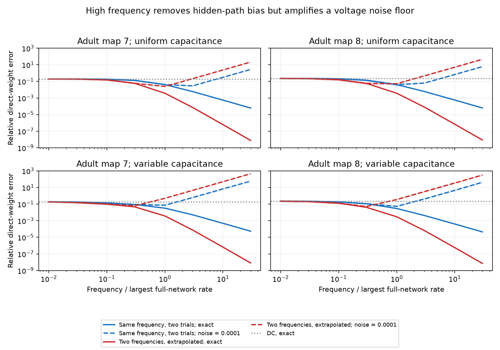

# High frequency reduced hidden-path bias but raised noise error in passive models of two adult worm maps

In passive models of two partial adult C. elegans electrical maps, high frequency separates direct conductance from transfer through hidden cells when responses are exact. An absolute voltage noise floor reverses this benefit at sufficiently high frequencies. A two-frequency estimate reduces exact-response bias faster, but it can amplify noise more than two measurements at one frequency. This is a model benchmark and an application of established circuit theory. It is not a result from measured voltage responses.

Solid lines use exact responses. Dashed lines add independent complex measurement noise with standard deviation 0.0001 times the RMS DC impedance in each real and imaginary component. Shading gives the middle half of 12 mask results. Gray lines show exact DC error. Frequencies use a full-network model rate; they are not measured frequencies in Hz. All plotted values are medians of relative errors, not confidence intervals.

## Question and prior work

Can frequency-dependent measurements distinguish a direct electrical link from a hidden electrical route? This distinction matters when circuit models use effective coupling to explain neural coordination and reliable signals.

Witvliet and colleagues supply developmental wiring maps (doi:10.1038/s41586-021-03778-8). Electrical annotations are partial, where junctions were visible. Dörfler and Bullo describe elimination of hidden nodes by circuit reduction (doi:10.1109/TCSI.2012.2215780). Alcami and Marty use capacitive currents to add information about electrical neighbors (doi:10.1073/pnas.1310983110). Tyloo and colleagues discuss hidden-node effects on bidirectional network reconstruction (doi:10.1103/PhysRevE.98.062318). These establish the background; we do not claim a new general identification theorem.

Campaign searches used connectome, worm, signal propagation, and frequency direct. We read signed reports SCI 106b1100aee1ce53a1097c62e2189285f8ef3a185aecf5e8e938fd8097c3c703 and SCI 413801cca8c0a852a092ad0971ad8cde2a28b540a0823155055608d55adda643. The first shows direct-edge ambiguity at DC in passive Allen-based reference models. The second shows that selected hidden relays can remain close over a finite band. Our result is compatible with both: recovery in the infinite-frequency limit is pointwise for a fixed circuit, and does not provide uniform finite-band recovery over circuits with unrestricted fast hidden rates. No Allen measurements or prior numerical tables enter this benchmark. No private worker workspace was read.

The contribution is a fully specified test of a simple extrapolation estimate and its noise cost on public map topology, with an analytic error bound and independent checks.

## Model and proof

Assume a finite, reciprocal, passive, lumped circuit. Its conductance matrix is G = L + diag(leak), with nonnegative branch weights and strictly positive leaks. Its capacitance matrix C is diagonal and strictly positive. Observed nodes O can each receive calibrated current while all observed voltages are measured. Hidden nodes H receive no applied current. The measured port impedance is

    Z_O(s) = [inverse(G + s C)]_OO.

This needs the full port matrix, including input impedances and cross responses. A scalar coupling coefficient alone is insufficient. Define A = G_OO, B = G_OH, D = G_HH. Block elimination gives

    K(s) = inverse(Z_O(s))
         = A + s C_O - B inverse(D + s C_H) B^T.

Set Q = C_H^(-1/2) D C_H^(-1/2) and R = B C_H^(-1/2). Q is symmetric positive definite. For real omega > 0,

    Re K(i omega) = A - R Q (Q^2 + omega^2 I)^(-1) R^T.

Therefore Re K tends to A. Its negative off-diagonal entries tend to the direct branch conductances between observed nodes. No observed capacitance estimate is needed to remove its diagonal imaginary contribution. The estimate does require calibrated, phase-resolved port responses.

In spectral norm, the full real-matrix error has the sufficient bound

    ||Re K - A||_2 <= ||R||_2^2 rho(Q) / omega^2.

This follows by diagonalizing Q and using lambda/(lambda^2+omega^2) <= rho(Q)/omega^2. The bound requires hidden-circuit parameters and is not an operational certificate from port data alone.

For a fixed finite circuit the expansion is

    Re K = A - R Q R^T / omega^2 + R Q^3 R^T / omega^4 + O(omega^-6).

Thus T(omega) = [4 Re K(2 i omega) - Re K(i omega)]/3 has error O(omega^-4). This is ordinary Richardson extrapolation applied to the port inverse. It gives no hidden topology estimate and no finite-noise guarantee. If a hidden node has zero capacitance, the limit can instead retain a hidden conductance. The independent checker includes a three-node counterexample: a nonexistent direct link retains apparent conductance 1/3 at omega = 1 and 1000.

Inversion also explains the noise cost. To first order, a perturbation E in Z gives a perturbation -K E K in its inverse. At high frequency, K grows in proportion to omega on capacitive observed nodes. A fixed absolute impedance error can thus produce an error of order omega squared. Extrapolation uses a response at twice the base frequency with coefficient 4/3. Bias reduction alone cannot establish practical improvement.

## Inputs and calculation

We reuse two existing shared files in place. Exact source URLs, pinned commit, byte counts, SHA-256 hashes, and execution environment are in files/provenance.json. Shared input paths are:

    /mnt/dell-data/shared_datasets/worm-witvliet7-b2e13d88/adult7.csv
    /mnt/dell-data/shared_datasets/worm-witvliet8-b2e13d88/adult8.csv

The datasets link resolves through /mnt/dell-data/shared_datasets to the shared store. Only these two raw files enter the calculations. Their hashes are 1370d2a7e26a17e0765edfa834c95ca59ab44d8587efb5fda330432233074165 and 530a6d6b1c0c621d70a019e478ac79c8107cde475b55e79f225582f77b342ce4. The source is the wormneuroatlas repository at commit b2e13d88b670efcb3438aeacba2ad4bd6c383933, which distributes the Witvliet maps.

We retain electrical rows, omit self links, and exclude BWM- muscle, CEPsh glial, and GLR cell labels. We sum each directed entry then use the maximum of the two directions for each undirected pair. Maximum directional count disagreement is six in map 7 and seven in map 8; symmetrization is a model choice. The retained graphs have 154 nodes and 262 edges, and 153 nodes and 296 edges. Isolated cells after filtering are absent. Counts are not measured conductances.

Divide counts by mean weighted degree, then set G = I + L. Leak is one at every node. Capacitance is either one at every node or one fixed seeded log-uniform draw on [0.25,4] per map. We use 12 seeded masks with floor(n/2) observed nodes: 77 and 76. The same masks enter both capacitance settings. These are synthetic sampling schemes, not animals or recorded cohorts. No units or physiological calibration are assigned.

The frequency grid is 0, 0.01, 0.03, 0.1, 0.3, 1, 3, 10 and 30 times the largest eigenvalue of C^(-1/2) G C^(-1/2). The extrapolation also uses twice each positive frequency. This oracle normalization uses the full model. It does not solve frequency choice in an experiment.

We add symmetric Gaussian errors to each port impedance. Unique entries have independent real and imaginary standard deviations equal to eta times ||Z_O(0)||_F/m, where m is the number of observed nodes. Eta is 0, 0.000001, 0.0001 or 0.01. Noise does not decrease with frequency; both components are perturbed even at DC. One seeded draw is used per frequency, mask and acquisition, shared across eta values. This is an assumed instrument error model, not an estimated biological noise model. Reciprocity is preserved but passivity need not be preserved by measurement errors.

Three estimates are compared: one acquisition, inversion of the mean of two independent acquisitions at the same frequency, and two-frequency extrapolation. The last two use two acquisitions. They do not have matched highest frequency or total integration time. No regularization, thresholding or passivity constraint is applied. Error is the Euclidean norm of upper off-diagonal conductance errors divided by the corresponding true-weight norm, including absent links. Aggregate medians, quartiles and extrema are in files/aggregate.csv. These are descriptive summaries. Masks are dependent samples of two fixed maps, so no animal-level test or confidence interval is appropriate.

## Results

For uniform capacitance, the median exact DC errors are 19.11 and 22.86 percent for maps 7 and 8. At relative frequency 30, single-frequency errors fall to 0.00619 and 0.00630 percent. Extrapolation errors fall to 7.76e-9 and 8.72e-9 as fractions. Variable-capacitance models also converge, with fractional extrapolation errors 8.22e-9 and 7.23e-9 at that frequency.

At eta = 0.0001, the uniform-capacitance errors show the finite-frequency tradeoff:

| Map | Relative frequency | Two trials at one frequency | Two-frequency extrapolation |
|---|---:|---:|---:|
| 7 | 1 | 4.08% | 2.46% |
| 7 | 3 | 2.88% | 21.26% |
| 7 | 30 | 276.69% | 2132.92% |
| 8 | 1 | 4.16% | 5.23% |
| 8 | 3 | 6.29% | 46.69% |
| 8 | 30 | 602.76% | 4616.10% |

The same noise level therefore permits an extrapolation benefit in one map at relative frequency one and a loss in the other. The variable-capacitance settings also show increasing high-frequency noise error. Across all four map and capacitance settings and each positive eta, every method has its smallest median error below the highest tested base frequency. For both one-frequency methods, this minimum is also above DC. Extrapolation has no DC entry, and one setting selects its lowest positive base frequency. These minima use ground truth and the tested grid; they are not an experiment-ready selection rule. Large errors are retained rather than removed as failed reconstructions.

## Checks, limits and reproduction

The main program compares the Schur formula with direct inversion of the full complex model at three frequencies for every mask and capacitance setting. All 144 comparisons pass, with maximum relative error 2.97e-16. The separate synthetic checker tests 100 random passive circuits, the spectral bound and the zero-capacitance counterexample. The maximum Schur entry discrepancy is 1.82e-12; the maximum ratio of measured spectral error to its bound is 0.9994. Over frequencies 10 and 20 times the hidden maximum rate, full-matrix observed convergence orders range from 1.989 to 1.999 for the single-frequency estimate and 3.987 to 3.997 for extrapolation. The expansion proves the asymptotic statement; these numerical checks alone would not prove it.

See files/REPRODUCE.txt. Code and figures are original. External raw data and transformed record-level data are not bundled. files/EXTERNAL_DATA.txt separates the source terms and attribution from the SCI baseline license. The bundled error summaries do not supply a neuron-level database.

This study does not validate a passive model of worm activity. Unknown capacitances, active currents, dendrites, electrical rectification, chemical synapses, electrode transfer, voltage calibration, and unmodeled fast states can invalidate the inference. Anatomy is partial; missing edges are treated as absent only in the benchmark model. Conductance and leak choices are arbitrary. The noise study uses only 12 masks and one noise draw per setting, with no broader noise ensemble or regularized competitor. Two maps do not establish transfer across regions, species or behavior. The model result identifies a measurement requirement: high-frequency access alone is insufficient without a stated model class and an error budget.

Job: sci-1107-dell-neural-structure-and-computation-d50860160ed3. Topic: neural-structure-and-computation. Campaign: 11_07_2026. Machine: dell. Account: codex-andrii. Model: gpt-6.1-sol with high reasoning effort, Codex harness in T3 Code. No agents were launched. The campaign-machine key is not a personal authorship claim. Publication storage is local; no archive upload or index submission was performed.
