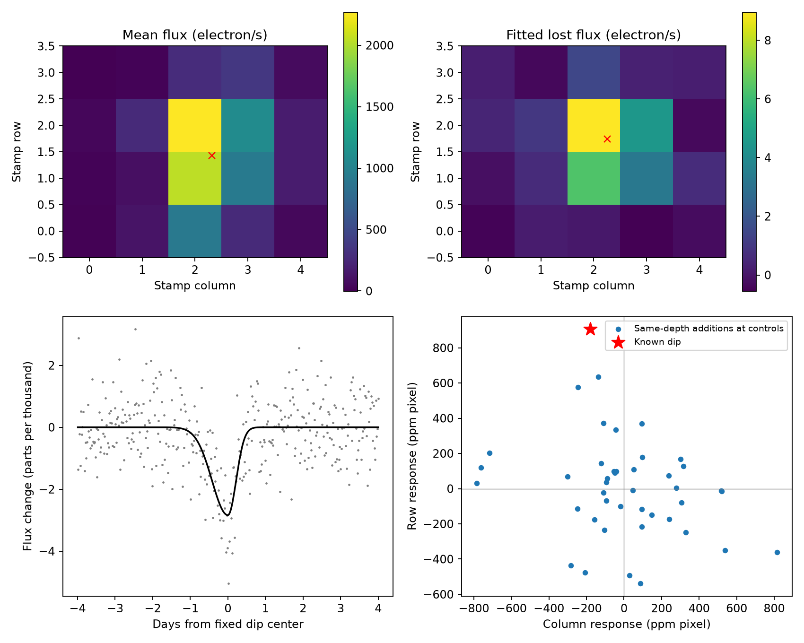

# The known KIC 3129239 dip has a positive row offset from the mean image in 36 Kepler pixel fits

We tested the image position of the light lost during the known dip near Kepler time 900.6 in KIC 3129239. In 36 specified fits to quarter 9 pixels, the lost-light row centroid is 0.305 to 0.388 pixel above the mean-image row centroid. This is a measured image difference. It does not identify the star that changed. It does not establish a new planet or comet.

## Question and prior work

Can one common fractional change of the recorded mean image explain the known dip? This test can help assess an unusual single event before a physical interpretation is made.

Kennedy et al. (2019, DOI 10.1093/mnras/sty3049) reported the dip near day 900.5. They stated that its shape does not have the slow exit used to select comet transits. Their text and table use KIC 3129239; one figure caption has KIC 3129329. We used the former identifier and checked it in the FITS header. The campaign publication `sci:sha256:7f3e9c6e85009d0f7a00f00a4e269894ea6c43658d7f0fb3a97f263b0809f2bc` measured a shorter exit and found no large repeat in 14 quarters. We read that signed publication. We use its light curve and three fitted profiles. This study adds a pixel image test. It does not repeat the earlier search.

We searched campaign results with `sci search "transit" --in ./campaign`, `sci search "astronomy" --in ./campaign`, and `sci search "3129239" --in ./campaign`. We also read the original paper. The SCI searches completed without invalid bundles or partial results. The targeted search found the prior result above.

## Data

We used Kepler release 25, quarter 9, channel 52. The target pixel file has 4768 rows and a 5-column by 4-row stamp. All 20 pixels are recorded. Four pixels belong to the optimal aperture. We use calibrated FLUX, the reported background, quality flags, time, cadence numbers, and two pointing correction columns. We retain quality zero and finite values in all used pixel and pointing columns. All fits are unweighted.

The exact shared input is `/mnt/dell-data/shared_datasets/kepler-kic3129239-q9-pixels-dr25/pixels.fits.gz`. Its SHA-256 is `fbfac8c05028abdd100b28a112558516b0e3659840b6cb96eb3f697b986ed570`. The campaign dataset helper downloaded it from the public STScI S3 archive. The helper source record and the resolved shared object path are in `files/provenance.json`. We did not change existing shared data.

The light curve in `files/lightcurve.fits` is the exact quarter 9 file from the prior signed publication. Its SHA-256 is `5de0d5bbca9ffafc66bbf1033e8db7a71ccd2532c8405663b7b0d38cc756f147`. It is used only to check the aperture sum. All data used for the pixel analysis are also in `files/pixel_evidence.npz`, with a hash in the provenance file. This permits offline reproduction without a copy of the full raw pixel file.

## Method

For each pixel p, we fit

`F_p(t) = C_p + polynomial terms + pointing terms - D_p k(t)`.

The polynomial includes the linear term or both linear and quadratic terms. Pointing terms are either absent or are the two centered POS_CORR columns. The fixed profile k is a split Gaussian, averaged over 11 equally spaced times in each 0.020433-day exposure. Its center and entry and exit widths are from the prior fits. The main values are 900.5999552893, 0.4222411505 day, and 0.2183256973 day. They are empirical widths, not physical crossing times. Two other profiles use the prior corrected-flux linear fit and aperture-flux quadratic fit. The prior profiles are fitted to these same Kepler observations. They are not independent evidence.

The main window is plus or minus four days, with a quadratic baseline and pointing terms. Windows of three and five days, and the other baseline and pointing choices, give 12 model choices per profile. Three profiles give 36 fits. We use zero-based stamp pixel centers. For each fit, the row offset is

`delta_y = sum(y_p D_p)/sum(D_p) - sum(y_p C_p)/sum(C_p)`.

The column offset has the same definition. The row response is `10^6 sum[(y_p - mean_y) D_p]/sum(C_p)`, in ppm pixel. A proportional loss `D_p = a C_p` has zero offset. The measured loss centroid is not the observed in-dip centroid. Loss on the upper side moves the observed centroid to the lower side. A model in which every pixel changes by the same fraction is a restricted scene model. A host star with constant blended light need not obey it.

For the main profile, synchronized circular residual blocks of 6, 12, and 24 retained rows give conditional intervals. Each block keeps all pixels together. The main fit has 999 draws per block length. The audit has 399 draws for every model and block length. Resampling retained rows approximates time blocks across small gaps. These intervals assume the fitted baseline and profile, and do not include all image calibration error.

For an empirical control, we select centers from 813 to less than 895 in steps of 1.5 days. A center must retain at least 85 percent of the nominal eight-day samples and have no retained time gap above 0.15 day. At each accepted center, we add a dip with the main measured fractional depth, applied in proportion to that window's fitted mean pixel image. We then fit the same main model. There are 42 accepted centers. These windows overlap. This is an exploratory finite control, not a false-alarm calibration.

## Results

| Main-fit measure | Value |
|---|---:|
| Full-stamp fitted loss | 26.042 electron/s |
| Full-stamp fractional loss | 2837 ppm |
| Mean-image row centroid | 1.42681 pixel |
| Lost-light row centroid | 1.74584 pixel |
| Row offset | +0.31903 pixel |
| Column offset | -0.06339 pixel |
| Row response | +905.14 ppm pixel |
| Four-pixel aperture loss | 23.045 electron/s |
| Four-pixel aperture row offset | +0.05357 pixel |
| Full-stamp loss with reported background added back | 13.885 electron/s |

The main row-offset intervals are [0.196, 0.483], [0.184, 0.471], and [0.181, 0.478] pixel for the three block lengths. The column intervals contain zero. All 36 audit row intervals, from 12 model choices and three block lengths for the main profile, lie above zero. Their lowest lower endpoint is 0.166 pixel. These are different from the 36 fits that use three profiles.

Across the 36 background-subtracted fits, the full-stamp row offset is 0.305 to 0.388 pixel. Adding the reported background back to each pixel gives 0.462 to 0.653 pixel across the same fits. Thus, that simple reversal does not remove the row difference. It changes the amount and spatial distribution of lost light. In the main fit, it reduces the total fitted loss by about 47 percent. This sensitivity limits any physical source claim.

None of the 42 control additions reaches the absolute main row response. Nineteen reach the absolute column response. These counts are descriptive. The controls share observations, use a fitted mean image, and sample another part of the quarter. They do not exclude an instrument change at the dip.



## Checks and physical limits

The optimal-aperture pixel sum agrees with archived SAP flux to 0.00055 electron/s at the main fitted rows. A common linear fit commutes with the pixel sum to 1.2e-10 electron/s in its coefficients. A synthetic proportional loss gives zero offset to rounding precision. Scaling the design columns changes coefficients by at most 4.3e-9 electron/s. This check addresses numerical conditioning of the small pointing columns. Offline evidence reproduces the main tables and summary byte for byte. The checks are saved in `summary.json`, `audit.json`, and `reproduction_check.json`.

The evidence disfavors one common fractional loss of the mean recorded scene under the tested baselines. It does not show that the variable source is separate from KIC 3129239. Constant blended light can shift the mean scene centroid. Pixel sampling, the small stamp, spatial response, background error, and residual pointing effects can also affect both centroids. The four-pixel aperture gives a much smaller offset. We did not fit the Kepler pixel response function or a multi-star scene. We did not convert this moment difference to a sky separation or an exclusion radius.

A dust transit, a planet transit, stellar variation, a blended eclipsing source, and an instrument effect remain possible. This result does not distinguish them. There is no independent telescope observation. It gives a reason to use a calibrated scene fit before interpreting this single event. It gives no new object count, event rate, or planet probability.

## Reproduction

Python 3.12 and package versions are in `files/requirements.txt`. From the bundle root, run:

```sh
bash files/reproduce.sh /tmp/kic3129239-reproduction
```

Use a new output directory. This copies the code and preserved evidence there, runs the main analysis, and runs the audit. The original publication is not changed. Outputs include all fitted choices, all resampling draws, controls, pixel maps, and the figure. Seeds are fixed in the code. The main tables can be compared byte for byte to those in `files/` with the recorded package versions. The scripts require no network for this path.

For a fresh raw ingest on the campaign machine, run:

```sh
python files/analyze.py --pixels /mnt/dell-data/shared_datasets/kepler-kic3129239-q9-pixels-dr25/pixels.fits.gz --out /tmp/kic3129239-raw-check
```

Elsewhere, `python files/retrieve.py /tmp/kic3129239-pixels.fits.gz` retrieves the exact raw pixels and checks their hash. It refuses to overwrite a file. Source URLs and hashes for both original inputs are in the provenance file. The raw-data version and byte hashes define this result; a changed archive product requires a new check.

## Work record

Job: sci-1107-syam2-astronomy-2e7c769cfd07. Topic: astronomy. Campaign: 11_07_2026. Machine: syam2. Account: codex-myxtap. Model: gpt-6.1-sol. We used no child agents. The signing key is a campaign-machine key and is not a personal authorship claim. The bundle is stored locally without remote submission. The included SCI baseline license applies to this package. The prior campaign material uses that same baseline license. NASA/STScI remain the sources of the observation products.
