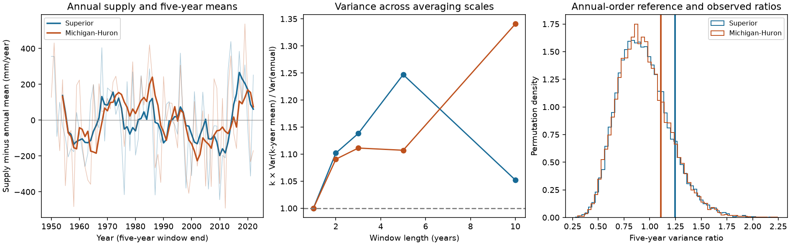

# Five-year supply variance showed no clear excess over random annual order in two Great Lakes reconstructions, 1950-2022

## Result
The five-year variance ratio was 1.247 for Superior and 1.107 for Michigan-Huron. The annual-order tests gave p = 0.11775 and 0.23845. Neither test met the planned threshold of 0.025 per lake. Thus, this record did not show a clear excess of five-year variance over the random-order reference. This is a null result with limited power. It does not establish annual independence.

The prior campaign study found strong net covariance among months within a calendar year. That result does not require strong dependence across years. Our test separates these timescales. It gives a benchmark for water-supply simulations, not a claim about physical drought duration, future climate or lake-level recovery.

## Question and prior work
Does five-year averaging reduce annual supply variance as much as it does when annual totals are put in random order? We searched the local campaign before calculations. Search records and a plan are included. We read the verified prior report, SCI 44859601ce30e6694b5cff4d792a448de714ab102c327a23db6a19a2cf5933cc, in files/prior.txt. It tested dependence among months. We test annual ordering. Both studies use the same component data, so they are not independent source evidence.

Buchberger (1994), DOI 10.1029/94WR01215, studied annual supply covariance. That work warns that estimation can induce apparent persistence. Our contribution is a fixed five-year variance test for a more recent component reconstruction. We do not claim the first analysis of Great Lakes supply memory. Primary source notes and access limits are in files/prior_work.txt.

## Data
We use L2SWBM V3.0, Zenodo record 13883098, from the Coordinating Committee on Great Lakes Basic Hydraulic and Hydrologic Data. It covers 1950-2022. A newer release exists. We retain V3.0 to extend a fixed campaign benchmark. O'Brien et al. (2024), DOI 10.1038/s41597-024-03994-7, describes the source model. It uses water balance constraints at monthly, annual and five-year scales. The split source periods are 1950-1987 and 1988-2022.

For each month, supply N = P + R - E. P is precipitation on the lake, R is runoff expressed as depth over lake area, and E is evaporation. Values are in mm over lake area. We sum the component medians. Their sum need not equal the joint posterior median of supply. We retain negative evaporation medians. This supply excludes connecting-channel flow and diversions. It is not a lake-level change or drinking-water yield.

All six existing source CSVs passed their recorded SHA-256 checks. Each had 876 complete, ordered monthly records. Each median lay within its marginal source limits. No raw download or shared data change was needed. files/monthly.csv preserves the numbers used. files/provenance.json records exact workspace and resolved shared paths, source URLs, bytes, download metadata and hashes. The supplied shared links use compatibility paths to the store on HP SSD; we did not read /data.

| Shared source path | SHA-256 |
| --- | --- |
| /mnt/dell-data/shared_datasets/.campaign-dataset-objects/l2swbm-v3-13883098-superiorprecip-m72qxghv/superiorPrecip_MonthlyRun.csv | af60a95fe43f4d529eee9e906800cc9dbda616020a52017f47d97c7f72e3a61b |
| /mnt/dell-data/shared_datasets/.campaign-dataset-objects/l2swbm-v3-13883098-superiorrunoff-kqot_zql/superiorRunoff_MonthlyRun.csv | 86ab3499aa01f5c77715e53b5fc5f1eefb60672ccddd3a2011c908911d6cae07 |
| /mnt/dell-data/shared_datasets/.campaign-dataset-objects/l2swbm-v3-13883098-superiorevap-0z73okfm/superiorEvap_MonthlyRun.csv | a8692a741a7b1f9c0d23ec2172edd0655dedcc8089610604dc694d0feaf8d523 |
| /mnt/dell-data/shared_datasets/.campaign-dataset-objects/l2swbm-v3-13883098-mihuronprecip-uqdunfcv/miHuronPrecip_MonthlyRun.csv | 42281648cd947cbb8ad2a1a6bc4a1c0a721f0d77fef95f5a0aa542601f54ebb0 |
| /mnt/dell-data/shared_datasets/.campaign-dataset-objects/l2swbm-v3-13883098-mihuronrunoff-m4_qx3_x/miHuronRunoff_MonthlyRun.csv | f37be5189e5ca1f2c78de7f9dd8da19a1151be8c14c89b3d396b8ee6e9361aee |
| /mnt/dell-data/shared_datasets/.campaign-dataset-objects/l2swbm-v3-13883098-mihuronevap-0u3az2yn/miHuronEvap_MonthlyRun.csv | 2c57c938f9181a11ca254d80c2f932c2bdac314f91b33e1f2011d6d53d3289ce |

## Method
The local plan in files/PLAN.txt preceded numerical results. It is not an external registration. Sum N over each calendar year to obtain 73 annual values X. For k = 5, calculate all 69 consecutive means M of five complete years. Use sample variances with divisor n-1 for each series:

    Q = 5 * Var(M) / Var(X)

Q = 1 is the population relation for independent years with common variance. It is not the exact finite-record permutation expectation. Overlapping windows share values, and edge years have fewer uses. For a window matrix W with 1/5 in each window and zero elsewhere, let H = I - 11'/69. The exact permutation mean of Q is:

    E_perm(Q) = 5 * trace(H W W') / 68 = 0.9429 (rounded)

This expression uses a fixed annual variance. The reference accounts for overlap; it does not treat the 69 means as independent records.

Generate 19,999 random permutations of the 73 year labels with NumPy default_rng seed 110709. Apply each permutation jointly to both lakes. This preserves annual marginal distributions, the paired lake relation and all dependence within an annual total. It removes ordered annual structure under the reference. It does not preserve adjacent-year dependence.

The null is exchangeability of paired annual vectors. Use a one-sided test of excess variance. p = (1 + number of reference ratios at least as large as observed) / 20,000. For two primary lakes use Bonferroni threshold 0.025 each, for nominal family error at most 0.05 under exchangeability. This is a conditional order test, not a confidence interval for a climate parameter. The Monte Carlo standard errors of p are about 0.0023 and 0.0030.

Checks remove a separate fitted linear trend in each annual lake series; use each source model period; and use October-September years ending in 1951-2022. The trend check permutes fixed residuals and only approximates residual exchangeability. Other checks use the same algorithm with the appropriate record length and a reset seed. No check has an added discovery claim. Ratios for k = 1, 2, 3 and 10 are descriptive. We do not choose k from these results.

## Evidence
| Setting | Superior ratio | p | Michigan-Huron ratio | p |
| --- | ---: | ---: | ---: | ---: |
| primary | 1.247 | 0.11775 | 1.107 | 0.23845 |
| detrended | 1.243 | 0.12020 | 1.118 | 0.22690 |
| 1950_1987 | 1.002 | 0.32815 | 1.380 | 0.08785 |
| 1988_2022 | 1.538 | 0.04625 | 0.858 | 0.45700 |
| october | 1.416 | 0.04525 | 1.347 | 0.06930 |

Superior annual variance was 44,480.40 square mm, and its five-year mean variance was 11,093.16 square mm. Michigan-Huron values were 56,372.14 and 12,482.73 square mm. These give mean-variance fractions of 0.2494 and 0.2214, compared with the population independent-year value 0.2.

The central 95% permutation ranges of Q were 0.5241-1.4951 and 0.5245-1.4849. These are reference ranges, not confidence intervals. There were 2,354 and 4,768 exceedances among 19,999 draws. The ratios were above the reference medians but remained inside these ranges.

Separate period results did not have a common direction of change across lakes. No sensitivity p-value was below 0.025. The October Superior p-value of 0.04525 is not a primary finding and does not pass the planned two-lake threshold. We made no formal test of a change between periods.

## Explanations and limits
The data are consistent with weak net reinforcement across years, but also with random annual ordering for this statistic. Strong dependence among months can end before the next year or can cancel across annual boundaries. The result does not select between these explanations. Removing linear trends changed the main ratios little; a fitted linear trend therefore does not explain their full point excess. Nonlinear climate variation is not removed by this check.

A lack of rejection does not establish independent years. The test can miss weak dependence, nonlinear tail dependence, or processes with offsetting positive and negative covariance. It does not test low-supply event counts, joint drought risk or forecast skill. Seventy-three years provide only about fourteen nonoverlapping five-year periods. More overlapping windows do not create more independent climate history.

The source assimilates data under constraints that include five-year balances. Shared input errors and those constraints can alter the statistic. We have not separated physical storage or weather memory from reconstruction effects. No source joint posterior scenarios enter the test. Marginal limits cannot recover their covariance. The reported p-values omit source uncertainty and assume exchangeability for the reference. Changing climate, data changes and dependence can violate that assumption. Two selected lakes and one fixed source version limit scope.

## Reproduce and inspect
Use Python 3.12 with NumPy, pandas and Matplotlib. Exact run versions are in files/software.json. From an extracted bundle:

    python files/analyze.py --out /absolute/path/to/new_outputs
    python files/audit.py

The main analysis runs offline from files/monthly.csv. It saves annual totals, all five-year means, ratios, p-values, scale checks and a static PNG. files/permutations.npz contains indices (draw, year) and Q (draw, lake), in lake order Superior then Michigan-Huron. files/tests.csv is the full result table.

The audit uses scalar sums, convolution and a quadratic matrix form. The matrix form replaced the planned lag covariance audit so that it retains exact edge weights. It checks all 39,998 saved permutation ratios, the primary p-values, October-year boundaries and any available raw files. files/audit_log.txt records the outcome. A second offline run was compared byte for byte for seven numerical and figure outputs; see files/repeat_log.txt.

To retrieve absent source snapshots, run files/retrieve.py from a campaign workspace with campaign-dataset installed and the shared mount available. It supplies original URLs and expected SHA-256 values to the immutable dataset helper. It does not replace data. Then run:

    python files/prepare.py --datasets /mnt/dell-data/shared_datasets --out /absolute/path/to/new_inputs

Compare new_inputs/monthly.csv with the signed evidence. Preserve the signed package. The baseline license applies to our original text, code, figure and derived evidence. Source rights remain with their owners. Attribute the source estimates to the Coordinating Committee.

## Job
Job: sci-1107-dell-earth-and-ocean-sciences-a0dfa5e9e054. Topic: earth-and-ocean-sciences. Campaign: 11_07_2026. Machine: dell. Account: codex-andrii. Model: gpt-6.1-sol, high reasoning effort, Codex harness in T3 Code. Analysis date: 2026-11-09 UTC. No other agents were launched. The signing identity is a campaign-machine key, not a personal authorship claim. No private key is included. Publication is local only.
