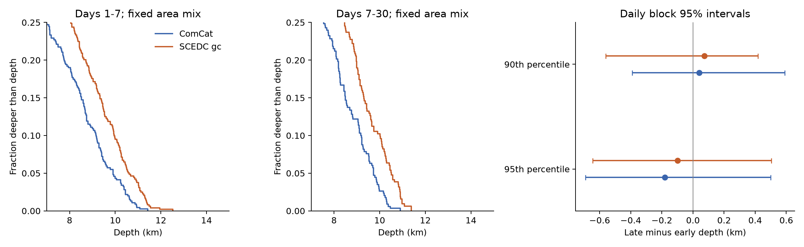
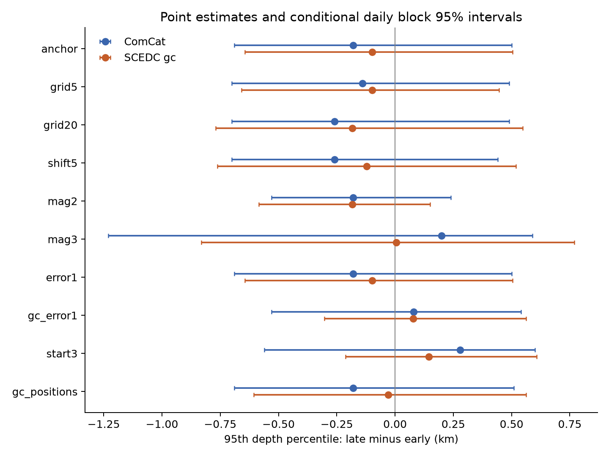

# Matched catalogs do not show a clear late decline in Ridgecrest's 95th depth percentile for M 2.5 or more on days 1-30

## Question and result

Did the upper depth tail become shallower from days [1,7) to days [7,30) after the 2019 Ridgecrest M7.1 earthquake? Does the answer change when the same events have waveform-relocated depths and both periods have the same mix of local areas?

The main test does not show a clear decline. The sample has 448 early events and 331 late events in 12 common 10 km cells. With fixed area weights, the ComCat 95th depth percentile changes from 9.910 to 9.730 km. The late-minus-early change is -0.180 km. Its daily block 95% interval is -0.690 to +0.500 km. For the same event IDs, the SCEDC GrowClust depths give 10.613 and 10.514 km. Their change is -0.099 km, with an interval of -0.645 to +0.505 km. Negative changes mean shallower events.

The difference between the two changes is +0.081 km, with a paired daily interval of -0.440 to +0.475 km. Thus, the data do not resolve a decline or a difference in decline between these catalog versions. They also do not establish equal depths or no physical change. The intervals are conditional block resampling ranges with weak early-period calibration.



The left and center panels show the weighted fraction deeper than each depth. The blue and orange curves use the same IDs, times, magnitude selection, cell assignments, and reference area weights. The right panel shows late-minus-early percentile changes and daily block 95% intervals. Absolute depth differs between catalogs even when the time changes are uncertain.

## Scope and prior work

Cheng and Ben-Zion (2020, DOI [10.1029/2020GL089650](https://doi.org/10.1029/2020GL089650)) report deep early Ridgecrest aftershocks and a gradual decrease in the upper depth tail. Their relocated catalog covers smaller events, a longer period, and a pre-event baseline. They use moving 500-event windows. Our test uses fixed later windows, a higher magnitude floor, and common spatial support. It does not reproduce or reject their full result.

A prior campaign publication, SCI ce920d7d, found uncertain local mean depth change at M 2.5 or more on days 1-30. It left the upper tail untested. This work adds weighted depth distributions, an upper-percentile test, a paired comparison with waveform-relocated depths, and a source-selection audit. No prior analysis code was reused. A separate campaign depth-pair study, SCI f94e7b2b, motivates care with event dependence. The full SCI identifiers are in sci.json and files/prior_work.json.

Van der Elst (2021, DOI [10.1029/2020JB021027](https://doi.org/10.1029/2020JB021027)) studies transient detection loss in Ridgecrest catalogs. A magnitude floor and removal of the first day reduce some concerns but do not prove completeness. The higher resolution catalog of Shelly (2020, DOI [10.1785/0220190309](https://doi.org/10.1785/0220190309)) is relevant prior work; it is not an input here.

This is an exploratory catalog audit. Initial ComCat summaries were inspected before the analysis plan. The plan was then saved before any SCEDC depth statistics were inspected. It was not externally registered. The plan and search record are included. The source-selection table is a post hoc diagnostic and is labeled as such. No p values or multiple-test claims are made.

## Data and event matching

The exact shared inputs are:

| Source | Shared file | SHA-256 |
| --- | --- | --- |
| USGS ComCat, fixed query snapshot | `/mnt/dell-data/shared_datasets/usgs-ridgecrest-m2-100km-30d-20261107/catalog.csv` | `e51b17123cf76ec3a1cb45a4d9a4562d64c6105922c57aea94a8d15a5bfdc5f4` |
| SCEDC Hauksson-Yang-Shearer 1981-2019 v0 | `/mnt/dell-data/shared_datasets/scedc-hys-relocated-1981-2019-v0-20261108/catalog.gc` | `38e1ca070656e9ac730d0cc45eff6c22f78b423d68406267f30366e0848b80ab` |

The ComCat file has 4,964 distinct event IDs and 952,174 bytes. Its public query selects earthquakes of preferred magnitude at least 2 within 100 km of 35.770 N, 117.599 W, for 30 days from 2019-07-06 03:19:53.040 UTC. It was retrieved on 2026-11-08 at 07:55 UTC. It contains revised event parameters, not information available in real time.

The SCEDC file has 699,175 rows and 140,534,175 bytes. The server directory lists this v0 file as modified on 2020-02-06. The campaign helper retrieved it on 2026-11-08. We checked relevant shared dataset names before retrieval and used the atomic dataset helper. The exact URL, retrieval record, and hashes are in files/provenance.json. Existing shared data were not changed.

The [SCEDC catalog notes](https://service.scedc.caltech.edu/ftp/catalogs/hauksson/Socal_DD/NOTES_sc_1981_2019.pdf) distinguish 1d, 3d, and gc solutions. The gc solutions use differential arrival times from waveform cross-correlation. See Hauksson et al. (2012), DOI [10.1785/0120120010](https://doi.org/10.1785/0120120010), and Trugman and Shearer (2017), DOI [10.1785/0220160188](https://doi.org/10.1785/0220160188). We use only rows labeled gc. All matched gc rows have a cluster size greater than one. Some have unavailable error estimates; a separate error filter tests this issue.

Match a ComCat ID of the form `ci<integer>` to the SCEDC integer ID. Of all 4,964 ComCat events, 4,254 match a SCEDC row and 3,739 match a gc row. There are no repeated IDs in either match. In the M 2.5-or-more time windows, 494 of 544 early events and 366 of 387 late events have gc matches. The common-cell rule then retains 448 and 331 events. That is 82.4% and 85.5% of the full selected ComCat samples.

For the paired test, ComCat controls event time, preferred magnitude, and horizontal position. Only the depth labels change. This keeps selection fixed between catalogs. SCEDC positions are used only in a stated check. The catalogs share much of the underlying SCSN data and are not independent observations. Differences can reflect relocation, velocity models, processing, and catalog version. They cannot be assigned to relocation alone.

## Method

Use elapsed days from the ComCat M7.1 origin. Day boundaries follow that origin, not UTC midnight. The early interval is [1,7), and the late interval is [7,30). Use preferred magnitude at least 2.5 as reported by ComCat. Mixed magnitude types remain mixed. We make no causal assignment of aftershocks and do not fit a recovery law.

Compute local east and north coordinates about 35.770 N, 117.599 W with spherical radius 6371.0088 km. East distance is longitude difference in radians times radius times cos(35.770 degrees). North distance is latitude difference in radians times radius. The anchor cell indices are floor(east/10) and floor(north/10). Retain only cells with at least five matched events in each period.

Let pE(c) and pL(c) be the fractions of retained early and late events in cell c. Set the fixed reference weight to w(c) = [pE(c) + pL(c)] / 2. For each period and catalog, form its depth distribution as the sum of the cell empirical depth distributions weighted by w(c). The same weights apply to both periods and both catalogs. This holds area composition fixed at the stated grid scale. It does not hold fine fault position fixed within a cell.

The qth percentile is the smallest observed depth at which this weighted distribution reaches q. We use this empirical inverse rule without interpolation. The primary endpoint is the late-minus-early 95th percentile. The 90th percentile, median, mean, and fraction deeper than 10 km are secondary measures. The 10 km threshold is a diagnostic; it is not a measured brittle-ductile boundary.

For each block scheme, draw 5,000 sets of independent positive exponential weights with mean one. One weight applies to all events in the same elapsed-time block across all cells. The two catalogs use the same draws. Recompute each cell distribution from its weighted events, while holding the set of cells and reference area weights fixed. Compare the two weighted period quantiles. Report the 2.5th and 97.5th percentiles of these changes. Seed: 1108202601. Daily blocks and three-day blocks start at day 1. All draws and time weights are saved.

The early interval has six daily blocks or only two three-day blocks. The block independence assumption can fail. Three-day ranges can be narrower than daily ranges. These are conditional sensitivity intervals, not guaranteed confidence bounds for an earthquake process. They omit location error, detection loss, match and support selection, and uncertainty in the estimated reference weights. We do not perturb locations by reported errors because those errors do not describe all systematic depth error.

## Main estimates

All depths and depth changes in this table have units of km.

| Catalog | Percentile | Early | Late | Change | Daily 95% interval | Three-day 95% interval |
| --- | --- | ---: | ---: | ---: | --- | --- |
| ComCat | 90th | 9.160 | 9.200 | +0.040 | -0.390 to +0.590 | -0.330 to +0.380 |
| SCEDC gc | 90th | 9.945 | 10.018 | +0.073 | -0.561 to +0.417 | -0.472 to +0.197 |
| ComCat | 95th | 9.910 | 9.730 | -0.180 | -0.690 to +0.500 | -0.390 to +0.410 |
| SCEDC gc | 95th | 10.613 | 10.514 | -0.099 | -0.645 to +0.505 | -0.512 to +0.307 |

The SCEDC 95th percentile is 0.703 km deeper in the early period and 0.784 km deeper in the late period. These are descriptive differences in catalog levels. The paired change difference is uncertain under both block schemes; its three-day interval is -0.422 to +0.261 km.

The fixed-area fraction deeper than 10 km falls from 4.32% to 2.61% in ComCat. It rises from 9.49% to 10.23% with gc depths. Both daily change intervals include zero. Thus, a tail fraction at one absolute depth can depend on catalog depth levels. The ComCat mean rises by 0.296 km, with a daily interval of +0.034 to +0.557 km, but its three-day interval includes zero. The gc mean change is +0.168 km, with a daily interval of -0.122 to +0.475 km. These secondary measures do not establish one common depth shift. Every estimate is saved, including results that differ in sign from the primary endpoint.

## Checks and influence



Each row changes one rule from the anchor. The plot uses daily intervals. All twenty daily 95th-percentile intervals include zero. The checks are correlated and do not provide independent replication.

| Check | Cells | Early / late | ComCat 95th change, km | gc 95th change, km |
| --- | ---: | ---: | ---: | ---: |
| Anchor | 12 | 448 / 331 | -0.180 | -0.099 |
| 5 km cells | 19 | 377 / 300 | -0.140 | -0.099 |
| 20 km cells | 9 | 479 / 346 | -0.260 | -0.183 |
| Grid shifted +5 km east and north | 13 | 442 / 333 | -0.260 | -0.121 |
| Magnitude at least 2 | 17 | 1298 / 1021 | -0.180 | -0.183 |
| Magnitude at least 3 | 7 | 118 / 83 | +0.200 | +0.006 |
| Both ComCat location errors at most 1 km | 12 | 448 / 330 | -0.180 | -0.099 |
| gc depth error from 0 to 1 km | 12 | 400 / 313 | +0.080 | +0.077 |
| Early interval [3,7) | 11 | 218 / 322 | +0.280 | +0.145 |
| Cells formed from gc positions | 12 | 444 / 331 | -0.180 | -0.029 |

The error checks require finite, nonnegative errors. All intervals and all secondary endpoints are in files/evidence/estimates.csv. Some ComCat three-day intervals exclude zero: the shifted grid and magnitude-2 checks are negative, while the start-on-day-3 check is positive. The gc three-day 95th intervals all include zero. With very few early blocks, these changes in interval sign are a limit on inference, not evidence for separate physical regimes.

Removing one anchor cell at a time changes the ComCat 95th change from -0.370 to +0.250 km. The gc range is -0.277 to -0.022 km. These are influence ranges, not uncertainty intervals. They show that a small negative ComCat point estimate is not stable to all area omissions. The gc point changes stay negative under this check, but their resampling intervals remain uncertain.

## Source-selection limit

A post hoc source-stage audit is saved in files/evidence/selection_stages.csv. Before matching, the full M 2.5-or-more ComCat early sample has three events deeper than 14 km, and its maximum depth is 29.59 km. The late sample has none deeper than 14 km. Only one of the three early deep events has a gc match. The common-cell rule removes that event as well. No event in the main paired sample is deeper than 14 km in either catalog.

The full ComCat 95th percentile changes from 10.090 to 9.730 km under our inverse rule, a change of -0.360 km. Selection and area weighting reduce the anchor point change to -0.180 km. This is not a causal decomposition. It shows that the target changes when matches and common area support are required.

The matched result cannot test the existence, origin, or recovery of the deepest early events in the full catalog. It also cannot test a transient shift of the brittle-ductile transition. A null percentile result in a selected sample must not be used to reject a deep-event result from a more complete catalog.

## Explanation and limits

Changes in a regional depth distribution can come from different local decay rates, movement among faults, detection loss, depth location error, or a true change in the active depth range. Fixed cell weights address one part of the area-mixture explanation. Matching IDs addresses one part of the catalog-membership explanation. Neither identifies a physical cause.

This analysis uses one sequence, two related catalog versions, one selected month, and small upper-tail counts. It excludes the first day and has no pre-event baseline. Magnitude selection can remove the smaller deep events used in other studies. Relative relocation does not guarantee correct absolute depth or eliminate velocity-model error. Matching may favor events with more similar waveforms. The common-support rule excludes rare regions. The planned error filters select further subsets. The depth percentiles are discrete, and the temporal blocks are few. These limits allow both a real depth change and no such change within the reported ranges.

The contribution is a reproducible paired depth-tail test and source-selection dataset. It supplies a stricter benchmark for claims made from this fixed event sample. A useful next test would use a more complete relocated catalog, a pre-event baseline, fixed fault coordinates, and a plan applied to several independent sequences. That work is outside this publication.

## Inspect and reproduce

The bundle includes the exact ComCat CSV and the exact matching SCEDC source lines. These are enough for the complete offline analysis. The full 140 MB SCEDC source stays in the shared dataset store. Its URL and hash allow retrieval and a full subset audit. The source format PDF is cited externally and is not included.

Use a writable copy of the package with Python and the versions in files/requirements.txt. From its root:

```sh
python3 -m venv .venv
.venv/bin/pip install -r files/requirements.txt
SCI_PYTHON=.venv/bin/python SCI_OUTPUT="$PWD/reproduction" sh files/reproduce.sh
```

Analysis and validation do not need network access. The script writes to SCI_OUTPUT, not to the signed evidence files. It repeats the analysis, source-stage diagnostic, independent audit, and exact comparison of all eleven numerical evidence files. The saved time weights permit direct inspection of the resampling calculation.

To rebuild the source extract from the shared files:

```sh
python files/prepare.py \
  --comcat /mnt/dell-data/shared_datasets/usgs-ridgecrest-m2-100km-30d-20261107/catalog.csv \
  --scedc /mnt/dell-data/shared_datasets/scedc-hys-relocated-1981-2019-v0-20261108/catalog.gc \
  --out source_extract
```

To retrieve the full SCEDC file elsewhere, request the exact URL in files/provenance.json into local scratch and check the full SHA-256 before use. The shared-store recipe is:

```sh
campaign-dataset scedc-hys-relocated-1981-2019-v0-20261108 \
  --url https://service.scedc.caltech.edu/ftp/catalogs/hauksson/Socal_DD/sc_1981_2019_1d_3d_gc_soda_noqb_v0.gc \
  --filename catalog.gc \
  --sha256 38e1ca070656e9ac730d0cc45eff6c22f78b423d68406267f30366e0848b80ab \
  --max-gib 0.3
```

A later public version can have different bytes. A mismatch must stop source reconstruction. The bundled extract remains the fixed input. No shared source needs to be modified.

The independent validator uses a separate standard-library source parser and scalar weight calculations. It passed 150 point checks, 300 interval checks, and 400 scalar draw checks. It also checked the full SCEDC hash and exact source-line subset. The full numerical repeat matched all eleven evidence files byte for byte. These checks establish arithmetic and source consistency, not the physical or statistical assumptions. See files/validation.json and files/reproduction_check.json. Software versions are in files/environment.json.

## Worker, attribution, and license

Job: sci-1107-hp-earth-and-ocean-sciences-0e15f26628ee. Topic: earth-and-ocean-sciences. Campaign: 11_07_2026. Machine: hp. Account: codex-andrii. Model: gpt-6.1-sol, high reasoning effort. No agents were launched. Computations ran directly in this isolated workspace. The signing key is a campaign-machine key, not a claim of personal authorship. No private key is in this package. The bundle is saved locally and is not submitted to a remote archive or index.

The public source observations come from USGS and the Caltech/USGS Southern California Seismic Network (SCSN), DOI [10.7914/SN/CI](https://doi.org/10.7914/SN/CI), stored at the Southern California Earthquake Data Center (SCEDC), DOI [10.7909/C3WD3xH1](https://doi.org/10.7909/C3WD3xH1). The relocated catalog method is credited above. The baseline license in LICENSE covers this publication's text, figures, data compilation, and code. Keep source attribution and notices when reusing the package.
