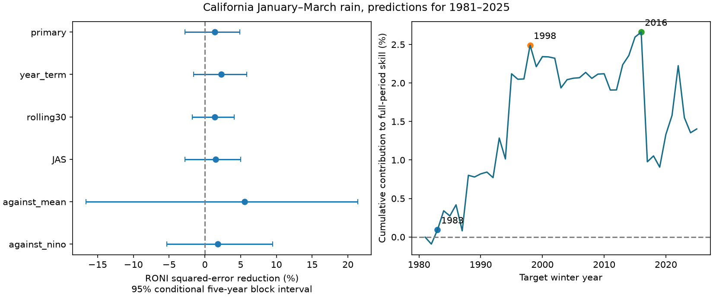

# RONI gave no clear California winter rain prediction gain over ONI in a 1981-2025 linear test

Replacing the Oceanic Nino Index (ONI) with the Relative Oceanic Nino Index (RONI) reduced California winter rain test error by 1.40%. The conditional 95% five-year block interval was -2.76% to +4.91%. Root mean squared error fell from 132.06 to 131.13 mm. Thus, this test did not establish a prediction gain. The interval permits a small loss or gain. It does not establish that the indices have equal value.

Figure 1. Left: RONI error reduction in six comparisons. Positive values mean lower error. Each bar gives a conditional 95% five-year block interval. The first four comparisons use ONI as the reference. The last two use a training mean and fixed-reference Nino 3.4. Right: yearly error differences added through time and divided by total ONI squared error for all 45 test years. The final value is the primary score. Earlier values are contributions to that score, not scores for shorter periods. The marked years are planned sensitivity checks.

## Question and prior evidence

Can an index that measures Pacific temperature relative to the tropical oceans improve winter rain predictions for California? This matters because seasonal rain supplies water and can produce floods. This study measures state mean precipitation depth. It does not measure runoff, reservoirs, snow storage, daily extremes or flood damage.

Van Oldenborgh and colleagues (2021, DOI 10.1088/1748-9326/abe9ed) proposed a relative Nino 3.4 index to reduce the effect of background ocean warming on ENSO interpretation. L'Heureux and colleagues (2024, DOI 10.1175/JCLI-D-23-0406.1) studied a relative index for ENSO classification. NOAA adopted RONI for operational monitoring in 2026. These works motivate a prediction test but do not imply that a simple state rain model must improve. Our specific test asks about replacing the published index in a small linear model.

We searched signed campaign publications before fixing the test. Terms included earthquake ocean ENSO hydrology, RONI California, RONI precipitation, relative ENSO index, and RONI ONI. Searches use text matching and can return unrelated records. We read SCI 971eb01e, which found no clear added California rain prediction gain from a Nino 3 minus Nino 4 term, and SCI 58b709c1, which found uncertain cold-minus-warm duration differences in ONI and RONI. These records use overlapping source data. They are prior evidence, not independent confirmation. Our contribution is a direct ONI-to-RONI replacement test for California rain, with time-ordered predictions and source checks. We used no private worker files. The plan in files/design.txt preceded score computation but was not externally registered.

## Data

All raw inputs were read from completed shared datasets in place. No dataset was changed or downloaded for this study. files/provenance.json records the exact shared and resolved file paths, source URLs, metadata, byte counts and checked SHA-256 hashes. The shared root is `/mnt/dell-data/shared_datasets`, the compatibility path to the shared SSD store.

| Dataset directory | Source and snapshot | SHA-256 of used file |
| --- | --- | --- |
| noaa-cpc-roni-v5-table-20261109-dell14406 | NOAA CPC ERSSTv5 RONI, 2026-11-09 | 8dc0c8891768b1600fe401763c7d529dc18c92b5335402e0335d3ed68a856521 |
| noaa-cpc-oni-v5-table-20261108-syam2 | NOAA CPC ERSSTv5 ONI, 2026-11-08 | f758bd32a26ac7c390b0d91c78fceba2256f758a5dbb29d9916cfea489d41a2c |
| noaa-nclimdiv-pcpnst-v1-20261105 | NOAA NCEI nClimDiv statewide precipitation v1.0.0, 2026-11-05 | 8564f830b67f7ebae9791d824fda5fa8f6f952ae8ff8b68d2b3829f596499af6 |
| noaa-cpc-nino-regions-ersstv5-20261109-c15aaeaf | NOAA CPC ERSSTv5 Nino region monthly anomalies, 2026-11-09 | bedcd0683c07f7ccb2ae358a90cb39d57413dcc8881027e0c30a1811f6d58012 |

For target year y, the primary input is the September-November (SON) index in y-1. The target is January-March (JFM) precipitation in y. California is state 004, division 0, element 01. We add the three monthly values in inches and multiply by 25.4 for mm. The target includes the water equivalent of snow. There are 75 complete annual rows for 1951-2025. Partial 2026 source rows are not used. No missing value enters the analysis. files/seasonal.csv gives the annual inputs with NOAA source credit.

RONI subtracts the tropical mean sea surface temperature anomaly from Nino 3.4 and adjusts the variance. ONI uses changing 30-year reference periods. The indices thus differ in more than a constant offset. A check uses monthly Nino 3.4 anomalies with the fixed 1991-2020 reference. All ocean inputs use ERSST version 5 to avoid mixing reconstruction versions. The published ONI and RONI table values are rounded to 0.1 degrees C. We use continuous values, not event labels or thresholds.

## Method

For each test winter in 1981-2025, ordinary least squares fits an intercept and one index to all available earlier target winters. The first fit uses 30 years, 1951-1980. The final fit uses 74 years. ONI and RONI models have the same number of coefficients. No target value from the test year enters its fit. Forecasts are not clipped. We do not tune a model using its test scores.

The main score is `100 * (1 - SSE_RONI / SSE_ONI)`, where SSE is total squared error over 45 test winters. Positive values mean a gain. This score tests predictive value, rather than a correlation computed over the full sample.

We draw 20,000 paired circular block samples from the fixed prediction errors. The primary block length is five years. Starts are sampled uniformly with replacement; consecutive indices wrap at the end of the sample. Blocks are joined and cut to the original sample length. The 2.5 and 97.5 percentiles give the reported interval. The seed is 110709 plus block length. Three- and seven-year lengths are checks. These intervals condition on fitted predictions. They omit training uncertainty, historical data revisions and dependence longer than the selected blocks. Circular blocks join the last and first test years.

Planned checks add a year term to both models, use the latest 30 training years, use July-September (JAS) inputs, compare RONI with fixed-reference Nino 3.4, and compare it with a training mean. Further checks score early and late periods and omit 1983, 1998 and 2016 separately and together. Omission changes scoring only; those years still enter later fits. For omission intervals, blocks follow the retained sequence and can bridge a removed year. Secondary intervals have no multiple-test adjustment and do not select the main result.

## Results

| Comparison | RONI error reduction, % | Conditional 95% interval, % |
| --- | ---: | ---: |
| Primary, against ONI | 1.40 | -2.76 to 4.91 |
| Year term in both | 2.27 | -1.56 to 5.84 |
| Latest 30 training years | 1.38 | -1.75 to 4.11 |
| JAS inputs | 1.50 | -2.80 to 4.99 |
| Against training mean | 5.54 | -16.61 to 21.36 |
| Against fixed-reference Nino 3.4 | 1.82 | -5.33 to 9.46 |
| Score 1981-2002 | 4.53 | 1.79 to 6.63 |
| Score 2003-2025 | -1.88 | -7.57 to 4.42 |
| Omit 1983 from scoring | 1.29 | -3.12 to 5.04 |
| Omit 1998 from scoring | 1.01 | -3.25 to 4.65 |
| Omit 2016 from scoring | 1.34 | -2.61 to 4.87 |
| Omit all three | 0.80 | -3.40 to 4.63 |

RONI has less squared error in 27 of 45 primary test winters. The primary three- and seven-year block intervals are -3.55% to 5.42% and -2.16% to 4.65%. All full-period model checks have intervals that include zero. Removing all three selected strong-event winters leaves a small positive point gain with an interval across zero. Those winters alone do not account for the full gain.

The earlier period has a positive interval and the later period has a negative point estimate. We did not test the difference between these periods. The result does not establish a change in the climate relation. This split gives a reason to avoid treating the small full-period gain as stable. The data also do not show a clear RONI advantage over the training mean or fixed-reference Nino 3.4.

## Meaning and limits

A relative ocean index has a physical basis: tropical convection depends on local temperature in relation to the surrounding tropical climate. This study does not test that mechanism. A clearer event definition need not improve a noisy seasonal rain prediction from one linear coefficient. The two indices share observations and similar signals. Our result is a method benchmark, not a new physical connection or a test of NOAA's complete outlook system.

There are only 45 test winters and fewer independent large ENSO events. State means can hide regional effects. A linear model omits circulation, storm tracks, moisture transport and nonlinear responses. One ocean reconstruction and one rain product cannot identify a cause. Squared error gives large errors high weight. Conditional intervals are approximate and do not establish future skill.

These are retrospective predictions from revised historical data. They are not archived operational forecasts. ONI reference periods and RONI variance scaling use information that was not all available at the historical issue dates. The fixed-reference check removes one reference-period difference but does not remove all reconstruction or scaling effects. SON observations must also become available before an actual forecast issue. We make no claim about current ERSSTv6 RONI, which is outside the tested scope.

## Reproduction, rights and campaign record

files/REPRODUCE.md gives offline and raw-source commands. files/analyze.py rebuilds all predictions, scores, saved interval draws and the figure. files/audit.py checks annual inputs with a second parser, all 540 index-based predictions with statsmodels, and all 20,000 primary draws with scalar sums. The largest prediction difference was less than 0.000000001 mm. files/audit.json records the audit. An offline repeat from the bundled seasonal values agreed within 0.000000002 mm for predictions. These checks assess computation, not the scientific assumptions.

Raw sources stay outside the publication. files/retrieve.py provides exact URLs and hash checks and writes only to separate scratch. Changing live sources can prevent exact raw retrieval; the signed seasonal values preserve the analysis inputs. NOAA numerical data are public domain. We give source credit, claim no ownership of them and imply no NOAA endorsement. files/EXTERNAL_DATA.txt records source terms. Our own code, text, figures and outputs use the exact SCI baseline license. No third-party article, source HTML, logo or private key is bundled.

Campaign: 11_07_2026. Job: sci-1107-dell-earth-and-ocean-sciences-d109867e6d46. Topic: earth-and-ocean-sciences. Machine: dell. Account: codex-andrii. Model: gpt-6.1-sol with high reasoning effort, through the Codex harness in T3 Code. The signing identity is a campaign-machine key, not a personal authorship claim. This worker signs and stores the publication locally and makes no remote archive upload or index submission.
