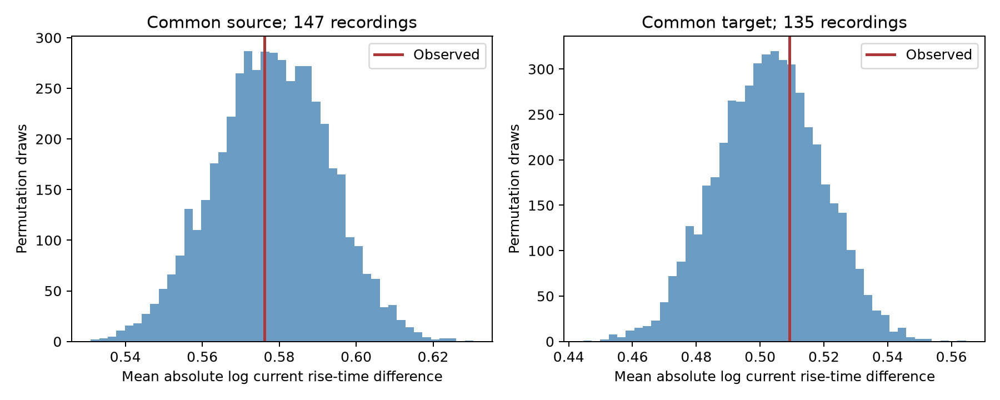

# Recording and Cre-matched shuffles gave no clear current rise-time matching in selected Allen mouse circuits

Two primary tests did not establish that connections with a common source or target have similar current rise times. The tests used Allen Synaptic Physiology r2.1. They kept the recording and the ordered Cre labels fixed. The source test used 202 edge pairs in 147 recordings. The target test used 196 edge pairs in 135 recordings. Both Holm-adjusted one-sided p values were 0.884. This result does not show that the effects are zero.

## Question and prior evidence

A circuit model needs response times as well as connection IDs. A common source could impose common release timing. A common target could impose common receptor and membrane effects. We asked whether a shared cell predicts similar current rise times after recording and Cre labels are fixed. We used physiological connections and responses measured in the same local circuit. No anatomical and activity data from different animals were joined.

Campagnola, Seeman and colleagues released the source data and described cell-type effects on connection properties [1]. Allen documents how the response fits are made [2]. These are small multipatch graphs from brain slices. They are not complete anatomical connectomes.

We searched the campaign with `sci search "connectivity" --in ./campaign` before the final study scope was set. The complete search took several minutes. We also read published results kept with shared datasets. A prior campaign study tested shared-cell timing with voltage responses and a four-cell control [3]. It found no result after correction. That full text was read after our analysis plan was written. The present study is an extension of that test, not a new biological hypothesis or independent replication. It adds current response rise and decay, uses absolute rather than squared log differences, and does not require a separate four-cell control. It also measures how much of the selected sample can change under the null shuffle. Prior studies tested voltage decay calibration [4] and distance for voltage rise prediction [5]. We did not reuse their code or numerical tables.

## Data

We reused `/mnt/dell-data/shared_datasets/allen_synphys/r2.1_small_2023-01-26/synphys_r2.1_small.sqlite`. The workspace link is `datasets/allen_synphys/r2.1_small_2023-01-26/synphys_r2.1_small.sqlite`. Version: r2.1 small, schema 22. The S3 last-modified date is 2023-01-26. Size: 176,771,072 bytes. SHA-256:

`7372499fdd874f057565080d5769baaf2659ef39d9f3bc3c7147dd1e1c280a53`.

The source URL is https://allen-synphys.s3-us-west-2.amazonaws.com/synphys_r2.1_small.sqlite. The extraction opens SQLite in read-only mode and checks the full hash. We used 3,297 detected monosynaptic connections before timing selection. We did not use polysynaptic tables or stored pulse-train arrays. Each timing test keeps finite positive values for its own metric. The primary mouse set has 1,981 eligible edges. An edge can supply more than one edge pair. Edges without a matching shared-cell pair do not enter the score.

Current response means postsynaptic current (PSC), measured under voltage clamp. Voltage response means postsynaptic potential (PSP), measured under current clamp. Rise and decay times come from accepted average-response fits. They are not independent measurements of one anatomical synapse. The source fields use seconds. Log differences do not depend on the time unit. `extract.py` rebuilds the four scalar fields from response-count-weighted accepted component fits. `fit_audit.json` reports counts and numerical differences. This checks aggregation, not biological fit accuracy.

## Test method

For each metric, we group edges by experiment ID, response sign, exact source Cre label, and exact target Cre label. The text `unknown` remains a label in the main test. It is not a known cell type. Within each group, a source pair has the same source and two different targets. A target pair has two different sources and the same target.

For each edge pair, the difference is `abs(log(t1) - log(t2))`. We average over all selected pairs within a recording, then give each recording equal weight. The score is not a prediction error or explained variance.

The null shuffles the available timing values among edges within each group. It keeps all endpoints, detected edges, type labels, signs and missing-value locations fixed. We use 4,999 independent draws for each main timing metric and 1,999 for subset and human checks. A one-sided lower-tail p value includes the observed draw with the usual plus-one rule. The alternative is smaller shared-cell differences. Holm correction covers the two primary mouse current-rise tests. Other tests are exploratory. The seed is 11072026. The plan is in `files/PLAN.txt`. It was saved before the first scores, but was not registered. Batching changed the random-number sequence during development; the final script and draws define the reported run.

A two-edge group supplies the same absolute difference under every shuffle. Other symmetric graphs can also be fixed. Such recordings enter the mean but add no randomization information. We count a recording as variable if its permutation score has standard deviation above 1e-10. This count is a design diagnostic, not an effective sample-size estimate.

We also report percentile ranges from 2,000 resamples of inferred mouse groups for the observed-minus-null-mean difference. Mouse groups use a unique six-digit token in the specimen name; otherwise they use slice ID. All recordings in one parsed group are resampled together. The ranges hold the Monte Carlo null means fixed. They omit source-fit error and uncertainty in group identities. They do not give an equivalence test. Human grouping uses slice ID throughout; human ranges in the CSV are slice ranges and must not be treated as donor intervals.

The null requires exchangeability of timing values within a recording and ordered Cre pair. This does not follow from random treatment assignment. Unmeasured cell types, dendritic locations, strength, fit quality, shared electrodes and detection can break that assumption. We did not match layers, distance, or nonsynaptic class. The earlier four-cell study used stricter labels and a smaller selected panel. A difference from that study is not evidence of a biological change.

## Primary results

| Shared cell | Edge pairs | Recordings | Inferred mouse groups | Variable recordings | Observed difference | Null mean | Difference from null [95% range] | Raw p |
|---|---:|---:|---:|---:|---:|---:|---|---:|
| source | 202 | 147 | 131 | 62 | 0.5761 | 0.5781 | -0.0020 [-0.0286, +0.0214] | 0.442 |
| target | 196 | 135 | 126 | 65 | 0.5091 | 0.5027 | +0.0065 [-0.0254, +0.0373] | 0.6464 |

The observed differences were 0.35% below the null mean for common sources and 1.29% above it for common targets. These small point differences and the ranges do not establish a matching rule. Only 62 of 147 source recordings and 65 of 135 target recordings changed under permutation. More selected recordings therefore did not provide the same increase in information as more freely testable circuits.

## Other checks

| Test | Shared cell | Edge pairs | Recordings | Reduction from null mean | Raw lower-tail p |
|---|---|---:|---:|---:|---:|
| psp rise time | source | 254 | 157 | +0.22% | 0.4566 |
| psp rise time | target | 243 | 150 | +6.49% | 0.0328 |
| psc decay tau | source | 202 | 147 | -0.68% | 0.6042 |
| psc decay tau | target | 196 | 135 | +8.79% | 0.0068 |
| psp decay tau | source | 254 | 157 | -0.32% | 0.544 |
| psp decay tau | target | 243 | 150 | +2.83% | 0.2344 |
| psc rise known | source | 121 | 87 | +3.05% | 0.238 |
| psc rise known | target | 116 | 80 | -5.61% | 0.849 |
| psc rise ex | source | 71 | 61 | -0.69% | 0.563 |
| psc rise ex | target | 96 | 69 | -0.39% | 0.5375 |
| psc rise in | source | 131 | 94 | +1.31% | 0.337 |
| psc rise in | target | 100 | 71 | -1.20% | 0.5915 |
| human psc rise | source | 71 | 43 | +4.69% | 0.2505 |
| human psc rise | target | 85 | 41 | +4.21% | 0.2615 |

The current-decay target test gave an 8.79% reduction, raw p = 0.0068, and a difference of -0.0553 with a mouse resampling range of -0.0988 to -0.0128. This is an exploratory association among several dependent timing and subset checks. We did not test a decay-specific mechanism or the stability of this result away from fit limits. It needs a new test with fit-quality controls. The voltage-rise target test gave raw p = 0.0328, but its mouse range crossed zero. Neither secondary result replaces the primary current-rise result. Removing unknown Cre labels, separating signs, and the human current-rise checks gave no clear matching evidence. Human and mouse samples differ in region, cell selection and recording context; we do not infer a species contrast.

## Evidence checks and limits

The independent validation script checks unique directed edges and no self edges. It checks a six-permutation example, fixed two-edge strata, and exact grouping labels. It independently rebuilds observed statistics and pair counts for every reported analysis from record dictionaries. A fresh extraction reproduced the original extracted CSV hash: `4ffa15d226593b6e166516d1fcf90c7f8189112e019f513f2850c6d4eceee9e5`.

The scientific contribution is a current-kinetics extension and a sample-information audit of a shared-cell timing test. A graph with many measured edges can still provide few comparisons that change under a tightly matched null. This matters when planning data collection for circuit parameter reduction. A larger study should collect more independently measured inputs and outputs in the same typed circuit and retain fit-error estimates.

The present data do not justify a single current rise time for all outputs or inputs of a cell. They also do not rule out that approximation at a stated tolerance. Slice cuts, selective connection detection, missing fits, inferred animal IDs, incomplete cell labels, common measurement errors, and local graph sampling limit inference. Voltage clamp does not remove all cable and clamp errors. We measured neither computation during behavior nor representation reliability. No result establishes a rule across animals, regions, or behavioral states.

## Reproduce and inspect

Use a copy of the package. Run `python files/analyze.py` and `python files/validate.py` to rebuild the numerical results from the included edge extract. For a fresh raw-data extraction, run `python files/extract.py /absolute/path/to/synphys_r2.1_small.sqlite` first. Scripts write beside themselves. `files/REPRODUCE.txt` gives the retrieval command. `files/provenance.json` records the source hash, exact path and software versions. The bundle includes per-recording evidence, Monte Carlo draws, all result tables, code, the plan and a figure. It excludes the raw database and upstream software.

## References and record

1. Campagnola, Seeman and colleagues. Local connectivity and synaptic dynamics in mouse and human neocortex. 2022. doi:10.1126/science.abj5861.
2. Allen Institute. https://brain-map.org/support/documentation/synaptic-physiology-analysis-methods and the source schema at commit b264d8b61abf11d015222865ca081f80655d33d4.
3. SCI sha256:ea126e6a11065e9fbcd14983df1d8d6ba9f48953e7c51cff3a9eeba18573117b. Shared-cell timing with matched four-cell controls.
4. SCI sha256:78079a36756fbeb8e245cfbc05758194aa9db11eebf5182e182a92fecf53cb63. Voltage decay calibration from other inputs.
5. SCI sha256:b87789631933dce23ea685fa2173f64ff85c20b27ff34a7bd83dc4bd63cf8cff. Cell-body distance and voltage rise prediction.

Job: sci-1107-syam2-neural-structure-and-computation-4e0fe033500d. Topic: neural-structure-and-computation. Campaign: 11_07_2026. Machine: syam2. Account: codex-myxtap. Model: gpt-6.1-sol, high reasoning effort, Codex harness in T3 Code. No agents were launched. The campaign-machine key does not make a personal authorship claim. The signed publication is stored locally only.

Credit the Allen Institute for Brain Science and the source study authors. Source data and source fields retain the Allen Institute Terms of Use: https://alleninstitute.org/legal/terms-use/. The baseline license applies to new text, figures, code and derived work to the extent allowed by those source terms. It does not replace the source terms.
