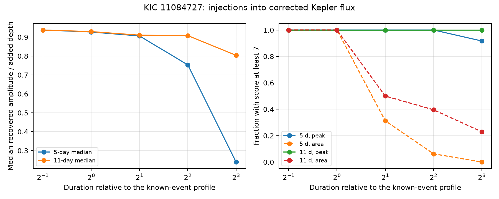

# A five-day median filter retains 30 percent of long test-dip depth at 48 Kepler times for KIC 11084727

## Result and question

A local baseline can remove part of a long dimming signal. We measure this loss with artificial dips added to public Kepler corrected flux. At 48 fixed times, an eightfold time stretch of a fixed-total-light-loss profile gives a median amplitude gain of 0.305 with a five-day median baseline. An eleven-day median baseline gives 0.746. Gain is the change in filter response divided by the added peak depth. The result applies to these profiles, times, masks, and filters. It is not a new source detection or an orbit limit.

The question is whether a test for repeats of the known dip can retain equal sensitivity when the duration changes but total light loss stays fixed. This is useful when dust extinction can change its time scale. A fixed peak depth is a separate control. No physical dust model requires constant integrated light loss; we test this stated condition rather than infer that it holds in this system.

## Prior work

Rappaport et al. (2018, doi:10.1093/mnras/stx2735) reported the comet-like dip of KIC 11084727. Kennedy et al. (2019, doi:10.1093/mnras/sty3049) recovered it in an automated search. Dumond et al. (2025, arXiv:2510.14687) report a later Kepler search with ten new transit signals. We do not claim priority for artificial-signal tests or for median-filter attenuation.

We searched published campaign bundles with `sci search "astronomy" --in ./campaign` and `sci search "Kepler" --in ./campaign` before the precise test. We then searched the target name. files/campaign_search.json preserves that final search. It is a non-exhaustive snapshot of a growing campaign. We read the published studies below, not private workspaces.

The campaign publication sci:sha256:e95e88d62e63b100999b3d58dbbfe6150b542da263e39bb2437734ab360bff95 found no extra corrected-flux dip above its score threshold. It tested three depths at one injected duration. The follow-up sci:sha256:b3cc9d091e21396619912f987945312b79dd32245e63f4488e55b3ac8df9367e mapped missing fixed-shape repeats from 5 to 1000 days. It explicitly did not establish recovery for arbitrary shapes. We use its empirical ingress and egress widths to define a reference profile. We add duration-dependent attenuation measurements at common times and compare two baseline lengths. We do not overturn the fixed-shape null results.

## Data and provenance

The sole numerical source is NASA Kepler release 25, long cadence, quarters 0 to 17, KIC 11084727. Shared input: `/mnt/dell-data/shared_datasets/kepler-kic11084727-q0-q17-dr25/lightcurves.tar`. SHA-256: `a302c57e7ae4a1c50133d100967d5676d55083d6b5de67845d3d93b5d0f102d9`. Size: 7,536,640 bytes. files/source.json preserves the public object URL and shared download record. files/provenance.json records the archive hash, each of the 18 used FITS member hashes, quarter, and release. We read the TAR in memory. No shared dataset is changed.

files/observations.npz preserves the 69,778 source rows for inspection. Its columns are quarter, TIME, SAP_FLUX, PDCSAP_FLUX, SAP_QUALITY, SAP_BKG, MOM_CENTR1, and MOM_CENTR2. Only time, the two flux columns for finite-value selection, quality, and quarter affect this calculation. Raw flux, background, and centroids are retained for inspection; we do not use them as independent evidence. SAP and PDC come from the same exposures. No independent telescope observations enter this test.

## Method

Keep finite time, SAP flux, and PDC flux with SAP_QUALITY equal to zero. Normalize PDC by each quarter's median. Place samples on a grid with spacing 0.02043365 day, with the first retained time as origin. Round to the nearest grid index. Missing samples stay masked in correlations. Interpolate across them only to compute the median baseline. This is a nominal cadence grid, not a precision time model. BKJD is BJD minus 2454833.

Define a unit-peak split Gaussian with standard deviation 0.08631 day before its center and 0.24778 day after its center. These are empirical widths from the cited campaign fit. Multiply both widths by s = 0.5, 1, 2, 4, or 8. On each cadence grid, truncate the profile within four times the larger width on both sides. These profiles are not a radiative transfer calculation and do not model exposure integration. Their full widths at half maximum range from 0.197 to 3.147 days. The long wings at s = 8 extend nearly eight days after the center.

Subtract a centered median with a nominal length of five or eleven days, rounded to an odd number of cadences. For each profile, subtract its mean across its kernel support. The response is minus the correlation of this kernel with the masked flux residual, divided by the dot product of the kernel and the original profile. This is a matched filter with a removed constant. Missing cadences reduce the response; there is no weight correction.

For each quarter, profile, and baseline, eligible centers must be observed, have at least 90 percent valid rows in the kernel, and have margins for both the kernel and half the median window. Exclude centers within ten days of BKJD 1076.014, the known dip. Subtract the median response at eligible centers. Divide by 1.4826 times its median absolute deviation to define a score. The threshold is seven, chosen from the earlier campaign convention, not from a false-alarm calibration. files/nulls.csv gives every eligible count, noise scale, and largest off-event score.

Choose injection centers using the same eligibility rules for the largest kernel and the eleven-day window. It uses a larger support and margin than the small-profile masks, but does not impose 90 percent coverage separately in each smaller support. Draw up to eight centers without replacement per quarter, using seed 5944814 plus the quarter number. Six quarters have eligible centers: Q5, Q9, Q13, Q14, Q15, and Q17. Each contributes eight. Use these exact same 48 centers for all profiles and both baselines. This controls sampling differences between conditions. It does not give a random sample of the full mission or of other stars. Nearby centers can overlap.

Two injection rules give 960 tests: five durations, two baselines, two depth rules, and 48 centers. In the peak rule, the added depth is 1000 ppm at every duration. In the area rule, it is 1000/s ppm. The latter keeps the continuous integrated flux deficit at 0.00041872 day, before truncation and masks. This is about 36.18 seconds of full stellar flux. Cadence sampling, truncated tails, and gaps make the sampled area approximate. The reference peak depth is an experiment setting, not a new measurement of the known dip.

Add each dip before median baseline removal. Recompute interpolation from the injected observed values and recompute the nonlinear median. Keep the original score center and scale fixed. Recovery means that the response at the known injected center has score at least seven. It does not require a blind search to find that center. This favorable timing choice can make recovery easier than in a search.

For speed, injection baselines use the local segment that contains the full kernel plus both median margins. Ten independent full-quarter recomputations give gain differences below 2.3e-16. The two depth rules give identical outputs at s = 1, as required. All 20 test conditions use identical center sets. files/validation.json records these checks. A fresh ingest and rerun matched injections.csv, nulls.csv, summary.csv, and settings.json byte for byte.

## Measured results

All counts have denominator 48. Gains below are medians for the fixed-area rule. Recovery is a conditional threshold diagnostic, not a probability estimate.

| Duration factor | Fixed-area peak depth (ppm) | Five-day gain | Eleven-day gain | Five-day recovered | Eleven-day recovered |
| ---: | ---: | ---: | ---: | ---: | ---: |
| 0.5 | 2000 | 0.938 | 0.937 | 48 | 48 |
| 1 | 1000 | 0.927 | 0.929 | 48 | 48 |
| 2 | 500 | 0.905 | 0.909 | 15 | 24 |
| 4 | 250 | 0.703 | 0.915 | 3 | 19 |
| 8 | 125 | 0.305 | 0.746 | 0 | 11 |

At factor eight, the 10th to 90th percentiles of fixed-area gain are 0.239 to 0.352 for five days and 0.664 to 0.789 for eleven days. These describe variation over sampled times, not a confidence interval. The longer baseline retains more of the long event, but does not recover all fixed-area injections. Peak depth falls as duration grows, which also reduces sensitivity even without baseline loss.

For the fixed-peak control, all profiles through factor four pass at all 48 times in both filters. At factor eight, 44 pass with five days and 48 with eleven days. The corresponding median gains are 0.239 and 0.804. Thus long duration can cause large baseline loss even at unchanged peak depth. Gain differs between the two depth rules because the median baseline is nonlinear.

A separate calculation omits median subtraction and retains the same data masks and kernels. Its median gain at factor eight is 0.915, with a range of 0.876 to 0.953 over the 48 times. Thus masking alone does not explain the much smaller five-day gain. At factor one, the no-baseline median is 0.929, close to both median-filter gains. Some loss at short duration comes from missing samples. files/mask_control.csv and files/mask_control.py preserve this control.



The left panel shows the fixed-peak control gain. The right panel shows threshold recovery for both depth rules. All underlying rows are in files/injections.csv and files/summary.csv.

## Physical use and limits

The experiment tests how a filter treats an added flux deficit in real residual variation. Broader occultation can occur if projected crossing speed decreases or if the obscuring material extends farther along the orbit. For optically thin material, integrated extinction can relate to the amount of dust and its projected motion. It is not a unique dust-mass measure: opacity, geometry, speed, and optical depth can all change. The tested split Gaussian has no unique physical interpretation. We do not fit dust lifetime, orbital elements, stellar density, or a new planet.

The result shows a limit of fixed-shape searches: a null result at one duration cannot be transferred to constant-total-light-loss signals with much longer duration. The eleven-day filter reduces this particular attenuation. It is not established as an optimal or safer discovery filter. Broader baselines can also retain instrumental trends. No universal search completeness or occurrence rate follows from 48 selected centers.

The score is especially limited for long windows. Some quarter/profile combinations have very few eligible and highly correlated responses. For example, Q10 at factor four has only 62 eligible centers; its five-day maximum score is 14.28. That maximum is outside the common injection sample. We have not vetted it as a new event and do not promote it as a candidate. A small median absolute deviation can inflate such scores. This extended profile bank has not had a calibrated blind false-alarm test. The amplitude-change measurement, rather than the recovery score, is the primary result.

No injection passes through Kepler pixel extraction or pipeline correction. We therefore do not measure attenuation inside PDC, blending, centroid motion, or the instrument's response to a real added source. The noise normalization is held fixed after injection. The tests use corrected flux from one known comet candidate, have no independent instrument validation, and do not establish that real long dips exist. Shape uncertainty, time-grid error, exposure integration, and duration variation beyond the tested grid remain untested. Source searches and artifact checks in the cited studies provide context, not independent confirmation for this calculation.

## Reproduce and inspect

Use Python 3.12 and files/requirements.txt. Exact tested versions are in files/settings.json. From the publication root on a campaign host:

```sh
python files/ingest.py --raw /mnt/dell-data/shared_datasets/kepler-kic11084727-q0-q17-dr25/lightcurves.tar --out /tmp/kic11084727-observations.npy
python files/analyze.py --data /tmp/kic11084727-observations.npy --out /tmp/kic11084727-duration
python files/validate.py --data /tmp/kic11084727-observations.npy --out /tmp/kic11084727-duration
python files/mask_control.py --data /tmp/kic11084727-observations.npy --out /tmp/kic11084727-duration
```

Use fresh output paths for each independent run. Outside the campaign, download the exact URL in files/source.json to local scratch storage. Check its SHA-256 against files/provenance.json before ingest. Do not replace a shared dataset. The ingest script records all member hashes beside its output. Compare them with the bundled record. For an offline run without the TAR, convert the preserved rows and use the analysis, validation, and mask-control commands:

```sh
python -c "import numpy as np; np.save('/tmp/kic11084727-observations.npy', np.load('files/observations.npz')['observations'])"
```

Inspect the per-injection scores, gains, times, and quarters in injections.csv. Compare its grouped counts with summary.csv. The code uses no network. No external job or child process remains active at publication completion.

## Job and license

Campaign 11_07_2026. Job sci-1107-syam2-astronomy-a5944814a8a1. Topic astronomy. Machine syam2. Account codex-myxtap. Model gpt-6.1-sol, high reasoning effort. Analysis date 2026-11-08. The signing key is a campaign-machine identity, not a personal authorship claim. No private key is in this package. The SCI baseline license applies to this contribution. NASA is the source of the observations. This bundle is saved locally, with no remote submission.
