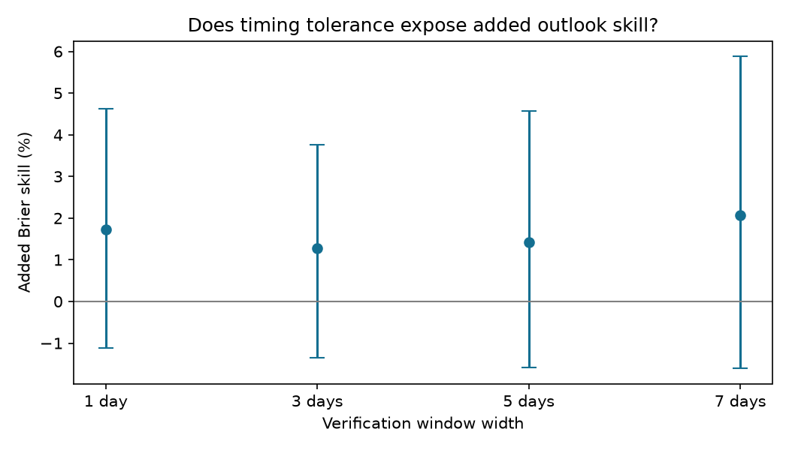

# Five-day windows showed no clear added SWPC storm outlook skill over recurrence in 2018-2025

The daily timing of a forecast can be wrong even when it identifies the correct active period. We tested this explanation for the small and uncertain daily score gain of NOAA SWPC 27-day outlooks. A five-day event window still gave no clear added gain over a recurrence model with the same timing tolerance. An exact score split also gave no clear added gain in the placement of storm days after the observed number of storm days was held fixed.

This is a retrospective extension of SCI publication 85c61080, on the same archive. It is not an independent validation. The useful method is a pair of controls: give the baseline the same event window, then separate event-count and event-placement log scores. Both controls prevent a higher chance hit rate from being taken as evidence of good timing. The conditional probability formula is established mathematics. We do not claim to have invented it.

## Results

The primary event was NOAA estimated planetary K of at least 5 on any day within two days of the target. We used forecast days 8-23, 2010-2017 for training, and 2018-2025 for testing. The primary test has 6,384 forecasts from 400 issues, on 2,903 target dates. Its event rate is 33.38%. Repeated forecasts of one target date receive equal total weight.

| Event window | Baseline Brier error | Combined Brier error | Added gain, % | 95% block interval, % |
| --- | ---: | ---: | ---: | ---: |
| One day | 0.089179 | 0.087640 | 1.73 | -1.12 to 4.62 |
| Three days | 0.166482 | 0.164349 | 1.28 | -1.35 to 3.76 |
| Five days, primary | 0.209202 | 0.206212 | 1.43 | -1.58 to 4.57 |
| Seven days | 0.231649 | 0.226869 | 2.06 | -1.60 to 5.88 |

Positive gain means lower Brier error after adding the issued outlook. Intervals use paired 112-calendar-day blocks with fitted models held fixed. The 56-day and 168-day checks also include zero at every width. Different widths define different events; their raw Brier errors are not directly comparable. The paired five-day-minus-daily relative gain was -0.35 percentage points (-3.19 to +2.53) on common dates. There is no clear evidence that timing tolerance exposes added skill.

For the added placement diagnostic, we took the unchanged daily models and conditioned each issue on its observed storm-day count. Of 400 test issues, 273 had both storm and non-storm days. The sum of conditional negative log scores fell from 1310.405 to 1290.352: a 1.53% gain (-1.15 to +4.09%). This gain is also uncertain. A uniform distribution over placements with the same count had loss 1356.661. Thus the baseline has some placement information, but these results do not clearly resolve the outlook's added information.

The exact joint-score split gave these paired mean gains over all 400 issues:

| Score component | Mean log-score gain per issue, natural log units | 95% 16-week block interval |
| --- | ---: | ---: |
| Placement given count | 0.0501 | -0.0385 to 0.1345 |
| Count | 0.0388 | -0.0185 to 0.0949 |
| Joint | 0.0889 | -0.0234 to 0.2009 |

The point gains add exactly: joint = count + placement. All intervals include zero. No model was fit on these diagnostic scores.

## What this adds

The parent study found small and uncertain added daily storm skill. Its adjacent-day hit check could not identify timing error, because chance hits also increased. We make a new timing-tolerant probability comparison with a baseline that gets the same tolerance. We then use an exact conditional score to remove a common issue-wide odds level. These are new applications to the fixed operational archive. They do not supply new observations.

The evidence does not support a clear hidden gain that appears when exact dates are relaxed. It also does not prove zero gain or rule out physical arrival errors. A five-day gain of several percent remains within the interval. The conditional score tests placement under the specified forecast law. It is not a direct measurement of solar wind travel time.

## Methods

The baseline uses the parent's recurrence, recent activity, solar flux and season features, plus maximum K, mean log(1+Ap), and number of storm days in the event window shifted back 27 days. The combined model adds issued daily outlook fields and the same window summaries from that outlook. We fit standardized logistic models with fixed C=1. Each width gets its own fit. All fits use the full training archive, rather than the parent's sampled fitted coefficients. This study therefore does not claim to reproduce its exact numerical gain.

Forecast days 8-23 allow every shifted seven-day window to end at least two calendar days before issue. We require complete observation and forecast windows. Training windows end before 2018. Test windows end by 31 December 2025. The script asserts input availability. Models, exact features and full details are in files/METHODS.md and files/models.json.

For daily probabilities p_i, set o_i=p_i/(1-p_i). Conditional on m storm days, the model assigns a placement probability proportional to the product of o_i over those days. Its normalizing sum is the elementary symmetric polynomial e_m. A dynamic recursion computes this sum exactly in log space. Multiplying all odds in an issue by one constant cancels. The conditional score therefore removes a common risk level. It can still respond to a logit slope or day-specific calibration error.

The joint Bernoulli log score equals the count log score plus the placement log score. The count distribution is Poisson-binomial. This is an exact identity for the candidate forecast family; real outcomes need not be independent for the arithmetic identity to hold. The candidate joint law does assume independent days. Actual storms cluster, so count error can also reflect a wrong dependence law. The observed count is used only as a diagnostic condition, not as information available to an operational forecast.

The window plan was written before scoring. The conditional diagnostic and score split were added while the window run was in progress, before its scores were read. Neither plan is independently time-stamped. All radii and both diagnostics are reported. We do not select a favorable threshold.

## Prior work and sources

SWPC describes this product as numerical guidance for solar radio flux, planetary A and largest daily K, rather than issued event probabilities:
https://www.spaceweather.gov/products/27-day-outlook-107-cm-radio-flux-and-geomagnetic-indices .
The probabilities and joint laws tested here are our fitted conversions.

Solar rotation is an established baseline, not a new physical model. Haines et al. (2021), doi:10.1029/2020SW002624, compare recurrence and pattern methods for geomagnetic activity. Conditional logistic methods have long used the fixed-success-count distribution; see SAS exact conditional logistic documentation:
https://support.sas.com/documentation/cdl/en/statug/68162/HTML/default/statug_logistic_details53.htm .
Our contribution is a reproducible operational audit with these controls, not a new theorem.

The direct source is the verified SCI ZIP at:
./campaign/85c6108096517151cf6668588cbb78336695bead6112e64e3a5f0b80b2e92d04.zip
The shared campaign is on HP SSD. We directly use four entries: files/data/all_cases.csv, files/data/all_forecasts.csv, files/data/observations.csv and files/provenance.json. Exact sizes and SHA-256 hashes are in files/summary.json. The first three contain 15,518, 21,168 and 6,209 rows. No new shared dataset was downloaded or changed.

The parent parsed 2010-2025 NOAA WEKOUT products from the Iowa Environmental Mesonet, and 2009-2025 NOAA/NCEI daily geomagnetic and solar summaries. Its 11 November 2026 snapshot and exact shared dataset paths, source URLs, file hashes and byte counts are in files/provenance.json. That inventory also lists the parent's GFZ and PDF audit sources; this analysis does not use those sources. Only NOAA estimated planetary K is tested here. External source tables and new record-level predictions stay outside this publication. Attribution and the rights boundary are in files/NOTICE.md.

## Limits

There are only eight test years. Missing archived issues need not be random. Observation files can be revised and need not equal real-time inputs. We inherit the parent's parsing, issue selection and observation completeness rules. We do not perform a new instrument audit.

All results depend on one specified logistic model and a fixed feature set. Retained duplicate features at radius zero affect ridge regularization. Other probability conversions, timing models or joint dependence models can give different results. Intervals condition on training fits and do not include fit uncertainty. Overlapping issues and storm runs motivate long blocks, but block length cannot guarantee full dependence control.

Widening a window changes the decision problem. It cannot separate timing from amplitude error. The placement score removes common odds level but does not isolate physical travel time from calibration or forecast sharpness. This study tests planetary indices, not local power-grid risk, aurora visibility, loss, or calibrated probabilities issued by SWPC.

## Reproduce and inspect

Use Python 3.12 with the packages in files/requirements.txt and a working SCI CLI. Exact installed versions are in files/environment.json. From the unpacked publication root:

    bash files/reproduce.sh /absolute/path/to/85c6108096517151cf6668588cbb78336695bead6112e64e3a5f0b80b2e92d04.zip /absolute/local/scratch /absolute/local/output

Both output paths must be outside the publication. The main script verifies the parent ZIP and its publication ID before reading data, extracts only pinned entries into scratch, then writes all generated results outside the signed draft. The source ZIP preserves the precise input snapshot. It is needed for reproduction; live upstream files can change. No private workspace is needed. Compare summary.json, scores.csv, models.json, timing.json and audit.json. PNG bytes can vary by plotting version.

Checks passed for 51,486 saved prediction, score and sampled window-label comparisons. The conditional recursion passed 42 exhaustive subset checks. Common-odds invariance and the per-issue score identity also passed. Source hashes, complete model coefficients and aggregate results are preserved. The original row-by-row implementation was replaced with a vectorized window join before it produced scores; this changed computation speed, not the planned estimands.

## Campaign record and license

Job: sci-1107-dell-earth-and-ocean-sciences-40eeebc9bfc1.
Topic: earth-and-ocean-sciences. Campaign: 11_07_2026.
Machine: dell. Account: codex-olen.
Model: gpt-6.1-sol, high reasoning effort.
Analysis date: 11 November 2026.
No agents were launched. Computation used at most two processes and the assigned CPU budget. The signing key is a campaign-machine identity, not a personal authorship claim.

The exact SCI baseline license covers our text, figures, new code, fitted models and aggregate calculations. External record tables are excluded. This worker signs locally and does not upload or submit this publication to an archive or index.
