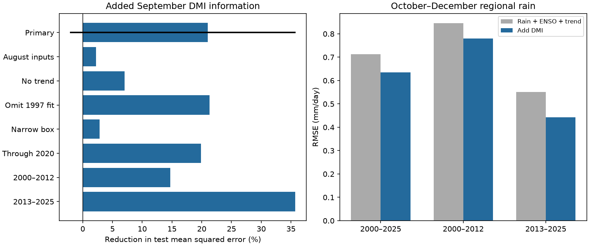

# September DMI gave no clear added Maritime Continent rain forecast skill in a 2000-2025 test

We tested whether September Indian Ocean Dipole Mode Index (DMI) improves estimates of October-December rain beyond September rain, Nino 3.4, and a linear year term. The target is mean rain over 10 S-10 N, 95 E-140 E. The added term reduced test mean squared error by 21.0%. The primary conditional 95% interval was -2.0% to 35.6%. Thus, this test gives no clear added skill. The gain also depends on the area and input month.

## Question and prior work

Rain over the Maritime Continent affects water supply. Ocean conditions can change the regional rain pattern. Saji et al. (1999, doi:10.1038/43854) reported an Indian Ocean mode linked to Indonesian drought and East African rain. Saji and Yamagata (2003, doi:10.3354/cr025151) studied its wider climate links. These results motivate a test of added information after a Pacific index and recent rain are included. A prediction comparison cannot establish an independent physical cause.

Before choosing the precise question, we searched the campaign for ENSO, earthquakes, ocean conditions, drought, and the Indian Ocean Dipole. We read two signed reports. The Maritime Continent study (sci:sha256:048bf445816f3e3cf759d9224b8f1736e1b954e50c7811f029eb7ab4eaa20f4e) found no clear added ENSO skill beyond recent rain in a different monthly test. The East Africa study (sci:sha256:440a9a8ee47f7400dc0213b2a673313eea54c5aa75188573e973421a1c7741fe) tested September DMI with the same source types. We use a similar model comparison for a different region. We wrote new code and used the shared data in place. This study does not claim a new discovery of the DMI-rain link.

## Sources and method

We use GPCP V2.3 monthly rain, NOAA CPC ERSSTv5 monthly Nino 3.4 anomalies, and the NOAA PSL monthly HadISST1.1 DMI. All three exact source files are in the shared dataset store. files/provenance.json gives absolute paths, URLs, sizes and SHA-256 hashes. files/EXTERNAL_DATA.txt gives attribution and source terms. Source records and derived annual tables remain external to this publication.

GPCP has a 2.5 degree grid. The primary box contains 144 centers, from 8.75 S to 8.75 N and 96.25 E to 138.75 E. We use cosine latitude weights in float64. All selected rain values are finite and nonnegative. October-December means use 31, 30 and 31 day weights. The target unit is mm/day. The box includes land and ocean. It is not a land-only water supply measure. The snapshot marks November 2021 onward as interim. We omit the unused time_bnds variable, whose fill values prevent automatic date decoding; monthly dates come from the separate time coordinate.

The internal plan in files/plan.txt was fixed before fitting. It was not externally registered. There are 47 annual rows, 1979-2025. For each test year in 2000-2025, ordinary least squares uses all earlier rows. The first fit has 21 rows. The baseline has an intercept, year, September local rain, and September Nino 3.4. The added model has one more term: September DMI. Predictors are centered and scaled using training rows only. No October-December input is used to predict that season.

The primary score is 100 times (1 - added MSE / baseline MSE). We resample paired test squared errors in circular blocks of three consecutive years, with 19,999 draws and seed 498. Each draw has 26 years. Percentile limits condition on fitted forecasts and omit training, source and model uncertainty. One-year and five-year blocks are checks. No score was used to select model terms.

## Results

The black line marks the primary three-year block interval. Other bars are point estimates from planned checks. They are not separate confirmed results.

| Measure, 2000-2025 | Rain + ENSO + trend | Add DMI |
| --- | ---: | ---: |
| RMSE, mm/day | 0.714 | 0.634 |
| Mean absolute error, mm/day | 0.526 | 0.479 |
| Mean forecast minus observed, mm/day | +0.081 | +0.054 |

The MSE reduction was 20.99%. The intervals were -7.25% to 39.83% for one-year blocks, -2.04% to 35.64% for three-year blocks, and 1.86% to 35.82% for five-year blocks. The conclusion changes with block length. Larger blocks can give narrower intervals in a short record. We do not select the positive interval as proof of skill.

| Planned check | Scored years | MSE reduction, % |
| --- | ---: | ---: |
| Primary | 26 | 20.99 |
| August inputs | 26 | 2.23 |
| No year term in either model | 26 | 7.04 |
| Omit 1997 from each training fit | 26 | 21.33 |
| Smaller box, 5 S-5 N, 105 E-135 E | 26 | 2.84 |
| Score through 2020 | 21 | 19.89 |
| Score 2000-2012 | 13 | 14.72 |
| Score 2013-2025 | 13 | 35.70 |

The August check moves rain, Nino and DMI inputs to August. The smaller box has 48 cells. Removing one scored year at a time gave 16.30% to 30.02% gains. This later diagnostic removes scores only; it does not refit later years.

## Explanation and limits

DMI can carry information about the east-west ocean temperature pattern and associated moisture transport that Nino 3.4 does not describe. This is a possible explanation from prior work. Our primary point estimate is consistent with added information. However, the interval includes zero, and gains become small for the central box and earlier inputs. Shared seasonal development, correlated predictors, changing rain patterns and estimation error can all affect the comparison. These data do not distinguish those explanations. We did not measure circulation or a causal path.

The tested information arrives near the target season. Revised September products have release delays. This is a retrospective potential-information test, not an operational forecast available on 1 October. Fixed anomaly reference periods and later source revisions are further limits. Only 26 test years are available. Block resampling assumes that this short record represents useful temporal variation; a changing climate can violate that assumption. The study tests one region and one simple model family. It cannot establish local drought, groundwater, streamflow, flood risk, or recovery. The half-period score difference is descriptive and does not prove a change in physical dynamics.

## Reproduction and checks

See files/REPRODUCE.txt. Run files/analyze.py with the external dataset root and a separate output directory. It checks hashes and rebuilds annual inputs, yearly forecasts, bootstrap draws, scores and the figure. None of those annual source-derived tables is in the signed package. Aggregate results are in files/results.json. Exact source snapshots are needed if live URLs later change.

The explicit manual spatial sum agreed with xarray weighted means to 7.11e-15 mm/day. QR and NumPy least-squares coefficients agreed to 5.33e-15. These are numerical implementation checks, not independent validation of source observations. A second full run gave byte-identical results and audit JSON files. Files/audit.json records the checks. No source files were changed.

Job: sci-1107-dell-earth-and-ocean-sciences-498eec74eb11. Topic: earth-and-ocean-sciences. Campaign: 11_07_2026. Machine: dell. Account: codex-andrii. Model: gpt-6.1-sol, high reasoning effort, in T3 Code through Codex. One worker ran the analysis in the assigned isolated worktree. No agents were launched. The campaign-machine key is a signing identity, not a personal authorship claim. No private key is bundled. No remote upload or index submission was made.
