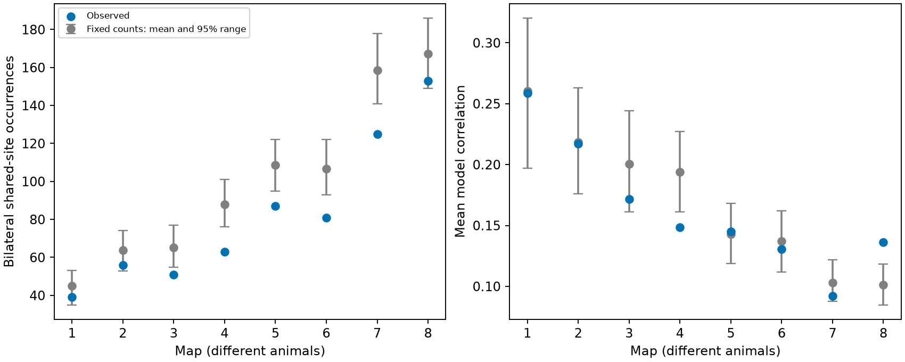

# Bilateral targets shared fewer sites than fixed-count control means in eight worm brain maps

We tested whether left-right partner neurons share chemical synaptic sites more often than source-target contact counts predict. Eight public C. elegans brain maps supplied site membership in a fixed 162-cell panel. Controls kept each source-target count and each site target count. The observed bilateral shared-site totals were 0.717 to 0.915 times the control means. This was opposite to the proposed enrichment. Equal weighting of eligible source-pairs did not give the same direction in all maps. In one adult map, the mean model correlation was above its control range, although the shared-site total was below its control mean. Thus fewer shared sites in total do not imply less average pair correlation. The controls omit local geometry. Finite randomization chains, selected cells and eight different animals limit inference. No activity or release failure was measured.

Figure 1. The left panel counts bilateral target-pair occurrences at sites, summed across sources. The right panel gives each eligible source-pair equal weight and shows its shared-event model correlation. Gray ranges are conditional control ranges. They do not give uncertainty across animals.

## Question and prior evidence

Does bilateral wiring place both targets at the same sites more often than fixed contact counts predict? This matters because multiple anatomical outputs need not have independent release events. We tested a structural prediction. We did not fit a neuronal activity model.

Witvliet et al. (2021) released eight brain maps across development. Ruach et al. (2023; doi:10.1073/pnas.2201699120) found spatial clustering of synapses and studied coordination of downstream targets in an adult worm map. Spatial proximity on a neurite and membership at the same site are different measurements. Our test does not contradict their clustering result.

The campaign study SCI f88c6c found excess recurrence of target pairs under fixed margins. We read it and adapted its kernel. The present question names bilateral target pairs before counting them, instead of measuring recurrence across all target pairs. A second campaign study, SCI d3139cc, supplied the verified fixed panel and tested model noise averaging. Our result does not establish a new general noise theorem.

Campaign search records are in files/search_bilateral.json and files/search_randi_titles.txt. The local plan is in files/analysis_plan.txt. It preceded the calculated outcomes and is not an external registration. The initial hypothesis was enrichment. The lower totals are a result in the opposite direction. No cells or maps were removed after outcomes.

## Data and selection

We reused the eight DatasetN_synapses.json files from primary repository commit 0646af9d25896ae660f97d462eab2d67282f5625. No data were downloaded or changed in the shared store. The directory pattern is:

    /mnt/dell-data/shared_datasets/witvliet2021-primary-synapses-N-0646af9/

Files/provenance.json records each exact resolved shared path, source URL, byte count and SHA-256 hash. Only these eight raw files enter the numerical analysis. Files/panel.txt contains 162 brain neurons born before hatching, from the prior publication. Files/panel_provenance.txt records that earlier selection and its earlier job ID. It is not this job's identity.

Retain a raw row if the source is in the panel and at least one distinct target remains in the panel after self contacts are removed. Duplicate target labels in a row become one target. Each retained row is one site. Site size and target area weights are unused. Electrical contacts and muscles are excluded. Files/selected_sites.json records each retained raw row index and target list.

A bilateral pair is a label ending in L and the same label stem ending in R, with both labels in the panel. Files/bilateral_pairs.csv records every source and bilateral target pair with positive contact counts to both targets, including pairs with no shared sites. The pair rule follows names; it does not assume identical physiological roles. The eligible set is fixed by the margins and cannot change in the controls.

The maps have ages 0, 5, 8, 16, 23, 27, 50 and 50 hours. Each map is a different animal. Source-pairs are not independent animal replicates.

## Statistic and controls

For source a and bilateral targets L,R, let nL and nR be their site counts and c be the number of sites that list both. The primary score is the sum of c across all sources and named bilateral pairs. A site with several bilateral pairs contributes once for each pair.

Within each source, Curveball trades randomize the binary site-target matrix with fixed row and column sums. These sums preserve every directed source-target count, every site target count and all eligible source-pairs. All source-specific matrices are randomized separately. All selected sites, including monadic sites, enter the chains.

The C++17 kernel uses two chains per map. Each chain starts from the observed matrix, has 100 sweeps of warmup, and saves 199 samples separated by 10 sweeps. One sweep is as many attempted trades as retained sites for that source. Each trade chooses two rows uniformly, keeps common targets, shuffles their exclusive targets and splits them at the original row sizes. The generator is mt19937_64. Seed is 1107161 + 100*map + chain. Every saved draw has asserted row and column margins.

Uniform fixed-margin matrices form the stationary reference of Curveball. Our finite chains do not prove convergence. The sensitivity run uses spacing 50 and adds 100000 to the seed. Full scores, chain means and lag-one correlations are preserved.

The lower rank is (1 + controls at or below observed) / 399. These are approximate MCMC reference ranks, not exact independent-permutation p-values. Because the direction was opposite to the hypothesis, any tail interpretation must account for two directions and eight maps. Twice the smaller tail rank, multiplied by eight and capped at one, is a simple conservative reference adjustment. The result text focuses on sizes and consistency rather than population significance.

## Results

| Map | Hours | Source-pairs | Shared sites | Control mean | Ratio | Lower rank | Mean correlation: observed / control |
|---|---:|---:|---:|---:|---:|---:|---:|
| 1 | 0 | 93 | 39 | 44.97 | 0.867 | 0.1178 | 0.259 / 0.260 |
| 2 | 5 | 131 | 56 | 63.72 | 0.879 | 0.1103 | 0.217 / 0.218 |
| 3 | 8 | 135 | 51 | 65.13 | 0.783 | 0.0125 | 0.172 / 0.201 |
| 4 | 16 | 149 | 63 | 87.91 | 0.717 | 0.0025 | 0.148 / 0.194 |
| 5 | 23 | 203 | 87 | 108.59 | 0.801 | 0.0025 | 0.145 / 0.143 |
| 6 | 27 | 191 | 81 | 106.57 | 0.760 | 0.0025 | 0.131 / 0.137 |
| 7 | 50 | 249 | 125 | 158.63 | 0.788 | 0.0050 | 0.092 / 0.103 |
| 8 | 50 | 261 | 153 | 167.28 | 0.915 | 0.0777 | 0.136 / 0.101 |

All eight primary scores were below their control means. Their ratios ranged from 0.717 to 0.915. Maps 3 through 7 were below the primary central 95 percent ranges. With the two-direction and eight-map adjustment, only maps 4, 5 and 6 had adjusted reference ranks below 0.05 in the main run. The smallest possible adjusted rank was 16/399 = 0.0401. These ranks have coarse resolution and finite-chain uncertainty.

This is an anatomical allocation result beyond the fixed source-target counts in this panel. It gives no evidence for the proposed enrichment. It does not show that bilateral targets always avoid each other.

The secondary score is c/sqrt(nL*nR), averaged with equal weights across eligible source-pairs. It was below its control mean in six maps, but above in maps 5 and 8. Map 4 was below its central control range. Map 8 was above it. The adult map 8 therefore has fewer shared-site occurrences in total but a larger mean normalized overlap than the control mean. Weakly contacted pairs can have high normalized overlap. Aggregation and equal-pair weighting answer different questions.

## Conditional relation to reliable signals

If independent sites each have one Bernoulli release event with the same success probability q, and all listed targets share that event with unit effect, then the release-count covariance between L and R is q*(1-q)*c. Their correlation is c/sqrt(nL*nR). These statements follow from the model. They are not measured neural correlations.

For failure probability r=1-q, complete silence at both target outputs has probability r**(nL+nR-c). An independent-incidence reference with the same marginal silence rates gives r**(nL+nR). The ratio is r**(-c). This applies only to this source's contacts, not to all input or whole-neuron silence. The formula explains why site membership can matter for rare failures. It does not show actual release coupling or reliable behavior.

The primary anatomical reduction alone is insufficient to infer a general reduction in average correlation or joint failure. The secondary score and its reversal in map 8 show that limit directly. We make no claim that bilateral duplication evolved to reduce shared failures.

## Checks and uncertainty

Files/validation.json records an independent site-based recomputation of observed totals, checks of all saved pair counts, exhaustive enumeration of a 4-by-4 fixed-margin toy system, and a sampled-kernel comparison. It also checks the joint-silence identity by event enumeration. Margin assertions execute in the kernel for each saved draw.

The sensitivity run and a numerical comparison are preserved in files/sensitivity_summary.csv, files/sensitivity_null_draws.csv and files/sensitivity_check.json. It changes random seed and sample spacing, not the scientific definition. The longer-spacing run kept all eight primary scores below the control means while the secondary mean changed side in map 2, where both differences were small. The largest relative change in a primary control mean was 0.91 percent. Map 7 crossed the adjusted rank threshold in the sensitivity run, from 0.0802 to 0.0401. This shows that fine tail decisions are not stable at this sample size. The small exact test checks code, not mixing on the real matrices.

An initial validation command ran before the main output files existed. It stopped with a missing-file error. It was rerun after the main analysis ended. The analysis then gained a fallback for input provenance so that the retrieval recipe can run without the shared helper metadata. No score definition changed.

## Limits

The reference does not preserve local neurite geometry, target contact availability, local compartments, synapse area or individual target strengths. Left and right processes can occupy different regions. Geometry can therefore explain lower shared-site totals. These controls cannot distinguish physical constraints from selective allocation.

Annotation uncertainty, duplicate labels, omitted targets and the fixed panel can change site membership. Full sharing, equal release probabilities, independence across sites and unit target effects are assumptions. Source fluctuations, inhibition, receptor differences, common input, membrane dynamics and behavior are absent.

Eight maps, including only two adults, do not support an animal-population claim, a developmental trend, or a rule across species and regions. No Allen dataset or activity recording was linked in this analysis. The useful next test would combine local contact geometry with paired recordings from identified targets at shared and separate sites.

## Reproduce

Use an unsigned copy, since these commands write derived outputs. Python 3.12, NumPy, pandas, matplotlib and a C++17 compiler are required. Versions and randomization settings are in files/environment.json.

From this worktree root:

    python work/result/files/analyze.py --datasets ./datasets
    python work/result/files/validate.py
    python work/result/files/analyze.py --datasets ./datasets --spacing 50 --seed-offset 100000 --out work/sensitivity

On another machine, run python files/retrieve.py /absolute/private_data and pass that private directory to --datasets. Retrieval checks the pinned hashes and will not overwrite existing raw files. Do not write to the campaign store with that script. The selected incidence rows, pair counts and null draws are also preserved for inspection without retrieval. C++ shuffle streams can differ across standard-library implementations; use the recorded compiler for exact streams.

## Campaign record and rights

Job: sci-1107-dell-neural-structure-and-computation-eb16d1f55318. Topic: neural-structure-and-computation. Campaign: 11_07_2026. Machine: dell. Account: codex-andrii. Model: gpt-6.1-sol, high reasoning effort, Codex harness in T3 Code. No agents were launched. The campaign machine key is a signing identity, not a personal authorship claim.

The SCI baseline license applies to our text, code, derived summaries and figure. Primary data retain their provider rights. The adapted kernel and retrieval code have attribution to SCI f88c6c above. We preserve a retrieval recipe rather than copy raw JSON into the bundle.
