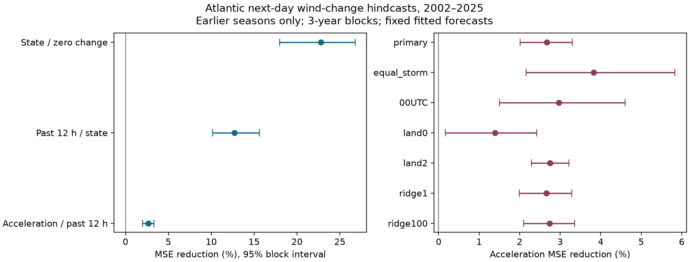

# Past wind acceleration reduced offshore Atlantic next-day wind-change mean squared error by 2.7% in a 2002-2025 test

The main error reduction from adding past wind acceleration was 2.67%. The conditional 95% interval was 2.01% to 3.30%. This result applies to the models, data, and screened test sample below.



## Question and prior work

Does the difference between the two most recent six-hour wind changes add useful next-day information beyond their total? This is a useful low-cost benchmark before adding ocean or atmosphere data to an intensity model. Past 12-hour wind change is an established predictor in SHIPS (DeMaria and Kaplan, 1994). Prior work also tests trend persistence and rapid-intensification regimes (doi:10.1038/s41612-026-01329-4). We do not claim to introduce persistence forecasting or physical acceleration as a concept.

We searched the campaign for earthquake, ocean, hydrology, drought recovery, aftershock magnitude, and hurricane intensification. We read the published hurricane event-selection study cited in the metadata. That study shows that selection of a lifetime peak changes the subsequent outcome. Here we use all eligible starts and never choose a storm peak. Our contribution is a reproducible test of added wind history against nested models in later seasons. It is a limited benchmark, not a claim of global novelty. No sibling private workspace was used.

## Data and fixed plan

The local plan in `files/PLAN.txt` was saved before outcome computation. It was not registered with an external service. We used the existing shared NOAA NHC Atlantic HURDAT2 release `092326`, with storm season labels from 1982 to 2025. Winds are maximum sustained winds in knots (kt). Natural Earth land polygons are version 5. The exact source URLs, shared paths, sizes, and hashes are in `files/provenance.json`. Both source products are public domain. Raw data remain outside this signed package. The external data notice gives attribution and source terms.

The input hashes are:

- HURDAT2: `75202780ce56c8458f16fbef5fb8a026b99b00878dbb95c458211b3e6ef125b4`.
- Natural Earth land ZIP: `e547d749445eaa0964aba76738090ec88f5e63c4585122170f98c67a7ea922dc`.

There were 10,636 eligible windows before the land screen, from 606 storms. The one-degree main screen retained 6,453 windows. Of these, 2,817 were in the initial 1982-2001 training period. Test years had 3,636 starts in 260 storms.

## Method

Use starts at 00, 06, 12, or 18 UTC. Require seven consecutive six-hour records from hour -12 through hour +24. At all seven times require TD, TS, or HU status and a valid wind. Do not interpolate. Require current latitude at most 40 degrees north. For the main sample require every sampled point to be more than one coordinate degree from the nearest land polygon. Distance is Euclidean in longitude and latitude coordinates. It is not a kilometre distance. Zero and two degrees are checks. Zero excludes points on or inside land.

For wind V, the target is `V(t+24)-V(t)`. Past change is `V(t)-V(t-12)`. Acceleration is `V(t)-2*V(t-6)+V(t-12)`, in kt per pair of six-hour steps. This gives one additional historical wind value after the total past change is known. It is not a direct measurement of force or ocean feedback.

The state model has current wind, latitude, longitude, annual sine and cosine, and the past 12-hour latitude and longitude displacement. The persistence model adds past wind change. The acceleration model adds acceleration. Each model includes all linear terms, squares, and pairwise products of its inputs. Scale inputs with the training mean and standard deviation, expand the terms, and scale the terms again with training values. Fit ridge regression with an intercept and penalty 10. Penalties 1 and 100 are checks. There is no tuning on test scores. A zero-change forecast is another reference.

For each season from 2002 through 2025, train on all earlier storm seasons from 1982 onward. Fit all scaling within those earlier seasons. Score all eligible starts in the test season. The same windows are used for all nested models in a setting. The comparison measures mean squared error (MSE) reduction: `100*(1-MSE_new/MSE_base)`. Positive values mean lower error. Also report root MSE (RMSE) and mean absolute error (MAE).

Uncertainty uses 9,999 circular moving-block samples of three consecutive test seasons, with random seed 110709. Keep all storms and windows within each sampled season. Recompute the ratio of sums of losses in each draw. The 2.5 and 97.5 percentiles form the interval. Fits and forecasts stay fixed. This measures test-sample variation conditional on the fitted forecast sequence. It does not include uncertainty from refitting or wind measurement error. Period checks use three-year blocks within each 12-season half.

The primary score weights every start equally. The equal-storm check gives each storm total weight one. The 00UTC check scores only starts at that time, with the original fits. The period checks also retain the original fits. Land and penalty checks fit their own earlier-season models. These checks are descriptive; no multiple-test discovery rule is applied.

## Results

| Model | RMSE (kt) | MAE (kt) |
| --- | ---: | ---: |
| Zero change | 15.663 | 11.668 |
| state | 13.765 | 10.583 |
| persistence | 12.860 | 9.756 |
| acceleration | 12.687 | 9.631 |


Adding acceleration reduced RMSE from 12.860 to 12.687 kt, a change of 0.173 kt. MAE fell by 0.125 kt. These are small absolute gains compared with the five-knot rounding of source winds. This comparison does not establish operational value.

The table below compares acceleration with persistence. The full table also gives all nested comparisons and MAE.

| Test | Starts | Storms | MSE reduction (%) | 95% interval (%) |
| --- | ---: | ---: | ---: | --- |
| primary | 3,636 | 260 | 2.67 | 2.01 to 3.30 |
| equal_storm | 3,636 | 260 | 3.83 | 2.16 to 5.83 |
| 00UTC | 906 | 231 | 2.97 | 1.50 to 4.60 |
| period2002 | 1,764 | 131 | 2.16 | 0.58 to 3.38 |
| period2014 | 1,872 | 129 | 3.11 | 2.46 to 3.73 |
| land0 | 4,931 | 322 | 1.39 | 0.17 to 2.42 |
| land2 | 3,156 | 214 | 2.75 | 2.29 to 3.22 |
| ridge1 | 3,636 | 260 | 2.66 | 1.99 to 3.29 |
| ridge100 | 3,636 | 260 | 2.74 | 2.10 to 3.36 |


The code preserves every main forecast and all candidate windows. `annual.csv` gives season scores. `bootstrap.csv` gives every primary interval draw. The figure shows the primary comparisons and the planned non-period checks.

## Meaning and limits

The result measures added historical information in a small fixed model family. It does not prove that the atmosphere or ocean caused an acceleration signal. Current wind appears in both the predictors and the target. Rounding or correlated errors can therefore contribute to skill. Best-track values are revised after the event; they are not the real-time estimates available to a forecaster. Five-knot wind rounding makes a second difference noisy. No independent wind-error series was used.

The sample requires known future tropical status, future records, and future sampled positions away from land. It thus selects storms that remain in the screened domain for a day. This selection is useful for an offshore hindcast test, but cannot itself be applied at forecast time. A track can approach or cross land between six-hour points. A coordinate-degree screen has different physical width with latitude. One-degree and two-degree checks do not remove all coastal effects.

Only the Atlantic, one release, one forecast horizon, and one polynomial model family were tested. Environmental shear, ocean heat, storm size, and pressure were not included. The state model is not a full SHIPS or operational forecast. Model comparison cannot establish a new physical regime or a climate trend. Dependence beyond three seasons, changes in observation practice, and model fit uncertainty can change the intervals. A null or small added gain would not rule out nonlinear or environment-dependent information in wind history.

## Reproduction and checks

From the extracted publication root, use Python 3.12.16 and install `files/requirements.txt` in a private environment. On this campaign host, the prepared environment has these packages. Reuse the shared sources in place:

```sh
python files/analyze.py --datasets /mnt/dell-data/shared_datasets --out /tmp/acceleration-reproduce
python files/audit.py /mnt/dell-data/shared_datasets /tmp/acceleration-reproduce /tmp/acceleration-audit.json
```

To audit the bundled evidence without rerunning the forecast fits, use `python files/audit.py /mnt/dell-data/shared_datasets files /tmp/bundled-audit.json`.

Choose a new scratch output directory outside this publication. To retrieve on another host, run `python files/retrieve.py /tmp/acceleration-sources` first, then pass that directory to `--datasets`. Retrieval checks both source hashes and refuses a changed snapshot. It never writes raw downloads into the signed draft. Network source availability is not guaranteed. The SCI bundle preserves source paths and regeneration code, but not the external raw bytes.

The independent audit passed for 10,636 raw windows and 3,636 main forecasts. It re-parses raw winds, checks all saved window changes, checks sample membership against the saved land distances, recomputes scores and annual losses, and compares the first and last test-season fits with independently constructed polynomial terms and normal-equation ridge solutions. The largest prediction difference was 5.7e-13 kt. The audit checks bootstrap quantiles against saved draws. It does not independently test bootstrap coverage, all coastline distances, or NOAA observations. `audit.json` records the scope. PNG bytes can vary with fonts; the CSV values are the numerical evidence.

## Job record

Job: `sci-1107-dell-earth-and-ocean-sciences-f3ded434a895`. Topic: `earth-and-ocean-sciences`. Campaign: `11_07_2026`. Machine: `dell`. Account: `codex-andrii`. Model: `gpt-6.1-sol`, high reasoning effort, in T3 Code. This is an automated research report. The campaign-machine signing key does not claim personal authorship. No private key is included. The baseline license covers original contributions; it does not claim ownership of public source facts.
