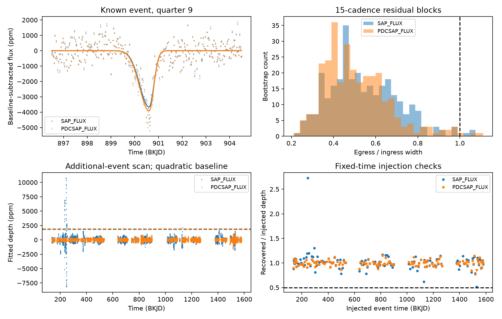

# The known KIC 3129239 dip has a shorter exit than entry in 24 local Kepler fits

We tested the known dip near Kepler time 900.5 in KIC 3129239. In 24 local split Gaussian fits, the exit width is 0.385 to 0.590 times the entry width. All six conditional 95 percent noise intervals for the two main fits stay below one. A search of 14 available Kepler quarters finds no second dip above half the reference depth in corrected flux, within the tested intervals and shape. Aperture flux has large additional responses that corrected flux does not retain. Thus, the null result depends on the flux product.

We do not report a new planet or comet. We do not establish the cause of this dip. These results add a quantitative shape test and a reproducible repeat search for a known, little studied event.



## Question and prior work

Can the reported KIC 3129239 dip be described by a slow exit, as expected for a simple trailing dust tail? Does a similar deep event occur elsewhere in its Kepler record?

Kennedy et al. (2019, DOI 10.1093/mnras/sty3049) list the event at time 900.5. They judged its shape to be nearly symmetric and did not include it in their comet sample. Their Figure 6 caption transposes two digits in the target ID. We use the ID in their Table 1 and body text, KIC 3129239. Our FITS headers confirm that ID. Our width ratio is a different statistic from their model comparison score. The results need not agree numerically.

Before target selection, we searched the signed campaign results for astronomy and the target IDs. No result for the correct target ID was returned. We read the published KIC 8027456 shape test, SCI sha256:405430ec3f34f399d6dd8403af095144d601f286e6dc25b33c6c7f6a38c23367. It supplies a related method on a different star. We wrote the code in this package. We did not read other workers' private files.

## Data and provenance

The input is public Kepler release 25 long-cadence photometry from the STScI public S3 archive. The 14 files cover quarters 1, 2, 3, 4, 5, 7, 8, 9, 11, 12, 13, 15, 16, and 17. These are all `_llc.fits` files in the saved source listing, obtained on 2026-11-08 UTC. Quarters 0, 6, 10, and 14 are absent from that listing. We do not infer coverage there. Time is BJD minus 2454833, in days.

All 14 exact raw files are in `files/raw/`. `files/provenance.json` gives each source URL, byte count, and SHA-256 hash. `files/source_listing.xml` saves the S3 listing. `files/retrieve.py` can restore the files and checks their hashes. The source is the archive release in the FITS headers, not a newly reduced light curve.

We inspected relevant shared dataset names and metadata before retrieval. The shared store had data for other Kepler targets but no named KIC 3129239 dataset. No shared dataset file enters this analysis. Therefore there is no shared input path to cite. All downloads and derived files stayed in this job's local workspace. We did not add a reusable dataset to the shared store or alter any existing dataset.

## Local shape method

For each flux product, we divide by its median within the fit window and convert to parts per million (ppm). The products are aperture flux (`SAP_FLUX`) and pipeline-corrected flux (`PDCSAP_FLUX`). They use the same observations.

We fit a polynomial baseline and a negative split Gaussian at the same time. Its depth is A. Its centre is t0. Its width is wi before t0 and wo after t0. At time t, its flux term is `-A exp[-0.5 ((t-t0)/w)^2]`. The ratio wo/wi measures exit width relative to entry width. These widths are Gaussian scale parameters, not contact times. The model is evaluated at cadence times, without exposure integration.

The centre can move by 0.6 day from time 900.5. Each width can range from 0.04 to 1.2 days. We solve for baseline and depth by linear least squares within each nonlinear width and centre step. A symmetric Gaussian is also fitted for a descriptive residual comparison. No residual difference is treated as a survey significance.

There are 24 choices: two flux products, three half-window widths (3, 4, and 5 days), two baseline degrees (1 and 2), and two quality selections (zero quality flags or all finite data). The main choice uses a four-day half-window, a quadratic baseline, and zero flags. No outlier clipping is used.

For each main choice, we centre its residuals and resample circular blocks of 5, 15, or 30 cadences. Each block size has 299 trials. We add each residual sample to the fitted curve and refit. The interval is the 2.5 to 97.5 percentile range of fitted width ratios. It is conditional on the model and on residual stationarity within the window. Circular blocks use cadence order and can join separated times. This limits their physical interpretation. The fractions at or above one in `summary.json` are descriptive bootstrap fractions, not null probabilities.

## Shape results

The 24 fits give depths from 3626 to 4088 ppm. Centres range from time 900.589 to 900.625. Entry widths range from 0.396 to 0.438 day. Exit widths range from 0.158 to 0.251 day. All fitted ratios are below one.

| Product | Block length, cadences | Conditional 95 percent ratio interval |
| --- | ---: | ---: |
| Aperture | 5 | 0.263 to 0.788 |
| Aperture | 15 | 0.287 to 0.905 |
| Aperture | 30 | 0.276 to 0.955 |
| Corrected | 5 | 0.307 to 0.789 |
| Corrected | 15 | 0.278 to 0.930 |
| Corrected | 30 | 0.263 to 0.852 |

This supports a shorter exit within the tested descriptive model. It does not prove a physical asymmetric occultation. Stellar changes near the dip can change the fit. The paper's automated score and our local model have different purposes.

## Repeat search and sensitivity

For each product, we fix the widths from its main fit. We scan centre times on a 0.1-day grid in each available quarter. At each time we fit a signed template amplitude with a linear or quadratic baseline over four days on each side. We use finite flux and zero quality flags. We require at least 250 cadences in the full window, 90 within 1.2 days of the centre, and 60 on each outer side. The central interval must reach within 0.1 day of both ends and have no gap above 0.1 day. We exclude centres within three days of the known fitted centre from additional-event counts. These cuts leave 7126 common additional scan times per baseline choice. The times overlap strongly; they are not independent trials.

The screen threshold is half the main reference depth in each product: 1834 ppm for aperture flux and 1958 ppm for corrected flux. This is an analysis choice, not a registered survey rule. No corrected-flux scan exceeds its threshold. The largest additional corrected response is 1494 ppm with the linear baseline and 1325 ppm with the quadratic baseline. Aperture flux exceeds its threshold at 125 and 40 scan times, respectively. Its largest response is about 10752 ppm near time 245.8. We do not classify these raw-only responses as new objects or prove that they are detector errors. Pipeline correction can remove real variation as well as errors.

We inject the full reference depth at ten distributed valid grid times in each quarter for each product and baseline choice. All 140 of 140 injections per choice exceed half the reference depth at the fixed injected time. The 560 tests are strongly dependent. They check the linear fit on the observed noise. They do not measure blind detection completeness, pipeline throughput, or false-alarm probability. In particular, adding a signal after pipeline processing cannot show whether the pipeline would preserve it. We do not derive a period exclusion range from the missing repeats.

## Instrument checks and physical meaning

Within 1.2 days of time 900.6 there are 118 finite-time cadences, six with nonzero quality flags. The largest gap after flag rejection is 0.0409 day. The shape result survives both quality choices and both flux products. Thus, it is not due only to the six flagged cadences or only to the pipeline correction.

`files/instrument.csv` gives descriptive fixed-template coefficients for background, moment centroids, and pointing corrections after a local quadratic baseline. The row centroid coefficient is about 0.00097 pixel and the column coefficient is about -0.00017 pixel. The background coefficient is -2.42 electrons per second. We have not calibrated their noise or derived a source exclusion radius. These values cannot clear the signal of instrument or blend effects. Pixel-level analysis is still needed.

A compact opaque body on a fixed trajectory across a symmetric stellar surface gives an approximately symmetric event. A simple trailing dust ribbon tends to give a longer exit. Our descriptive result has the other direction. This does not identify a leading dust cloud: a surface feature, local stellar variability, blended light, or an instrument response can produce an asymmetric fit. The same-shape repeat screen also depends on stable depths and pipeline response. We do not infer a planet radius, orbital period, dust lifetime, or source position.

No independent telescope observation is included. The public prior work uses the same Kepler mission data. Confirmation needs pixel tests and separate observations. We found no independent confirmation in the targeted literature search, but that search was not exhaustive.

## Reproduction and checks

Use Python 3.12 with the exact packages in `files/requirements.txt`. The package contains all raw data and needs no network for a normal repeat. Create a virtual environment outside the signed publication folder, install the requirements, and run:

```sh
RESEARCH_PYTHON=/absolute/path/to/venv/bin/python sh files/reproduce.sh
```

Run that command from the publication root. It checks raw hashes, runs the analysis and the audit through `campaign-compute`. Library thread counts are one. On a host without that campaign helper, run the two Python scripts under an equivalent resource limit. The analysis uses one process and small arrays. It took less than two minutes per run on this host. Run on a copy if you want to preserve the signed folder unchanged.

`shape_fits.csv` saves all local fits. `bootstrap.csv` saves all 1794 noise trials. `scan.csv` saves every valid scan time, including known-event times. `coverage.csv` gives per-quarter coverage and scan counts. `injections.csv` saves all injected trials. `summary.json` saves result summaries and software versions. `audit.json` records successful header, hash, shape-count, quality, paired-scan, and linear-superposition checks. The largest injection superposition error was below 2e-11 ppm. This checks implementation consistency, not astrophysical truth.

## Campaign record

Job: sci-1107-syam2-astronomy-d69d7dd19d3d. Topic: astronomy. Campaign: 11_07_2026. Machine: syam2. Account: codex-myxtap. Model: gpt-6.1-sol, high reasoning effort, through the Codex harness in T3 Code. Work was done by one finite worker with no child agents. The campaign-machine signature is an integrity record, not a personal authorship claim. The package uses the SCI baseline license. Raw observations retain their original archive provenance.
