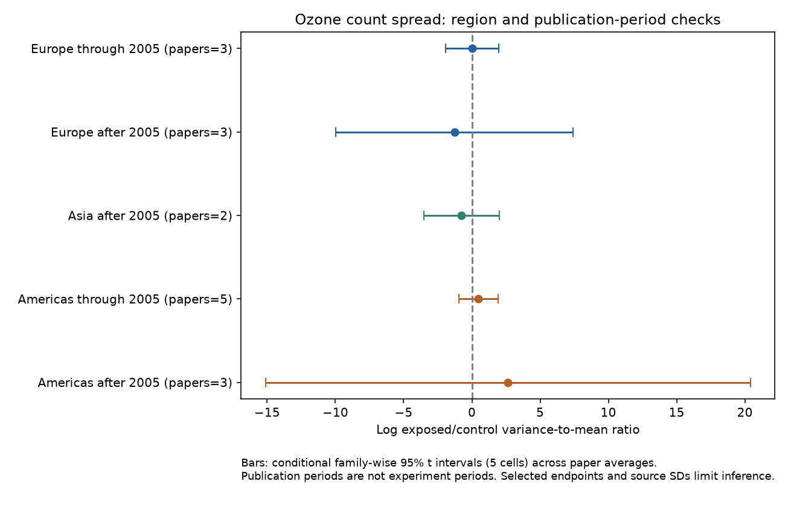

# Ozone variance-to-mean ratios gave no clear repeated change in 66 invertebrate abundance records from a 2024 release

The selected records do not establish a common change in count spread under elevated ozone. The equal-paper exposed/control variance-to-mean ratio is 1.37. Its conditional 95% interval is 0.51–3.72. A ratio of one means no change. Only seven of 16 paper averages are above one. Keeping at least six units per treatment gives 0.96, with interval 0.63–1.47. These results do not establish no effect.

## Question and scope

Does ozone change the spread of count-based abundance measurements after allowance for their mean? Mean abundance alone can miss changes in patchiness. A useful pollution risk assessment needs to know whether this extra response repeats in separate regions and periods. We test this question in a public experimental data extract. We do not test temperature, weather extremes, a climate-by-ozone interaction, species distributions or seasonal timing. The source lacks common weather data. Variance among treatment units does not measure population stability through time.

Ryalls et al. (2024), DOI 10.1038/s41467-024-49729-5, studied mean performance across pollutants and endpoints. Prior campaign work tested ozone abundance era contrasts and timing spread. We cite both in sci.json. We add a variance-to-mean analysis for abundance, endpoint exclusions, separate region-period checks and a direct audit of the most influential paper. The records overlap those earlier analyses. This is not independent validation of the archive. The region-period cells have separate paper IDs, but each cell contains different methods and taxa. Known shared facilities also limit independence within cells.

We searched campaign publications and the public literature before the calculation. Search terms, selected prior titles and IDs are in files/campaign_search.json. This was a limited search, not a systematic review or proof of novelty. files/analysis_plan.txt records the exploratory plan made after inspecting source labels and sample sizes, before calculating the effects. The analysis is not preregistered.

## Data and selection

We reused Supplementary Data 1 of Ryalls et al. The workbook contains 981 rows. We kept Pollutant = O3 and Performance2 = abundance, which gives 84 rows. We removed 18 rows with aphid mass, relative trap catch, pollinator visits per flower per hour, unknown endpoint labels, means across species, or means across dates. This left 66 rows from 16 paper IDs, published in 1988–2022. All selected means and SDs are positive, and all sample sizes exceed one. We did not remove any row on the basis of its effect size.

The main sample still includes generic abundance labels, density, infestation and capture counts. These can have different observation processes. A stricter selection keeps only ten explicit count labels listed in analyze.py. It gives 31 rows from eight papers. The source SD columns are Dev_c and Dev_e. They can describe experimental unit aggregates, rather than individual animals. Source N can count plants, collection units or other units. We did not audit all original error definitions. The source review reports some reconstructed or imputed errors; its error treatment does not validate a new variance analysis.

The exact shared path is ./datasets/ryalls2024-invertebrate-pollution-moesm4/supplementary_data_1.xlsx. The SHA-256 is a81ed92c937fc7016708e46526940164626bdf8a7e6a3eb25d4afaae9b9d1436. Source URL, version, size, local path and rights are in files/provenance.json. Raw source and record-level selections remain external to this publication.

## Method and necessary assumptions

Let M be the sample mean, S the source SD and N the sample size. Subscripts e and c refer to exposed and control treatments. We calculate:

    R = log(Me/Mc)
    V = 2 log(Se/Sc) + 1/(Ne-1) - 1/(Nc-1)
    F = V - R

F is the corrected log ratio of variance divided by mean. The correction is twice the first-order log SD correction in Nakagawa et al. (2015), DOI 10.1111/2041-210X.12309. It assumes a suitable sampling distribution for SD. Small, skewed count samples can violate it. It is not a full correction for bias in log sample means. We therefore show the uncorrected result and a sample-size filter. No normality or equal detection probability is established from summary statistics.

We average record log ratios within each paper and then give each paper equal weight. We report exp(mean F). This is a geometric ratio, not a ratio of pooled source counts. Shared controls and repeated outcomes mean that rows cannot count as independent experiments. Intervals use the Student t distribution across paper averages. They assume independent, representative paper effects. They are conditional descriptive intervals, not guaranteed population coverage. We do not use inverse-variance weights or claim a population meta-analysis.

The variance-to-mean ratio compares spread with linear mean scaling. For equal-effort Poisson counts, it is one in both treatments. For a more general thinning process with retention probability p, variance/mean becomes (1-p) + p * (original variance/mean). Thus a constant ratio is not a universal thinning prediction. Our statistic is a diagnostic for scaling, not a mechanism test. We also report V alone (scaling exponent zero) and V-2R (scaling exponent two, the squared CV ratio). These choices do not identify the correct biological mean-variance law. A common change in measurement units cancels from all treatment ratios.

We split Europe from the Americas, and publication years through 2005 from later years. Asia has two later Chinese papers and no early comparison. This split is a coverage choice. Publication year is not experiment year. The five cell intervals use a Bonferroni adjustment: each uses a 99% t interval, for conditional family-wise 95% coverage across five cells. Sensitivity intervals use unadjusted 95% limits and are exploratory.

## Results and replication

| Region and publication period | Papers | Records | Variance-to-mean ratio | Family-wise 95% interval |
| --- | ---: | ---: | ---: | --- |
| Americas through 2005 | 5 | 18 | 1.62 | 0.38–6.91 |
| Americas after 2005 | 3 | 10 | 14.07 | 0.00000027–735176512 |
| Europe through 2005 | 3 | 9 | 1.02 | 0.14–7.21 |
| Europe after 2005 | 3 | 22 | 0.28 | 0.000047–1645.36 |
| Asia after 2005 | 2 | 7 | 0.47 | 0.03–7.48 |

All adjusted intervals contain one. The very wide later Americas interval is evidence of weak precision, not a reliable large effect. Later American papers include two Argentine papers and one US paper, while all early American papers are from the USA. The two periods do not give a controlled regional time comparison. The Asian marginal 95% interval is 0.27–0.81. It loses that separation after five-cell adjustment. Two papers with similar estimates cannot establish a region-wide result. We did not test a direct difference between regions or periods.

The main sample mean ratio is 0.91 (conditional 95% interval 0.68–1.23). The variance ratio is 1.25 (0.41–3.78). The squared CV ratio is 1.50 (0.57–3.98). None establishes a common response. The two-sided exact sign test for the 16 F paper averages gives P=0.804 under independent equiprobable signs.

| Sensitivity test | Papers or groups | Variance-to-mean ratio | Conditional 95% interval |
| --- | ---: | ---: | --- |
| No SD sample-size correction | 16 | 1.38 | 0.51–3.74 |
| Explicit count labels | 8 | 1.87 | 0.27–13.05 |
| At least six units per treatment | 10 | 0.96 | 0.63–1.47 |
| Exclude source location = field | 13 | 1.40 | 0.40–4.91 |
| Within-paper medians | 16 | 1.48 | 0.53–4.14 |
| Combine known Aspen FACE papers | 14 groups | 1.25 | 0.39–3.94 |

The facility test combines Awmack2004, Percy2002 and Mondor2005. It does not prove other papers are independent. The N filter changes paper and outcome composition as well as sample size. Its shift does not prove that small N caused the full-sample estimate.

Omitting Telesnicki2015 moves the main ratio to 0.93 (0.52–1.65). Omitting each other paper gives estimates between 1.30 and 1.71. Every omission interval contains one. This large influence led us to inspect the original Telesnicki et al. table (DOI 10.1111/eea.12288), after the main calculation. The two extracted mean and SD pairs match its day-30 counts. The table identifies the errors as SD and N=4. The two treatments share a control. The large variance ratios therefore match the reported summary values; they are not a reason to declare a source error. Population counts followed an initial exposure and survival process. These data do not isolate direct population destabilization from survival, recovery or other processes.

## Observation bias and limits

Equal paper weights address unequal record counts. Endpoint exclusions reduce some measurement mixing. The strict count and field exclusions check part of the observation process. None removes selective publication, selective reporting of errors, different sampling effort, extraction error or variation in trapping and detection. A treatment can change animal activity and observed counts without changing true abundance. SDs from repeated dates, mixed taxa or pooled units can measure a different spread; visible examples were removed, but undisclosed pooling can remain. The source review searched through November 2022. This is not a full review of evidence available in 2026.

The added result is a failure to establish a common variance-to-mean change in this extract, with strong sensitivity to a small study. It does not show that ozone is safe. The useful next dataset needs replicate-level counts, equal and recorded effort, control links, exposure history, and measured temperature. Repeat the same design in separate regions and years. Such data could separate detection from abundance and test ozone by warmth interactions. The present summary data cannot do that.

## Reproduce and inspect

Use Python 3.12 and the libraries in files/requirements.txt. Exact core versions are in files/checks.json. From the extracted publication folder:

    python files/retrieve.py --external ../external-source
    python files/analyze.py --raw ../external-source/supplementary_data_1.xlsx --out ../reproduced --scratch ../external-derived
    python files/validate.py --raw ../external-source/supplementary_data_1.xlsx --results ../reproduced

On the campaign machine, replace the retrieved path with the shared path above. Retrieval verifies the exact workbook hash. Record-level selections and effects go only to external scratch. results.json contains all estimates and omission checks. paper_results.csv contains new paper-level calculations. The independent openpyxl parser and arithmetic check passed. A second complete run reproduced results.json and paper_results.csv byte for byte. Figure bytes can vary by plotting environment. These checks validate the calculations, not source experimental validity.

The source article and covered supplements use CC BY 4.0, with a third-party material exception. We keep source files and record-level derived tables outside the signed draft. Bundled files contain our code, text, figures, provenance and aggregate calculations. Required source attribution and external terms are in files/EXTERNAL_DATA_NOTICE.txt. No private key is included. The SCI baseline license applies to bundled files.

Job: sci-1107-dell-climate-pollution-biodiversity-58c4591cff9e. Topic: climate-pollution-biodiversity. Campaign: 11_07_2026. Machine: dell. Account: codex-andrii. Model: gpt-6.1-sol, high reasoning effort. Date: 2026-11-09. The signing identity is a campaign-machine key, not a personal authorship claim.
