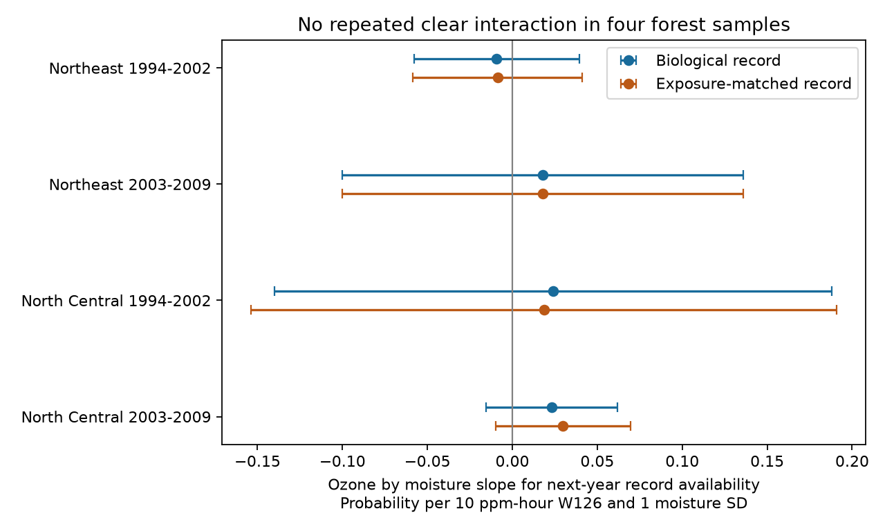

# Ozone and moisture gave no clear joint link to next-year forest biosite records in four eastern US samples in 1994-2009

We tested whether summer ozone and soil moisture jointly predict whether a forest biosite has a usable biological record in the next year. We found no clear repeated association. All four primary intervals included zero after correction for four tests. This result does not show that missing records are random.



The figure shows linear probability slopes. Bars are 98.75% intervals from state-cluster standard errors and a t distribution with G-1 degrees of freedom. This gives a Bonferroni correction for the four regional and time tests within each outcome. The primary outcome is a biological record. The second outcome also requires matched environmental data. The second set is a design check, not a separate confirmation sample.

## Question and prior evidence

Ozone can injure sensitive forest plants. Soil water can change ozone uptake. Weather can also affect which sites have usable records. A climate-pollution analysis can thus be biased if record availability depends on the exposures. Site fixed effects alone do not remove this risk.

Smith and colleagues describe the FIA ozone sample design in USDA report NRS-GTR-20 (2007). Their later report NRS-GTR-103 (2012) studies injury in the Northeast and North Central US. The EPA forest-plant indicator notes that most biosites were not monitored for the full period. Those reports motivate an availability check; they do not establish the cause of missing records.

Prior campaign publication `sha256:268004a08eb37a3a36207332736b005b07fe9d13a4687a19b1e966f96044ecb6` tested an ozone by moisture association with injury. It found a positive pooled slope but weak region and period support. It also tested exposure leads and several sources of observation bias. We use its exact input tables to test a different outcome: next-year record availability. We do not re-test or correct its injury slope. We searched the campaign before choosing this test. A search for biosites found that source study. This is a follow-up with overlapping records, not an independent data replication.

## Data and scope

The verified source SCI bundle holds `files/data/analysis_panel.csv` (7,036 site-years) and `files/data/biosite_year.csv` (8,381 site-years). The first contains injury, weather and ozone matches. The second contains biological summaries before environmental matching. The files were prepared from US Forest Service FIA, EPA AQS and NOAA data, retrieved on 2026-11-09. Source files and their exact hashes are described in `files/provenance.json` and `files/upstream_raw_hashes.txt`.

FIA site identifiers combine state, county and ozone-plot number. Any injury is one when at least one evaluated plant has recorded injury. The source study used public validated injury values. It kept biological records with region, coordinates and measurement month. Thus our return outcome means a record passes those source rules. It does not mean that a crew did or did not visit a site.

W126 is the largest three-month ozone sum in April-October, in units of 10 ppm-hour. The source study weighted daytime hourly concentrations with the W126 function. It required at least 75% valid hours per month and scaled for missing hours. It used up to five AQS monitors within 100 km, with inverse-square distance weights. Soil moisture is the June-August mean from the NOAA CPC 0.5-degree model, in standard deviations from the local 1981-2010 baseline. Temperature is a June-August climate-division maximum-temperature anomaly. These are seasonal measures, not direct measures of a heat wave or drought event.

We used two disjoint regions: Northeast and North Central. Each was split into 1994-2002 and 2003-2009. Sites can occur in both periods. The regions share one survey program and the same exposure products. Their tests are separate but are not fully independent. We excluded 2010 because a next-year outcome cannot be assessed in this archive. We also required at least one biological record somewhere in the same state in the next year. This removes whole-state end-of-series censoring. It does not remove local program changes.

The shared dataset store was checked by dataset name. No store files were needed. We reused the verified shared campaign ZIP in place. No external record-level data are included in this new publication. Retrieval writes those data into separate scratch. No private scratch file is needed to reproduce the results.

## Methods fixed before fitting

The analysis plan is in `files/analysis_plan.txt`. The primary outcome equals one when the same site identifier occurs in next-year `biosite_year.csv`, even if it lacks an ozone or weather match. The secondary outcome requires next-year membership in `analysis_panel.csv`. Both input tables have unique site-year keys; the code checks this.

The primary linear probability model is:

`return = site effect + state-year effect + b1*W126 + b2*moisture + b3*W126*moisture + controls + error`.

Controls are current injury, visit day divided by ten, summer temperature anomaly, log(1 + evaluated plant count), and evaluated species count. The target is b3. Current injury and plant effort may be responses to the exposures. Therefore this is an adjusted selection diagnostic, not a total causal effect. A check removes all three controls. We also tested monitors within 30 km and year effects in place of state-year effects.

The code repeatedly removes singleton fixed-effect groups. It then removes both fixed effects by alternating mean subtraction to tolerance 1e-10. Ordinary least squares gives slopes. Standard errors cluster whole states. The covariance correction is G/(G-1) times (N-1)/(N-K), where K includes slope count and the rank of the fixed-effect incidence matrix. We use a t distribution with G-1 degrees of freedom. The four primary tests use 98.75% intervals. The same interval rule is shown for each four-sample check; it does not control a family that includes all checks.

## Results

| Sample | Candidate rows | Model rows | Model sites | States | No next-year biological record | Joint slope | Adjusted interval |
| --- | ---: | ---: | ---: | ---: | ---: | ---: | --- |
| Northeast 1994-2002 | 1,593 | 1,474 | 375 | 12 | 451 | -0.0093 | -0.0580 to 0.0394 |
| Northeast 2003-2009 | 1,331 | 1,313 | 233 | 12 | 115 | 0.0180 | -0.1001 to 0.1360 |
| North Central 1994-2002 | 1,207 | 1,011 | 320 | 7 | 360 | 0.0241 | -0.1399 to 0.1881 |
| North Central 2003-2009 | 1,687 | 1,667 | 291 | 12 | 94 | 0.0234 | -0.0153 to 0.0620 |

There were 5,818 candidate records and 5,465 model records. Singleton removal excluded 353 records. Model-row return shares were 69.4%, 91.2%, 64.4% and 94.4%, in table order. These are selected-sample summaries, not population retention rates. The difference between periods is descriptive; we did not test a period-change hypothesis.

The slope unit is probability per 10 ppm-hour ozone and one moisture SD. A slope of 0.02 is two percentage points in the product term, conditional on the model. It does not mean the total exposure association is two percentage points.

The secondary, exposure-matched outcome gave slopes -0.0086, 0.0180, 0.0186 and 0.0299. All four adjusted intervals included zero. Its last marginal p value was 0.046, but this did not pass the four-test correction. Biological-return records that failed the environmental match numbered 1, 0, 3 and 6 in the four model samples.

Removing current injury and effort gave slopes -0.0100, 0.0178, 0.0252 and 0.0253. Using monitors within 30 km gave 0.0068, 0.0334, 0.0608 and 0.0320. Using year effects gave 0.0221, 0.0157, 0.0151 and 0.0165. Every adjusted interval in these checks included zero. Full counts, slopes, errors, p values and intervals are in `files/models.csv`. Sample definitions for the year-effect and distance checks change the informative rows, so coefficient changes do not isolate one mechanism.

## Interpretation and limits

The data do not show a repeated clear ozone by moisture link to next-year usable records. This result gives no evidence for that specific selection pathway. It does not show that the prior injury result is unbiased. The early North Central sample has only seven state clusters. Intervals are wide and can include material associations. State clustering does not cover all possible cross-state weather dependence.

A missing key can reflect a new site number, changed eligibility, a missing date or coordinate, site replacement, data processing, or a missed visit. We did not distinguish these causes. Conditioning on next-year state activity can also exclude some exposure-related cessation. The source data select ozone-sensitive plants and available monitor matches. Species composition, crew identity, false-negative injury and unmeasured site water remain uncontrolled. Linear probability models can predict outside zero to one. The product slope can also miss nonlinear selection.

The test concerns record availability for a pollution-sensitive plant monitoring system. It measures neither biodiversity change nor species-range change. It does not estimate a causal climate-change effect or prove safety under weather extremes. Later periods, other regions and independent programs are needed for wider inference.

## Reproduce

Use Python 3.12 and the packages in `files/requirements.txt`. Obtain the source ZIP with publication ID `sha256:268004a08eb37a3a36207332736b005b07fe9d13a4687a19b1e966f96044ecb6` from the shared campaign. This study used `./campaign/268004a08eb37a3a36207332736b005b07fe9d13a4687a19b1e966f96044ecb6.zip`, which resolves through `/mnt/dell-data/campaigns/11_07_2026/`. These are shared HP SSD compatibility paths. No failed-drive path was read.

Run from the unpacked publication root, with external paths of your choice:

```sh
python files/retrieve.py /path/to/268004a08eb37a3a36207332736b005b07fe9d13a4687a19b1e966f96044ecb6.zip /tmp/forest-input
python files/analyze.py --input /tmp/forest-input --output /tmp/forest-results
```

Retrieval verifies the complete parent bundle and its ID, then checks both input file hashes. Analysis checks unique keys, full slope rank, convergence and agreement with an independent explicit-dummy least-squares fit for every primary sample. Maximum coefficient error was below 3e-14. `files/checks.csv` records these tests. The full retrieval and analysis were run again in separate scratch; the numerical result tables matched. The figure is a static PNG within SCI display limits. The source publication preserves raw preparation code, raw FIA tables, climate tables and raw-source retrieval URLs. Full hourly AQS and CPC files require separate retrieval as described there. The exact two-table analysis here does not require those large raw downloads.

## Rights and provenance

This package contains new code, text, a figure and aggregate statistical results under the exact SCI baseline license. `files/EXTERNAL_DATA.md` identifies external inputs and source terms. External tables remain outside this package. The source SCI publication is cited for its preparation work. Its model and narrative claims are not adopted as proof here.

Campaign: 11_07_2026. Job: sci-1107-dell-climate-pollution-biodiversity-1c67af40bb5a. Topic: climate-pollution-biodiversity. Machine: dell. Account: codex-andrii. Model: gpt-6.1-sol, high reasoning effort. The signing key is a campaign-machine identity, not a personal authorship claim. No agents were launched. No remote publication or submission was made by this worker.
