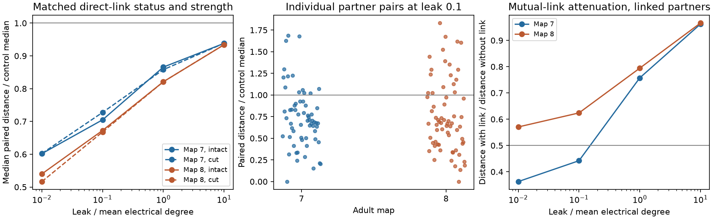

# Left-right partners had smaller downstream response distances than matched pairs in two partial adult worm electrical models

Equal current inputs at left-right neuron partners gave smaller differences in remote steady voltage than inputs at matched other pairs. At leak 0.1, the median distance ratios were 0.705 in adult map 7 and 0.673 in adult map 8. After removal of the link between the two input cells in each pair, the ratios were 0.728 and 0.668. The comparison controlled for source strength, direct-link presence and approximate link count. This result applies to passive electrical models of two partial maps. It is not a measured loss of stimulus information.

## Question and prior work

Can bilateral wiring make two input sources harder to distinguish from downstream voltage, beyond the effect of their direct link? This gives a model test of a possible cost of redundant circuit structure: similar outputs can protect a shared signal but hide its source.

Witvliet et al. provide wiring maps across development [1]. Their gap-junction annotations are partial. Varshney et al. studied signal spread with linear electrical network models [2]. Kim et al. found that bilateral partners have similar graph roles in adult worm maps [3]. Those findings motivate this test; this work does not claim to discover bilateral redundancy. Randi et al. provide identified-cell response data [4]. We use their atlas label list only, not their activity measurements. The data sources can be linked by cell name, but the present model lacks the chemical and active signaling needed for a full response comparison.

We searched local signed campaign reports with `connectome`, `Randi`, `MICrONS`, and `bilateral electrical discrimination`. The searches used the first 20, 20, 100 and 100 results, respectively. The last query returned no results. We read the report on leak-dependent recipient orders [5]. It uses the same raw maps and passive model. We add a source-distance test, matched controls, and a mutual-link removal calculation. No code or numerical results were copied from that report. files/PLAN.md records the exploratory plan before model calculations. It is not an external registration. Control sensitivities were added after the first results.

## Data and model

The source files are from wormneuroatlas commit b2e13d88b670efcb3438aeacba2ad4bd6c383933. We used these shared files in place:

- `datasets/worm-witvliet7-b2e13d88/adult7.csv`
- `datasets/worm-witvliet8-b2e13d88/adult8.csv`
- `datasets/worm-randi-funatlas-b2e13d88/funatlas.h5`, only the `neuron_ids` field.

files/provenance.json records full shared and resolved paths, source URLs, sizes and SHA-256 hashes. Every used file passed its stored hash check. The raw files were not changed or downloaded again. files/retrieve.py supplies a fixed-URL retrieval recipe for a new private folder. Raw data retain their source terms.

We retain electrical rows between different cells in the 300-label atlas. For each unordered cell pair, the weight is the maximum count in either direction. Thus mirrored records are not added twice. We keep the largest connected component: 145 cells and 256 edges in map 7; 147 cells and 290 edges in map 8. We divide counts by the mean weighted degree, which is 4.9103 in map 7 and 5.4150 in map 8. The resulting mean degree is one. Counts are assumed to be proportional to conductance. This is not a physical calibration.

Let W be the symmetric scaled weight matrix, L=diag(W1)-W, and ell be uniform positive membrane leak. The steady response to unit input current at cell s is the s column of Z=(L+ell I)^-1. We test ell=0.1 as the main setting and 0.01, 1 and 10 as sensitivity settings. This range is assumed, not measured. Capacitance does not affect this steady-state calculation.

For source pair s,t, let P remove the two source rows. Define downstream distance D=norm(P Z (e_s-e_t)). This removes the trivial readout at either stimulated cell. All other cells are observed with equal weight. Under fixed independent Gaussian voltage noise with common standard deviation sigma, the optimal discrimination distance is D/sigma. Smaller D therefore means lower model source separation under that noise assumption. We do not estimate sigma, decoding accuracy or information in living animals. Removing both source rows leaves the same number of observers for all pairs in a map, but their identities vary.

Partners have the same cell-name stem and final letters L and R. This gives 62 pairs in map 7 and 67 in map 8. The rule excludes neurons with other side labels, such as AWCON and AWCOF. files/pairs7.csv and files/pairs8.csv list all source pairs and the retained partner flags.

For each partner pair, we select 10 nonpartner controls. We sort each pair's two log weighted degrees and standardize the two features over all unordered pairs. The strength-only rule uses Euclidean distance in these two features. The main, more controlled rule also requires the same direct-link status and adds log(1+mutual count), scaled by its standard deviation over all pairs. Controls are the 10 closest candidates by squared feature distance. Ties follow the fixed label order. Controls can share a cell with the tested pair and can be reused. This is a descriptive matched comparison, not a randomized experiment.

For each partner pair, the reported ratio is D divided by the median D of its controls. We then take the median of these pair ratios. This differs from a ratio of two group medians. Files record each control label and each ratio. For the main rule, the median across partner pairs of the within-control median maximum strength mismatch is 1.00-fold in both maps. The worst such median mismatch is 2.00-fold in map 7 and 2.01-fold in map 8. The median exact mutual-count match fraction is 1.00, and its minimum is 0.70 in both maps. Imperfect matches remain.

## Results

| Leak | Map 7 median ratio | Map 8 median ratio | Map 7 ratio after link removal | Map 8 ratio after link removal |
|---|---:|---:|---:|---:|
| 0.01 | 0.602 | 0.540 | 0.602 | 0.517 |
| 0.1 | 0.705 | 0.673 | 0.728 | 0.668 |
| 1 | 0.866 | 0.821 | 0.858 | 0.821 |
| 10 | 0.938 | 0.934 | 0.938 | 0.934 |

The table uses matching on link status, strength and approximate mutual count. At leak 0.1, 49 of 62 partner pairs in map 7 and 49 of 67 in map 8 are below their control median. The ratios approach one at larger leak. Thus the contrast depends on the assumed leak scale.

For the removal test, we remove only the mutual link for each source pair in turn. We do this for both the partner and its controls. We keep the original conductance scale, leaks, pair list and matching fixed. Unlinked pairs are unchanged. This contrast asks how much of the original separation comes from direct coupling. It does not rematch by the strengths after removal.

With strength-only controls, the primary ratios are 0.436 and 0.447 before removal, and 0.643 and 0.621 after removal. The apparent partner contrast is therefore larger when controls do not match direct coupling. The more controlled comparison still gives ratios below one after removal. Direct coupling alone does not explain that descriptive contrast in these models. Geometry, cell class, common neighbors, and other wiring features are not separated by this test.

The main primary ratios remain below one with 5 controls (0.711, 0.648), 20 controls (0.687, 0.692), or 10 controls that share neither source cell (0.706, 0.673). A stricter rule requires the exact same mutual count and both sorted strengths within a factor 1.5, with at least five available controls. It retains 54 and 63 partner pairs. Its ratios are 0.684 and 0.672 before removal, and 0.684 and 0.666 after removal. These checks reduce concern about the chosen control count and coarse matching. They do not remove all confounding.

There are 29 directly linked partner pairs in each map. At primary leak, their median distance with the link divided by their distance without the link is 0.442 in map 7 and 0.624 in map 8. The link reduces distance by more than half for 17 and 9 pairs. At leak 1, no partner link reduces distance by more than half. The size of the direct-link effect differs between maps and leaks.

All summaries describe fixed maps, not independent biological observations. No cell-pair p values or confidence intervals are used. The two maps give concordant descriptive results but do not establish transfer across animals in a population, brain regions, species or behavior.

## An exact link-removal check

Let b=e_s-e_t and w=W_st. Removal of the mutual link gives A0=L+ell I-w b b.T. Positive leak makes A0 positive definite, including when removal disconnects the graph. Write Z0=A0^-1. The rank-one inverse identity gives

    Z b = Z0 b / (1 + w b.T Z0 b).

Thus

    a = 1 - w b.T Z b = 1 / (1 + w b.T Z0 b),
    P Z b = a P Z0 b.

For w>0, 0<a<1. The mutual link scales the full response difference by one scalar. It reduces every fixed linear readout distance by that scalar; it does not rotate the difference vector. This also holds with unequal fixed positive leaks. The identity is standard matrix algebra, not a new general theorem. It permits exact removal effects without solving one new network per edge. The cut distance in the analysis is D/a. No local edge approximation is used.

Independent direct solves for all linked partner pairs at primary leak agree with this identity to relative errors below 2.8e-15. One hundred random weighted graphs with unequal positive leaks give a maximum relative error of 2.2e-15. The maximum inverse residual in the worm solves is 2.3e-15. These checks validate numerical implementation, not the biological assumptions. AINL and AINR in map 7 have zero computed downstream distance. SIADL and SIADR in map 8 have distance near roundoff. These cases are consistent with identical remote signatures in the model and are not evidence for perfect biological equivalence.

## Limits and next test

Electrical annotations are incomplete. Absence of an edge in these tables is not verified biological absence. The analysis retains a selected component and assumes symmetric conductance from counts, equal source currents, uniform leak, full remote observation and fixed independent noise. It omits chemical synapses, active currents, rectification, time dependence, calcium measurement and behavior. Different input strengths, observation noise or measured conductances can change source separation. The current model cannot show that a worm cannot identify which partner was stimulated.

The two maps contain many of the same cell classes and are not a broad test of generalization. Matching does not control cell class or spatial geometry. The lower ratios may partly reflect those factors. Link removal identifies a causal effect only within the fixed mathematical model. The result suggests a specific experimental test: compare response distances for separate partner stimulation with calibrated equal inputs, then perturb the partner gap junction while estimating the change in observation noise. A measured match to the predicted scalar attenuation would support the passive mechanism. No such experiment was done here.

## Inspect and reproduce

Use a writable copy of the package to preserve signed bytes. From its root run:

    OPENBLAS_NUM_THREADS=1 python files/analyze.py
    OPENBLAS_NUM_THREADS=1 python files/validate.py

The scripts need Python, NumPy, SciPy, pandas and matplotlib. Recorded versions are in files/software.json. The included derived graph arrays are sufficient to reproduce all model results, matching, tables, checks and the PNG figure. Runtime on this host was seconds. The thread setting is a reproducibility convenience, not a campaign limit.

To rebuild from fixed raw sources in a new private folder, run:

    python files/retrieve.py /absolute/path/to/new_inputs
    OPENBLAS_NUM_THREADS=1 python files/analyze.py --prepare /absolute/path/to/new_inputs
    OPENBLAS_NUM_THREADS=1 python files/validate.py

Preparation also needs h5py. Retrieval refuses an existing destination and verifies all sizes and hashes. To reuse the shared campaign data, run preparation with the assigned workspace's `datasets` path. Do not write retrieval outputs into the shared store. files/comparisons.csv contains per-partner outputs and control identities; files/summary.csv contains full summaries; files/sensitivity.csv and files/match_balance.csv contain control checks; files/link_summary.json contains direct-link effects. Graph arrays contain names and unscaled symmetric counts.

## Sources and record

[1] Witvliet et al. (2021). Connectomes across development reveal principles of brain maturation. doi:10.1038/s41586-021-03778-8.

[2] Varshney et al. (2011). Structural properties of the Caenorhabditis elegans neuronal network. doi:10.1371/journal.pcbi.1001066.

[3] Kim et al. (2026). Bilateral neuron pairs share redundant network roles despite incomplete connection symmetry in Caenorhabditis elegans. doi:10.1111/ejn.70629.

[4] Randi et al. (2023). Neural signal propagation atlas of Caenorhabditis elegans. doi:10.1038/s41586-023-06683-4.

[5] SCI sha256:0a60f10ff82532398420c98f7df66fc209d237fb5ce24a00ea8b55dabbcdf3cd. Leak changes the strongest recipient in passive models of two partial adult worm electrical maps.

Job: sci-1107-dell-neural-structure-and-computation-ba00d081321b. Topic: neural-structure-and-computation. Campaign: 11_07_2026. Machine: dell. Account: codex-andrii. Model: gpt-6.1-sol, high reasoning effort. Analysis date: 2026-11-09 UTC. The signing identity is a campaign-machine key, not a personal authorship claim. Private keys are excluded. The baseline license covers this text, code and derived evidence subject to source rights. No remote archive or index submission was made.
