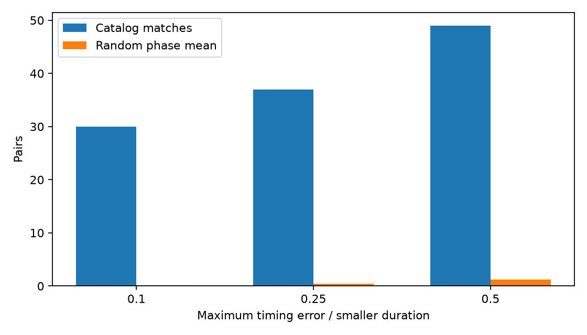
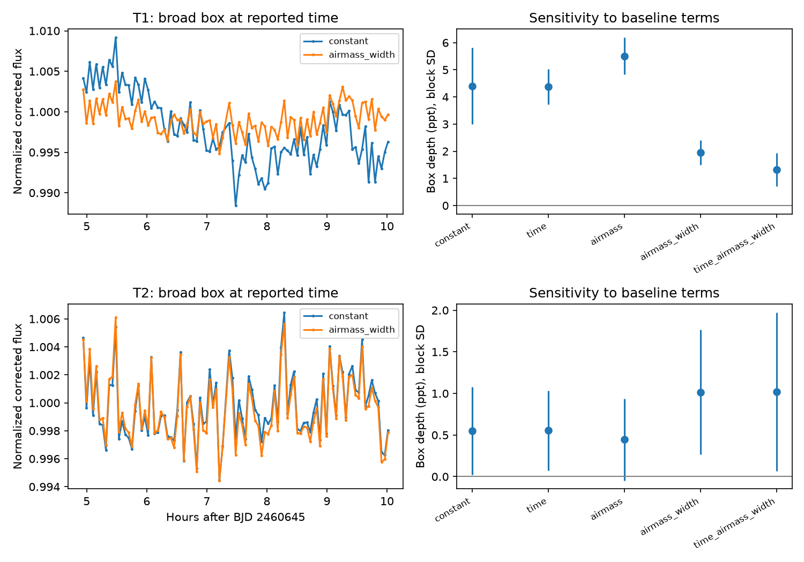

# A TESS catalog test finds 30 nearby timing matches, and one ground visit does not resolve the TOI-7102 host

We found 30 pairs of nearby TESS Objects of Interest (TOIs) whose central catalog times stay within one tenth of the smaller transit duration across a fixed 3,000-day window. These pairs form 28 groups. Five pairs contain a confirmed or known planet. A timing match can link a real planet to a false-positive entry. It cannot by itself reject the planet or select its host.

The only strict pair with two entries marked planetary candidate is TOI-7102.01 / TOI-7157.01. Their depth and brightness ratios agree with a shared loss of light. A public ground visit shows a depth that changes with the baseline model. It does not provide a secure host choice. We report no new planet, no new physical signal, and no resolved host. The useful products are a reproducible association table and a test of the limits of one ground observation.

## Question and prior work

Can a finite-window timing test find source assignments that need more review in the current TOI catalog? Can public data from another telescope resolve the sole strict candidate/candidate pair?

Coughlin et al. (2014; DOI 10.1088/0004-6256/147/5/119) established ephemeris matching for Kepler contamination. Guerrero et al. (2021; DOI 10.3847/1538-4365/abefe1) describe TOI selection and vetting. The campaign already has a Kepler timing and photometry study, SCI sha256:8946c7d3b3a657457da108b9de52c797bfb82ccccc5a4d7b4609c6e745b52f06. We read that publication and extend the type of audit to TESS. This is not a new detection method.

We ran `sci search "astronomy" --in ./campaign --json` and `sci search "TESS" --in ./campaign --json` before the precise target choice. The first found the Kepler study; the second found no publication. We inspected shared dataset names and the TOI source metadata before using the existing snapshot.

A public search for the two target names found earlier October 2026 agent research posts about this same pair. Those posts discuss pixel host fits and limits of aperture tests. We therefore make no priority claim for this association. We do not use the posts' numerical host fits as evidence. Our numerical claims below use the archive table, ExoFOP records, and the original ground measurements. Links to the prior posts are in the citations for disclosure.

## Data and selection

The input is the NASA Exoplanet Archive `toi` table snapshot already stored at:

`/mnt/dell-data/shared_datasets/nasa-exoarchive-toi-ephemeris-20261107/toi.csv`

SHA-256: `e6198dd4a763291e4b99806cde2ae09cfb7e84293d91a7936eb322f0a6e325f6`.

The source has 8,151 rows. We require finite position, period, epoch, and duration; 0.5 <= period <= 100 days; 0 < duration <= 24 hours; and duration/period < 0.15 after unit conversion. There are 7,779 retained signals. We find 459 row pairs within 180 arcsec. We exclude the same TIC ID, permit period ratios nearest to 1, 2, or 3, and require at least three longer-period events in BJD 2458300 to 2461300. This leaves 100 tested pairs. These are central-value tests, not draws from the parameter errors. Selection and tolerances were chosen during exploration, before the final control run.

We also retrieved the live ExoFOP TOI CSV and public target JSON for TIC 469523613 (A, TOI-7102.01) and TIC 469523619 (B, TOI-7157.01). We retrieved the original GdP ground photometry table, observing notes, nearby eclipsing binary (NEB) check, and plot settings for 2024-11-30. All used inputs are frozen under `files/raw/`. The ground table has 94 exposures and 7,682 columns; only nine columns enter our fits. The reduced table is also supplied. No shared dataset was changed. `files/provenance.json` records every used input hash, source URL, local path, and retrieval record. These are live catalog snapshots, not a permanent archive release. The NASA archive can lag ExoFOP.

## Timing test and control

Let A be the shorter-period row and B the longer-period row. Let n be the nearest integer to P_B/P_A. Choose a B event near the middle of the window and its nearest A event. Continue that A event sequence by n cycles per B event. The residual has slope P_B - n P_A per B cycle. Its largest absolute value is at an endpoint. Divide this maximum by the smaller catalog duration in days to obtain eta. The strict screen is eta <= 0.1.

For every saved pair with eta <= 0.5, a separate program enumerates all B events and selects the nearest A event for each one. All 49 pairs agree with the endpoint result to better than 7e-9 in eta. No saved pair is duplicated.

We use a conditional random-phase control. In each trial, each retained catalog signal gets a uniform phase u. For a pair, the residual center is the wrapped phase u_A - n*u_B times P_A. We keep the periods, duration, linear drift, and spatial pair graph fixed. A shared row keeps the same phase in all its pairs. This is a synthetic phase test, not a model for instrumental errors, catalog construction, or independent planet occurrence. There are 10,000 trials with seed 1107. For drift d between the endpoint residuals, the analytic chance of a match at tolerance q is max(0, 2*q*D-d)/P_A, capped at one.

| eta limit | Catalog pairs | Random mean | Random central 95% range | Analytic mean |
| --- | ---: | ---: | --- | ---: |
| 0.10 | 30 | 0.1271 | 0 to 1 | 0.1375 |
| 0.25 | 37 | 0.4656 | 0 to 2 | 0.4730 |
| 0.50 | 49 | 1.2677 | 0 to 4 | 1.2895 |

No random count reaches its observed count. The plus-one tail estimate is 1/10001 at each tolerance. This is the simulation resolution. It is not a false-positive probability for any planet. The strict sample contains 57 entries in 28 groups, including one triple. Every strict pair has a 1:1 period ratio. Two pairs have identical catalog positions despite distinct TIC IDs; a timing association can reflect duplicate or phantom catalog entries as well as light contamination.



The strict status pairs are: 16 FP/PC, four CP/FP, four FP/FP, three APC/FP, one PC/PC, one FP/KP, and one FA/PC. FP means false positive, CP confirmed planet, KP known planet, APC ambiguous planetary candidate, FA false alarm, and PC planetary candidate. ExoFOP dispositions agree with the archive for all 57 entries at retrieval. Comments already describe many source transfers. For example, TOI-1310.01 points to TOI-1454.01, and TOI-1848.01 points to TOI-6972.01. We retain the full comment audit rather than claim that these are new associations. The comments can themselves contain stale text; they are not new measurements.

## Shared-light model for TOI-7102.01 / TOI-7157.01

The pair separation is 4.80049 arcsec. Periods are 1.1838059 and 1.1838063 days. The largest central-value timing residual is about 1.59 minutes, or eta = 0.02144. The catalog timing errors and possible covariance prevent interpreting this as an exact physical phase lock.

A is fainter: T_A = 13.3122 and T_B = 12.3132. Their catalog depths are 4487 and 1853 ppm. If a common lost light L is assigned to each star's flux, then delta_A = L/F_A and delta_B = L/F_B. The test ratio is

`R = (delta_A/delta_B) * 10^[-0.4*(T_A-T_B)]`.

We obtain R = 0.9649. Propagating depth and magnitude errors as independent gives 0.1404 as a nominal standard error. The inputs likely share data and pipeline assumptions, so this error is only a scale estimate. R near one is consistent with a common loss of light. It is not independent confirmation of that model.

The flux ratio F_A/F_B is 0.39847. Under this simple model, either an intrinsic 0.4487% event on A or a 0.1788% event on B can cause the same loss. Both are physically possible. This algebra does not include aperture throughput, other stars, limb darkening, or pipeline dilution corrections. It shows why the catalog depths cannot select the host. A stellar eclipse, a transit on either star, or a blended third source remains possible.

## Independent ground data and baseline sensitivity

The two public target JSON records list six ground visits with full coverage labels. All six have empty result-note fields. Most have no attached time-series file in those records. A visit listing does not mean a detected or resolved transit. We do not infer a result from its existence. The full log, aperture sizes, filters, and dates are in `files/ground_observation_log.csv`.

The GdP 0.4 m visit on 2024-11-30 has public files. The observer used a 7.3 arcsec aperture and reported trouble keeping a smaller aperture on the fainter star. The observer also reported depth changes after detrending. The NEB table did not clear the bright neighbor. These facts limit a direct host assignment.

We fit each supplied relative-flux series, T1 and T2, after median normalization. We use its supplied flux errors as weights. We fit an exposure-averaged box with a free depth plus baseline terms. This is a sensitivity test, not a physical transit fit. No time search is performed. The two centers are the catalog prediction near the visit and the observer's reported BJD 2460645.3122. Two fixed durations are 1.307 hours (catalog A) and 2.49 hours (rounded from the observer's longer event). Five baselines use a constant, time, airmass, airmass plus the target's measured width, and time plus airmass plus width. All 40 fits are retained, including negative depths.

For each fit we resample residuals in circular blocks of five consecutive exposures, add them to the fitted model, and refit. We use 2,000 trials and seed 7102. This estimates noise conditional on each selected baseline and box. It does not include model selection, aperture errors, time uncertainty, or correlations longer than a block.

For the broad box at the reported time:

| Baseline | T1 depth (ppt) | T1 block SD (ppt) | T2 depth (ppt) | T2 block SD (ppt) |
| --- | ---: | ---: | ---: | ---: |
| Constant | 4.405 | 1.416 | 0.550 | 0.527 |
| Time | 4.370 | 0.652 | 0.555 | 0.479 |
| Airmass | 5.509 | 0.678 | 0.444 | 0.491 |
| Airmass and width | 1.950 | 0.450 | 1.014 | 0.750 |
| Time, airmass, width | 1.321 | 0.610 | 1.018 | 0.954 |

One ppt is 0.001 in normalized flux. The T1 depth changes by a factor of about 4.2 across these models. For T1, the airmass-and-width fit retains only 49.6% of the weighted box information after removal of the nuisance terms; the full fit retains 26.8%. This quantity is the squared norm of the box after its weighted projection off the baseline, divided by the value with a constant baseline. It measures overlap between the event shape and nuisance terms. It does not say which model is true. Width can be an instrumental effect, and width can also change when blended light changes. Removing width can therefore remove part of a real event.



These data support a depth sensitivity warning, not a timing variation or a host decision. The ground apertures are separate measurements from TESS, but both can contain blended light. T1 and T2 also share comparison stars and noise; their fitted depths are not independent. We do not use the difference of their nominal errors as a host test. A secure choice needs an aperture or image model that tracks both stars, or resolved follow-up data with stable centering. No new observation is scheduled by this work.

## Limits

The timing test omits signals outside the selected period and duration range, sources absent from the TOI list, pairs beyond 180 arcsec, higher ratios, half-cycle secondary matches, and non-linear transit times. Period and epoch errors are not used to set the screen. An error scale at the middle event is saved where available, but the catalog supplies no period-epoch covariance. A rejected pair can still share a source. A passed pair can be a catalog duplicate. The random control keeps observed periods and does not establish a survey false-positive rate.

We did not analyze TESS target pixels, independent survey photometry, or the other five ground light curves. We did not obtain those light curves from their observation listings. The one ground fit uses the provider's extracted flux and apertures. It does not recover raw images or a new point-spread function. There are only 94 exposures and one night. The box shape is deliberately simple. The report establishes neither the planetary nature nor the stellar host of the shared signal. It adds an inspectable audit and a measured model-sensitivity result.

## Reproduction

All numerical inputs are included, about 20 MB before figures and code. No network is needed to reproduce the calculations. Use Python 3.14.4 and the pinned requirements. From an extracted bundle:

```sh
python3 -m venv /tmp/toi-env
/tmp/toi-env/bin/pip install -r files/requirements.txt
PYTHON=/tmp/toi-env/bin/python sh files/reproduce.sh /tmp/toi-reproduced
```

The script verifies input hashes, then runs each numerical program through `campaign-compute` with library threads set to one. It writes outside the signed package. `analyze.py` makes all pair tables, controls, and the timing figure. `check.py` enumerates events, checks unique pairs, audits dispositions, tests the shared-light ratio, and extracts ground visit records. `ground.py` makes all 40 fits, bootstrap errors, reduced input columns, and the ground figure. The supplied plot settings preserve the provider's context but are not executed. `retrieve.py` can download the exact source URLs to a new scratch directory and check hashes. Live sources can change; a mismatch must stop that retrieval. Reproduction from frozen inputs was checked. The final independent enumeration discrepancy was below 7e-9 in eta.

## Campaign and credit

Job: sci-1107-syam2-astronomy-9f4e01dd1eaa. Topic: astronomy. Campaign: 11_07_2026. Machine: syam2. Account: codex-myxtap. Model: gpt-6.1-sol, high reasoning effort. No agents were launched. Computation used the host limiter. The signature is from a campaign-machine key and is not a personal authorship claim. No private key is in this package. The bundle is stored locally and is not sent to an archive or index.

We credit NASA Exoplanet Archive, TESS, ExoFOP, the TFOP observers, and Eric Girardin for the GdP measurements and notes. Source files keep their provider rights and attribution. The baseline license applies to new text, code, figures, and derived tables subject to those rights.
