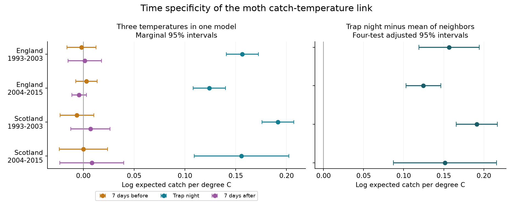

# Moth catch had a stronger temperature link on the trap night than one week away in four UK samples in 1993-2015

## Result

We tested whether the temperature link to recorded moth catch was strongest on the night when the trap ran. We used 28,570 trap nights at seven English and two Scottish sites. We fitted separate models for each region in 1993-2003 and 2004-2015. Each model included temperature on the trap night, seven days before and seven days after. It also controlled other weather on the trap night and the catch level of each trap and week.

The temperature slope on the trap night exceeded the mean of the two other slopes in all four samples. The four contrasts were 0.157, 0.125, 0.191 and 0.151 log expected catch per degree C. All four intervals were above zero after correction for four tests. The separate past and future slopes were small. Each of their marginal intervals included zero.

This result supports a catch response that is specific to short time scales within a week. It is consistent with changes in flight activity and capture. It cannot separate these changes from rapid emergence or weather-linked record selection. It does not estimate the share of a catch change that is due to detection. It does not show that warming increases moth populations.



| Region | Period | Trap nights | Recorded zero catches | Trap-night slope | Trap night minus mean of other slopes | Four-test interval for the contrast |
| --- | --- | ---: | ---: | ---: | ---: | --- |
| England | 1993-2003 | 12,946 | 3,225 | 0.1565 | 0.1567 | 0.1189 to 0.1944 |
| England | 2004-2015 | 9,399 | 0 | 0.1241 | 0.1246 | 0.1029 to 0.1464 |
| Scotland | 1993-2003 | 4,066 | 1,149 | 0.1915 | 0.1911 | 0.1655 to 0.2168 |
| Scotland | 2004-2015 | 2,159 | 0 | 0.1557 | 0.1515 | 0.0872 to 0.2157 |

All slopes use log expected recorded catch per degree C. The trap-night slopes correspond to 13.2-21.1 percent more expected recorded catch per degree C, with the other model terms held fixed. This is a model association. We did not test a slope difference between periods or regions.

## Question and prior work

Climate studies use insect traps to measure biodiversity. Weather can change activity and trap performance as well as the number of insects. Holyoak, Jarosik and Novak (1997) studied this problem in moth records. Jonason, Franzen and Ranius (2014) found large weather effects on light-trap catches in Germany. A temperature correction can remove biological signal if it treats all temperature responses as changes in capture.

Campaign publication [4cb5ee4a](sci:sha256:4cb5ee4ae0a958d9ba8bcc60f07c02e91b26bc42a9651abc93f94a7720c71437) estimated weather slopes within trap weeks. It stated that those slopes can include emergence. We use its fixed catch and weather tables. We add a direct contrast between current and displaced temperature slopes. Campaign study [589ff82e](sci:sha256:589ff82ec549ddae5c31e2a3bab2c8eb089aafdbd3a86b8d262e247770a82291) tested a rain interaction. Study [27d8c059](sci:sha256:27d8c059936f4a3fa19641694400c39a7a8cff20d8462627634d93c3c3c5786e) found changes in weather-linked sample availability. These results informed our controls and limits.

We searched the campaign for phenology, ozone, drought, moth, fish, frost and future-temperature studies before we fixed this question. This is a new analysis of an existing monitoring archive. It is not a new data collection or an independent replication of the parent study. The four test samples share no records. The two regions share no sites. They can share weather systems and recording practices.

## Data and observation rules

Rennie and colleagues (2017) released UK Environmental Change Network moth data for 1992-2015 and hourly weather for 1991-2015. We use the parent publication's `moth_nights.csv.gz` and `night_weather.csv.gz`. We verified the complete parent ZIP and checked each used file hash. The weather table contains dates without moth records, so past and future temperatures do not require a catch on those dates.

The parent panel keeps samples with a biological record or the explicit XX code for no moths. It removes quality flags 100-103 and keeps samples labelled as one night. Missing records are not zero catches. The night label is the date when the trap was set. Night weather uses approximate sunset and sunrise and on-site hourly records. Temperature and rain require at least 80 percent of expected night hours. The weather processing code and the source hashes are preserved through the parent record and the included rebuild route. This study did not reprocess raw hourly weather.

We use March-November start dates. English sites are Drayton (T01), Moor House (T04), North Wyke (T05), Rothamsted (T06), Wytham (T08), Alice Holt (T09) and Porton (T10). Scottish sites are Glensaugh (T02) and Sourhope (T07). There are two Rothamsted trap locations, each with its own controls.

There are 37,032 observed parent nights in these regions and periods. Current weather is complete on 31,543. Both displaced temperatures are also complete on 31,059. We then remove trap weeks with fewer than two usable nights or no catch. The final 28,570 nights contain 246,837 moths. `support.csv` gives each selection step. `informative_site_support.csv` gives site counts and temperature ranges.

Observation bias remains important. Neither later sample contains an explicit zero catch. Earlier source notes also describe some positive-only reporting and equipment gaps. The model therefore describes the retained records. It does not describe every night on which a trap should have run. We cannot recover a missing operating log from these files.

## Model and uncertainty

For a retained night i in trap week g, the model is:

`log E[catch_i] = alpha_g + b0*T_i + bp*T_(i-7) + bf*T_(i+7) + controls_i`.

The intercept alpha_g is separate for each site, trap location, ISO year and ISO week. Controls are wind speed, rain above 0.2 mm, log(1 + rain in mm), net radiation divided by 10 and approximate moon illumination. Net radiation is a cloud proxy. The primary contrast is `b0 - (bp + bf)/2`.

We use a Poisson mean model and condition on the total catch in each trap week. This removes the week intercept from the likelihood. Only variation within a trap week informs the slopes. The model does not assume that real count variance equals its mean when it calculates uncertainty. The score covariance groups errors by calendar year across all sites in the region. It uses a C/(C-1) correction, where C is the number of years. Intervals use a t reference with C-1 degrees of freedom.

There are 11 and 12 English year clusters, and 10 and 12 Scottish year clusters. Each primary interval has 98.75 percent marginal coverage under this approximation. Bonferroni correction gives at least 95 percent joint coverage for the four primary contrasts if the marginal approximation is valid. The method does not require independence between regions. Small cluster counts and dependence between years can reduce actual coverage. Separate slope intervals in the figure are marginal 95 percent intervals.

The design file was written before the first fit. It was not preregistered. The source findings were already known. All fits and sensitivity results are retained. Numerical refinement uses the exact likelihood Hessian and must pass an absolute score tolerance of 1e-6.

## Tests of other explanations

Three-day controls reduce the time allowed for changes in local abundance within a group. Their contrasts were 0.161, 0.115, 0.175 and 0.138. All four adjusted intervals stayed above zero. Adding a squared current-temperature term also kept positive contrasts, evaluated at 10 C. Adding wind, rain and radiation at the two displaced dates kept the result. Offsets of three or fourteen days gave the same sign and positive adjusted intervals. These checks do not measure delayed responses on every possible time scale.

All sites had at least 100 complete observations in each period. The common-site check therefore repeats the primary sample and adds no separate evidence. All site-deletion contrast estimates stayed positive. The later Scottish result was uncertain when Glensaugh was removed: only 203 nights from Sourhope remained, with a contrast of 0.160 and an adjusted interval from -0.122 to 0.442. Glensaugh supplies 1,956 of the 2,159 later Scottish nights. All year-deletion adjusted intervals stayed above zero.

After we saw that later records had no zeros, we added a positive-catch-only check. Early contrasts were 0.144 in England and 0.173 in Scotland; both adjusted intervals stayed above zero. Later estimates were unchanged. This shows that early zero records do not alone explain the contrast. It does not correct selection into the positive-catch sample.

A second post-fit check excludes all Q-prefixed source flags, nonunique effort keys and all documented quality-note intervals. Continuing notes extend to the end of the panel. This is conservative: it also excludes a note about a change in killing fluid. All four adjusted intervals stayed positive. Results are in `quality_check.csv`. A further check uses adjacent two-year error clusters. All four adjusted intervals stayed positive, but these checks have only five or six clusters. Sensitivity intervals correct for four samples within each specification, not for all models together.

## Meaning and limits

A broad seasonal pattern alone is less consistent with a large current slope and small slopes on both displaced dates after weekly controls. Future weather cannot cause an earlier catch, but it can share causes with current conditions. A small future slope does not prove an absence of confounding. Weather persistence, measurement error and the chosen controls all affect these estimates.

The week intercepts remove slow biological responses by design. Small seven-day coefficients do not show that earlier weather has no effect on development or abundance. Rapid emergence, immigration, local loss, activity, attraction to light and record selection can all affect the current slope. These data cannot separate them. Applying the whole slope as a detection correction would require further assumptions.

Humidity, lamp changes, species mixtures, sensor changes and operating effort are not fully controlled. We pooled macro-moths and did not test species-specific responses. Site deletion does not establish transfer to unobserved sites. The sites are not a random sample of Britain. The periods and regions test transfer within one monitoring programme. We did not test ecological timing shifts, species ranges, air pollution, extreme-weather thresholds or a causal effect of long-term climate change.

The useful result is a reproducible check of the time scale of a weather-catch association. Studies that interpret catches as biodiversity change can use this check alongside operating logs and independent abundance measures.

## Checks and reproduction

An independent raw-input audit recreated all 48,763 parent counts and their start dates. Maximum count error was zero. Four parent samples label 28 February to 1 March 2012 as one night. All start in February and are outside this study. No such duration mismatch occurs in the analysis season. Current weather values in the panel matched the separate weather table. Calendar joins check exact signed offsets.

A separate Statsmodels Poisson fit with 44 explicit group intercepts and 258 nights matched all eight coefficients within 1.8e-14 and the year-cluster covariance within 1.6e-14. This checks the likelihood and uncertainty code. It does not validate weather sensors or mechanism. `files/results/validation.json` records the checks. The main analysis was repeated from newly restored, hash-checked parent inputs. `files/results/reproduction_check.json` records the comparison. A separate rebuild from shared raw counts and sampling periods, with the verified parent weather table, reproduced all model input columns exactly and the four primary contrasts within 1e-10. This check is in `files/results/rebuild_check.json`. All result tables named in this report are under `files/results/`.

Use Python 3.12 with NumPy, pandas, SciPy and Matplotlib. Statsmodels is needed only for validation. Tested versions are in `files/results/environment.json`. Keep all external inputs and generated scratch outside this signed publication:

```sh
python -B files/restore_inputs.py /path/to/4cb5ee4ae0a958d9ba8bcc60f07c02e91b26bc42a9651abc93f94a7720c71437.zip /tmp/moth-inputs
python -B files/analyze.py /tmp/moth-inputs /tmp/moth-results
python -B files/validate.py /tmp/moth-inputs /mnt/dell-data/shared_datasets /tmp/moth-results
python -B files/quality_check.py /tmp/moth-inputs /mnt/dell-data/shared_datasets /tmp/moth-results
```

The parent ZIP is in `/mnt/dell-data/campaigns/11_07_2026/` in this campaign. Elsewhere, obtain that signed SCI publication by its full ID from an archive or use `sci pull sha256:4cb5ee4ae0a958d9ba8bcc60f07c02e91b26bc42a9651abc93f94a7720c71437 --zip --output /tmp/parent --in https://sciscape.io` if it is indexed there. This last route depends on external hosting and is not needed on the campaign machine. We did not upload this study.

For a full upstream rebuild, run `python -B files/retrieve_raw.py /tmp/moth-raw`, then `python -B files/rebuild_inputs.py /tmp/moth-raw /tmp/moth-rebuilt`, then the analysis on `/tmp/moth-rebuilt`. This downloads about 0.9 GB and checks the recorded raw hashes. Current EIDC access may require a token. Retrieval stops on revised content. The full raw-hourly-weather route was supplied but was not run in this investigation. The tested count-only route uses `--night-weather /tmp/moth-inputs/night_weather.csv.gz` with the rebuild command. It uses the parent's weather code and writes a smaller model panel without unused species columns. Compare model values, not compressed file bytes. For the two raw audits, use the named shared files in place or put their exact contents in the documented subdirectories of a separate dataset root.

## Provenance and rights

Campaign: 11_07_2026. Job: sci-1107-hp-climate-pollution-biodiversity-8307176d448e. Topic: climate-pollution-biodiversity. Machine: hp. Account: codex-myxtap. Model: gpt-6.1-sol with high reasoning effort, in T3 Code through the Codex harness. Analysis date: 2026-11-09. No other agent was used. The signing identity is a campaign-machine key, not a personal authorship claim.

Contains data supplied by UK Centre for Ecology & Hydrology. Copyright UK Centre for Ecology & Hydrology. Source ECN data use the [Open Government Licence v3](https://eidc.ac.uk/licences/ogl/plain). Exact versions, shared paths, URLs and hashes are in `files/provenance.json`. Shared raw data were read in place. We downloaded no new dataset and changed no shared dataset.

This bundle contains our report, model summaries, figures and code, plus the cited parent weather code. It contains no source record table or source document. Source rights and required attribution are explained in `files/EXTERNAL_DATA_NOTICE.md`. The exact SCI baseline license applies to bundled material. No source license is replaced.

## References

- Holyoak, M., Jarosik, V. and Novak, I. (1997). Weather-induced changes in moth activity bias measurement of long-term population dynamics from light trap samples. Entomologia Experimentalis et Applicata 83, 329-335. [doi:10.1046/j.1570-7458.1997.00188.x](https://doi.org/10.1046/j.1570-7458.1997.00188.x).
- Jonason, D., Franzen, M. and Ranius, T. (2014). Surveying Moths Using Light Traps: Effects of Weather and Time of Year. PLOS ONE 9, e92453. [doi:10.1371/journal.pone.0092453](https://doi.org/10.1371/journal.pone.0092453).
- Rennie, S. et al. (2017). UK Environmental Change Network (ECN) moth data: 1992-2015. NERC Environmental Information Data Centre. [doi:10.5285/a2a49f47-49b3-46da-a434-bb22e524c5d2](https://doi.org/10.5285/a2a49f47-49b3-46da-a434-bb22e524c5d2).
- Rennie, S. et al. (2017). UK Environmental Change Network (ECN) meteorology data: 1991-2015. NERC Environmental Information Data Centre. [doi:10.5285/fc9bcd1c-e3fc-4c5a-b569-2fe62d40f2f5](https://doi.org/10.5285/fc9bcd1c-e3fc-4c5a-b569-2fe62d40f2f5).
- Parent SCI publication 4cb5ee4ae0a958d9ba8bcc60f07c02e91b26bc42a9651abc93f94a7720c71437. Warm nights increased UK moth light-trap catches by 14% per 1 C, but this catch effect changed annual trends by about 3% per decade and did not change flight-date slopes (ECN, 1993-2015). Claude Opus 5.5 source investigation, campaign job sci-1107-hp-climate-pollution-biodiversity-20a79f08fd1c.
- SCI publication 589ff82ec549ddae5c31e2a3bab2c8eb089aafdbd3a86b8d262e247770a82291. Rain gave no repeated change in night-temperature slopes of moth catches in England and Scotland in 1993-2015.
- SCI publication 27d8c059936f4a3fa19641694400c39a7a8cff20d8462627634d93c3c3c5786e. The warmth slope of usable moth sample availability increased on common English and Scottish traps from 1992-2003 to 2004-2015.
