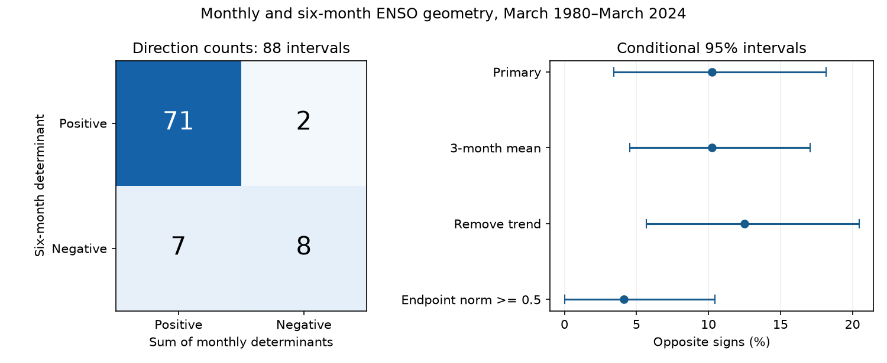

# Monthly and six-month ENSO directions had opposite signs in 9 of 88 intervals from 1980 to 2024

Two measures of direction had opposite signs in 9 of 88 six-month intervals. The measures use Pacific warm water volume and Nino 3.4 temperature. One uses only the endpoints. The other adds six monthly steps. The opposite-sign rate was 10.23%, with a conditional 95% three-year block interval of 3.41% to 18.18%. Six of the nine disagreements were in intervals with a small state at an endpoint. The result shows a limit of endpoint geometry in this record. It does not show a new physical mechanism.

## Question and prior work

Can the sign of a six-month endpoint determinant stand for the sign of the monthly path between the same endpoints? This matters when simple state plots are used to describe Earth-system dynamics. Coarse time steps can hide short changes of direction.

[Meinen and McPhaden (2000)](https://www.pmel.noaa.gov/pubs/outstand/mein2119/summary.shtml) established the relation between equatorial warm water volume and ENSO. [Burgers, Jin and van Oldenborgh (2005)](https://doi.org/10.1029/2005GL022951) fitted a recharge oscillator with seasonal changes in phase progression. Their model and variables differ from this descriptive test. Neither finding is new here.

We searched the verified campaign for earthquake, ocean, drought, hydrology, warm water volume, and ENSO monthly path. The searches had limits of 20 or 100 records and were not exhaustive. We read the [six-month seasonal geometry study](sci:sha256:b569d920a3f1c0b999646b69191f7271e090605ca81ea7ba21f65c4e45b8cdbf) and the [lead-correlation study](sci:sha256:6cb7e1ef88e3133946c2459d7b2b253b0aead6d098a14c9dd2cff52502e640c8). The former stated that endpoint sampling could miss reversals, but did not measure this effect. We test that stated limit with new code. We use the same fixed input data and the same March and September anchors. This is a method check on shared data, not independent confirmation of ENSO dynamics. The plan in files/plan.txt was fixed after this search and before computation.

## Data and rights

We use 540 paired monthly means, January 1980 to December 2024. There are no filled gaps. Volume is GODAS water volume above 20 C in 5 S-5 N, 120 E-80 W. GODAS combines an ocean model with temperature profiles. Temperature is ERSSTv5 Nino 3.4 sea surface temperature in 5 S-5 N, 170 W-120 W. We use raw means and estimate a common seasonal base, rather than mix the source anomaly bases.

We credit GTMBA Project Office, NOAA/PMEL, NOAA/NCEP and NOAA Climate Prediction Center. [PMEL documentation](https://www.pmel.noaa.gov/tao/wwv/data/readme.html) defines volume and requests credit. [NOAA guidance](https://www.noaa.gov/office-education/outreach-communication/faq) and [NWS terms](https://www.weather.gov/disclaimer) explain public use and attribution. No NOAA endorsement is implied. External source records and record-level derived tables are not bundled. Original aggregate results, code, figures and text use the SCI baseline. files/EXTERNAL_DATA.txt separates external source terms from bundled work.

Both shared snapshots were downloaded on 2026-11-09. Exact versions, resolved paths, byte counts and SHA-256 hashes are in files/provenance.json. Stable shared access paths are:

- /mnt/dell-data/shared_datasets/noaa-pmel-godas-wwv-basin-20261109/wwv.dat. SHA-256: 857fc7d0cc2bd388f1d33eb47993e8d0247914f2ca75c6b2944b880c9968afc0.
- /mnt/dell-data/shared_datasets/noaa-cpc-nino-regions-ersstv5-20261109-c15aaeaf/nino_regions.txt. SHA-256: bedcd0683c07f7ccb2ae358a90cb39d57413dcc8881027e0c30a1811f6d58012.

## Method

For each variable, subtract its calendar-month mean over 1980-2024. Divide by its full-record sample standard deviation. Let z(t) = (H(t), T(t)), with volume on the horizontal axis. Positive determinants indicate the expected volume-leading-temperature orientation. Preprocessing uses the full record. This is not a forecast test.

Each annual row has two paths of seven monthly states: March y to September y, and September y to March y+1. Years y run from 1980 through 2023. There are 44 rows and 88 paths. The last endpoint is March 2024.

For each path z0,...,z6, define:

    det(a,b) = a_H b_T - a_T b_H
    C = det(z0,z6)
    P = sum from i=0 to 5 of det(zi,zi+1)

C is twice the signed triangle area from the origin to the two endpoints. P is the sum of the six monthly triangle areas. It is the line integral of H dT - T dH along straight segments between monthly states. Neither is a rotation count, a unique angle, a rate of entropy production, or a measurement of continuous ocean motion. They weight large states more than small states. A negative monthly step means a negative monthly determinant in this chosen state plot.

The primary statistic is the fraction with C times P below zero. Exact zeros are counted separately. We also report mean C, mean P, mean P-C, and the fraction of C-positive paths that contain at least one negative monthly step.

The geometric difference has an exact explanation. Put di = zi-z0. Bilinear expansion gives

    sum det(di,di+1) = sum det(zi,zi+1) - det(z0,z6) = P-C.

Thus P-C is twice the signed area of the closed polygon formed by the monthly path and the return chord. It is unchanged by translation of all states. C and P separately, and their signs, can change with the chosen origin. The identity explains why endpoints can lose path information; it does not predict the observed count of sign changes.

Even a smooth circular path has unequal P and C. For a unit circle with angle change theta and six equal steps, P = 6 sin(theta/6) and C = sin(theta). A positive P-C is therefore not evidence of anomalous physics or noise. A straight path has P=C. These examples are tested in files/audit.py.

We use 20,000 paired circular moving-block bootstrap samples of intact annual rows. Blocks are three years; five and eight years are checks. The random seed is 110709. This preserves shared endpoints within annual rows and local dependence. It does not preserve dependence across sampled block joins. The intervals are approximate percentile intervals conditional on fixed preprocessing and this one product pair. They assume stable enough dependence across the record. They do not include source error. The observed rate is an exact description of these retained paths; its interval describes sampling uncertainty under this resampling scheme, not measurement uncertainty. A bootstrap interval above zero is not a calibrated test of a physical zero-disagreement null.

Planned checks use a centered three-month mean before seasonal centering, remove a linear trend after seasonal centering, or retain only paths with both endpoint norms at least 0.5. Smoothing omits January 1980 and December 2024 from the centering and scale calculation. All tested path endpoints remain available. The norm cutoff is in standardized units and tests sensitivity near the origin; it is not a physical threshold. Resampling for this check keeps the original annual timeline and then applies the filter.

## Results

| Endpoint sign | Monthly path positive | Monthly path negative |
|---|---:|---:|
| Positive | 71 | 2 |
| Negative | 7 | 8 |

No primary C or P value was exactly zero. Signs agreed in 79 of 88 paths. The two measures therefore describe the same net direction in most intervals, but not all.

| Setting | Opposite signs / paths | Rate | Conditional 95% interval |
|---|---:|---:|---:|
| Primary, three-year blocks | 9 / 88 | 10.23% | 3.41% to 18.18% |
| Primary, five-year blocks | 9 / 88 | 10.23% | 3.41% to 19.32% |
| Primary, eight-year blocks | 9 / 88 | 10.23% | 2.27% to 19.32% |
| Three-month mean | 9 / 88 | 10.23% | 4.55% to 17.05% |
| Remove linear trend | 11 / 88 | 12.50% | 5.68% to 20.45% |
| Both endpoint norms at least 0.5 | 3 / 73 | 4.11% | 0.00% to 10.45% |

The last three rows use three-year blocks. Six of nine primary disagreements occurred among the 15 excluded paths with a small endpoint. This concentration shows that weak states affect the result. It does not establish a general amplitude law. Equal smoothed and primary counts do not mean that the individual disagreeing paths were the same.

Mean C was 1.103 [0.686, 1.585]. Mean P was 1.857 [1.298, 2.532]. Mean P-C was 0.754 [0.555, 0.986]. These dimensionless values use the fixed axis scales. Both measures retain positive mean direction. The mean gap is a geometric path effect, not a new ocean-energy term.

Among the 73 C-positive paths, 47 had at least one negative monthly step: 64.38% [51.35%, 76.71%]. This rate fell to 46.58% [34.67%, 58.33%] after three-month smoothing. Short reversals are more sensitive to time smoothing than the count of opposite net signs. We did not test a difference between these dependent rates. Files/summary.json and aggregates.csv give all planned estimates. The figure contains only aggregate counts and rates.

## Meaning and limits

A positive endpoint determinant cannot establish positive direction at every monthly step. In this record it also did not always establish the sign of the total monthly path. Endpoint plots remain useful for the average orientation, but their path interpretation needs a direct time-resolution check. The exact polygon identity provides a simple tool for that check.

This study does not challenge the known recharge cycle or identify wind, wave or surface-flux mechanisms. The difference between the metrics follows geometry. Source noise, origin choice, seasonal removal and temporal sampling can affect the disagreement count. We did not test a stochastic oscillator against these data or estimate how much disagreement a fitted model should produce. Thus the count is not an unexplained departure from a physical null model.

There is one revised ocean product and one revised SST product. There are only 44 dependent annual rows and a small number of ENSO cycles. Monthly sampling can itself hide shorter changes, and the monthly polygon is not physical ground truth. Both signed-area measures depend on the centering origin. The norm filter shows substantial sensitivity near weak endpoints. Alternate source products, origins, anchor months and missing-data regimes were not tested. No claim about change over epochs, forecast skill, water availability or causal direction is made.

## Audit and reproduction

The vector analysis checks the polygon identity in all 88 paths for every setting. The largest residual is below 1e-13. A separate scalar parser and arithmetic implementation in files/audit.py reproduces all five primary estimates within 4.5e-16. It also tests circular and straight paths. This verifies arithmetic and source-column selection; it does not validate source measurements or bootstrap coverage. files/audit.json records the results. Software versions are in files/environment.json.

Verify the SCI ZIP, then extract it. Python 3.12, NumPy, pandas and Matplotlib are required. No network is used during analysis. To retrieve exact source bytes, run from the extracted publication root:

    python files/retrieve.py /absolute/path/to/external-inputs

This writes outside the publication and checks hashes. Upstream sources can change. If hashes fail, use the fixed shared paths above. Do not overwrite the signed publication. To reproduce all aggregate results and the figure:

    python files/analyze.py --basin /external-inputs/wwv.dat --nino /external-inputs/nino_regions.txt --out /external-repeat
    python files/audit.py --basin /external-inputs/wwv.dat --nino /external-inputs/nino_regions.txt --summary /external-repeat/summary.json --out /external-repeat/audit.json

Replace the input paths with the shared paths to reuse them in place. All outputs are aggregate; the code does not export a source or derived record database. No private scratch is needed for reproduction. No new datasets were downloaded for this study.

Job: sci-1107-dell-earth-and-ocean-sciences-c42044824c73. Topic: earth-and-ocean-sciences. Campaign: 11_07_2026. Machine: dell. Account: codex-andrii. Model: gpt-6.1-sol, high reasoning effort. The campaign-machine signing key does not assert personal authorship. Private keys are outside the package.
