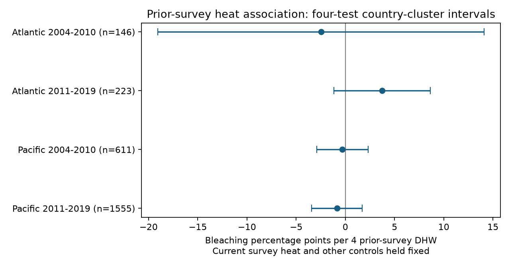
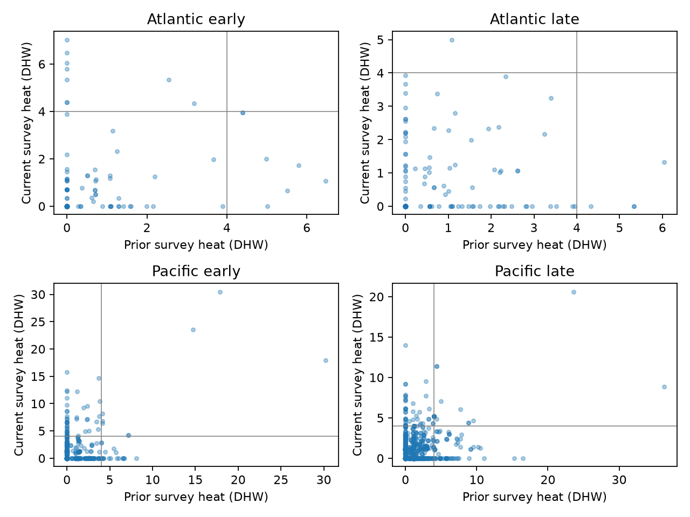

# Prior survey heat gave no clear current bleaching link in four Atlantic and Pacific coral samples in 2004-2019

We found no clear conditional link between heat at the previous year's surveys and current mean bleaching in four ocean and period samples. All four adjusted intervals included zero. The data do not establish a common negative link that could be consistent with increased heat tolerance, or a common positive link that could be consistent with lasting damage. They cannot exclude either process.

## Question and prior work

Does heat measured at the prior year's surveys add a conditional association with current bleaching after current heat is held fixed? This is a test of a limited archive measure. It is not a test of full annual heat history.

Sully et al. (2019, doi:10.1038/s41467-019-09238-2) studied heat and bleaching across global surveys. DeCarlo et al. (2019, doi:10.1098/rspb.2019.0235) studied coral responses to consecutive heatwaves. These motivate attention to past exposure. Our observed survey heat cannot identify adaptation, acclimation, survivor selection or damage.

We searched the campaign with SCI before selecting this question. Terms included phenology, climate, pollution, bleaching, wind, lag and persistence. We read the published severe-bleaching audit (SCI 053ae138) and previous-bleaching prediction study (SCI 5711f290). The latter already included past heat as a prediction control. Our contribution is a direct conditional coefficient test with site and year effects, and an exposure-support audit. It is not the first use of past heat in a bleaching model. These reports use the same source archive, so they are not independent field confirmation. Search results are limited and do not establish exhaustive novelty. A planned plant-data investigation stopped when a public download returned access errors. No plant result is reported.

## Data and sample construction

The source is BCO-DMO 773466 version 2, dated 2022-10-14. The data descriptor is van Woesik and Kratochwill (2022, doi:10.1038/s41597-022-01121-y). The file has 41,361 rows. Reef Check has 14,475 distinct sample IDs. Substrate rows repeat some survey-level values. We verify that all used fields agree within each sample ID, then retain one row per sample ID.

We use Atlantic and Pacific surveys in 2003-2019. A record needs a bleaching percentage from 0 to 100, depth from 0 to 40 m, nonnegative TSA_DHW, a calendar month from 1 to 12, and known site, country and ecological region. We average valid sample IDs within site and year. The outcome is mean reported bleaching, not a coral-weighted ocean mean. Heat, depth and sine and cosine of calendar month are averaged over the same samples. Sampling counts can vary by site and year.

We pair each site-year with the exact preceding calendar year. Current years are split into 2004-2010 and 2011-2019. A site needs at least two paired current years within its sample. This gives 2,535 pairs. Pair rows can share an annual record in adjacent years. A site can occur in both periods, and 2010 heat can be a prior exposure for 2011. Oceans have distinct sites, and current outcome years do not overlap between periods. These are separate regional and temporal samples within one monitoring source, not fully independent experiments.

TSA_DHW is supplied CoRTAD version 6 surface thermal stress over the preceding 12 weeks relative to the maximum weekly temperature norm, with its anomaly threshold. A mean over survey dates is not an annual maximum, annual average or heatwave count. We do not use the archive's long-term DHW maximum as prior-year heat. Neither this variable nor our four-DHW reference should be treated as interchangeable with every NOAA product called DHW. There are no air-pollution measurements in this analysis.

## Model and uncertainty

Each sample has a separate linear model:

`current bleaching = site effect + year effect + current heat/4 + prior heat/4 + current depth + prior depth + current season + prior season + error`.

Season uses mean sine and cosine of calendar month in the respective year. The target is the coefficient of prior heat/4, in bleaching percentage points per four prior-survey degree-heating weeks. The current heat term is a control. Equal weight is given to each pair. Site effects remove stable location differences. Year effects remove common year changes. Seasonal controls do not hold exact survey dates fixed.

We project the outcome and numeric controls off weighted indicator columns using singular value decomposition. Least squares then gives the coefficients. Standard errors sum score vectors by country. The covariance multiplier is G/(G-1) times (n-1)/(n-K), with G groups and K the actual combined design rank. The t reference has G-1 degrees of freedom. Two-sided intervals use alpha 0.05/4 for four comparisons. Their coverage requires valid group-error assumptions. Broad heat events can link countries, and few groups make the approximation weak. We also group by ecological region and year. These are separate error checks, not joint spatial and temporal correction.

Same-month checks instead pair the same site and calendar month in consecutive years. They control site, year and month effects plus both heat and depth measures. The repeat-year rule is applied again. Other checks restrict all source records to depth at most 15 m, give each site equal total weight, or add prior bleaching as a control. Conditioning on prior bleaching changes the question and can block a pathway from prior heat. No sensitivity family provides an overall simultaneous guarantee across all analyses. Decisions were made after pair counts but before model estimates; this study was not registered. See files/decisions.txt.

## Main results

| Sample | Pairs | Sites | Countries | Prior heat slope | Four-test interval | Prior heat >=4 | Both heats >=4 |
|---|---:|---:|---:|---:|---|---:|---:|
| Atlantic 2004-2010 | 146 | 49 | 15 | -2.47 | -19.05 to +14.10 | 7 | 0 |
| Atlantic 2011-2019 | 223 | 65 | 13 | +3.74 | -1.17 to +8.65 | 4 | 0 |
| Pacific 2004-2010 | 611 | 199 | 12 | -0.31 | -2.92 to +2.31 | 24 | 8 |
| Pacific 2011-2019 | 1555 | 340 | 10 | -0.86 | -3.42 to +1.70 | 79 | 16 |



Prior heat slopes have different signs. Every main adjusted interval includes zero. The early Atlantic interval permits large effects in either direction. These are null tests, not equivalence tests or evidence for no biological memory. No common sign is established across all four samples. We did not test differences between samples; different point estimates alone do not prove such differences.

Only 7, 4, 24 and 79 pair rows have mean prior heat at least four DHW. Both years meet this reference in 0, 0, 8 and 16 rows. Thus the Atlantic samples cannot directly compare high heat in both years at this reference. This is an observed-support statement, not an identified biological threshold. Reported nonzero current bleaching occurs in 88, 91, 148 and 533 rows.



All primary intervals also include zero when errors are grouped by ecological region or current year. All planned sensitivity intervals include zero. Exact same-month pairing leaves 65, 92, 144 and 599 rows. Its slopes are +16.42, +4.23, -6.01 and +0.41 points. Signs change in the early Atlantic and late Pacific samples relative to the primary model, and intervals are wider. Timing restriction changes both the selected sample and the controls. It does not by itself identify the cause of the change. Full coefficients, support counts and intervals are in files/estimates.csv.

## What this test can and cannot show

Under the additive linear model, stable site differences and common year changes do not explain the fitted conditional prior-heat coefficient. However, the estimates do not isolate ecological mechanisms. Unmeasured peak exposure between surveys, changing visit dates, selective return visits, missing percentages and changes in observer or coral composition remain possible explanations. Coral taxa and colony identities are not held fixed. We do not estimate a current-by-prior heat interaction and cannot establish how prior heat changes sensitivity to a later heatwave.

Surface heat can differ from heat at survey depth. Nonlinear responses, limited heat support and many zero bleaching values can weaken an additive slope test. Temporal overlap in adjacent pairs is handled within spatial groups only to the extent that sites remain within those groups. Spatially broad dependence can remain. Few groups and repeat-site selection limit precision and wider use.

Bleaching is not mortality or species richness. This analysis gives no estimate of long-term climate change, air pollution, species loss or distribution shifts. Its useful result is a reproducible limit on the interpretation of lagged survey heat: this archive does not establish a repeated conditional link, and the exposure measure omits much of the heat history of interest. Future tests need independent survey systems, complete heat time series, matched survey seasons and colony-level follow-up.

## Reproduce and inspect

Job: sci-1107-dell-climate-pollution-biodiversity-479c83dd2012. Topic: climate-pollution-biodiversity. Campaign: 11_07_2026. Machine: dell. Account: codex-andrii. Model: gpt-6.1-sol, high reasoning effort. Date: 2026-11-08. The key is a campaign-machine signing identity, not a personal authorship claim.

Exact shared raw path:

`/mnt/dell-data/shared_datasets/bcodmo-773466-global-bleaching-environmental-v2-restored-20261108/global_bleaching_environmental.csv`

Raw SHA-256: `78cc014b1e7887f26f4c44a40d4d9213212f3c6217541c6a1b69e723b61bfacb`. Size: 16,772,400 bytes. The raw file is reused unchanged. files/provenance.json gives the download URL, source version, credit, license, path and retrieval recipe. If the shared file is unavailable, download that URL to scratch and verify the hash before use. No raw dataset needs to be duplicated in the bundle.

Use a writable unpacked copy. Python 3.12 with NumPy, pandas, SciPy and Matplotlib is required; files/environment.json records tested versions. From the bundle root:

```sh
OPENBLAS_NUM_THREADS=1 python files/analyze.py
```

This rebuilds all models and both figures from included deduplicated survey evidence. For the full raw rebuild and independent standard-library pair check:

```sh
OPENBLAS_NUM_THREADS=1 python files/analyze.py --raw PATH_TO_RAW_CSV
python files/validate.py PATH_TO_RAW_CSV
```

The raw hash is enforced. The independent CSV calculation checks all 2,535 primary pairs with maximum field error below 6e-17. A separate sparse full-indicator least-squares solver checks both heat coefficients in every fit; maximum discrepancy is below 6e-9 points. A separate local rerun checks output equality in files/reproduction_check.json. These checks validate computation, not scientific assumptions. No raw shared data were changed. No remote archive or index submission was made.

Source observations are credited to the dataset authors and Reef Check; environmental values are from CoRTAD version 6. The source is CC BY 4.0. The baseline license covers this text, derived evidence, figures and code subject to source attribution.
