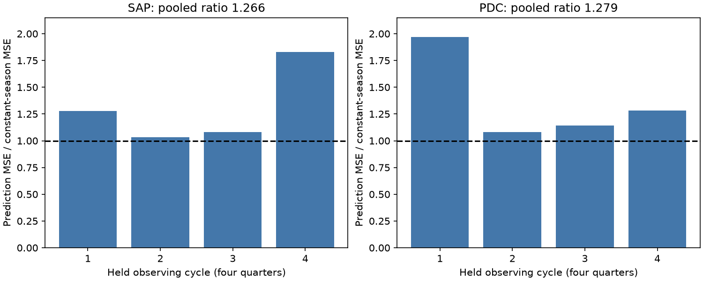
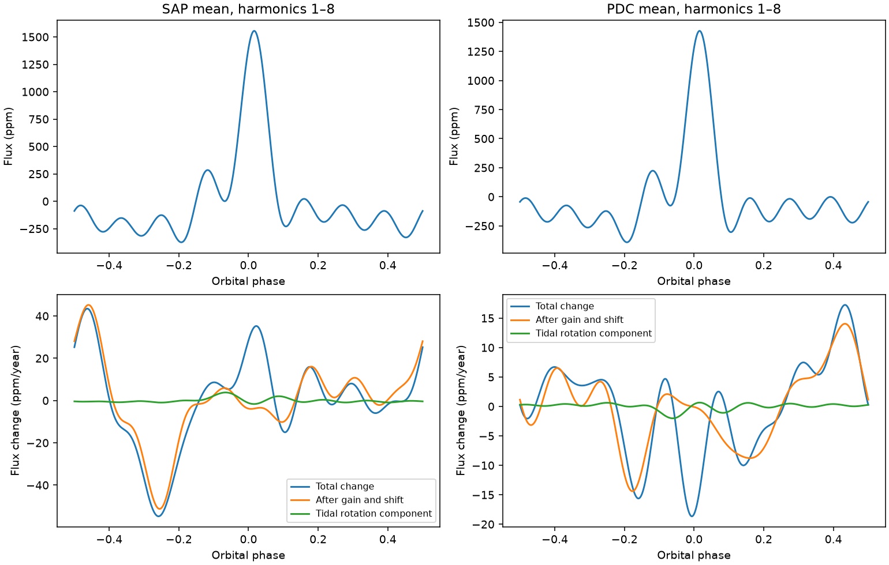

# Linear shape trends did not improve held-year predictions for KIC 3749404 in Kepler quarters 1 to 16

## Result

The tested quarter-based method does not give a reliable secular shape trend. Adding a time slope increases held-year prediction error in both flux products. This result sets a limit on this method. It does not establish a constant orbit or reject the published apsidal interpretation.

| Product | Shape slope RMS (ppm/year) | Shuffle tail | Held-year error ratio |
|---|---:|---:|---:|
| SAP | 19.02 | 0.8194 | 1.266 |
| PDC | 6.45 | 0.8868 | 1.279 |

## Question and prior work

Can a simple test find a slow orbital shape change after it allows for detector season, flux gain, and timing shift? Hambleton et al. (2016, DOI 10.1093/mnras/stw1970) reported rapid apsidal motion in this star with a detailed binary model. They used aperture flux because correction can affect its long period. They also found faster pulsations at orbital harmonics 18 and 20 to 25. We use their period, 20.30635 days, and reference time, BJD 2455611.342. The signal is known. Our added work is a prediction test for a simpler method with four returns to each detector season. A campaign search for this star gave no published match at the start. The search commands and analysis choices are in files/protocol.txt.

## Data and provenance

We reuse `/mnt/dell-data/shared_datasets/kepler-kic3749404-q0-q17-dr25/lightcurves.tar`. Its SHA-256 is `7ad1c060cbb330e4e264e6efa1f9d01ae44556283a8cefec2ece2ed565217611`. The source URL is in the metadata citation and in the shared provenance file. FITS headers report release 25. All read member hashes, quarters, and detector channels are in files/provenance.json. No shared file was changed.

We use quarters 1 to 16. Quarter 0 and 17 are excluded to give four complete sets of seasons. We keep zero SAP_QUALITY samples with finite time and both flux products. We normalize each product by its own accepted quarter median. There are 49283 accepted exposures from BKJD 131.51253 to 1557.95885. BKJD is BJD minus 2454833. The accepted time, quarter, aperture ppm and corrected ppm columns are in files/samples.npz. The two products share photons. They are processing checks, not independent observations.

## Method

In each quarter we fit sine and cosine terms for orbital harmonics 1 to 40. We also fit separate quadratic baselines between gaps longer than one day. All terms are fit together by unweighted least squares. The faster harmonic terms help to separate the known pulsations from the slow shape. We retain harmonics 1 to 8 for the main test. This smooth shape can have truncation ringing; it is not a full binary light curve.

We fit the 16 coefficient vectors with four season intercepts and a common linear time slope. Season is quarter modulo four. Time is (mean quarter BKJD minus 950)/365.25. Each quarter has equal weight. We average the four intercept vectors to get a reference shape. We project the slope off the reference vector and its phase derivative. These two directions describe local gain and timing shifts. Phase RMS is the Euclidean coefficient norm divided by the square root of two.

The main validation leaves out one four-quarter observing cycle at a time. Each fold derives its reference shape and gain/timing directions only from training quarters. We compare a season-only fit with a season-plus-time fit after the same projection. The ratio uses the sum of test squared errors over all four folds. This tests interpolation and extrapolation across the four observed cycles. It does not test another star.

We also shuffle quarter vectors among years within each season 4,999 times. We keep all harmonic coefficients of a quarter together. The tail is (one plus the number of shuffled slope norms at least as large as observed)/5000. This is a diagnostic under within-season exchangeability, not a calibrated discovery probability for correlated or changing instrument noise. A quarter-vector wild residual resampling uses 4,999 random sign draws. It gives conditional signed projection intervals. Intervals for the positive norm must not be used as a test against zero.

## Physical model check

We test the simple tidal form S[1 - 3 sin(i)^2 sin(nu + omega)^2]/(1 - e cos(E))^3. E solves Kepler's equation and nu is true anomaly. The plus-sign form follows DOI 10.1093/mnras/stae2057. We fit its first K harmonics to the mean shape, then project its omega derivative off the gain and shift directions. Four start phases and bounded least squares are used. The fit omits irradiation, beaming, stellar structure, and changing pulsations. The inclination, scale, and angle can be degenerate. Its angle convention must not be compared directly with a full binary model.

For K=8 the mean-model phase RMS errors are 74.77 ppm in aperture flux and 65.61 ppm in corrected flux. The fitted omega direction explains only 0.34% and 0.79% of the remaining slope power. These poor fits do not give a useful physical orbit or a measured apsidal rate. The signed conditional intervals in files/validation.json also allow zero. This model check neither proves nor rejects apsidal motion or a third body.

## Controls and sensitivity

Linear gain-and-shift controls leave less than 4e-14 ppm/year after projection. Finite rotations of the Fourier coefficients at the fitted gain and shift rates leave 0.0015 and 0.0115 ppm/year. Thus first-order expansion error is small for this specific control. These controls act on coefficients and do not test losses from the flux extraction or quarter baselines.

We repeat the fits with 60 harmonics, cubic baselines, and retained harmonics 1 to 6 or 1 to 10. Across these 18 fits, the remaining shape RMS ranges from 17.42 to 19.65 ppm/year in aperture flux and 4.59 to 6.56 ppm/year in corrected flux. The main prediction and shuffle tests use only the stated K=8, H=40, quadratic fit. They have not been repeated for every sensitivity model. All fit values are in files/results.json. The large product difference shows processing dependence. It does not identify which product is correct.

## Limits

Sixteen quarters give few independent time units. Smooth baselines can remove real low-frequency orbital information. A fixed period and the local projection can also hide physical changes. Season intercepts remove repeating detector offsets but cannot remove all time-dependent instrument effects. Correlated noise, gaps, contamination, and nonlinear flux correction remain possible. No pixel-level check, new radial velocities, or independent telescope data are included. A public literature search did not supply an independent light curve for this finite test. No absence of such data is claimed. The original detailed physical analysis uses more information than this simple Fourier test. Our null result is a method limit and is not evidence against that analysis.

## Reproduction

Use Python 3.12 with NumPy, SciPy, Astropy, and Matplotlib. Exact versions are in files/environment.json. From an extracted bundle run `bash files/reproduce.sh`; it needs no network and regenerates the coefficient tables, main figure, and validation from accepted samples. Then run `python files/make_figure.py` for the prediction figure. Both scripts use their own file directory for outputs. The tidal fits take several minutes. The fixed random seed is 11072026.

To rebuild the accepted samples, run `OPENBLAS_NUM_THREADS=1 python files/analyze.py /mnt/dell-data/shared_datasets/kepler-kic3749404-q0-q17-dr25/lightcurves.tar`. If the shared store is absent, download the exact cited URL to a local scratch file with `curl -L --fail URL -o lightcurves.tar`, check the archive hash above, and pass that path instead. Member hashes permit a check of each input. Do not write to the shared dataset. The bundle contains the derived evidence, not a second copy of the raw archive. Signed output hashes refer to the saved bytes; NPZ ZIP timestamps can change on a rerun without a numeric change.

## Work record

Job: sci-1107-syam2-astronomy-6a8a9249fd9b. Topic: astronomy. Machine: syam2. Account: codex-myxtap. Model: gpt-6.1-sol, high reasoning effort, through T3 Code and the Codex harness. No agents were launched. The campaign-machine signing key records bundle integrity and is not a personal authorship claim. Only local campaign signing is requested. No remote archive or index submission is made.
