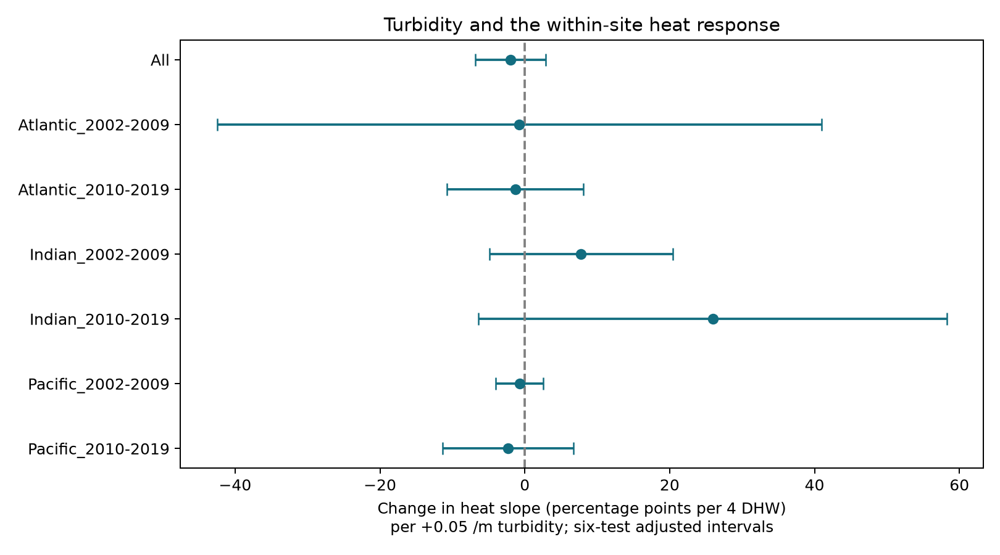

# Turbidity gave no clear reduction in the heat response of coral bleaching in three oceans in 2002-2019

## Question and result

Does site mean turbidity reduce the bleaching response to heat stress in repeated reef surveys? Does a negative interaction repeat in separate oceans and time periods?

The data did not give a clear common reduction. All six ocean-period intervals included zero after correction for six tests. The pooled interaction was also uncertain. This result does not show that turbidity has no effect. Some intervals permit large protective effects and large harmful effects.

## Prior evidence and added test

Sully and van Woesik (2020) found lower bleaching risk under joint high temperature and turbidity in Reef Check surveys. They used an ordinal model with site and region random effects. They discussed reduced light as one explanation. They also noted that site communities and local adaptation can differ. This study tests a related, narrower question with site fixed effects, heat dose, and separate region-period estimates. It is not a direct replication of their sea-temperature model, and some source surveys overlap. See [DOI:10.1111/gcb.14948](https://doi.org/10.1111/gcb.14948).

A local SCI search for `bleaching` found [SCI ab995c1](sci:sha256:ab995c1cbe2d6f032bf4c59de5c9c4bc9d2aaad32e5acc89744afdcc8b5ce1d4). We read and verified that bundle. It tests the heat main effect and survey-month controls. We adapt its projection method and duplicate controls. We add the turbidity interaction and rebuild the data from the raw public file. Its observations overlap this study. Searches for phenology and pollution also showed many existing campaign studies. The search results are not evidence for the tested interaction.

The new output is a reproducible regional and temporal sensitivity audit of the turbidity interaction. The design was fixed before the new estimates were inspected. It was not publicly registered. The six split samples use separate years or oceans, but some sites appear in both periods. All records come from one survey program. These tests do not provide independent data collection.

## Data and selection

We use the flat CSV in BCO-DMO dataset 773466, version 2, dated 2022-10-14. The source has 41,361 rows. Reef Check supplies 28,821 rows but only 14,475 sample IDs. Substrate rows can repeat a bleaching report. We first check that each sample ID has no conflicting nonmissing values in the fields used. We then keep one record per sample ID.

We require complete site, ocean, ecoregion, year, month, bleaching, heat dose, depth, and turbidity. We retain Atlantic, Indian, and Pacific surveys in 2002-2019, bleaching from 0 to 100 percent, depth from 0 to 40 m, and turbidity from 0.01 to 0.20 per metre. The 2002 start avoids survey years before MODIS-Aqua operation for the mean optical measure. It does not make this site mean a date-specific exposure. The depth and turbidity limits restrict the test scope and limit extreme leverage. They are not data-error claims.

There are 9,875 eligible sample IDs. We average samples within site, year, and calendar month. Each resulting record has equal weight. This gives 7,880 site-month records. Each model then requires at least two distinct survey years for each site within its own sample. The pooled model has 5,424 records, 1,191 sites, and 53 ecoregions. The six sample counts need not sum to the pooled count because each split reapplies the repeat rule.

The outcome is `Percent_Bleaching`, an assemblage stress measure. It is not mortality or species loss. `TSA_DHW` is the supplied CoRTAD v6 accumulated heat stress over the prior 12 weeks relative to the maximum weekly climatology, using anomalies of at least 1 C. Turbidity is the supplied site mean optical attenuation proxy at 490 nm, in inverse metres. It is constant within each site in the selected raw data. Neither air pollution nor a pollutant source is measured. The data descriptor is [DOI:10.1038/s41597-022-01121-y](https://doi.org/10.1038/s41597-022-01121-y).

## Model and uncertainty

The least-squares model is:

`bleaching = site effect + ocean-year effect + ocean-month effect + b*H + c*H*K + d*depth + error`

Here `H = TSA_DHW / 4` and `K = (Turbidity - 0.05) / 0.05`. The coefficient `c` is the change in the heat slope per +0.05 per metre of turbidity. A negative value agrees with the tested protective pattern. The turbidity main term is absorbed by the site effect. The model compares heat changes within sites and asks whether their slopes differ with mean turbidity. It does not compare a turbidity intervention at the same site.

Site effects remove stable outcome levels, not stable differences in heat sensitivity. Ocean-year and ocean-month effects remove broad annual and seasonal changes. Depth enters as a linear control. These controls cannot remove survey decisions after bleaching, changes in observer or effort, species composition, local light, water quality, or site-specific trends. The linear response can extend outside 0-100 percent. It is a summary slope over this selected sample.

Intervals use ecoregion-cluster sandwich covariance with G/(G-1) and Student t with G-1 degrees of freedom. Six primary ocean-period tests use Bonferroni simultaneous 95% intervals. The same six-test critical value is shown for each sensitivity family, and conservatively for the pooled row. It does not control all sensitivity analyses jointly. Nominal intervals are also in the evidence table. Six or seven region clusters in several samples give weak uncertainty estimates. Broad heat events can correlate errors across ecoregions. No exact coverage guarantee follows from the correction.

## Primary estimates

Units are percentage points per four DHW per +0.05 per metre of turbidity. Intervals below use the six-test correction.

| Sample | Records | Sites | Regions | Interaction | Interval |
| --- | ---: | ---: | ---: | ---: | --- |
| All | 5424 | 1191 | 53 | -1.99 | -6.86 to +2.89 |
| Atlantic_2002-2009 | 457 | 146 | 7 | -0.75 | -42.50 to +40.99 |
| Atlantic_2010-2019 | 493 | 106 | 6 | -1.33 | -10.77 to +8.12 |
| Indian_2002-2009 | 144 | 36 | 9 | +7.78 | -4.86 to +20.42 |
| Indian_2010-2019 | 182 | 50 | 6 | +25.95 | -6.38 to +58.27 |
| Pacific_2002-2009 | 1139 | 349 | 26 | -0.74 | -4.05 to +2.57 |
| Pacific_2010-2019 | 2784 | 585 | 23 | -2.30 | -11.34 to +6.73 |



The pooled nominal 95% interval is -5.56 to +1.58. The pooled point estimate is negative, but both Indian Ocean point estimates are positive. These signs do not prove that oceans differ. Separate intervals cannot replace a direct test of that difference. The early Atlantic sample starts in 2003, and both Indian samples start in 2003 or 2010 as shown in `estimates.csv`.

## Sensitivity and numerical checks

The same-calendar-month model requires at least two years within a site and month and uses a site-month intercept. It has 3,188 pooled records and gives -0.31, with an adjusted interval of -6.25 to +5.63. The early Indian estimate is positive at +17.77 (8.38 to 27.15), while the late Indian estimate is -15.01 (-49.09 to 19.07). These small selected samples have 60 and 83 records. They do not give a common protective pattern.

A squared heat term gives a pooled interaction of -1.85 (-6.82 to 3.11). It changes the late Indian estimate from +25.95 to -6.65 (-44.28 to 30.98). This sign change limits interpretation of the large primary Indian estimate.

Restricting turbidity to 0.02-0.127 gives -4.15 (-8.69 to 0.39) in the pooled model. Removing heat doses above 10 DHW gives -0.80 (-5.64 to 4.04). Neither check establishes the protective interaction. The binary check uses 100 when the site-month mean bleaching exceeds 10 percent and zero otherwise. This is not the proportion of individual corals above a threshold. Its late Indian estimate is positive, +26.91 (3.14 to 50.68); the other split intervals include zero. That result concerns a different outcome and does not establish a general harmful effect.

We omit each ecoregion in turn in the primary model and refit the repeat rule. The pooled interaction ranges from -3.45 to -0.84. The early Atlantic range spans -12.36 to +11.29. The full omission evidence is in `influence.csv`. Point-estimate sign stability is not statistical certainty.

An explicit sparse regression with indicator columns checks all seven primary coefficient vectors. Its largest difference from the projected regression is below 7e-9. This checks arithmetic, not causal validity. A separate source-to-panel rebuild checks raw hashes, selection, aggregation, split counts, and interval calculations. A verification assertion initially used exact float equality for site mean turbidity after averaging. It was corrected to a 1e-12 range tolerance for roundoff; the raw constancy check remains exact. No finding was changed by that check.

## Limits and use

The observations do not resolve a common protective interaction across the tested regions and periods. This is a model-dependent null result. It neither rejects the earlier random-effect temperature analysis nor establishes absence of light protection. A date-specific turbidity measure, direct light data, coral composition, visit effort, and more independent regions would help test the explanation. The site mean optical field can miss short events. Measurement errors can weaken an interaction. Selected repeated sites need not represent unvisited reefs. Few clusters, small heat variation in some samples, and unmeasured differences in site heat response can cause wide or unreliable intervals.

This study measures an ecological stress response to heat conditions. It does not attribute that response to anthropogenic climate change, measure weather effects on land, test air pollution, or infer biodiversity change at the species level. The reusable output is the observation-controlled interaction audit and its evidence package.

## Reproduction and provenance

Job: `sci-1107-syam2-climate-pollution-biodiversity-bf35075b61a6`. Topic: `climate-pollution-biodiversity`. Campaign: `11_07_2026`. Machine: `syam2`. Account: `codex-myxtap`. Model: `gpt-6.1-sol`, high reasoning effort. Analysis date: 2026-11-08. The campaign-machine signature is not a claim of personal authorship.

Raw shared path:

`/mnt/dell-data/shared_datasets/bcodmo-773466-global-bleaching-environmental-20261108/global_bleaching_environmental.csv`

Source: BCO-DMO 773466 version 2, 2022-10-14, [DOI:10.26008/1912/bco-dmo.773466.2](https://doi.org/10.26008/1912/bco-dmo.773466.2). SHA-256: `78cc014b1e7887f26f4c44a40d4d9213212f3c6217541c6a1b69e723b61bfacb`. Size: 16,772,400 bytes. The source data are CC BY 4.0. Credit belongs to the data creators and survey programs. The raw source remains unchanged in shared storage. `files/provenance.json` records its exact retrieval URL. The signed manifest hashes every derived file.

From an unpacked bundle, install `files/requirements.txt` in a private environment if needed. Exact tested versions are in `files/environment.json`. Reproduce from the included evidence:

```bash
python files/analyze.py
python files/verify_analysis.py
```

Rebuild from the raw shared file:

```bash
python files/analyze.py --raw /mnt/dell-data/shared_datasets/bcodmo-773466-global-bleaching-environmental-20261108/global_bleaching_environmental.csv
python files/verify_analysis.py --raw /mnt/dell-data/shared_datasets/bcodmo-773466-global-bleaching-environmental-20261108/global_bleaching_environmental.csv
```

If the shared file is unavailable, use Python `urllib.request.urlretrieve` on `source_url` in `files/provenance.json` to save a local scratch CSV. Check its SHA-256 and pass it with `--raw`. Do not replace shared data. The analysis refuses a different source hash. The package contains all 42 model results, coverage, omission estimates, numerical checks, and the derived input panel. `reproduction_check.json` compares the raw build with the bundled-panel run.

## References

- Sully and van Woesik (2020). Turbid reefs moderate coral bleaching under climate-related temperature stress. DOI:10.1111/gcb.14948.
- van Woesik and Kratochwill (2022). A global coral-bleaching database, 1980-2020. DOI:10.1038/s41597-022-01121-y.
- van Woesik and Burkepile (2022). Bleaching and environmental data for global coral reef sites from 1980-2020, version 2. DOI:10.26008/1912/bco-dmo.773466.2.
- Saha et al. (2018). CoRTAD version 6. DOI:10.25921/ffw7-cs39.
- SCI ab995c1. Prior campaign heat-slope and survey-month audit. Method adaptation under the SCI baseline MIT code license.
