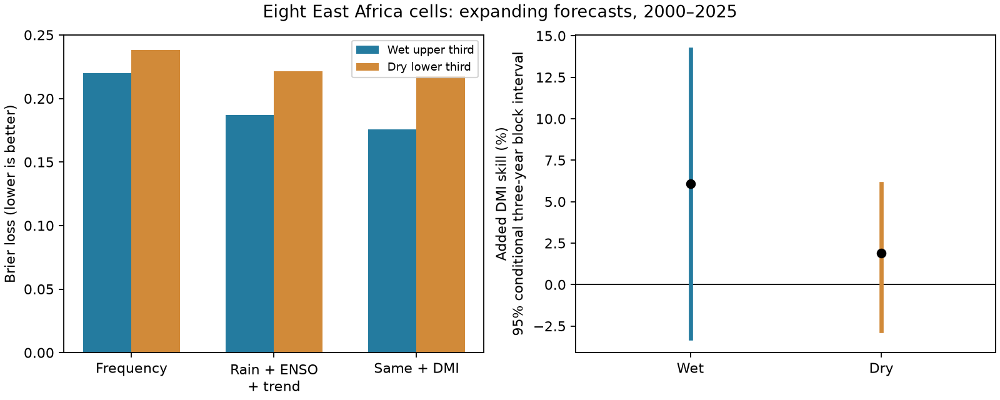

# September DMI gave no clear added upper-third rain probability skill in eight East Africa cells in 2000-2025

Adding September Dipole Mode Index (DMI) reduced wet-event Brier error by 6.09% in this test. The conditional 95% three-year block interval was -3.23% to +14.18%. The interval includes zero. The test gives no clear evidence of added skill. The larger point gain for wet events than for dry events also had an interval that includes zero.

The figure compares separate models for wet and dry events. Error bars are conditional intervals for paired, area-weighted yearly losses. Cells are kept together in all resampling. Eight related cells are not eight independent climate records.

## Question and prior work

Can a September ocean temperature gradient improve the probability forecast for a wet October-December season after recent local rain, ENSO and a time trend are known? Can the same test show a larger gain for wet than for dry seasons? A wet event here means a seasonal rain rate at or above the earlier-year two-thirds quantile. It is a relative rain class. It is not a flood measure.

We searched the campaign before the precise design. We read the signed text of SCI sha256:26b7a582990a31b480f852b3ab04ca112c1eaaa7a9d693d38aa07640ee532e9d. That work found no clear DMI gain for dry-event probabilities in these eight cells. It also described an earlier mean-rainfall result, SCI sha256:440a9a8ee47f7400dc0213b2a673313eea54c5aa75188573e973421a1c7741fe. Our new test addresses the wet side and a paired wet-minus-dry contrast. We use the same shared source snapshots and geographical scope, with new code. This is an extension, not independent replication. Search summaries are in files/campaign_searches.json. The searches are not an exhaustive review.

The Indian Ocean Dipole and its rain link are established. Saji et al. (1999), doi:10.1038/43854, describes the ocean mode. Behera et al. (2005), doi:10.1175/JCLI3541.1, reports its East Africa influence in climate model experiments; we consulted the public abstract. MacLeod et al. (2024), doi:10.1029/2023GL105258, uses a large reforecast ensemble and finds a strong response of heavy rain days to positive IOD. We consulted its abstract and introduction. These studies give a reason to test wet probabilities. Our small observed-data test does not reproduce their models, test daily extremes, or challenge their mechanism.

## Data

NOAA PSL, Boulder, Colorado, USA, provided GPCP and DMI data from https://psl.noaa.gov. CPC provided ERSSTv5 Nino 3.4 anomalies. We use GPCP V2.3 monthly rain, January 1979 through December 2025; CPC anomalies use a 1991-2020 reference. The PSL DMI series uses HadISST1.1. DMI is the anomalous west-minus-east tropical Indian Ocean temperature gradient in degrees C. The source descriptions and terms are cited below and in files/EXTERNAL_DATA_NOTICE.txt.

The eight 2.5-degree cells have latitude centers -3.75, -1.25, 1.25 and 3.75 degrees and longitude centers 36.25 and 38.75 degrees. There is no land mask. We retain all cells in 5 S-5 N, 35 E-40 E. October-December rain is a mean rate in mm/day, with day weights 31, 30 and 31. There are 47 complete seasons. All used rain values are finite and nonnegative. GPCP combines satellite and gauge information. Metadata mark November 2021 onward as interim and describe different inputs before 1988.

Exact shared paths, resolved paths, source versions, URLs, byte sizes and SHA-256 hashes are in files/provenance.json. Only these three source files were read for the analysis. No shared file was changed. No source records or source-derived event tables are in this publication. The record-level regeneration output stays in external scratch. The package includes original statistical summaries, not a source database. See files/EXTERNAL_DATA_NOTICE.txt for attribution and external terms.

## Method

The plan in files/plan.txt was saved before fitting. It was not registered with an external service. The primary test uses 26 forecast origins, 2000-2025. For year y, all model fitting, scaling and threshold estimation use years 1979 to y-1. Each cell has its own threshold and model. The first origin has 21 training years.

Wet events have rain at or above the earlier-year two-thirds quantile. Dry events have rain at or below the one-third quantile. Quantiles use linear interpolation. All training event labels use the current origin's threshold. The threshold thus changes between origins.

The baseline logistic model uses an intercept, year, September local rain and September Nino 3.4 anomaly. The added model also uses September DMI. Slopes use training means and population standard deviations. Each fit minimizes summed logistic negative log likelihood plus half the sum of squared standardized slopes. The primary penalty multiplier is 1. The intercept has no penalty. There is no test-set tuning. A reference model uses the earlier-year event frequency. Wet and dry models are separate; they do not form a three-class forecast.

Brier loss is (probability - event indicator) squared. We first average over cells with cosine latitude weights, then over test years. Added skill is 100 times (1 - added loss / baseline loss). The secondary contrast is the wet absolute loss reduction minus the dry absolute loss reduction. This contrast avoids comparing two percentages with different denominators. It remains sensitive to event base rates and model choice.

We use 19,999 circular block resamples of the 26 paired annual loss vectors. The primary block length is three years; one and five years are checks. Both targets and all models stay paired. Each interval is the 2.5th to 97.5th percentile. Seeds are 942136 plus block length. Intervals condition on fitted forecasts and thresholds. They omit model-fitting, source-product and design-selection uncertainty. A short climate record can violate assumptions needed for correct coverage.

## Results

| Model | Wet Brier loss | Dry Brier loss |
| --- | ---: | ---: |
| Earlier-year frequency | 0.220135 | 0.238102 |
| Rain + ENSO + trend | 0.187036 | 0.221608 |
| Same predictors + DMI | 0.175646 | 0.217405 |

The wet loss reduction was 0.011390 and the dry reduction was 0.004202. Wet added skill was 6.09%; dry added skill was 1.90%. The dry result agrees with the prior campaign result to its reported precision. This agreement is a code check, not new evidence from another sample.

The wet-minus-dry reduction was 0.007188. Its conditional 95% interval was -0.006936 to +0.020873. Thus, the test does not resolve a wet-dry difference. A positive point contrast does not establish physical asymmetry.

| Block length, years | Wet skill 95% interval, % | Dry skill 95% interval, % |
| --- | ---: | ---: |
| 1 | -6.57 to 17.08 | -3.14 to 6.98 |
| 3 | -3.23 to 14.18 | -2.76 to 6.09 |
| 5 | -1.69 to 13.34 | -2.30 to 5.68 |

All planned checks below are point estimates. They use the same small source record. No check was promoted to the primary result.

| Check | Added wet skill, % | Added dry skill, % |
| --- | ---: | ---: |
| Penalty 0.1 | 1.72 | -0.49 |
| Penalty 10 | 8.27 | 3.16 |
| No trend | 3.08 | 0.04 |
| Fixed 1979-1999 threshold | 9.97 | 1.52 |
| Omit 1997 from training | 4.00 | 0.86 |
| Upper and lower fifths | 19.59 | 4.90 |
| Score through 2020 | 4.32 | 0.26 |
| Score 2000-2012 | 4.36 | -0.10 |
| Score 2013-2025 | 8.19 | 4.06 |

Removing one scored year without refitting leaves wet skill between 3.12% and 9.55%. The outer-fifths point gain is larger, but we did not estimate a separate interval for that check. It cannot support a claim about rare extremes. The no-trend baseline and added models both have lower wet loss than the primary models. The model choice matters.

## Interpretation and limits

The test leaves both added wet skill and wet-dry asymmetry unresolved. It provides a reproducible benchmark for a question left open by the prior dry-probability study. It does not show that the ocean index lacks useful information. A mean-rainfall score, a seasonal event-probability score and a daily extreme-rain score have different targets.

Prior work gives a plausible circulation and moisture-transport explanation for IOD rain links. We did not measure circulation, transport, soil water, river flow or damage. We cannot identify a physical cause for these point estimates. A useful next test would use an independent rain product and a longer validation record with a fixed model. No such replication was done here.

Only 26 test years constrain the uncertainty. The cells share weather and data inputs. Thresholds and event frequencies change with the training sample. The logistic relationship is linear in predictor effects on log odds. This can miss nonlinear or interactive ocean effects. Sensitivity checks do not span all useful models. Interim rain values, changing satellite inputs, source revisions and possible gauge errors limit interpretation.

All predictors are revised observed monthly values. Their past release dates and real-time versions were not reconstructed. The SST reference period includes future years relative to early origins. Training centering absorbs constant September offsets but does not correct historical source revisions. The results measure potential information in revised data. They do not establish an operational forecast, warning service, flood prediction or water-supply benefit.

## Reproduction and validation

See files/REPRODUCE.txt. Run python3 files/check_aggregates.py to check all saved mean scores, all 59,997 bootstrap statistic vectors and all intervals without source data. Run files/analyze.py with the exact three shared snapshots to regenerate the full result. The output path must be outside this signed publication. The script writes event labels, thresholds and cell-year probabilities only to that external path. Live URLs can change; hash mismatches stop retrieval. Exact snapshots must then be found using the recorded hashes. No claim is made that a dynamic URL will always serve the same bytes.

Run files/audit.py for direct netCDF4 indexing and separate text parsers. Rain extraction matched exactly. The second logistic solver, trust-exact, differed from BFGS by at most 1.16e-8 in probability and 2.06e-9 in aggregate loss. Direct score calculation from cell forecasts agreed within 1.12e-16. The aggregate-only audit passed. Environment versions and audit outputs are included. These checks test implementation; they do not test the climate mechanism or remove statistical uncertainty.

## Job record

Job: sci-1107-dell-earth-and-ocean-sciences-f6ad42136034. Topic: earth-and-ocean-sciences. Campaign: 11_07_2026. Machine: dell. Account: codex-andrii. Model: gpt-6.1-sol, high reasoning effort, through Codex in T3 Code. One worker used its assigned isolated worktree. No agents were launched. The campaign-machine key identifies the signing machine, not personal authorship. Keys remain outside the package. No remote upload or index submission was made.
