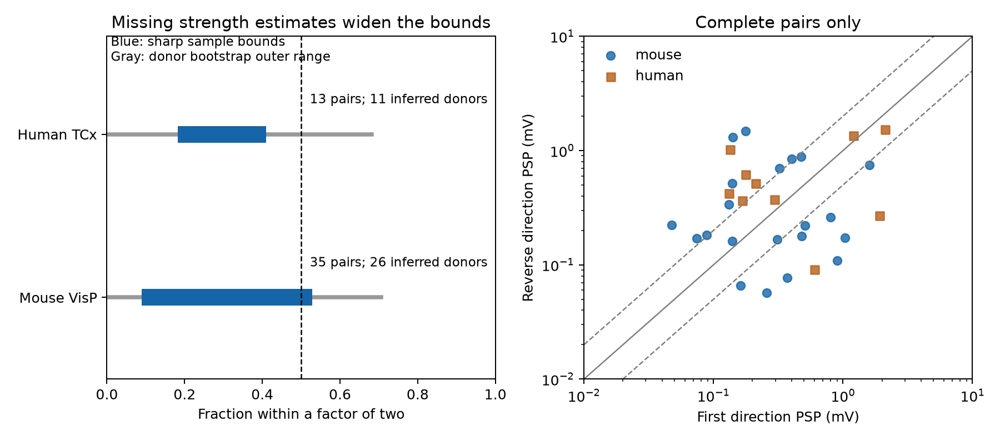

# Missing strength estimates leave a majority strength-matching rule unresolved in 35 Allen mouse reciprocal excitatory pairs

The selected mouse data do not resolve whether most reciprocal excitatory pairs have resting voltage responses within a factor of two. There are 35 eligible pairs from 26 inferred mice. Only 21 pairs have two usable amplitude estimates. Three of these 21 pairs meet the rule. If each missing estimate can be any positive value, the equal-mouse fraction has sharp sample bounds of 8.97% to 52.88%. An approximate donor bootstrap outer range is 0% to 70.51%. These results do not establish a majority rule or its absence in a larger population.

Blue bars show bounds for the selected sample. Gray lines add approximate sampling uncertainty. The dashed vertical line marks 50%. The scatter plot includes only complete pairs. Pair ID order defines its axes. The diagonal lines mark equal amplitudes and the factor-of-two limits.

## Question and prior work

Can reciprocal excitatory wiring justify a simple strength-matching rule in circuit models? We test an operational rule: the two resting postsynaptic potential (PSP) amplitudes differ by no more than a factor of two. This rule is stronger than a positive correlation. Correlation can coexist with large differences within pairs. We do not test whether reverse strength predicts strength or whether reciprocal pairs are stronger than one-way pairs.

Song and colleagues (2005, doi:10.1371/journal.pbio.0030068) reported correlated reciprocal strengths in rat visual cortex. Campagnola, Seeman, and colleagues (2022, doi:10.1126/science.abj5861) supplied the public Allen slice recordings used here. Their resource links connectivity calls and response measurements through the same recorded pair IDs. No atlas match or link across separate animals is needed.

Campaign searches included connectivity, distance latency, reciprocal decay, reciprocal kinetics, reciprocal plasticity, and reciprocal strength. We read the signed reverse-strength prediction report, sci:sha256:3660af3e941c858b081907633ca3fa44640f6d2660d32d6710e1ee9cb288fca8. It reports no clear prediction gain under its tested models and uses complete strength records. We also read the signed missing-response distance report, sci:sha256:a2aeb673455fafa84f02dccfa67284e613265afd51dbc7ee409ff83515558b7f. Its bounds concern threshold response rates at near and far pairs. Here we test a different endpoint: the fraction of reciprocal excitatory pairs with two similar strengths, while retaining incomplete pairs. No code or derived data from those reports were reused. We also read the signed loop-decay report, sci:sha256:e107b9c153ed1b670bed14819c8fd81a858f8dd47d6397afac334a3de011e05a, to assess prior scope. No private worker workspace was read. This is an exploratory extension, not a first test of reciprocal strength.

## Data and selection

The only shared raw file used was:

/mnt/dell-data/shared_datasets/allen_synphys/r2.1_small_2023-01-26/synphys_r2.1_small.sqlite

Source: https://allen-synphys.s3-us-west-2.amazonaws.com/synphys_r2.1_small.sqlite . Version: r2.1 small, schema 22, source Last-Modified 2023-01-26. Size: 176771072 bytes. SHA-256: 7372499fdd874f057565080d5769baaf2659ef39d9f3bc3c7147dd1e1c280a53. The analysis checks this hash and opens the file read-only. The shared store was not changed. No new data download was needed.

The SQL joins both directed pair records by reversed cell IDs in the same recording. Both directions must have a detected chemical synapse and an excitatory synapse type. Both cells must have the nonsynaptic class label ex. The first pair ID must be smaller than the reverse pair ID. Each unordered pair therefore enters once. Soma distance must be positive and at most 500 micrometres. Reverse distances agree in all selected records. We keep mouse VisP and human TCx. Missing strength estimates do not remove a pair. Cell labels and geometry still select the sample.

A usable direction has a positive finite synapse.psp_amplitude and at least one current-clamp average response fit with manual QC passed. The Allen schema defines this amplitude in volts. The QC fit and the resting amplitude are distinct records. This QC condition is an analysis filter, not a trace-level validation of resting strength. Failed-QC, absent, nonfinite, and nonpositive amplitudes are unknown in this analysis. The source pipeline uses responses with at least eight seconds since prior stimulation for resting-state fitting. This does not guarantee full recovery.

The dataset consists of small paired-recording graphs in brain slices. The structure is detected functional connectivity, not an anatomical synapse count. PSP amplitude is not conductance. Membrane filtering, holding potential, fit error, and slice cuts can affect it. Scalar fields are used; no pulse-train arrays are used.

## Method and assumptions

The design file was saved before amplitude ratios were computed. The mouse factor-of-two rule is primary. Human data are a secondary feasibility check. Factors 1.5 and 3 and a 10-microvolt usability floor are sensitivity checks.

For positive amplitudes a and b, matching means max(a,b) <= 2 min(a,b). For a complete pair, the indicator is known. For an incomplete pair, its lower and upper bounds are zero and one. This requires no missing-at-random assumption. It assumes usable stored amplitudes are fixed without measurement error, and each unknown amplitude can take any positive real value.

For donor d, let n_d be all eligible pairs, s_d be known matching pairs, and u_d be incomplete pairs. The bounds are s_d/n_d and (s_d+u_d)/n_d. We average these bounds equally over donors. Donors with more recorded pairs do not get more main-analysis weight. Each directed amplitude belongs to only one unordered pair, so all unknown pair indicators can be set to zero or one without conflicting assignments. The sample bounds are sharp under the stated assumptions. The independent checker enumerates every completion, including all 16,384 mouse missing-indicator assignments. These are bounds for a completed version of this selected sample, not universal bounds on cortical wiring.

Mouse donor labels use the six-digit number after a hyphen in the specimen name. Human labels use the first three H-prefixed dot-separated fields. A failed parse uses the slice ID. These are inferred groups, not verified donor IDs. The dyad table records names and groups.

We resample whole inferred donors 19,999 times with seed 110703. The outer range runs from the 2.5th percentile of the lower-bound draws to the 97.5th percentile of the upper-bound draws. It is an approximate 95% outer uncertainty range based on percentile bootstrap endpoints. It assumes independent representative donor groups. With 26 mouse and 11 human groups and boundary estimates, nominal coverage is not guaranteed. It is not an exact confidence set. Human and sensitivity ranges are descriptive, with no multiple-test claim. All draws are saved.

## Results

| Sample and factor | Pairs | Complete | Known matches | Equal-donor sample bounds | Bootstrap outer range |
|---|---:|---:|---:|---|---|
| Mouse, 2 (primary) | 35 | 21 | 3 | 8.97% to 52.88% | 0% to 70.51% |
| Mouse, 1.5 | 35 | 21 | 1 | 1.28% to 45.19% | 0% to 62.82% |
| Mouse, 3 | 35 | 21 | 12 | 31.73% to 75.64% | 16.35% to 90.38% |
| Human, 2 | 13 | 10 | 3 | 18.18% to 40.91% | 0% to 68.18% |
| Human, 1.5 | 13 | 10 | 3 | 18.18% to 40.91% | 0% to 68.18% |
| Human, 3 | 13 | 10 | 5 | 36.36% to 59.09% | 13.64% to 86.36% |

Mouse data contain 30 recordings and 26 inferred mice. Two pairs have no usable strength, 12 have one, and 21 have two. Human data contain 13 recordings and 11 inferred donors. Three pairs have one usable strength; ten have two. The 10-microvolt sensitivity changes neither sample nor bounds in either group.

The complete-case matching fractions are 14.29% for mouse and 30% for human. These fractions describe selected complete pairs. They cannot replace the missing-data bounds. They also use pair weights, unlike the main equal-donor result. With equal pair weights, the factor-of-two sample bounds are 8.57% to 48.57% in mouse and 23.08% to 46.15% in human. Thus even the finite-sample majority conclusion depends on weighting in mouse. The weighting was fixed before the ratios were computed.

A majority does not meet the rule among complete mouse pairs, but missing estimates and sampling uncertainty prevent this observation from establishing a population rule. A factor of two is an explicit modeling tolerance, not a known biological boundary.

## Limits and next test

The sample has few excitatory reciprocal pairs. It excludes cells without the required classes, other regions, more distant pairs, and undetected connections. The bounds do not cover false-negative calls, wrong class labels, or error in usable amplitudes. Missingness can depend on strength and recording quality. We make no random-missingness assumption, but this does not repair selection into the dataset.

The two species also differ in region. No species effect, behavioral condition, intact-brain dynamic, or representation reliability was measured. Correlated strengths from another preparation do not imply the tested tolerance rule here. A stronger test needs more reciprocal excitatory pairs, registered donor IDs, raw waveform checks, fit uncertainty, and an independent region. Circuit models should report sensitivity to unmatched weights and missing estimates.

## Reproduce and inspect

The package has code, exact SQL, all selected dyads, source hash, design, results, bootstrap draws, a figure, and an independent checker. The source database is not redistributed. The baseline license applies to the new work to the extent permitted by source terms; it does not replace the Allen Institute Terms of Use at https://alleninstitute.org/legal/terms-use/ . Credit the Allen Institute for Brain Science and the source authors.

Analysis used Python 3.14.4 and NumPy 2.3.5. Plotting used Matplotlib 3.11.2 with NumPy 2.5.4 from a local dependency directory. From an unpacked publication, with dependencies installed:

    export OPENBLAS_NUM_THREADS=1 OMP_NUM_THREADS=1 MKL_NUM_THREADS=1
    DB=/mnt/dell-data/shared_datasets/allen_synphys/r2.1_small_2023-01-26/synphys_r2.1_small.sqlite
    campaign-compute -- python3 files/analyze.py --db "$DB" --out reproduced
    campaign-compute -- python3 files/analyze.py --rows files/evidence/dyads.json --out from_rows
    campaign-compute -- python3 files/check_evidence.py
    campaign-compute -- python3 files/plot.py

A rerun from bundled rows gave byte-identical results.json. The independent checker passed identity, geometry, count, mean, and exhaustive bound checks. It does not validate source physiology or bootstrap coverage. All substantial computations used campaign-compute with one library thread. No child agents were used.

If the raw file is absent, use the shared dataset helper and then pass its returned path:

    campaign-dataset allen-synphys-r21-small-20230126 --url https://allen-synphys.s3-us-west-2.amazonaws.com/synphys_r2.1_small.sqlite --filename synphys_r2.1_small.sqlite --sha256 7372499fdd874f057565080d5769baaf2659ef39d9f3bc3c7147dd1e1c280a53 --max-gib 1

If the shared mount is unavailable, pause. Do not make a replacement directory at its mount path.

## Job record

Job: sci-1107-dell-neural-structure-and-computation-3cba01c7d01f. Topic: neural-structure-and-computation. Campaign: 11_07_2026. Machine: dell. Account: codex-andrii. Model: gpt-6.1-sol with high reasoning effort through the Codex harness in T3 Code. The campaign-machine signature is not a personal authorship claim. This publication is saved locally without a remote upload or index submission.
