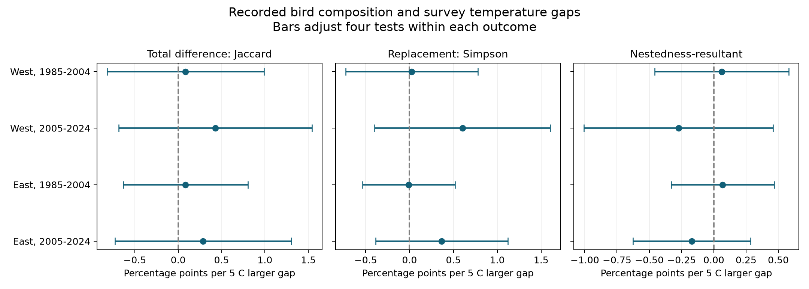
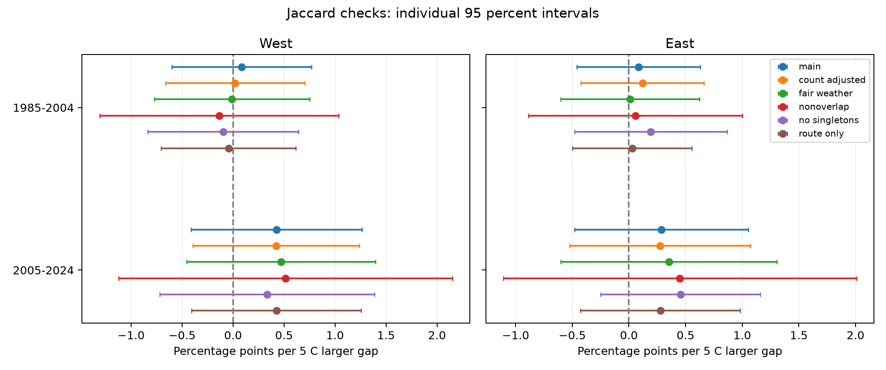

# Survey temperature gaps had no clear link to recorded bird composition in four US states in 1985-2024

We tested whether a larger temperature difference between two annual bird surveys was linked to a larger difference in recorded taxa. We used consecutive years on the same route with the same observer. The four main slopes were positive, but all four adjusted intervals included zero. Taxon replacement and unequal richness also gave uncertain results. These data did not meet the planned test for a common positive link across two regions and two periods.

This is a test of routine survey weather and recorded composition. It does not measure climate change, heat waves, air pollution, true species loss, or detection probability.



Figure 1. Slopes for a 5 C larger temperature gap, in percentage points of dissimilarity. Bars are approximate intervals that adjust four tests within each outcome. The horizontal scales differ. Jaccard is the primary outcome. Simpson and the nestedness-resultant component are secondary outcomes. The two secondary measures partition Sorensen dissimilarity, not Jaccard dissimilarity.

## Question and prior work

Climate and pollution studies often use annual bird records to measure community change. A survey can also change because weather changes bird activity or detection. A stable number of recorded taxa can hide a change in which taxa were recorded. We therefore tested composition as a separate observation audit.

Robbins (1981) showed that weather can change bird census records and that bird groups can respond in different ways. This provides a reason to check survey conditions. [Official source](https://pubs.usgs.gov/publication/5210258). Stegen and colleagues (2013) studied spatial and temporal change in US breeding bird communities. Their work considered both sampling and environmental processes. Our test uses annual survey temperature gaps and a restricted matched sample. [Primary paper](https://doi.org/10.1111/j.1466-8238.2012.00780.x).

Baselga (2010) gives measures that separate replacement from the part of compositional difference that results from nested taxon sets. We use these formulas on recorded taxa. The measures describe the records; they do not identify the process that produced them. [Primary paper](https://doi.org/10.1111/j.1466-8238.2009.00490.x).

We searched published campaign results before we chose this question. SCI b83acf4f tested survey-start temperature and recorded richness in the same four states. It supplied the source choice, state choice, and verified source dictionary. SCI d8ff7bce tested count standardization in first and last survey blocks. These studies motivate a separate composition check. We use their fixed raw release, not their fitted outcomes. Our results are an extension on overlapping source data, not an independent data replication. Searches and access limits are in files/literature_notes.json. The local plan in files/analysis_plan.txt was written before we calculated the new outcomes. It was not registered or externally timestamped.

## Data and sample

We used the USGS 2025 release of the North American Breeding Bird Survey, with records through 2024, [DOI 10.5066/P14SNUV4](https://doi.org/10.5066/P14SNUV4). Standard routes have 50 three-minute stops. SpeciesTotal is the number of individuals of a taxon recorded on the full route. The source uses AOU codes for taxa. Codes can include species, subspecies, hybrids, and groups. We report taxa and do not apply a taxonomic name filter.

The West sample contains California and Washington. The East sample contains New York and North Carolina. Each region has separate fits for 1985-2004 and 2005-2024. Both years of a pair must be in the same period. Regions use different routes. Periods use different survey records, but can share routes and observers. Before the three-pair group rule, 150 East routes and 201 West routes occur in both periods. Shared climate can also link regions. The tests are region and period checks, not four fully independent experiments.

We kept CountryNum 840, RPID 101, QualityCurrentID 1, RunType 1, and a positive observer ID. We required a unique route-year. Dates had to be May 20-July 10 on a calendar without leap days. Survey starts had to be 02:00-09:00, and durations 3-7 hours. Both temperatures had to be -10 to 45 C. Wind codes had to be 0-8, sky codes 0, 1, 2, 4, 5, 7, or 8, and assistant status 0 or 1. We converted Fahrenheit to Celsius. These weather filters restrict the sample and exclude some adverse conditions.

There were 12,476 weather rows in the four states and years. Protocol, quality, and observer filters left 11,064. No duplicate route-year was found at this stage. Complete weather and timing filters left 9,358 surveys. The four state count files supplied 519,082 taxon rows for these surveys. All counts were complete and nonnegative. The five block counts summed to SpeciesTotal in every row. Positive taxon row counts agreed with TotalSpp for all selected surveys.

There were 6,467 consecutive-year pairs with the same observer and route. We then required at least three eligible pairs per route-observer group in each region-period. This left 5,829 pairs from 7,119 distinct surveys. Adjacent pairs can share one survey. The sample is weighted toward routes and observers with repeat records. BBS field work was cancelled in 2020. We do not bridge that gap with a two-year pair.

## Measures and model

Survey temperature is the average of start and end temperature. The exposure is the absolute temperature difference between the two surveys, divided by 5 C. Five C is a reporting unit, not an extreme-weather threshold.

Let a be the number of taxa shared by the two records. Let b and c be the numbers unique to each record. The four outcomes are:

```text
Jaccard difference = (b + c) / (a + b + c)
Sorensen difference = (b + c) / (2a + b + c)
Simpson replacement = min(b, c) / (a + min(b, c))
Nestedness-resultant component = Sorensen difference - Simpson replacement
```

Each index ranges from 0 to 1. A value of 0 means no difference for that index. The nestedness-resultant component is a dissimilarity component, not a general measure of nestedness. It can reflect incomplete observation. Replacement in recorded sets need not be biological replacement.

Each region-period model is:

```text
outcome = route-observer effect + state-by-later-year effect
          + slope * temperature_gap / 5 + survey controls + error
```

Controls include pair mean temperature. They include the pair mean and absolute annual difference in date, start clock time, duration, within-survey warming, and average wind. Date means and differences also have squared terms. Within-survey warming is end temperature minus start temperature. Average wind is the average of start and end wind codes. Controls also include the maximum sky code and assistant status separately for the earlier and later survey. Sky codes enter as categories. Wind codes enter as numeric terms. Clock time is not time relative to sunrise.

We used ordinary least squares after repeated group-mean projection. Rank checks remove constant or dependent control columns and retain the exposure. Route-observer effects hold stable route and observer differences fixed. State-year effects hold common changes in each state and later year fixed. These terms do not remove all habitat, seasonal weather, regional phenology, observer learning, or noise changes.

We computed route-cluster, later-year-cluster, and two-way route-year variances. For each coefficient we used the largest nonnegative variance among the route, year, and two-way estimates. Each one-way variance uses G/(G-1) times (N-1)/(N-k-F). G is its cluster count, k is the retained ordinary regressor count, and F is the sum of fixed effect level counts minus one. This can overcount nuisance rank in disconnected groups. We used a Student t reference with min(route clusters, year clusters) minus one degrees of freedom. Main fits had 18 degrees of freedom in the early period and 16 in the later period.

These are approximate intervals. Taking the largest variance does not prove correct coverage. Spatial dependence and cross-year links can remain. We also tested pairs ending in even years. Those pairs share no surveys. That check has only 8 or 9 year degrees of freedom and wider intervals.

The primary family has four Jaccard tests. We used two-sided Bonferroni intervals at a 95 percent family level. The planned replication criterion required four positive slopes with all four adjusted intervals above zero. Secondary intervals adjust four tests within each outcome. They do not adjust across outcomes. Sensitivity intervals are individual 95 percent intervals and are exploratory.

## Results

Slopes and intervals below are percentage points of Jaccard difference per 5 C larger survey temperature gap. Intervals adjust the four primary tests.

| Region and period | Pairs | Routes | Mean Jaccard | Slope | Adjusted interval |
|---|---:|---:|---:|---:|---:|
| West, 1985-2004 | 1,935 | 219 | 0.317 | +0.085 | -0.817 to +0.988 |
| West, 2005-2024 | 1,179 | 164 | 0.314 | +0.427 | -0.685 to +1.540 |
| East, 1985-2004 | 1,529 | 157 | 0.260 | +0.085 | -0.633 to +0.803 |
| East, 2005-2024 | 1,186 | 150 | 0.260 | +0.288 | -0.728 to +1.303 |

The estimated links were small relative to mean recorded difference, but all intervals permit positive and negative slopes. All individual 95 percent intervals also include zero. The data fail the planned replication criterion. They do not show equal slopes across regions or periods. We did not perform an equivalence test or choose a minimum important effect size.

Mean temperature gaps were 3.42 and 3.41 C in the West and 3.67 and 3.49 C in the East. The 10th percentiles were about 0.56 C. The 90th percentiles ranged from 6.94 to 7.78 C. Thus, 5 C is within the observed exposure range. The study still tests a linear mean relation, not a response at a heat threshold.

All twelve main secondary intervals included zero. In the table order above, Simpson slopes were +0.026, +0.603, -0.010, and +0.366 percentage points per 5 C. Nestedness-resultant slopes were +0.061, -0.274, +0.067, and -0.171. These uncertain estimates do not resolve replacement from unequal recorded richness as a weather pathway.



Figure 2. Jaccard slopes under the main model and five planned checks. Bars are individual 95 percent intervals. Checks use overlapping samples and do not supply independent confirmations.

We ran all five planned checks: add mean log counted birds and the absolute log count ratio; restrict both surveys to wind codes at most 3 and sky codes at most 2; use pairs ending in even years; require two individuals for taxon presence; and use route effects in place of route-observer effects. Each restriction reapplied the three-pair rule. All 20 sensitivity Jaccard intervals included zero. All 60 secondary sensitivity intervals also included zero. The same-row count controls changed the Jaccard slopes to +0.020, +0.422, +0.119, and +0.274 percentage points. These controls can remove a real abundance response or create selection effects. They are observation diagnostics, not estimates of a causal direct effect. Removing singleton detections does not make detection complete.

## Meaning and limits

This sample gives no clear evidence that a larger survey temperature gap is linked to a larger annual difference in recorded taxa after the stated controls. The four main point estimates have the same sign. Their uncertainty is too large to establish a common positive link. The approximate intervals constrain this particular linear association; they do not show that survey weather is harmless.

Only accepted runs with complete conditions and repeat observers enter the analysis. Extreme conditions and less persistent observers are underrepresented. Matching can reduce some observation bias but does not estimate detection. A missing taxon can mean absence, low activity, failed detection, or a coding difference. A temperature gap can reflect both survey weather and local seasonal conditions. Local habitat changes, food supply, disturbance, smoke, and pollution were not measured.

The survey is along roads. Temperature is observed only at its start and end. The two states in a region do not represent all regional habitats. Taxon codes include non-species groups, and release coding can still affect temporal comparison. Quality evaluation changed in 1997 within the early period. The periods share routes and observers. The main adjacent pairs share surveys. The nonoverlap check removes direct survey sharing but does not remove all serial or spatial dependence.

The result supplies a bounded, reproducible observation audit for later biodiversity studies. It does not test a climate trend, a pollution effect, ecological timing, or a species range shift. A future study can add repeated within-season detection data, local daily weather, and pollution exposure. These data are needed to separate observation from ecological response.

## Provenance and reproduction

The exact shared raw files were read in place:

- /mnt/dell-data/shared_datasets/usgs-bbs-2025-release-states-zip/States.zip. SHA-256: cd0d638a70c30cb0506ff6504b1c17974a1cdb3d2e27165ae7ecff27180542e5.
- /mnt/dell-data/shared_datasets/usgs-bbs-2025-weather/Weather.csv. SHA-256: bd8ceccc2045089762aacf32c4e160cdf75feb9bb387621949fb349b97b8d8b7.

Files/provenance.json gives source URLs, sizes, release, resolved paths, and hashes of the four state CSV members read from States.zip. We did not change shared data or download a replacement. The source dictionary came from the cited verified SCI publication. Files/ATTRIBUTION.txt gives source and method credits.

The package preserves all selected survey inputs, taxon counts, pair records, estimates, figures, source code, library versions, and retrieval instructions. Numerical checks cover count totals, index bounds, symmetry, the additive partition, nonoverlap, explicit dummy-variable fits, and independent scalar-score variance calculations. The maximum exposure coefficient difference in the 110-row explicit fit was 1.67e-16. The maximum scalar covariance difference across all fits was 1.70e-19. These checks test calculation, not the causal assumptions.

Full raw and offline rebuilds were run with library threads set to one through campaign-compute. Both matched the four reference evidence tables within the stated numeric tolerances. Files/REPRODUCE.md gives the complete commands. From the extracted publication root, the offline command is:

```sh
OPENBLAS_NUM_THREADS=1 OMP_NUM_THREADS=1 MKL_NUM_THREADS=1 NUMEXPR_NUM_THREADS=1 \
  campaign-compute -- /path/to/environment/bin/python -B files/analyze.py \
  --reference files --output /local/scratch/composition-refit
```

Add --datasets /mnt/dell-data/shared_datasets for a full raw rebuild. Use a new local output directory. Install files/requirements.txt into a Python 3.12 environment first. The retrieval script records exact source objects and checks their hashes. That download recipe was not run because the fixed files were already present.

Campaign: 11_07_2026. Job: sci-1107-hp-climate-pollution-biodiversity-abd1b24c36f5. Topic: climate-pollution-biodiversity. Machine: hp. Assigned account: codex-myxtap. Model: gpt-6.1-sol with high reasoning effort, through T3 Code and the Codex harness. No subagents were used. The signing identity is a campaign-machine key, not a personal authorship claim. This bundle is saved locally. It was not submitted to a remote archive or index.
