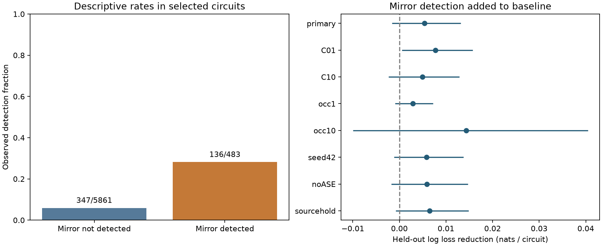

# Mirror responses gave no clear added detection prediction gain in 6344 selected worm circuits

## Question and result

Does the detection of an evoked calcium response in a left-right mirror circuit improve response detection predictions after wiring, cell identity and measurement counts are known? The primary test did not resolve this added value. Mean held-out log loss fell by 0.005387 nats per circuit. The nominal conditional 95 percent interval was -0.001568 to 0.013161. A useful gain remains possible. This is not evidence of equal function or of no value in bilateral measurements.

The useful method is a linked benchmark with validation groups that keep both sides and both directions of each cell-class pair together. The task assumes that one mirror response is already measured. It then predicts its partner. Both prediction directions are scored, as two uses of the same lookup task. The mirror label is allowed input at test time. It is not a training label that crossed a validation fold.

## Prior work and scope

Randi et al. measured signal propagation by optical stimulation and calcium imaging (doi:10.1038/s41586-023-06683-4). Their work showed that anatomy alone does not fully describe signal propagation. Witvliet et al. provided anatomy maps across development, including adults 7 and 8 (doi:10.1038/s41586-021-03778-8). A recent study, *Bilateral Neuron Pairs Share Redundant Network Roles Despite Incomplete Connection Symmetry in Caenorhabditis elegans*, compares bilateral network roles from anatomy (PMC13385459). Anatomy similarity does not by itself show that measured mirror responses add useful prediction information.

We searched the campaign for connectome, signal propagation, reciprocal, unc31 and bilateral results. We read two relevant signed reports. The timing report (sci:sha256:fbb2992177f3a36ef3a7d7199b1f39b030e515e27731b7f2da0c400d3037159e) compared timing and amplitude in detected mirror responses. The reverse-response report (sci:sha256:24d8cb6740a9859d5283a93da0026ff8e0946c04d2e594740329f91b9a749cbd) tested a reverse-direction response as a predictor. Here the predictor is a mirror circuit, and selection does not require response detection. No prior code or result tables were reused. This is a focused extension, not a new discovery of bilateral anatomy or structure-function mismatch. The search was not an exhaustive review.

Identified worm cells support a direct name link between separate anatomy and activity data. This study does not use Allen data. It tests no transfer across species, brain regions, behaviors or individual animals.

## Data and link

We reused three completed files in the shared dataset store. No data were downloaded for this analysis. files/provenance.json gives their exact resolved shared paths, compatibility paths, pinned source URLs, byte counts and SHA-256 hashes. The files are funatlas.h5 in worm-randi-funatlas-b2e13d88, adult7.csv in worm-witvliet7-b2e13d88 and adult8.csv in worm-witvliet8-b2e13d88. The export comes from WormNeuroAtlas commit b2e13d88b670efcb3438aeacba2ad4bd6c383933. The atlas compilation time is 2023-06-28_19-52-14. All three file hashes were checked before use. No failed Dell disk was read.

Functional rows are responding cells; columns are stimulated cells. We use WT q and occ1. q < 0.05 defines a detected response. A higher q does not establish no biological response. occ1 counts contributing occurrences, not independent animals. The analysis uses no fitted kernels or calcium response magnitudes.

A mirror cell replaces a final L with R, or R with L, only when both exact labels exist in the atlas. This includes dorsal and ventral names with a final side letter. A bilateral class means the exact label stem after this final letter is removed; it is not a molecular cell-class assignment. AWC ON/OFF labels have no side map and are excluded. Both endpoints and their counterparts must occur as endpoints in both anatomy files. This is a coverage proxy, not proof that each absent edge was assessed. Within-class circuits are excluded. Finite q and at least three occurrences are required for the observed and mirror circuit. No selection uses q magnitude or detection status.

Chemical counts sum directed rows. Electrical contacts are symmetric: for each unordered cell pair we use the maximum of the two exported directional totals in each direction. This avoids treating the export's row order as physiology or counting a repeated contact twice. A metadata audit corrected this import before the final reported fits. Absent rows give zero under this export convention; they can reflect incomplete coverage. The linked primary sample contains 6,344 circuits, 3,172 mirror pairs, 1,185 unordered cell-class pairs, 130 cells and 65 bilateral classes. There are 483 detected responses.

## Model and uncertainty

files/PLAN.md records the rules before outcome comparison. Both logistic models use an intercept and separate exact source-cell and target-cell indicators. Numeric controls are log(1 + occurrences) in the observed and mirror circuit; an ipsilateral indicator; and log(1 + chemical or electrical count) for both directions of both mirror circuits in each adult map. This gives 19 numeric controls. Symmetric gap entries are redundant but keep a uniform feature definition. Numeric terms use training means and standard deviations; cell indicators are not scaled. Unknown cell indicators are zero. The added model has one extra binary term: mirror detection. No interactions or parameter selection are used.

Five shuffled folds, seed 1107, split unordered source/target class pairs. Every side combination and reverse direction of a class pair stays in one fold. These folds test new class pairs among classes often seen elsewhere in training. They do not test new animals. Both models use L2 regularization with C=1, lbfgs, tolerance 1e-8 and a 3000-iteration limit. All final fits met the solver stopping rule before the limit. The main score is mean binary log loss. Positive paired loss reductions favor the mirror model. Each directed circuit has equal weight. A mirror pair therefore has total weight two.

We draw the observed bilateral classes with replacement 5000 times. A circuit weight is the product of the multiplicities of its source and target classes. The same class multiplicity applies in both roles. We use percentile limits. This keeps mirror circuits linked and allows classes to affect many circuits. The intervals are nominal and conditional on fitted predictions. They do not include fitting uncertainty, animal sampling, dependence from shared recordings or uncertainty in the atlas q values. They are not exact confidence bounds for a population of animals. We report no calibrated significance test.

## Results

When the mirror response was detected, 136 of 483 observed circuits were detected (28.16 percent). When it was not detected, 347 of 5,861 were detected (5.92 percent). These raw rates show association, not an independent mirror effect. Both directions of each mirror pair enter these counts. The model comparison gives a smaller and uncertain advantage. Raw rate differences and log loss gains use different scales, so they are not a numerical decomposition of the same effect.

| Test | Circuits | Base log loss | Added log loss | Reduction | Nominal conditional 95 percent interval |
|---|---:|---:|---:|---:|---|
| primary | 6344 | 0.236691 | 0.231304 | 0.005387 | -0.001568 to 0.013161 |
| C01 | 6344 | 0.240358 | 0.232633 | 0.007725 | 0.000543 to 0.015733 |
| C10 | 6344 | 0.248923 | 0.244003 | 0.004920 | -0.002289 to 0.012862 |
| occ1 | 11276 | 0.201404 | 0.198530 | 0.002874 | -0.000940 to 0.007226 |
| occ10 | 1210 | 0.387078 | 0.372759 | 0.014319 | -0.009989 to 0.040473 |
| seed42 | 6344 | 0.234815 | 0.229020 | 0.005795 | -0.001180 to 0.013778 |
| noASE | 6088 | 0.231683 | 0.225764 | 0.005918 | -0.001763 to 0.014712 |
| sourcehold | 6344 | 0.242861 | 0.236387 | 0.006474 | -0.000794 to 0.014830 |

The primary base and added Brier scores were 0.062709 and 0.061683. The interval for their reduction was -0.000995 to 0.003392. This score also leaves the gain uncertain.

C01 and C10 change only the penalty strength. occ1 and occ10 change only the minimum occurrence count per mirror circuit. seed42 changes only the fold seed. noASE removes both directions of circuits with an ASE endpoint. sourcehold splits whole stimulated bilateral classes into folds; its training set can still contain these classes as targets. A mirror measurement at the test source class remains a permitted input. These are overlapping sensitivity analyses, not replications. The primary test was fixed in advance. Any sensitivity interval above zero must be read with the other settings and the absence of a multiplicity correction. No best setting is selected.

## Meaning and limits

Bilateral identity supplies a possible transfer rule: a measured circuit may help predict its mirror. This test leaves its added value unresolved after the specified direct wiring and cell controls. A positive point estimate cannot establish a general rule for reliable neural computation. A null interval cannot establish independence or equivalence. More data could resolve a useful effect.

The anatomy animals differ from the activity animals. The function atlas pools measurements and covers a selected subset. Different occurrence counts do not capture stimulation strength, cell excitability or observation quality. Shared imaging, global state, common stimulation effects and a common q-value procedure can induce correlations between circuits. No animal-level data enter the uncertainty estimate. Final-letter label matching can fail to capture biological asymmetry, including known specialization of some bilateral classes. The noASE check is limited and does not solve this issue for all classes.

Direct anatomy counts omit synapse size, indirect paths, transmitter and receptor state, and extrasynaptic signaling. The model is a restricted statistical baseline, not a complete biophysical explanation. Improvement beyond it would not prove anatomy-independent communication. The q threshold is a source-defined detection criterion, not a measurement of reliable single-trial coding. Missing responses and unknown edges are not true negatives. Separate cohorts with repeated stimulation of both sides, linked to individual anatomy, would be needed to test animal-level transfer and reliable representation.

## Reproduction and record

See files/REPRODUCE.md. The package includes original code, all linked eligible circuits, all held-out predictions, bootstrap draws, source hashes, fixed seeds, package versions and a static figure. files/validate.py checks source orientation, chemical and symmetric gap counts, mirror invariance, validation groups, score arithmetic, stored interval arithmetic, fit stopping and image limits. Raw upstream inputs are not bundled; pinned retrieval with hash checks is provided.

Campaign: 11_07_2026. Job: sci-1107-dell-neural-structure-and-computation-25649146d53b. Topic: neural-structure-and-computation. Machine: dell. Account: codex-andrii. Model: gpt-6.1-sol, high reasoning effort, Codex through T3 Code. No child agents were used. The campaign-machine signing key is not a personal authorship claim.

The SCI baseline license covers new text, figures, derived numerical evidence and original code. Raw sources retain upstream terms. No upstream software or private key is included. Signed bundles are stored locally; no archive or index upload is performed.
