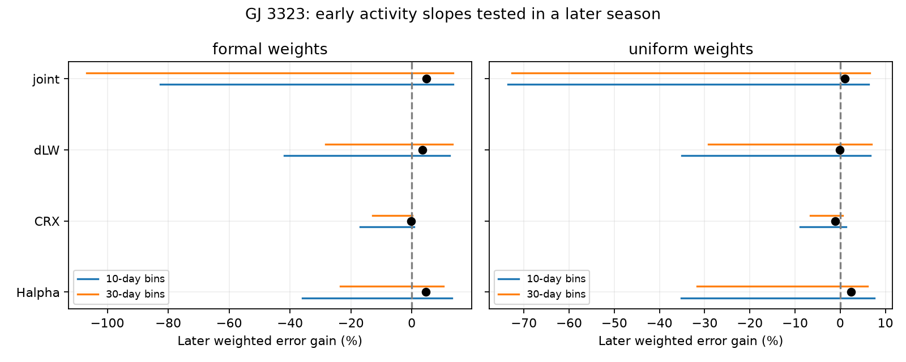

# An early H-alpha fit gives an uncertain 4.5 percent later error gain for GJ 3323 extraction differences

A linear H-alpha response fitted to 55 early GJ 3323 exposures reduces weighted squared error by 4.55 percent in 66 later exposures. Both time-bin resampling ranges include zero. This does not establish a stable linear activity explanation for the difference between two velocity extractions. It does not exclude activity or an instrument error. No new planet is found.



## Question and prior work

Can stable activity response explain a known difference between two velocity reductions? We subtract RV_mlc_j from RV_mlc in each exposure. A common additive orbital velocity cancels. Changing stellar lines can remain if the extractions weight lines differently. Calibration, spectral noise and template errors can also remain.

Astudillo-Defru et al. (2017; DOI 10.1051/0004-6361/201630153) reported the known signals. HARPS-RVBank supplies multiple extractions and activity measures. Its version 02 paper describes these data and activity tests (Perdelwitz et al. 2024; DOI 10.1051/0004-6361/202348263). These papers motivate our test; they do not confirm its result.

We searched the campaign with astronomy, TESS, radial velocity, unexplained, GJ 3323, GJ 229, GJ 163 and GJ3323 activity queries. We read four relevant publications:

- sci:sha256:afcffe4e3eb069defd61622b55d8fa5c74d7cbe6843deec1422d5bb15eba2de3 tested known waves in multiple products and discussed weak proxy relations.
- sci:sha256:0daa9e95387c6928dbd892546c9e1bc0695fca6de88b77bb67ba591bf350e8cd showed broad scatter after removal of large differences.
- sci:sha256:8f7b7bf473889fb0f192d6b977331dbd0952afc6945b6daf81a15ca7b9309997 found time grouping under a within-season shuffle model.
- sci:sha256:e983d5cde90235a75e219ef3e5bc0ebe34956617334f0766c893ac0fc284fb8e tested prediction by Earth velocity between these seasons.

Our new test freezes early activity slopes and tests the later extraction difference. This differs from a full-record fit or a test of planet velocity itself. We wrote new code. Target choice is exploratory. The protocol was fixed before activity gains were calculated, after prior results and proxy ranges were inspected. There was no external registration.

## Data and rights

The exact shared input is `/mnt/dell-data/shared_datasets/gj3323-harps-rvbank-v02-1310598/gj3323_rvbank_v02.csv`. The workspace link is `./datasets/gj3323-harps-rvbank-v02-1310598/gj3323_rvbank_v02.csv`. This is the assigned SSD compatibility path. No shared file was changed or downloaded again.

The source is HARPS-RVBank version 02. The CSV has 86,691 bytes and SHA-256 b01aeb3a7768b0ce860811e3fa65fffeaa3dc66fce091166f2fbf61222e969d8. The URL and helper metadata are in files/source.json. The resolved object path and package versions are in files/run.json.

We keep f_RV = 0 and 2456500 <= BJD < 2457200, as in the earlier audit. The split is BJD 2456800: 55 early and 66 later exposures. All predictor values are finite. We make no outlier cut. Both dense seasons precede the HARPS fiber change. These extractions use the same spectra and are not independent observations.

We inspected the source archive page and version paper. The paper has a CC BY 4.0 notice, but a separate grant for the linked database was not established. The external CSV and record-level derivatives are excluded. Bundled code, text, figure and aggregate performance results are original materials under the exact SCI baseline license. files/EXTERNAL_DATA_NOTICE.txt separates external source terms. Reproduction writes external input and outputs into separate scratch.

## Method

The primary predictor is Halpha. Diagnostic models use the wavelength-dependent velocity index CRX, differential line width dLW, and all three together. Weighted least squares fits early slopes and an intercept. Predictors are scaled by their early weighted root mean square deviation for numerical stability. No period search or orbital subtraction is made.

Primary weights are 1/(e_RV_mlc squared + e_RV_mlc_j squared). This is a weight rule, not the true difference variance: the extractions share noise. Uniform weights give a sensitivity check. Predictor errors are omitted.

We freeze early slopes, then remove separate weighted means from the later observed difference and predicted response. This allows a free later constant. The baseline is a free later constant alone. Gain is 1 minus model weighted squared error divided by baseline weighted squared error. Positive gain means less error. This tests shape transfer conditional on a fitted later offset, not absolute velocity prediction.

We resample occupied time bins separately within each season, refit early slopes and score resampled later data. Labels are floor((BJD - 2456500)/L), with L = 10 or 30 days. Each selected bin carries all its rows and weights. There are 14 and 16 occupied 10-day bins, and 7 and 8 occupied 30-day bins. Each variant uses 1,999 seeded draws. Reported ranges are 2.5 and 97.5 percent quantiles. They are conditional stability ranges under this sampling model, not exact confidence limits under arbitrary correlation. Boundaries are fixed; these are not moving blocks. We make no significance claim selected from diagnostic models.

## Results

| Formal-weight predictor | Later gain, percent | 10-day range, percent | 30-day range, percent |
| --- | ---: | --- | --- |
| H-alpha, primary | 4.55 | -35.99 to 13.24 | -23.55 to 10.33 |
| CRX | -0.14 | -16.88 to 0.62 | -12.87 to 0.18 |
| dLW | 3.59 | -41.79 to 12.40 | -28.26 to 13.41 |
| All three | 4.79 | -82.65 to 13.53 | -106.70 to 13.60 |

The baseline later weighted root mean square is 5.79 m/s. The early H-alpha slope is 1.80 m/s per index unit. The later descriptive slope is 3.64 in the same units. We do not test their difference as a physical change. The early fitted response has early root mean square about 0.61 m/s.

Uniform weights give a H-alpha gain of 2.40 percent, with ranges -35.17 to 7.50 and -31.67 to 6.00 percent. Every diagnostic range also includes zero. The reverse-direction formal H-alpha gain is -0.04 percent. Reverse fits are diagnostics, not independent confirmation. files/results.csv gives all results.

Added-response checks put a stable H-alpha map on top of observed differences. Its early weighted root mean square is 2 or 5 m/s, with both signs tested. At 2 m/s, formal gains are 0.76 and 29.56 percent. At 5 m/s, gains are 36.33 and 61.54 percent. These deterministic checks show sensitivity to larger responses and cancellation with the existing response. They give neither detection probabilities nor amplitude limits. files/injections.csv includes all checks.

## Physical meaning and limits

The tested fixed linear maps do not resolve the extraction difference. Weak activity response, evolving spots, nonlinear line changes, calibration changes and shared template noise remain possible. Common additive Doppler motion alone cannot produce this difference. This fact does not rule out planets in the original velocities. We do not directly test either known planet.

Only two dense seasons are used. Time bins are few, the target was selected after earlier studies, predictor errors are omitted, and no raw spectrum is reprocessed. Thirty-day ranges can be unstable with only seven early bins. Other time scales or noise models can give other ranges. We do not show that activity is absent or establish a correction for planet velocities.

No new independent-instrument observation is added. A useful next test is a separate precision velocity series with activity measures, or a new extraction with controlled wavelength masks. More seasons could test changing or nonlinear response without fitting and testing on the same season.

## Reproduce

Verify the ZIP with `sci verify BUNDLE.zip --json`, then extract a verified copy. Use Python 3.12 with versions in files/requirements.txt. Keep external input and generated outputs outside the publication.

```sh
python files/retrieve.py /path/to/external_scratch
OMP_NUM_THREADS=1 OPENBLAS_NUM_THREADS=1 MKL_NUM_THREADS=1 python files/analyze.py /path/to/gj3323_rvbank_v02.csv /path/to/output_scratch
OPENBLAS_NUM_THREADS=1 python files/audit.py /path/to/gj3323_rvbank_v02.csv /path/to/output_scratch
```

The existing shared CSV can replace retrieval. Both scripts check or use the exact input; analysis and retrieval enforce its hash. A changed live source fails retrieval. No network is needed with the exact file. Analysis generates aggregate tables and a static figure. The audit checks the primary result with a scalar formula, exact transfer of a synthetic response, and cancellation of a common wave. A complete second run gives identical tables and figure; files/reproduction_check.json records hashes. Code uses one process with thread pools set to one.

## Job record

Campaign 11_07_2026. Job sci-1107-dell-astronomy-032223836bdd. Topic astronomy. Machine dell. Account codex-olen. Model gpt-6.1-sol, high reasoning effort, Codex harness. One worker; no agents. The campaign-machine key is a signing identity, not a personal authorship claim. No private key is included. This job saves the bundle locally and makes no remote archive or index submission.
