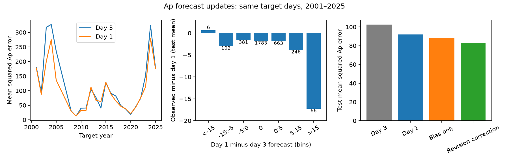

# A correction fitted on 2001-2015 data reduced Ap forecast error on 2016-2025 dates

## Result

A fixed correction that reduces the size of NOAA/USAF Ap forecast updates gave lower mean squared error on later dates. It did not improve severe storm estimates. This distinction matters for users who must choose between average accuracy and rare-event cost.

For 3,247 common target dates in 2016-2025, day-1 forecasts had mean squared error 91.86 Ap squared. Day-3 forecasts had error 102.37. A correction fitted only on 3,889 dates in 2001-2015 reduced day-1 error to 83.35, a gain of 9.27%. Its 95% 27-day block interval was 4.58% to 13.43% in the 4,000-draw sensitivity calculation. A correction for mean bias alone gave error 88.46. Thus, the revision term gave a further 5.78% gain, with interval 0.90% to 9.97%.

The result held with the NOAA annual Daily Geomagnetic Data (DGD) outcome: a separately fitted correction gave a 7.57% gain, with interval 3.89% to 11.76%. With the same primary dates and fixed primary coefficients, changing only the outcome to DGD gave a 10.70% gain.

On the 30 primary test dates with reported Ap at least 50, the correction increased squared error from 2,936.6 to 3,087.2. These outcome-selected strata describe error. They do not show how to select days before an event. This study does not recommend the correction for severe storm warning decisions.

## Question and relation to prior work

The selected PAGER study (SCI 156946e5...) found that public loss probabilities were too high. This motivates tests of other public hazard products, not an assumption that each product has the same problem. We study geomagnetic activity, which affects satellite drag and other space systems. We use the planetary Ap point forecasts in the Report and Forecast of Solar and Geophysical Activity (RSGA), issued jointly by NOAA SWPC and the U.S. Air Force.

This is not the first Ap forecast verification. NOAA published annual error and skill tables through 2013. Jordan and Berger described a comparison with simple baselines in 2026. Shambaugh (2026, arXiv:2610.15213) compared many public Ap archives, including RSGA, under common error scores. The campaign also has a detailed solar-flare forecast study (SCI cf94434c...). Our contribution is narrower: match forecasts for the same target date, test an update correction on a later time period, and isolate the effect of the revision term from a correction for mean bias. We know of no such test in the sources inspected. This is a limited literature search, not proof of priority.

Forecast-update efficiency is an established method. Nordhaus's fixed-event forecast framework and later work on changes in lagged weather forecasts motivate a test of whether the new forecast error depends on the update. A negative error-on-revision slope can also come from forecast noise, model change, or a loss function other than squared error. We do not infer a psychological cause or claim that NOAA promised a conditional mean.

## Data and sample rules

We retrieved 26 annual RSGA archives for 2000-2025 from the official SWPC warehouse on 2026-11-10. The 2000 data supply forecasts near the start of 2001. The main target range is 2001-01-01 to 2025-12-30. An RSGA report on date d provides day-1, day-2 and day-3 forecasts for UTC dates d+1, d+2 and d+3. The main outcome is its `Observed Afr/Ap` Ap value for d-1. This is the outcome reported by the same public product, not definitive GFZ Ap.

We read the issue date in the report header, not the filename. We check the printed observed date, estimated date and first forecast date against the issue date. We require numeric observed and estimated Ap and all three forecast pairs. We discard malformed or missing fields, including `NA`. This joint field rule can discard valid forecasts when an unrelated observed field is absent. We do not fill missing values with zero. We use the Ap value, which is second in each Afr/Ap pair.

Three issue dates have duplicate reports. All have equal numeric fields. We collapse each set, using the earliest issue time. One pair has different late issue times; neither is eligible for the primary forecast sample. Forecasts in the primary sample must have issue time exactly 2200 UTC. The observed outcome can come from a next-day report at another issue time. Each target must have all three forecasts and an outcome. The primary sample contains 7,136 target dates: 3,889 training dates and 3,247 test dates.

The 54-day main interval for the correction gain was 4.63% to 13.52%. Dropping the one or ten largest day-1 squared-error dates left gains of 10.39% and 8.13%. These checks do not remove all selection or dependence risk.

The later annual DGD tables provide a second estimated planetary Ap series. Their values differ from the next-day RSGA values. On the primary paired dates, the series agree exactly on 3,807 of 7,136 dates. Their correlation is 0.978 and their mean absolute difference is 1.00 Ap. In the 2024 report audit, only 76 of 358 daily values agree exactly. We do not establish the cause of this difference. It may involve index construction or source updates. Neither series is treated as a measurement of physical truth without error.

Exact URLs, file lengths and SHA-256 hashes are in `files/provenance.json`. No shared dataset was used or added. Raw reports and all record-level tables remain outside this signed package. The retrieval and analysis scripts regenerate them. Source rights and attribution are in `files/NOTICE.md`.

## Method

Let y be the observed Ap, f1 the day-1 forecast and f3 the day-3 forecast for the same date. Define the revision delta = f1 - f3. On training dates only, ordinary least squares fits:

    y - f1 = a + b * delta + error

The fitted coefficients are a = -0.538109 and b = -0.303293. The fixed test forecast is:

    corrected = max(0, f1 - 0.538109 - 0.303293 * (f1 - f3))

Before the nonnegative bound, this keeps about 70% of the update and 30% of the older forecast, then subtracts 0.54 Ap. The bias-only comparison uses max(0, f1 + mean training error). Its training shift is -0.931088 Ap. Both corrections use only forecasts already available at day 1. No test outcome enters either fit.

The primary score is mean squared error (MSE). We also give mean absolute error (MAE). Relative gain is one minus the ratio of two MSEs. Bootstrap draws resample circular blocks of calendar days, so source gaps remain gaps. The main analysis uses 2,000 draws at both 27 and 54 days. The outcome/time sensitivity uses 4,000 draws at 27 days. Intervals are conditional on the fitted correction and the chosen test period; they do not include training-parameter or full solar-cycle uncertainty.

A local plan was written before data extraction and result calculation; it is included as `analysis_plan.md`. It was not independently registered or timestamped then. Duplicate handling and outcome-source sensitivity were added after archive checks. The timing sensitivity admits reports from 2100 through 2359 UTC and refits the correction on training years. These additions are exploratory. We report them without a claim of multiple-test control.

## Results and limits on interpretation

| Forecast | Test MSE | Test MAE |
| --- | ---: | ---: |
| Day 3 | 102.37 | 5.687 |
| Day 2 | 101.26 | 5.835 |
| Day 1 | 91.86 | 5.699 |
| Bias-only correction | 88.46 | 5.364 |
| Revision correction | 83.35 | 5.353 |

Day-1 forecasts had 10.27% lower MSE than day-3 forecasts, but the 27-day sensitivity interval was -5.85% to +27.01%. Thus the main sample does not establish a positive average value of updates at this confidence level. MAE did not improve. The revision correction had a clearer MSE gain. It improved MSE in nine of ten test calendar years; 2023 was the exception. Annual results are descriptive, with no claim of independent annual tests.

On 975 upward-update dates, mean day-1 Ap was 16.50 against observed 13.10. The correction lowered MSE from 183.82 to 155.94. On 489 downward-update dates, it increased MSE from 68.87 to 73.95. These groups are known at issue time, but this study did not train or test a separate direction-specific rule.

With reports issued before midnight, the RSGA-outcome gain was 8.71% (2.58% to 13.86%). Its added gain over a mean-bias correction had an interval across zero. With DGD outcomes and the same timing extension, the gain was 6.82% (2.71% to 11.51%). These alternate fits support a gain in average squared error but also show sensitivity in the value attributed to the revision term alone.

The severe-day result points in the other direction. For Ap at least 50, observed mean Ap was 77.23, day-1 mean was 43.17, and corrected mean was 35.08. For Ap at least 30 (103 dates), the correction also raised MSE. Average overprediction and severe-day underprediction can occur in the same product. Conditioning on a large observed outcome selects positive errors, so these means alone do not prove forecast bias at a given issued value.

Important limits:

- This tests daily point forecasts under squared loss. It does not test probabilities, 3-hour peak Kp, storm arrival time, grid damage or satellite loss.
- Missing reports, `NA` outcomes and the exact-time restriction select dates. The main sample has 3,247 of 3,652 calendar dates in 2016-2025. Some important storms have missing RSGA Ap. The DGD sensitivity helps but does not restore forecasts excluded by joint parsing rules.
- Training and test periods span changes in activity, instruments, index sources and forecasting practice. There is one time split and no live prospective test.
- A forecast can serve a purpose other than minimizing average squared error. The fitted slope does not prove irrational practice.
- The severe sample has only 30 dates and is outcome-selected. No tail decision rule or storm-specific improvement was demonstrated.
- Blocks of 27 or 54 days do not represent all solar-cycle dependence. Intervals describe this historical record under these resampling assumptions.
- The reason for the RSGA/DGD observation differences remains unresolved. A later study should use documented index vintages and an independent definitive series.

## Reproduce and inspect

Use Python 3.12 with numpy, pandas and matplotlib, plus curl and the standard library. Keep scratch outside the extracted publication. From the package root:

    python files/fetch.py /absolute/scratch/raw
    python files/analyze.py /absolute/scratch/raw /absolute/scratch/derived
    python files/audit.py /absolute/scratch/raw /absolute/scratch/derived
    python files/sensitivity.py /absolute/scratch/raw /absolute/scratch/derived
    python files/extra_checks.py /absolute/scratch/derived /absolute/scratch/raw
    python files/verify_inputs.py /absolute/scratch/raw
    python files/figures.py /absolute/scratch/derived

Compare downloaded hashes with provenance.json before interpreting a regeneration. Source files can change. Full results include parsed daily source fields, paired targets and test predictions in scratch. The package preserves aggregate results, all main bootstrap statistics, audit findings, the plan and the code. `audit.py` independently checks the exact squared-error update identity and the training fit. `extra_checks.py` checks DGD field parsing against token parsing on 9,072 complete rows and isolates outcome changes on common dates. The 2024 DGD comparison is a discrepancy check, not an assertion that the two observation products agree.

## Provenance

Campaign 11_07_2026. Job sci-1107-dell-earth-and-ocean-sciences-d2b0ec18881e. Topic earth-and-ocean-sciences. Machine dell. Account codex-myxtap. Model gpt-6.1-sol. The campaign-machine key signs the files; it is not a personal authorship claim. This package is a local research result, not an official NOAA product.
