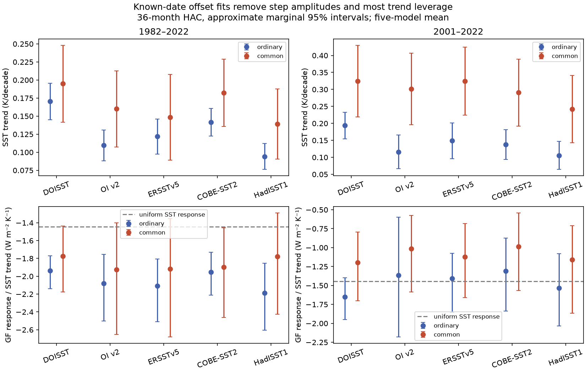
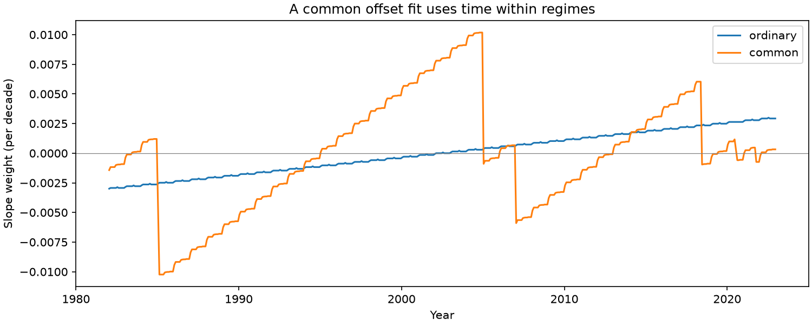

# Fits that ignore six tested SST offsets retain 14-15% of linear trend information under equal independent noise

A fit can ignore uncertain SST step amplitudes without a reference product. But it then uses a different part of the climate record. In the tested monthly records, use of the six-date offset set retains only 13.80% of linear trend information in 1982-2022 and 14.86% in 2001-2022. This is an exact design result under independent noise with equal variance. The minimum standard error increases by factors of 2.69 and 2.59. It is not a measured loss of climate signal or a universal error estimate.

The resulting five-model mean DOISST response-to-SST trend ratio changes from -1.938 to -1.774 W m-2 K-1 in 1982-2022, and from -1.650 to -1.197 in 2001-2022. Raw DOISST and its two published corrections give the same offset-fit estimate within 3e-9 W m-2 K-1. This agreement follows from the fit geometry. It does not validate a correction or identify the historical feedback.

## Question and contribution

Can one remove uncertainty in step amplitudes by fitting a separate intercept for each input regime? If so, what is the cost, and does the result still describe the full historical trend?

The source SCI study 78d7f2e calculated radiation responses from five symmetric atmosphere-model Green's functions. It found that DOISST step corrections change the inferred pattern feedback. Studies c0ad230d and 051df67c tested other response definitions and spatial correction uncertainty. Study 1b8b1683 tested whether uncertain trend denominators leave feedback ratios bounded. We use the same published aggregate series. We test a different estimator: a common slope with unknown offsets at tested input changes. We add an exact minimum-variance bound for this design, tests across reference SST products, offset-injection checks, and checks of date and transition width.

Joint trend and shift regression is established climate practice. SST trend work has used breakpoint models; see Good et al. (2007), doi:10.1175/JCLI4049.1. Fieller sets are also established; see von Luxburg and Franz (2009). We do not claim either method as new. The contribution is the measured design limit for these input changes, and evidence that this alternative cannot serve as an assumption-free correction of historical pattern feedback.

Campaign searches for SST feedback, SST step regression, Fieller and within-regime preceded the final scope. They found the prior spatial and ratio tests. No sibling private workspace was read.

## Inputs and scope

The only numerical inputs are two verified files in SCI publication
sci:sha256:78d7f2e0e904a30d9d8856aef2e045507dd6f1c6621614f0637521274e3b8db2:
files/data/feedback_series.npz and files/data/gf_boxes.npz.
Their SHA-256 hashes and byte counts are in files/results/provenance.json.
We verified the complete source ZIP before use. No shared raw SST dataset was read anew. Original shared paths, source versions, URLs and recorded raw hashes are in files/upstream_sources.json. These are inherited records, not our new verification of raw files.

The source uses 1,366 five-degree boxes on a fixed ice-free ocean mask from 60 S to 60 N. T is area-mean SST on this mask. N is the linear model response of global net top-of-atmosphere radiation, positive down. SST change outside the mask is zero. Models are CAM5, CanESM5, ECHAM6, GFDL-AM4 and HadAM3. Their mean uniform response is -1.44439 W m-2 K-1. We exclude the one-sided CAM4 response. We form the equal-weight mean of the five N series before division by T; model-by-model tables are also saved.

This ratio is per K of masked SST. It is not per K of global surface air temperature, observed radiation, an atmosphere-model integration, or an estimate of climate sensitivity.

## Fit and proof

For each series y, fit y = Z a + t b + e. Time t is in decades, centered on the retained observations. Z has 12 calendar-month indicators and cumulative step indicators. Each response has its own unconstrained amplitudes a. Let M remove the projection onto Z, r = M t and w = r/(r' r). Then b = w' y. The weights satisfy w' Z = 0 and w' t = 1. Thus, any constant offset in the span of Z has exactly zero effect on b. The ratio uses this same fit for N and T.

There are three designs:

- Ordinary: calendar-month indicators and time only.
- Native: the DOISST dates for DOISST versions; June 2018 for OI v2, its correction and AMIP 1.1.9; no steps for the other products.
- Common: the union of all tested dates for every product, so that product comparisons use identical temporal weights.

DOISST dates are January 1985, January 2005, January 2007, July 2020 and October 2021. The last two dates capture the NAVO and ACSPO input changes used in the published correction. Some estimated steps are small or reference-dependent. Their inclusion does not assert that each is a proven artifact. June 2018 is the OI v2/AMIP candidate step. The 1985 date precedes the short window, so that window has five active step directions. We omit January 1985 and July 2020 from every main fit, including ordinary fits, since those months contain mixed input regimes. This makes the fit insensitive to the uncertain within-month fraction. The April 2023 correction is outside both analysis windows. Month indicators remove the calendar dependence induced by the source anomaly convention.

**Exact minimum variance.** Suppose e has covariance sigma squared times I. Any linear estimator v' y that is unbiased for b for all a must have v' Z = 0 and v' t = 1. Since v' r = 1, Cauchy-Schwarz gives v' v >= 1/(r' r). Equality holds for w. Therefore no other linear estimator with these constraints has lower variance under this noise model. Relative information is r' r divided by r0' r0, where r0 removes month indicators only. We report both the information fraction and its inverse square root. This bound does not apply to arbitrary correlated noise or biased estimators.

**Limit of identification.** Without a model for the true climate series C, y = C + Z a has many decompositions. For any vector h, the pair C + Z h and a - h gives the same y. Its full-record ordinary trend changes if the step part of Z h has a nonzero ordinary trend. Thus one cannot both ignore arbitrary offsets and recover the ordinary trend of an unrestricted C from this series alone. The within-regime slope is identified only under assumptions such as a common expected linear climate trend plus suitable zero-mean errors.

The common fit has repeated changes of sign in its time weights. It uses time within regimes rather than the full separation between the start and end of the record.

## Results

Main point estimates use the same retained months in each design. Slopes are K per decade; ratios are W m-2 K-1. Small differences from the source arise from month indicators and the two omitted transition months.

| Period | Product | Ordinary SST slope | Common-fit SST slope | Ordinary ratio | Common-fit ratio |
|---|---|---:|---:|---:|---:|
| 1982-2022 | DOISST | 0.1704 | 0.1948 | -1.938 | -1.774 |
| 1982-2022 | ERSSTv5 | 0.1218 | 0.1484 | -2.107 | -1.919 |
| 1982-2022 | COBE-SST2 | 0.1417 | 0.1824 | -1.951 | -1.897 |
| 1982-2022 | HadISST1 | 0.0941 | 0.1392 | -2.189 | -1.777 |
| 2001-2022 | DOISST | 0.1938 | 0.3247 | -1.650 | -1.197 |
| 2001-2022 | ERSSTv5 | 0.1491 | 0.3245 | -1.407 | -1.122 |
| 2001-2022 | COBE-SST2 | 0.1377 | 0.2906 | -1.309 | -0.986 |
| 2001-2022 | HadISST1 | 0.1057 | 0.2423 | -1.534 | -1.161 |

The native DOISST design retains 15.21% and 23.98% of information in the two windows. The native OI v2 design, with only one step, retains 70.55% and 50.93%. Thus, the cost depends strongly on the number and position of input changes. The larger cost in the common design buys immunity to all six candidate offsets and identical weights across products.

The common-fit SST slope increases in all five raw products in both windows. The same method increases the slope of ERSSTv5, COBE-SST2 and HadISST1, even though their main input histories do not motivate the full DOISST step set. These products share observations and are not independent error-free controls. Their agreement still shows that the change is not confined to removal of the published DOISST amplitudes.

The 2001-2022 DOISST pattern term changes from about -0.21 to +0.25 relative to the uniform response. This is a point-estimate change of sign. The common-fit 95% interval for the full ratio is -1.703 to -0.795, which includes the uniform value -1.444. We do not establish a positive pattern term. The common-fit 1982-2022 DOISST interval is -2.177 to -1.435. Both intervals condition on the fit and model maps.

**Tests.** The arbitrary-offset injection changes any fitted slope by less than 1e-10. Native and common fits reduce the published raw-minus-corrected DOISST ratio differences from about 0.08-0.13 in the long window to less than 3e-9. OI v2 and its 2018 correction also agree to numerical precision. This is the expected algebraic result, not independent evidence that the inferred climate slope is correct.

A constructed smooth series y = 0.1 t + 0.05 t squared contains no offsets. In 1982-2022 its ordinary slope is 0.1000 K per decade, but the common-fit slope is 0.0534. This counterexample shows that offset immunity changes the trend target for curved climate evolution. It is not a fitted model of Earth's warming.

Moving all six dates by one month changes the long-window DOISST ratio by less than 0.001. A six-month shift changes it to -1.872 or -1.833. Removing observations within six months on either side of each date gives -1.861 in 1982-2022 and -1.270 in 2001-2022. The corresponding SST slopes are 0.194 and 0.385. The main qualitative concern survives; exact values depend on time selection. Full results are in files/results/timing_checks.csv.

## Uncertainty and limits

We use a paired Newey-West type covariance for the T and N slope estimates: Bartlett weights through 24, 36 or 60 retained monthly lags, with n/(n-p) residual scaling. We invert the normal approximate ratio test to give Fieller sets. All 972 product-model-design-window-lag combinations have bounded sets. The main figure uses 36 lags. The data support nonzero fitted warming under these models; denominator failure is not the main issue here.

A second check uses 5,000 circular moving-block residual draws, 36 retained observations per block, for the mean response of the five raw products in ordinary and common designs. It also gives bounded sets. The common-fit DOISST ratio sets are -2.245 to -1.413 and -1.591 to -0.852. This check is not a coverage proof. Both methods can miss long climate memory, nonstationary residuals and error from a wrong common-trend model. Missing transition months mean that retained-row lags are close to, but not exactly, calendar lags.

The 14-15% result is a geometry result under equal independent noise. Actual errors are serially correlated. The result must not be interpreted as an 85% loss of information under all climate noise models. Uncertainty intervals omit Green's function error, structural model error, SST product error and nonlinear atmospheric response. Dates are externally selected, not inferred here; unknown drift and gradual changes remain. Marginal intervals have no simultaneous coverage guarantee across models or products.

The method cannot decide which original SST product or correction is right. Its agreement across corrections is built in. Stronger inference needs independent temporal or spatial constraints on artifact amplitudes, or an explicit, tested model for climate evolution. Arbitrary offset fitting cannot replace those constraints.

## Reproduction

Use Python 3.12, NumPy, pandas, SciPy and Matplotlib, with SCI on PATH. From the extracted signed publication at P, run:

    OPENBLAS_NUM_THREADS=1 OMP_NUM_THREADS=1 MKL_NUM_THREADS=1 python P/files/reproduce.py --campaign /path/to/campaign --scratch /path/to/new-scratch --out /path/to/new-results

The source ZIP must be in that campaign folder. The script verifies it, retrieves the two exact files into external scratch, checks their hashes and regenerates all tables and PNGs. It takes about one minute on one CPU. No external raw download is needed. To rebuild the source aggregates from raw SST, follow the source publication's code and recorded URLs.

For a read-only numerical audit of the bundled results:

    OPENBLAS_NUM_THREADS=1 PYTHONDONTWRITEBYTECODE=1 python P/files/audit.py

The audit checks time and offset constraints, information ratios from sums of squared weights, confidence-set boundary equations, correction invariance, and 200 random perturbations of the minimum-variance solution. Its saved output is files/audit.json. This is a numerical check, not statistical validation.

The signed package contains code, original summary results, time weights, figures and provenance. It excludes external time-series and gridded databases. See files/EXTERNAL_DATA.md for attribution and separate input terms.

## Provenance

Campaign 11_07_2026. Job sci-1107-dell-earth-and-ocean-sciences-f56e0e2e9a25.
Topic earth-and-ocean-sciences. Machine dell. Account codex-olen.
Model gpt-6.1-sol, high reasoning effort. Analysis date 2026-11-11.
No child agents or remote submissions were used. The campaign-machine signing
key is not a personal authorship claim.
