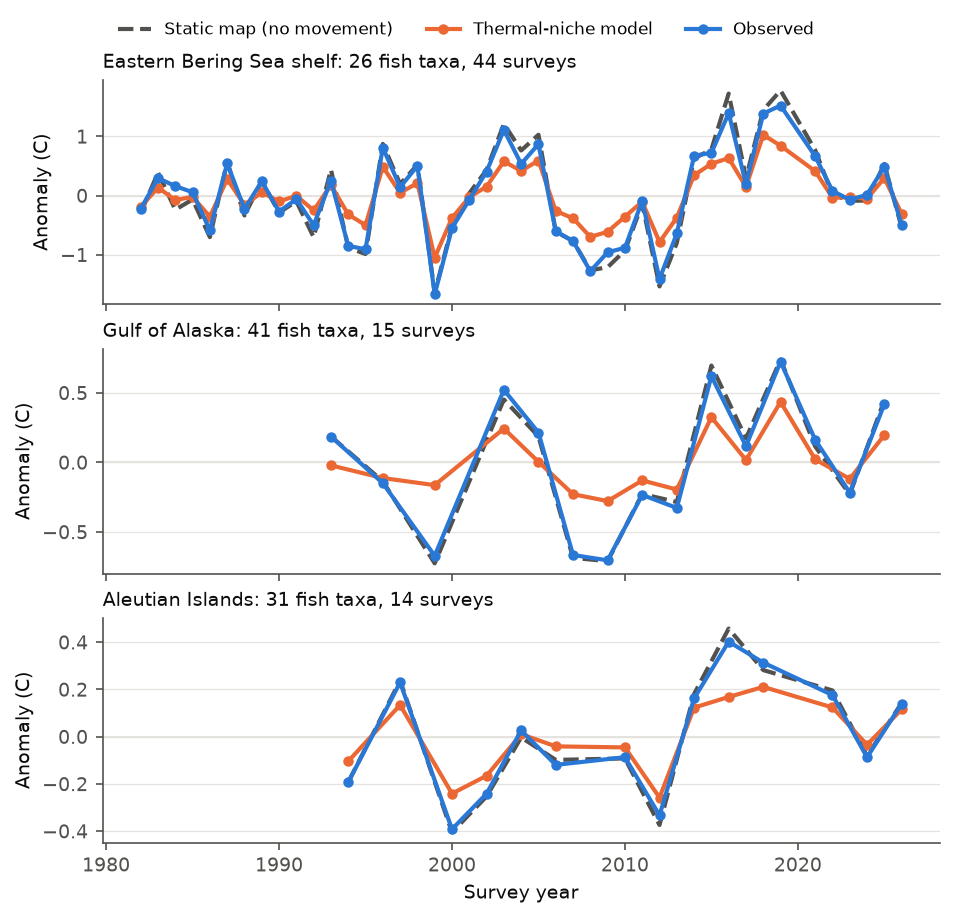
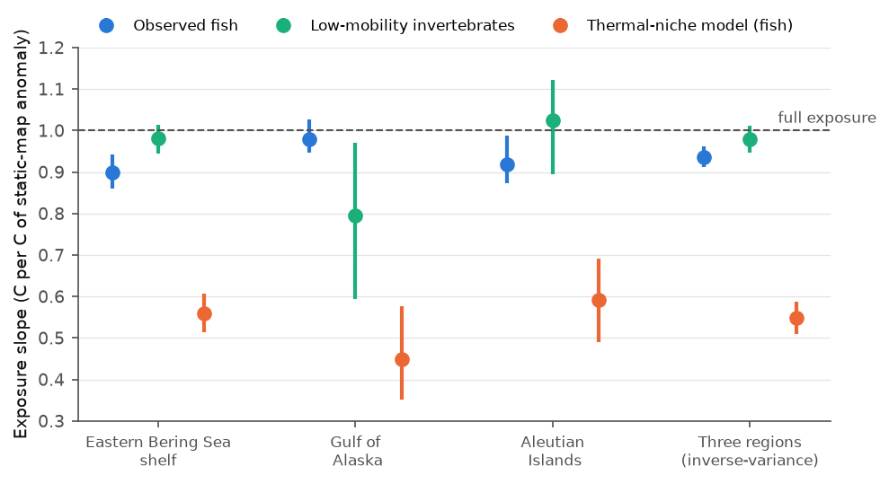
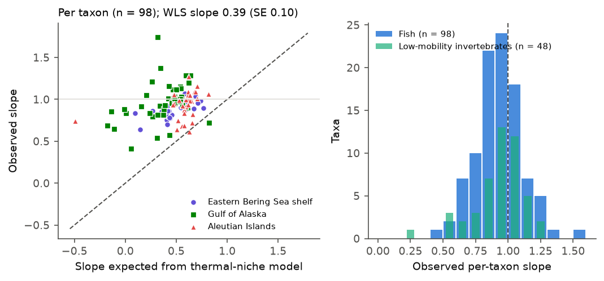

# Demersal fish in three Alaska trawl surveys experienced about 93% of year-to-year bottom temperature anomalies in 1982-2026; a thermal-niche model predicted about 55%

## Summary

**Question.** When the sea floor is warmer or colder than usual, do demersal fish move to keep their usual temperature? Or do they stay in their usual places and experience the full anomaly? The answer is important for heatwave impact studies and for species distribution models. Many such models use the "space-for-time" assumption: a species responds to a temperature change in time as its spatial distribution responds to temperature in space.

**Data.** We used three independent NOAA Alaska Fisheries Science Center (AFSC) bottom trawl surveys: eastern Bering Sea shelf (EBS, 44 surveys, 1982-2026), Gulf of Alaska (GOA, 15 surveys, 1993-2025) and Aleutian Islands (AI, 14 surveys, 1994-2026). Each haul has a measured bottom temperature and an area-swept catch (CPUE). We used 98 demersal fish taxa (26 EBS, 41 GOA, 31 AI) and 48 low-mobility benthic invertebrate taxa (sea stars, urchins, sponges, corals, anemones, tunicates, bivalves) as a negative control.

**Method.** For each taxon and year we calculated two values:

- **Observed experienced temperature (E).** The catch-weighted mean bottom temperature of the hauls, with design weights.
- **Static-map exposure (S).** The temperature that the taxon would experience in that year if it kept its usual spatial distribution. We used its mean distribution over the *other* years and the temperatures of the current year.

The **exposure slope** is the within-taxon regression slope of E on S. A slope of 1 means that the taxon experiences the full anomaly of its usual habitat. A slope of 0 means that redistribution removes all of the anomaly. We compared the observed slope with a **thermal-niche model**. In this model, each taxon re-weights its usual map by a Gaussian thermal niche, with the mean and SD of the temperatures at which it was caught. This is the space-for-time expectation.

**Main results.**

1. Fish experienced most of each anomaly. The exposure slope was **0.90 in the EBS (95% CI 0.86-0.94), 0.98 in the GOA (0.95-1.03) and 0.92 in the AI (0.87-0.99)**. The inverse-variance mean was **0.94 (0.91-0.96)**. Thus redistribution removed about 6% of the anomaly (between 2% and 10% in the three regions).
2. The thermal-niche model predicted a slope of **0.55 (0.51-0.59)**, which is about 45% buffering. The fish realised **23% (EBS), 4% (GOA) and 20% (AI)** of the predicted buffering. With a niche that is twice as wide, the model still predicted more buffering (slope 0.87) than we observed.
3. Low-mobility invertebrates had slopes of 0.98 (EBS), 1.03 (AI) and 0.80 (GOA). In the EBS, fish buffered more than the invertebrates (difference -0.08, CI -0.14 to -0.03). In the AI, the difference was -0.11 (CI -0.21 to +0.05). In the GOA, the invertebrate control failed. This failure came mostly from the surveys before 2000 (slope 0.90 from 2000).
4. Taxa that the niche model predicted to move more did move more. But they moved only about 0.2-0.4 times as much as the model predicted (per-taxon weighted slope 0.39, SE 0.10). Walleye pollock (slope 0.64-0.93) and Pacific cod (0.82-0.87) buffered in all three regions.
5. We found no sign that buffering failed in the warmest years. In years with a regional anomaly of more than +1 SD (EBS 2003, 2005, 2016, 2018, 2019, 2021; GOA 2015, 2019; AI 2016), the mean residual was -0.03 to -0.05 C. This is slightly more buffering than in other years, not less. In the EBS warm years, the mean static-map anomaly was +1.33 C and the fish experienced +1.16 C. The niche model predicted +0.68 C.
6. We found no consistent movement to deeper water in warm years (-0.65 m per C in the EBS, +0.9 m per C in the GOA, -7.5 m per C in the AI).

**Interpretation.** In these three surveys, demersal fish did not avoid most interannual bottom temperature anomalies by redistribution, including during the 2014-2021 marine heatwaves. A temperature-only niche model predicted about 4 to 5 times more redistribution than we observed in the EBS and AI, and much more than that in the GOA. Thus, impact studies should assume that most of a bottom temperature anomaly reaches the fish. Distribution models that assume space-for-time equivalence probably overestimate how fast fish distributions follow interannual temperature.

*Figure 1. Mean within-taxon anomalies of the fish taxa in each region. Dashed grey: static-map exposure S (the anomaly with no movement). Blue: observed experienced temperature E. Orange: the thermal-niche model. The blue line follows the grey line. The orange line shows the buffering that the niche model predicts.*

## Context and prior work

Pinsky et al. (2013) showed that marine taxa follow local climate velocities over decades. Burrows et al. (2019) found that fish community composition changed less than expected where steep depth-temperature gradients let species move deeper. In the Gulf of Alaska and the northeast Pacific, Yang et al. (2019) and Li et al. (2019) reported depth and latitude responses to the 2014-2016 warm anomaly that differed by subregion and species. Fredston et al. (2023) found that marine heatwaves were not a dominant driver of demersal fish biomass change. Our study asks a different question: how much of each year's temperature anomaly does a taxon avoid by redistribution? We use a static-map counterfactual for each taxon, a mechanical null, a low-mobility negative control and a niche-model benchmark. The data include the surveys from 2016 to 2026.

In this campaign archive, an earlier study (sci:sha256:b83b9063...) found that the previous-year cold pool area did not change groundfish northing in the EBS, and found a northward offset after 2000. We reuse its archived haul and EBS catch files. Another earlier study (sci:sha256:c0a3a9aa...) found that North American bird community temperature indices tracked less than 10% of warming. Our result is a similar finding for fish at the interannual scale, with a different method.

## Data

All inputs are public. They are archived in `files/data/raw/`, because the FOSS database is live and can change.

| File | Source | Retrieved (UTC) | SHA-256 (uncompressed) |
| --- | --- | --- | --- |
| `haul.csv` (35,561 hauls, all AFSC surveys) | AFSC FOSS `https://apps-st.fisheries.noaa.gov/ods/foss/afsc_groundfish_survey_haul/`; bytes reused from campaign bundle sci:sha256:b83b9063138622a70c8fa5421cd2b2d578c62dcf01789f8d0f7a30c430b68a33 | 2026-11-08 ~11:42 | `306a581f4de00e563bfc1f4f2f83830355f2800cb9bb7c977bb28a7fdd9fcbf1` |
| `catch_ebs.csv` (461,554 positive catches, EBS) | AFSC FOSS `.../afsc_groundfish_survey_catch/`; reused from the same bundle | 2026-11-08 11:47 | `d28aee640f65224e63dc7e5420a1091afd1277fcdefec40c0b13c8fe78d32f53` |
| `catch_goa_ai.csv` (365,128 positive catches, GOA and AI) | AFSC FOSS `.../afsc_groundfish_survey_catch/`, per survey-year `hauljoin $between` queries (`code/fetch_goa_ai_catch.py`, log in `fetch_goa_ai_log.json`) | 2026-11-08 15:26 | `44e73e64621b148591e46b8f02cb3de62a4f4393e247258f9fe6e7b08d613789` |
| `species.csv` (997 taxa) | AFSC FOSS `.../afsc_groundfish_survey_species/`; reused from the same bundle | 2026-11-08 11:47 | `32c538b11e6ce870f0a5a6a239dc03cf1972ffdbe1e2b7da3a8dbad99a05141b` |

We did not use files from the shared campaign dataset store, because it has no trawl survey data. The FOSS catch table does not include commercial crabs.

## Methods

**Hauls and years.** We used hauls with performance code 0 or more and a recorded bottom temperature. GOA: we removed 1990 (60% of hauls without temperature) and 2001 (only the western part was sampled). AI: we removed 1991 (81% without temperature). Depth limits: EBS 200 m, GOA and AI 500 m (the deeper strata were not sampled in all years).

**Cells and fixed footprint.** Main scheme: cells of 2 degrees longitude by depth band (GOA and AI: 0-100, 100-200, 200-300, 300-500 m), and in the EBS also 1 degree latitude (depth bands 0-50, 50-100, 100-200 m). We kept only cells that were sampled in every year of the region (EBS 40 cells, 12,455 hauls; GOA 48 cells, 8,718 hauls; AI 43 cells, 5,292 hauls). The cell weight is the number of different survey stations in the cell (a proxy for trawlable area). Each haul has the weight (cell weight)/(hauls in the cell in that year). This design weighting is necessary because GOA and AI use stratified random sampling.

**Correction for station placement.** GOA and AI stations change from year to year. If a cell's sampled stations are in a warmer part of the cell in one year, the cell mean temperature changes for a reason that is not climate. We calculated a location climatology for each haul: the mean deviation from the survey-year mean of the 15 nearest hauls from other years (distance in km, 1 m depth = 2 km). The cell-year temperature is the cell's fixed climatology plus the mean anomaly of its hauls in that year. The climatology explained 56-73% of the within-year temperature variance. The raw cell means gave the same results (combined slope 0.93).

**Quantities.** For taxon s and year y, with q the share of the taxon's weighted biomass in each cell:

- E (observed) = sum over hauls of w c T / sum of w c, with haul temperature T and haul CPUE c.
- S (static map) = sum over cells of pbar T_cell, where pbar is the mean share of the taxon in the cell over the other years (leave-one-year-out).
- E_cell = sum over cells of q T_cell. This is the cell-level part of the observed redistribution. E - E_cell is the part inside cells.
- Niche model: q* proportional to pbar f(T_cell,y)/f(Tbar_cell), with f a Gaussian with the catch-weighted mean and SD of the taxon's haul temperatures.

**Exposure slope.** We fit the slope of E on S with taxon intercepts and one common slope in each region. CIs come from 2,000 bootstrap resamples of survey years (all taxa share the years, so this keeps the correlation between taxa). We combined the regions with inverse-variance weights.

**Mechanical null.** We gave each year the biomass shares of a different year (2,000 random derangements) and recalculated the cell-level slope. The null mean was 1.000 in all regions, so the estimator has no mechanical bias to values below 1.

**Taxa.** Fish taxa (codes below 40000) had a mean occupancy of 5% or more and at least 3 positive hauls in every year. We combined taxa whose field identification changed (rock soles, arrowtooth and Kamchatka flounder, flathead sole and Bering flounder, all skates, rougheye and blackspotted rockfish, dusky and dark rockfish). We removed pelagic taxa (salmon, herring, capelin, eulachon), because a bottom trawl does not sample them well. Low-mobility controls are anthozoans, echinoderms, sponges, bryozoans, lampshells, tunicates and bivalves. We removed the sunflower sea star, because it moves fast and wasting disease killed most of them in 2014-2017.

**Secondary tests.** Controls for log biomass index and mean survey day (taxon-specific slopes); first and second half of the years; years from 2000; slopes for warm and cold anomalies; residuals in the warmest years; experienced depth; a meta-regression of per-taxon slopes on the niche-model slope, the niche width and the thermal position (niche mean minus regional mean). Sensitivity schemes: `fine` (1 by 1 degree by depth band in all regions) and `station` (EBS fixed stations, 2006-2026 only because temperature is missing at 2-22% of stations before 2006; GOA and AI survey strata, GOA to 2023 only because 2025 used new strata).

## Results

### Exposure slopes

*Figure 2. Exposure slopes with 95% year-bootstrap CIs. Blue: observed fish. Green: low-mobility invertebrates (negative control). Orange: the thermal-niche model for the fish. A slope of 1 means no buffering by redistribution.*

| Region | Fish taxa | Observed slope (95% CI) | Cell-level slope | Null p (cell, lower) | Niche model slope | Fraction of niche buffering realised | Invertebrate slope (n) | Fish minus invertebrate |
| --- | --- | --- | --- | --- | --- | --- | --- | --- |
| EBS 1982-2026 | 26 | 0.900 (0.859-0.941) | 0.925 | < 0.001 | 0.559 (0.514-0.606) | 0.23 (0.14-0.31) | 0.981 (9) | -0.081 (-0.136 to -0.030) |
| GOA 1993-2025 | 41 | 0.980 (0.948-1.026) | 0.950 | 0.021 | 0.448 (0.350-0.577) | 0.04 (-0.05 to 0.10) | 0.796 (19) | +0.184 (0.009 to 0.400) |
| AI 1994-2026 | 31 | 0.918 (0.873-0.988) | 0.980 | 0.18 | 0.592 (0.491-0.690) | 0.20 (0.03-0.32) | 1.025 (20) | -0.106 (-0.211 to 0.049) |
| Combined | 98 | 0.937 (0.911-0.962) | 0.949 | | 0.548 (0.509-0.588) | | 0.979 (0.947-1.011) | |

The heterogeneity between regions was moderate (Q = 8.0, df = 2). In the AI, most of the buffering occurred inside cells (within-cell part -0.06, CI -0.10 to -0.01). In the EBS, most occurred between cells (-0.075) and a small part inside cells (-0.025).

### Robustness

| Variant | EBS | GOA | AI | Combined |
| --- | --- | --- | --- | --- |
| Main | 0.900 | 0.980 | 0.918 | 0.937 |
| Raw cell temperatures (no placement correction) | 0.902 | 0.979 | 0.929 | 0.928 |
| Static map from all years (includes the current year) | 0.905 | 0.996 | 0.927 | |
| Control for log biomass and survey day | 0.883 | 0.980 | 0.898 | |
| Years from 2000 | 0.897 | 0.972 | 0.913 | 0.927 |
| First half of years | 0.914 (to 2003) | 1.015 (to 2009) | 0.958 (to 2010) | |
| Second half of years | 0.890 | 0.965 | 0.885 | |
| `fine` cells (1 x 1 degree x depth) | 0.897 | 0.998 | 0.912 | 0.924 |
| `station` scheme | 0.906 (2006-2026) | 0.980 (strata) | 0.885 (strata) | 0.932 |
| Niche model with 2 x niche SD | 0.875 | 0.845 | 0.867 | 0.870 |

All variants gave fish slopes between 0.88 and 1.00. In every variant and region, the observed fish slope was higher than the niche-model slope, also when the niche was twice as wide (the EBS observed slope 0.90 and the wide-niche slope 0.875 are close).

### Per-taxon results

*Figure 3. Left: per-taxon observed slope against the niche-model slope. The dashed line is equality. Most taxa are above the line (less buffering than predicted). Right: distribution of per-taxon slopes for fish and for low-mobility invertebrates.*

- 66 of 98 fish taxa (67%) and 29 of 48 invertebrate taxa (60%) had slopes below 1. With naive per-taxon standard errors, 25 fish taxa (13 of 26 in the EBS, 5 of 41 in the GOA, 7 of 31 in the AI) and 5 invertebrate taxa had slopes clearly below 1.
- Lowest fish slopes: EBS arrowtooth and Kamchatka flounder 0.64, plain sculpin 0.70, walleye pollock 0.78; GOA redbanded rockfish 0.41, Pacific ocean perch 0.65; AI Atka mackerel 0.61, walleye pollock 0.64. Walleye pollock (0.78, 0.93, 0.64) and Pacific cod (0.82, 0.82, 0.87) were below 1 in all three regions.
- The weighted slope of observed on niche-model slope (region intercepts) was 0.39 (SE 0.10, p < 0.001; `fine` 0.23, `station` 0.22, p = 0.012). Taxa with a narrow niche and a strong predicted response did buffer more, but much less than predicted.
- Niche width: in the main and `fine` schemes, taxa with a wider niche had higher slopes (+0.16 per C of niche SD, p < 0.001). In the `station` scheme this effect was absent (+0.02, p = 0.53). We do not consider it robust. The thermal position of the taxon had no effect in any scheme.

### Warm years, warm anomalies and depth

- Warm minus cold anomaly slope: EBS -0.052 (CI -0.093 to -0.003), GOA -0.004, AI -0.015. Fish in the EBS buffered slightly more in warm years than in cold years.
- Mean residual in years above +1 SD: EBS -0.05 C, GOA -0.04 C, AI -0.03 C (from slopes fit on the other years). The invertebrate controls had residuals of -0.08, +0.09 and +0.03 C. Thus the fish residuals are in the range of the control.
- Experienced depth per C of static anomaly: EBS -0.65 m (CI -1.28 to -0.09), GOA +0.93 m (-0.99 to 2.68), AI -7.5 m (-17.0 to -0.03). We found no consistent movement to deeper water.

## Limitations

- **The GOA negative control failed.** The invertebrate slope was 0.80 (CI 0.60-0.97; cell-level null p = 0.013). It was 0.90 from 2000. Possible causes are inconsistent invertebrate identification and recording in the 1990s, deaths of sea stars from wasting disease, and catchability changes. If the same bias affects the GOA fish, their true slope can be higher than 0.98. This does not change the main conclusion (little buffering). But the GOA fish-invertebrate contrast cannot be interpreted.
- **Catchability.** A trawl catches a fish only when it is near the bottom. If fish move off the bottom or out of the trawl path in warm water, the catch weights change without redistribution. A log-linear catchability that depends on temperature cancels in the biomass shares when all cells warm by the same amount, but not when warming is patchy. The within-cell buffering in the AI is the part most exposed to this effect. Such effects would make the observed buffering larger than the true value, so our main conclusion is conservative.
- **Survey footprint.** We measure only redistribution inside the fixed survey footprint and to 200 m (EBS) or 500 m (GOA, AI). Movement out of the footprint (for example north of the EBS survey area into the northern Bering Sea, or deeper than 500 m) is not seen. This movement can be important in the EBS warm years 2017-2019. The niche model uses the same footprint, so the comparison between them is fair. But the absolute buffering can be larger for the full population.
- **Thermal-niche model.** The Gaussian niche comes from where the taxa were caught. Depth, substrate and prey also control where they are caught, so the model can overstate the temperature response. We show a model with a niche twice as wide, but the benchmark is not a fitted species distribution model.
- **Time scale.** We test year-to-year anomalies at the time of the summer survey. Slow shifts over decades (Pinsky et al. 2013) and movements in other seasons are a different question.
- **Size and age.** We used total biomass. Small and large fish can respond differently (Yang et al. 2019).
- **Few surveys in GOA and AI.** 14-15 surveys give wide CIs. The per-taxon standard errors do not include serial correlation.
- **One ocean basin.** All three surveys are in Alaska and use similar gear. We could not add the US West Coast survey because its public API path did not answer on 2026-11-08.

## Reproduce

From `files/`: `PY=python3 bash code/run_all.sh [OUTDIR]` (Python 3.12 with the packages in `code/requirements-lock.txt`; about 6 minutes). The script uncompresses the archived inputs, prints their SHA-256 values, rebuilds the three panel schemes, runs the three analyses and the figures, and compares the rebuilt `results.json` and panel files with the archived files. We checked that all six files are byte-identical.

To download fresh data: `python -I code/fetch_foss.py RAW` (haul table), `python -I code/fetch_ebs_catch.py RAW` (EBS catch and species table), `python -I code/fetch_goa_ai_catch.py RAW` (GOA and AI catch). Then run `code/build_panel.py RAW DERIVED {main,fine,station}`, `code/analyze.py DERIVED RESULTS SCHEME NBOOT` and `code/figures.py RESULTS FIGDIR`.

Files:
- `code/build_panel.py`: haul selection, cells, weights, placement correction, taxon groups and the E, S, depth and biomass panels. Writes `data/derived/panel_<scheme>.csv`, `region_year_<scheme>.csv`, `meta_<scheme>.json` (taxon lists, cell counts) and `arrays_<scheme>.npz` (cell-year temperatures and biomass shares).
- `code/analyze.py`: slopes, bootstrap, null, niche model, secondary tests. Writes `results/<scheme>/results.json`, `per_taxon.csv` and `year_series.csv`. Logs are in `results/<scheme>.log`.
- `code/figures.py`: the three figures.

## Provenance

- Campaign 11_07_2026, job `sci-1107-dell-climate-pollution-biodiversity-ef2738f64d3e`, topic `climate-pollution-biodiversity`, machine `dell`, account `claude-andrii`.
- Analysis and text: Claude Opus 5.5 (model ID `claude-opus-5-5`), working as an automated research agent. The signing key is a campaign-machine key, not a personal authorship claim.
- Software: Python 3.12.16, numpy 2.5.4, pandas 3.1.1, scipy 1.18.1, statsmodels 0.15.0, matplotlib 3.11.2.
- Data: NOAA AFSC Groundfish Assessment Program bottom trawl surveys (FOSS), retrieved 2026-11-08. The survey data belong to NOAA AFSC, not to this publication.

## References

- Burrows, M. T., et al. (2019). Ocean community warming responses explained by thermal affinities and temperature gradients. Nature Climate Change 9:959-963. doi:10.1038/s41558-019-0631-5
- Fredston, A. L., et al. (2023). Marine heatwaves are not a dominant driver of change in demersal fishes. Nature 621:324-329. doi:10.1038/s41586-023-06449-y
- Li, L., Hollowed, A. B., et al. (2019). Subregional differences in groundfish distributional responses to anomalous ocean bottom temperatures in the northeast Pacific. Global Change Biology 25:2560-2575. doi:10.1111/gcb.14676
- Pinsky, M. L., et al. (2013). Marine taxa track local climate velocities. Science 341. doi:10.1126/science.1239352
- Yang, Q., et al. (2019). How "The Blob" affected groundfish distributions in the Gulf of Alaska. Fisheries Oceanography 28. doi:10.1111/fog.12422
