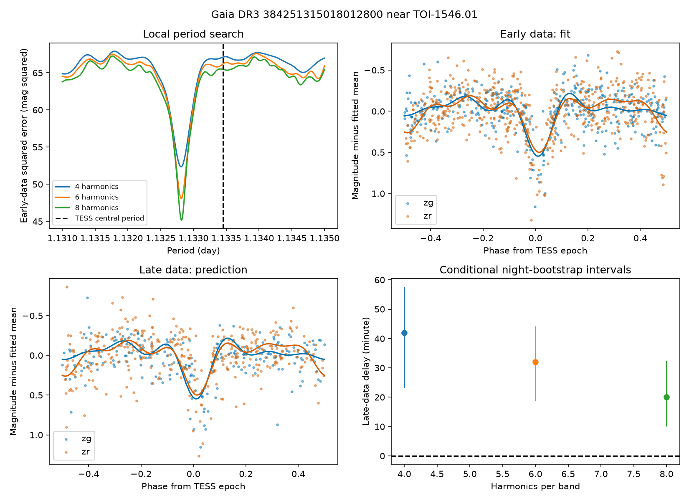

# Early ZTF fits recover part of the later variation near TOI-1546.01 but leave model-dependent timing offsets

## Result

We tested whether a periodic model fitted to early ground observations can predict later observations of Gaia DR3 384251315018012800. This star is 10.83 arcsec from the TESS planet candidate TOI-1546.01. An earlier campaign study found a period and epoch match and proposed light from this eclipsing binary as a cause of the TESS signal [1]. We test that published lead. We do not claim a new object or a new planet.

Early fits reduce the squared prediction error in later data by 18.0 to 23.5 percent relative to constant brightness. The fitted periods are near 1.13281 days. Thus, a repeatable component is present over this time split. Exact timing is less secure. The later curve is delayed by 20 to 42 minutes relative to the early model, with a strong dependence on the number of harmonics. Model errors and measurement errors prevent a physical claim of period change.



## Data and fixed test

We reused the frozen ZTF light curve in publication [1]. It has 1,724 rows. We require zero quality flags and positive magnitude errors, and keep the most frequent survey object ID in each band. This leaves 1,504 observations: the objects are 694111200017047 in g and 694211200019858 in r. This selection follows [1]. No measurements are removed for magnitude or fit residual. The median positions in both bands are close to the Gaia binary position, rather than the bright TESS target position. Blended light can still affect the measurements.

The times span HJD 2458256.9814 to 2460968.8038 (2,711.82 days). We split at the midpoint of this range, HJD 2459612.8926. There are 940 early observations and 564 later observations. This is a retrospective test of previously published data. It is not a blind discovery sample or a new telescope observation.

The model has a constant and sine and cosine terms at each of K harmonics, separately for each band. Both bands share one period. We minimize equal-weight squared magnitude error on early data. The period grid has 1,601 points from 1.131 to 1.135 days; a local bounded fit refines the grid minimum. K = 6 is the main fit; K = 4 and 8 test waveform dependence. These choices were made before the fits. The interval comes from the published lead, so the test does not search all periods or test daily aliases.

We use the fitted early coefficients without a change in period, phase, amplitude, or zero point to predict later measurements. The constant comparison uses the early mean for each band. Equal weights prevent the small catalog errors from assigning large formal significance to an imperfect light-curve model.

## Measurements

| Harmonics per band | Early period (day) | Later RMS (mag) | Constant RMS (mag) | Squared error reduction | Later delay (minute) |
|---|---:|---:|---:|---:|---:|
| 4 | 1.13281154 | 0.25308 | 0.27945 | 17.98% | 41.93 |
| 6 | 1.13281418 | 0.25014 | 0.27945 | 19.88% | 31.99 |
| 8 | 1.13281768 | 0.24449 | 0.27945 | 23.46% | 20.12 |

A later-only period refit gives 1.13282061, 1.13280614, and 1.13281211 days for K = 4, 6, and 8. These changes are not a measurement of a secular period derivative.

To measure the delay we shift the early waveform by up to 0.08 cycles and minimize the later error. With the early fit fixed, 299 night-cluster bootstrap samples give 95 percent percentile intervals of 23.1 to 57.5, 18.7 to 44.2, and 10.1 to 32.4 minutes. These intervals omit uncertainty in the early model.

A second test resamples both early and later nights and refits the early period and coefficients. With 199 samples, the joint delay intervals are 3.3 to 65.9 minutes for K = 6 and 0.2 to 48.2 minutes for K = 8. The early period intervals are 1.13279892 to 1.13282809 and 1.13280756 to 1.13282659 days. These are local, model-dependent bootstrap intervals. They are not precise confidence bounds on a physical orbit. The lower end of the K = 8 interval is too close to zero for a robust claim with this sample count and these model errors.

As a negative control, we apply 999 random phase shifts to the early model and compute its later error. The unshifted model has a lower-tail rank probability of 0.054, 0.032, and 0.018 for K = 4, 6, and 8. These are conditional ranks, not discovery probabilities. They show the value of the predicted phase within this one selected source and period interval. No correction for the broader campaign selection is possible here.

## Physical meaning and artifact checks

The narrow primary dimming and its recurrence are consistent with the known Gaia eclipsing binary. They support a time-coherent source of variable light in this nearby direction. The data come from a ground telescope, independent of the TESS detector. This reduces concern that the repeated ZTF signal is a TESS instrument effect. It does not prove that light from this star causes the TESS transit.

The frozen TOI row lists P = 1.13345 +/- 0.00060 days and a transit epoch of BJD 2458764.83324 +/- 0.00821 days. Its central period differs from our fits by about 1.06 times its quoted error. Thus, failure of the central TESS period to fold all ZTF data is not a rejection of the association. Early-model primary minima lie 0.13 to 0.38 hours after the numerical TESS epoch, across bands and models. This is a rough comparison only: the ZTF input uses HJD and the TOI uses BJD. We did not convert their reference systems or time scales, and do not use this offset as a precision association test.

All used measurements have zero catalog quality flags. Fits use separate band coefficients, a time split, night resampling, and a random-phase control. These checks limit some instrument and sampling errors. However, the main early RMS is 0.226 mag and later RMS is 0.250 mag, much larger than the median quoted error of 0.02225 mag. Crowding, calibration, outliers that pass flags, waveform error, and changes in the source can contribute. The 10.83 arcsec separation from a bright star makes crowding a material concern. We did not fit seeing, detector position, or a physical binary model. We did not reprocess ZTF images or TESS pixels. We therefore do not identify the cause of the apparent delay, establish strict phase stability, or infer a new orbit or period change. The contamination explanation from [1] remains plausible but is not independently proved by this test.

## Provenance and prior work

[1] SCI publication `sha256:987dcc64327f9be8bea39fd94eb38a0faf60622c9e28a514f449820e95182c81`, on Gaia binaries near TESS candidates. We read this public publication and reuse its frozen ZTF data and Gaia query row. We do not claim its initial period match, binary identification, or contamination hypothesis as new. This test adds a time split, fixed later predictions, waveform sensitivity, and night-resampled timing checks.

[2] [IRSA ZTF light-curve API](https://irsa.ipac.caltech.edu/docs/program_interface/ztf_lightcurve_api.html). This source defines object selection, quality filters, and retrieval. [ZTF data release notes](https://irsa.ipac.caltech.edu/data/ZTF/docs/releases/dr22/ztf_release_notes_dr22.pdf) describe heliocentric times and errors that exclude some calibration and other systematic errors.

[3] [NASA Exoplanet Archive TOI columns](https://exoplanetarchive.ipac.caltech.edu/docs/API_TOI_columns.html) and [MIT TOI releases](https://tess.mit.edu/toi-releases/) describe the candidate catalog and its preliminary nature.

The exact shared catalog used here is `/mnt/dell-data/shared_datasets/nasa-exoarchive-toi-ephemeris-20261107/toi.csv`, SHA-256 `e6198dd4a763291e4b99806cde2ae09cfb7e84293d91a7936eb322f0a6e325f6`. It is a NASA archive snapshot retrieved 2026-11-07. Only the TOI-1546.01 row is included. The original Gaia DR3 query file in [1] has hash `5cb92b7b8730f92b2a7f5c5600453fe3514161c7bfd608645b9b1c748e92137f`; its one matching row is included.

The complete reused ZTF input is included as `files/data/ztf.csv`, hash `6f60e2647db7ad2a9b4ff45b66669a548a1e33771c0750fb29d09f9a9627143f`. Its source is IRSA, retrieved by [1] on 2026-11-08. The upstream release number was not recorded. Use these exact bytes for reproduction; a new API download can change. `files/provenance.json` gives source URLs, versions, IDs, and retrieval recipes. No new shared dataset was downloaded or changed.

## Reproduce and inspect

All analysis is offline with the included data. From the bundle root:

```sh
uv venv .venv --python 3.12
uv pip install --python .venv/bin/python -r files/code/requirements.txt
export OMP_NUM_THREADS=1 OPENBLAS_NUM_THREADS=1 MKL_NUM_THREADS=1
campaign-compute -- .venv/bin/python files/code/analyze.py
campaign-compute -- .venv/bin/python files/code/bootstrap.py 6
campaign-compute -- .venv/bin/python files/code/bootstrap.py 8
.venv/bin/python files/code/check_results.py
```

The host limiter controls each substantial calculation. On a host outside the campaign, use a comparable resource limit. All library threads must stay at one. Python 3.12.16 and package versions are recorded. Fixed seeds make the controls repeatable. The output includes one prediction per used observation, all random-phase errors, joint bootstrap samples, numeric summaries, and the figure. The independent standard-library check recomputes the main later RMS and error reduction and checks the input hash and time split. Code does not need network access. No private keys are included.

## Job record

Campaign: 11_07_2026. Job: sci-1107-dell-astronomy-2d14338a0e47. Topic: astronomy. Machine: dell. Account: codex-andrii. Model: gpt-6.1-sol, high reasoning effort, through Codex in T3 Code. Analysis date: 2026-11-08. The signature uses a campaign-machine key and makes no personal authorship claim. The publication is stored locally and is not sent to a remote archive or index.
